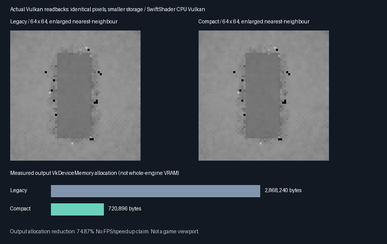

# Compact ReSTIR replay storage — 2026-10-28

**Implemented and tested a smaller native C++/Vulkan storage layout without changing the estimator.**
The 64×64 fixture's actual output allocation drops **74.87%**, with byte-identical rendered output and history.
This is a memory result on SwiftShader CPU Vulkan, not an FPS claim or completed game renderer.



## Implemented

| Component | Change |
| --- | --- |
| Shared C++ footprint | `PathReplayRequiredCompactOutputRecords(N)` and checked logical-slot addressing |
| Shared C++ Vulkan recorder | Opt-in `PathReplayCompactStorage`; validates the smaller range and address limits |
| Shared replay Slang | Remaps the nine used reservoir/guide/bank/scratch slabs without the all-feature prefix |
| Shared primary Slang | Stores hit/miss diagnostics inside the compact range, not at legacy slab 15 |
| Validation submission | Actually creates a smaller buffer and allocation; binds the exact descriptor range |
| Existing route | Legacy layout remains the default and is exercised as a control |

`Frontier/Engine/Rendering/PathReplayVulkan.{h,cpp}` and shared shaders own the implementation.
The exhibit reuses them; it is not a separate copied renderer.

### Layout and allocation contract

| Compact float4 slab | Contents |
| --- | --- |
| 0 | Final output |
| 1–5 | Existing logical replay slots 0–4: retained local reservoir, position, candidate, radiance and normal |
| 6–9 | Existing logical slots 11–14: two seed banks and two gathered scratch slabs |
| 10 | Primary triangle hit/barycentric or miss diagnostics |

All integer addressing remains checked against 32-bit shader indexing and device dispatch limits.
Unsupported logical slots return a sentinel in the C++ address function. The recorder rejects undersized
ranges, compact mode without sample history, and receiver counts above the compact index limit.

Compact mode currently requires the bounded sample-history domain, with either arithmetic averaging or local
RIS and optional spatial replay. It does not permit colour reconstruction, selected-reservoir temporal reuse,
rough/textured materials or unrelated lighting entry points. All primary/replay pipelines must be compiled with
the compact-aware shader implementation. Reset histories after any layout/allocation change; old layout bytes
must never be reinterpreted as compact history. Allocation layout is fixed for each validation submission host.
The caller still owns successful submission, external barriers, lifetime and invalidation after failures.

## Measured memory, not just a revised formula

These are the actual `VkBuffer` sizes and `VkDeviceMemory` allocation sizes supplied to Vulkan, using the
reported device memory requirements. At 64×64 there is no extra validation-tail allocation.

| 64×64 fixture | Legacy | Compact | Reduction |
| --- | ---: | ---: | ---: |
| Output descriptor range | 2,868,240 B | 720,896 B | 74.87% |
| Output buffer allocation | 2,868,240 B | 720,896 B | 74.87% |
| All eight storage-buffer allocations | 3,501,492 B | 1,354,148 B | 61.33% |

The final row is not total engine memory: it excludes pipelines, driver overhead, other scenes and viewport
resources. It is not a physical-GPU VRAM measurement. No shading work or path budget was reduced.

| Footprint calculation | Legacy | Compact |
| --- | ---: | ---: |
| Output bytes for N pixels | `640*N + 246800` | `176*N` |
| 1080p output-only extrapolation | 1,265.86 MiB | 348.05 MiB |

**1080p is a formula extrapolation, not an allocation or rendering test.** The asymptotic reduction is 72.5%;
the small measured fixture also benefits from removing the fixed prefix. The remaining footprint is still too
large for a final game GI allocation and can exceed a device's per-storage-buffer range. Further packing,
resource splitting and an explicit game budget remain necessary; the runtime must honour device limits.

## Verification

Linux x86-64, GCC 12.2.0, CMake 4.4.4, Slang 2026.14.1, SwiftShader Device (Subzero), CPU type 4, Vulkan 1.3.
Final Release and host ASan/UBSan runs pass. Neither the driver nor shader execution is sanitizer-instrumented.

| Check | Result |
| --- | --- |
| Native CTests | ✔️ 5/5 Release; 5/5 host sanitizer, including expanded recorder/address-boundary tests |
| 17×17 padded workgroups | ✔️ 14 paired legacy/compact frames |
| Four-bounce 64×64 capture | ✔️ Four paired frames; 3,990 histories retained after half-pixel motion |
| Final output | ✔️ Every float4 identical between layouts |
| History | ✔️ All nine logical slabs identical at every pixel after every compared frame |
| Primary input/diagnostics | ✔️ Receivers and primary strikes identical, including 289 all-miss pixels |
| Work/history counters | ✔️ All 24 counter words identical |
| Corrupt banks | ✔️ Seven rejected; unaffected banks retained |
| Revisions | ✔️ Spatial policy, geometry, source off/on, explicit reset and arithmetic/RIS transitions |
| Tail sentinel | ✔️ 256 bytes unchanged in guarded 17×17 checks; descriptor excludes that tail |
| Incompatible request | ✔️ Rejected without advancing history sequence |

The tail sentinel is an extra diagnostic, not a general GPU out-of-bounds proof. Paired state comparisons,
checked address formulas and recorder guards cover the bounded scenarios exercised here. No Vulkan validation
layer or physical-device acceptance is implied.

[Release](Results/ReplayCompactStorage-release.txt) ·
[Host sanitizer](Results/ReplayCompactStorage-sanitized.txt).

Final Release/sanitizer allocation rows and both decoded captures agree. All 30 logged source, driver and
SPIR-V hashes match the final tested files. The full legacy sample-history regression also passed: 15 retained
numerical/device/capture rows and four decoded PNGs match the pre-seed-reservoir baseline. The compact capture
matches the preceding spatial-RIS capture as well.

[Final hash/image/reference parity](Results/ReplayCompactStorage-parity.txt) ·
[Full legacy reference regression](Results/ReplayCompactStorage-regression.txt).

## Accepted memory scope — 2026-10-28

The user accepts the **348.046875 MiB output-only 1080p extrapolation for now**, provided it remains
reported. Further packing is deferred. This is not a measured 1080p allocation or total renderer VRAM,
and device storage-buffer limits still apply. The next gate is eight fresh current paths versus spatial
seed RIS, reporting the reuse warm-up separately rather than continuing memory optimization.

## Remaining ReSTIR path

| Priority | Remaining work |
| --- | --- |
| Deferred by user | Further packing; retain the accepted 348.05 MiB output-only 1080p extrapolation for now |
| 2 | [Eight-current-path gate completed](ReplayPathBudget.md); physical-GPU equal-time quality/cost still open |
| 3 | Mathematically specified temporal combination; do not simply enable selected-reservoir history here |
| 4 | Broader moving-scene, disocclusion, material and lighting validation with safe reset/reuse rules |
| 5 | Material/PDF coverage and validated reconstruction/denoising in the seed-reservoir path |
| 6 | Production C++ scene/frame submission, viewport presentation and failure/lifetime recovery |
| 7 | Windows and physical-GPU acceptance, including the selected hardware/software tracing routes |

This continuation completes the first storage compaction, not all memory work, general ReSTIR GI or production
integration. [Previous estimator evidence and limitations](ReplaySeedReservoir.md) remain applicable.

## Reproduce

Pinned Linux tools: `python3 Automation/PrepareReplayTools.py --verify`; restore them with the same command
without `--verify`. CMake, C++20, Vulkan headers v1.4.321 and Pillow are also required.

```bash
CAPTURE=1 bash Exhibits/LightCompute/RunReplayCompactStorage.sh
SANITIZE=1 CAPTURE=1 BUILD_JOBS=1 bash Exhibits/LightCompute/RunReplayCompactStorage.sh

_ClaudeScratch/venv/bin/python Exhibits/LightCompute/Code/ReplayCompactStorageImages.py \
  _ClaudeScratch/replay-compact-storage-capture-release/png \
  Exhibits/LightCompute/Results/ReplayCompactStorage-release.txt Exhibits/LightCompute/Images
```

Inherited legacy-regression command, retaining previous result files:

```bash
CAPTURE=1 RESULTS="$PWD/Exhibits/LightCompute/Results/ReplayCompactStorage-regression.txt" \
  OUTPUT="$PWD/_ClaudeScratch/replay-compact-storage-regression" \
  bash Exhibits/LightCompute/RunReplaySampleHistory.sh
```

Scripts retain compiler, source, shader-binary and runtime hashes. They fall back to local tools under ignored
`_ClaudeScratch/venv/`; otherwise use CMake/CTest on PATH and Python with Pillow, or their explicit overrides.
Source base: recovered upstream `3de9061`, destination base `68f3016`, plus uncommitted seed-reservoir and compact
storage changes on `arena/08e7de48-frontier`. No commits, pushes or remote workflows were initiated.
