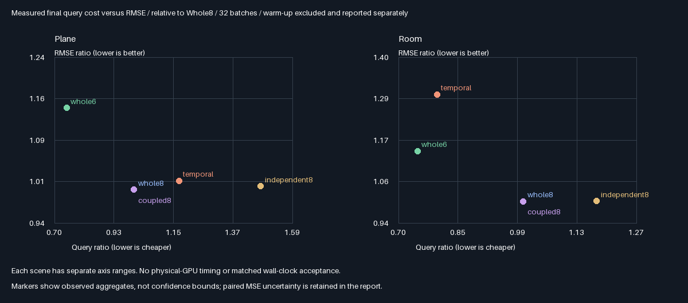
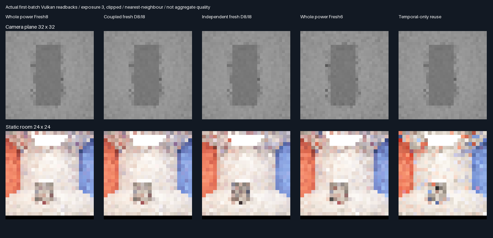

# Fresh D/I correlation and Fresh6 control — 2026-10-29

## Fixed experiment

The [reuse ablation](ReplayReuseAblation.md) found temporal-only room reuse cheaper in traversal queries but
noisier than whole-power Fresh8. This phase isolates fresh direct/indirect seed coupling and adds a cheaper
whole-path control. Existing rejected outcomes remain preserved.

| Concern | Choice fixed before measurement |
|---------|---------------------------------|
| Methods | Whole8; coupled fresh D8/I8; independent fresh D8/I8; Whole6; temporal-only D8/reuse |
| Fixtures | Same plane 32×32 camera offset .03125 and static room 24×24 |
| GPU cohorts | 32 paired batches; eight warm submissions for temporal-only, four bounces |
| Shared seeds | MT19937-64 `0x7b2e6139 + condition * 0x1000193` |
| Independent I seeds | Separate MT19937-64 stream `0x15ce49a7 + condition * 0x1000193`, one draw per batch |
| CPU reference | Checked independent double power sampler, 4096/2048 paths per measured plane/room point |
| CPU seeds | `0x46d9a173 + condition * 0x1000193 + pixel * 0x9e3779b97f4a7c15` |
| Coupling isolation | Same direct frame seed; change only indirect frame seed in cold fresh generation |
| Fresh6 | Same first six whole-path seeds as Whole8; divide by six; exact 6:8 path-call ratio required |
| Structural checks | Matched override exact RGB/nine slabs; one-bounce changed-I-seed output exact |
| Additional checks | Direct work unchanged; reconstructed direct terms equal within rounding; independent output active |
| Means | All methods within 4 combined nominal SE + .001 of independent CPU reference |
| Contrasts | Independent−coupled; temporal−Whole6; temporal−Whole8; temporal−independent paired MSE ± nominal SE |
| Covariance | Per-pixel population variance/covariance over 32 frames, averaged over measured pixels |
| Decomposition | MSE = Var(D) + Var(I) + 2 Cov(D,I) + squared empirical mean error, checked numerically |
| Promotion | Zero; controls diagnose mechanisms and cost/quality, not production acceptance |

The independent arm uses separately seeded pseudorandom frame streams, not a fixed XOR salt on the same seed.
Its I8 and D8 marginal samplers are unchanged. With different current seeds it generally cannot reuse the direct
first-hop cache: extra traversal work is measured, not silently removed. Direct values are reconstructed from
unclamped combined output minus persisted fresh I mean; primary residual must be zero on measured points.
Roundoff is checked. Component variances are finite-cohort diagnostics, not exact population parameters.

The audit-only seed override uses Maximum.z without changing layout or buffers; the host fills it with the
ordinary frame seed unless the audit explicitly supplies another seed. It is guarded to cold, non-spatial submissions; no independent-seed history reuse is tested. Whole6 is
**not guaranteed equal-cost** to temporal reuse: compare actual query counts. No matched wall-clock claim is made.
Environment .025, target floor .01, beta=2, reservoir weights/caps/banks and production shaders remain unchanged.
Output stays 348.046875 MiB at 1080p, output-only. Packing is deferred.

Reproduce sequentially with `bash Exhibits/LightCompute/RunReplayCorrelation.sh`, then
`SANITIZE=1 BUILD_JOBS=1 bash Exhibits/LightCompute/RunReplayCorrelation.sh`.
Prerequisites: pinned Slang/SwiftShader, Vulkan headers 1.4.321, CMake 3.31.6 as in prior checkpoints.
Base `ceebd8a` plus the retained convergence/ablation and current working changes; source hashes are logged.
Physical-GPU, Windows/editor, rough/textured/full-scene GI acceptance remains untested.

## Verified outcome: correlation is not the main room failure

| Scene | Whole8 RMSE | Coupled D8/I8 | Independent D8/I8 | Whole6 RMSE | Temporal-only RMSE |
|-------|------------:|--------------:|------------------:|------------:|-------------------:|
| Plane | 0.008561618 | 0.008561618 | 0.008615338 | 0.009827249 | 0.008700624 |
| Room | 0.138515749 | 0.138515751 | 0.138640406 | 0.157961268 | 0.179752331 |

All ten mean/reference gates pass. CPU reference means are 0.107914199 for the plane and 0.536333440 for the room;
nominal uncertainty and exact masks/path counts are in the log. Current seeds/references differ from previous
experiments: these results do not retrospectively regrade an earlier outcome.

| Scene | Paired contrast | MSE difference ± nominal SE |
|-------|-----------------|----------------------------:|
| Plane | Independent − coupled | +0.000000922746 ± 0.000000159112 |
| Plane | Temporal − Whole6 | −0.00002087397 ± 0.000000802979 |
| Plane | Temporal − Whole8 | +0.00000239956 ± 0.000000187673 |
| Plane | Temporal − independent | +0.00000147681 ± 0.000000225110 |
| Room | Independent − coupled | +0.0000345487 ± 0.000463205 |
| Room | Temporal − Whole6 | +0.007359138 ± 0.001267812 |
| Room | Temporal − Whole8 | +0.013124288 ± 0.001206574 |
| Room | Temporal − independent | +0.013089739 ± 0.001328014 |

- The plane's independent-stream RMSE increases 0.63%, with a supported paired error increase in this stream.
- The room's independent-stream RMSE increases only 0.09% observed; the paired change is uncertain.
- Temporal-only remains worse than independent fresh D8/I8 in both fixtures. Lost current-seed correlation alone
  does not explain the room penalty. The allocation/proposal/reweighting/history bundle remains unisolated.
- Error bars are nominal and conditional on the finite reference, not guaranteed confidence intervals.

## Cost/quality frontier: a cheaper fresh control wins the room comparison

| Scene | Whole8 queries | Coupled queries | Independent queries | Whole6 queries | Temporal queries |
|-------|---------------:|----------------:|--------------------:|---------------:|-----------------:|
| Plane | 558,039 | 558,039 | 820,582 | 418,483 | 651,561 |
| Room | 778,942 | 778,942 | 913,991 | 584,171 | 619,922 |



**Room:** Whole6 has **12.12% lower RMSE and 5.77% fewer queries** than temporal-only. The paired MSE gap is
0.007359138 ± 0.001267812 nominal SE. Thus temporal-only is empirically dominated on these measured axes even
before warm-up is charged. Whole6 was fixed in advance, not tuned to match the observed reuse budget.

**Plane:** temporal-only has 1.62% higher RMSE and 16.76% more queries than Whole8. Although temporal-only has
lower error than Whole6, it pays substantially more work and does not beat the Whole8 control.

Counts sum 32 final submissions per method, not warm-up work or GPU time. Temporal-only additionally requires
256 warm submissions: 5,004,567 plane queries and 4,715,029 room queries. Four preflight submissions per scene
are extra diagnostic work. The independent arm generally loses first-hop sharing, so equal D8/I8 evaluation
counts do not mean equal traversal cost. Whole6 is lower-cost, not exactly equal-query, in the room comparison.
These are tiny synthetic fixtures and software Vulkan; no matched wall-clock or game-frame dominance is claimed.

## Component evidence

| Scene | Empirical Cov(D,I), coupled | Empirical Cov(D,I), independent |
|-------|---------------------------:|-------------------------------:|
| Plane | −0.000000484025 | −0.000000036273 |
| Room | −0.000109802 | −0.000059742 |

The plane's change in the `2 Cov(D,I)` contribution is +0.000000895504, close to its total observed MSE increase
+0.000000922746; small marginal-variance/empirical-mean changes supply the rest. The room covariance comparison
is not precise enough to explain its much larger reuse loss. All four component identities rederive the measured
MSE. Squared empirical mean error includes sample/reference noise and is not a claim of population estimator bias.
Direct reconstruction roundoff is at most 1.44e-8 plane and 1.79e-7 room; marginal direct variances agree to rounding.

## Actual readbacks



Exposure 3 and clipping are display-only. Metrics and decomposition use unclamped red-channel readbacks over
all 32 paired cohorts. Identical-looking first-batch images are not aggregate quality evidence.

## Verification and decision

The initial audit attempted Maximum.w for a seed-override marker. The production recorder correctly rejected it
because that lane is a distance-field offset. It stopped before experimental metrics; the prototype now uses
only Maximum.z, leaving distance/fog guards unchanged. No production validation was weakened.

Release and host-sanitized runs exit zero, correctness=1/promote=0; all five CTests pass in each. Both matched-override preflights preserve RGB/nine slabs exactly;
one-bounce output is exactly unchanged by independent I seeds. Fresh6/Whole8 call counts are exactly 6:8 and
matched coupled/whole traversal budgets are exact. Independent output is active, direct work unchanged,
temporal sources accepted and spatial links zero. [Release log](Results/ReplayCorrelation-release.txt).
[Sanitized log](Results/ReplayCorrelation-sanitized.txt) and [parity audit](Results/ReplayCorrelation-parity.txt):
37 semantic rows identical, 70 logged hashes verified per build, ten captures byte-identical across builds and
retained PNG pixels exact. Shader rederivation, covariance identities and work sums pass. Host sanitizers do not
instrument SwiftShader internals or GPU shader instructions.

Regenerate visuals and verify after both runs:

```sh
_ClaudeScratch/venv/bin/python Exhibits/LightCompute/Code/ReplayCorrelationImages.py \
  Exhibits/LightCompute/Results/ReplayCorrelation-release.txt \
  _ClaudeScratch/replay-correlation-capture-release Exhibits/LightCompute/Images
_ClaudeScratch/venv/bin/python Exhibits/LightCompute/Code/ReplayCorrelationParity.py
```

The image/audit scripts require Pillow. Build/capture inputs are ignored scratch artifacts; final logs and PNGs
are retained. The audit intentionally checks current measured-source hashes, so later source edits require a new
measurement checkpoint rather than rewriting this evidence.

Do not port the current design unchanged or rescue it with post-hoc weight tuning. Its room query saving versus
Fresh8 is not an efficiency win against the fixed cheaper fresh control. The evidence does not prove a particular
resampling formula is faulty: fresh-candidate allocation and history/proposal variance remain confounded.
A substantive proposal/allocation change would need new fixed holdouts and explicit densities/normalization,
not a retrospective acceptance of this configuration. Production defaults/layouts and prior rejections remain
unchanged; physical-GPU, editor/Windows and material-general acceptance are still outstanding.


### Next-phase decision

Stop tuning this seed-replay configuration. The next substantive experiment should prototype bounded
secondary-vertex reconnection, with explicit proposal density, geometry/Jacobian and visibility handling, first
on diffuse static fixtures in the isolated exhibit. That is a new representation, not an already implemented or
accepted feature. Require independent-reference correctness and held-out quality/cost comparisons against
**both Whole6 and Whole8**, account for history/storage/warm-up, and require physical-GPU measurements before
claiming game-frame benefit. Keep production and the 348 MiB allocation unchanged during that work.
