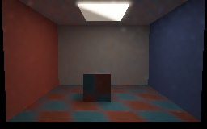
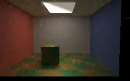
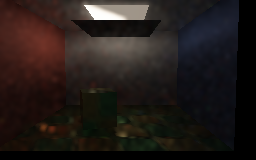
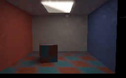
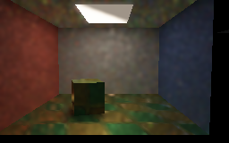
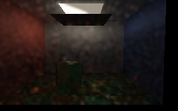
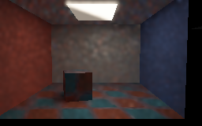

# Uniform/power mixture: motion and occlusion readbacks

These are actual **SwiftShader CPU Vulkan** readbacks of the bounded four-hit rough-textured replay
experiment, not screenshots from the production editor or a physical GPU. The 50/50 emitter mixture,
facet/BSDF balance weighting and temporal/spatial reuse are enabled. They illustrate the experiment;
they do not establish photorealism, real-time performance or absence of ghosting.

## Settled views

Each view averages the final six of twelve submissions in linear RGB. The displayed previews use a
geometry-, normal- and albedo-aware blur; unfiltered readbacks are linked alongside the previews.
All images are `256 × 160`, with exposure `0.45`, `1-exp(-L×exposure)` and gamma `2.2`.

| Before motion | Camera, cuboid, material and source powers changed |
|---|---|
|  |  |
| **Blocker inserted** | **Blocker removed; material and source powers restored** |
|  |  |

Unfiltered readbacks: [before](Images/ReplayMixtureBefore.png), [moved](Images/ReplayMixtureMoved.png),
[blocked](Images/ReplayMixtureBlocked.png), [reopened](Images/ReplayMixtureReopened.png).

## First submission after each change

These are individual submissions, not settled averages. The preview blur can spread bright samples
and soften shadows; the unfiltered versions retain their actual visible noise.

| Motion, material and source change | Blocker inserted | Blocker removed and sources restored |
|---|---|---|
|  |  |  |

Raw first submissions: [motion](Images/ReplayMixtureMovedFirst.png),
[blocker](Images/ReplayMixtureBlockedFirst.png), [reopening](Images/ReplayMixtureReopenedFirst.png).

The rectangular ceiling emitter consists of two triangles. One is scaled to `0.08` of the other's
radiance; their powers swap during the motion, then are restored on reopening. The camera shifts
`0.35` units; the cuboid rotates `0.28` radians and translates `0.224` units. Material and texture
change during the first transition. Both current and previous rigid/camera transforms are supplied,
and retained random sequences are retraced through the current triangle BVH.

| First transition | Temporal accepts | Spatial links | Reset | History cap |
|---|---:|---:|---:|---:|
| Camera, cuboid, material and powers | 34,922 | 142,226 | 0 | 1 |
| Blocker inserted | 34,470 | 142,148 | 0 | 1 |
| Blocker removed and powers restored | 34,470 | 142,226 | 0 | 1 |

The fixed lower-image linear luminance means for the four settled views were `0.098905`, `0.136965`,
`0.013177` and `0.101817`. These are scene sanity checks, not photometric ground truth. The release
and sanitized-host runs produced matching decoded RGB hashes for all 14 raw and preview PNGs.
A focused default-off regression compares the capture helper with the previous explicit submission
arguments across two `96 × 128` frames: all 98,304 float components match, including 11,616 temporal
accepts and 46,030 spatial links on the second frame. Both release and sanitized hosts pass. This is
not a full-gallery comparison: an attempted recapture of the older 16-frame gallery was stopped before
its first sequence completed. Its earlier committed images are unchanged.

Independent area and four-hit references for the mixture are documented in
[ReplayFacetMixture.md](ReplayFacetMixture.md). Those fixed-receiver numerical fixtures do **not**
validate every pixel or this larger camera/object motion. Earlier moving-primary two-probe references
and the previous gallery are documented in [RoughTextureMotion.md](RoughTextureMotion.md) and
[RoughTextureReplayCaptures.md](RoughTextureReplayCaptures.md). A later
[moving-primary mixture test](ReplayFacetMixtureMotion.md) checks two probes in a smaller related
scene with translated emissive triangles; it does not validate every pixel in this gallery. Its
[separate moving-light readbacks](ReplayFacetMixtureMotionCaptures.md) use the same scene changes at
another resolution. Preview filtering is not used by numerical tests.

## Reproduce

```sh
Exhibits/LightCompute/RunReplayFacetMixtureCapture.sh
SANITIZE=1 BUILD_JOBS=1 Exhibits/LightCompute/RunReplayFacetMixtureCapture.sh
CHECK=--capture-replay-default-parity Exhibits/LightCompute/RunReplayFacetMixtureCapture.sh
CHECK=--capture-replay-default-parity SANITIZE=1 BUILD_JOBS=1 Exhibits/LightCompute/RunReplayFacetMixtureCapture.sh
```

Requires the prepared Slang/SwiftShader toolchain, CMake and Pillow. The sanitized run instruments
host code only and writes its PNGs to scratch; Vulkan and shader execution are not instrumented.

[Release capture and RGB hashes](Results/ReplayFacetMixtureCapture-release.txt) ·
[Sanitized capture and RGB hashes](Results/ReplayFacetMixtureCapture-sanitized.txt) ·
[Default capture parity](Results/ReplayFacetMixtureCaptureDefaultParity-release.txt) ·
[Sanitized default parity](Results/ReplayFacetMixtureCaptureDefaultParity-sanitized.txt) ·
[Stopped earlier-gallery recapture](Results/ReplayFacetMixtureCaptureLegacy-regression.txt).
