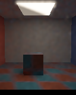
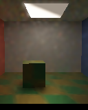
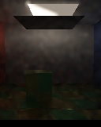
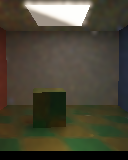
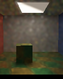
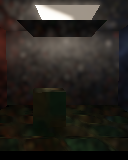
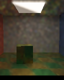

# Moving-light mixture: actual Vulkan readbacks

These images are **SwiftShader CPU Vulkan** readbacks from the bounded four-hit GI experiment, not
production-editor screenshots or physical-GPU results. The related
[numerical test](ReplayFacetMixtureMotion.md) compares independent CPU paths at two `64 × 64` probes;
these images use the same scene changes at `128 × 160`, different seeds and eight submissions per
state. The numerical test does not validate every pixel of this gallery.

Each settled image averages the final four submissions in linear RGB. The displayed previews use an
albedo-, geometry- and normal-aware blur. Unfiltered images are linked below; they retain visible
noise. Display encoding uses exposure `0.45`, `1-exp(-L × exposure)` and gamma `2.2`. These captures
are diagnostics, not evidence of photorealism or a real-time performance measurement.

## Settled views

| Before | Camera, material, light position and powers changed |
|---|---|
|  |  |
| **Blocker inserted** | **Blocker removed; light positions and powers restored** |
|  |  |

Unfiltered: [before](Images/ReplayRadiantMotionBefore.png), [moved](Images/ReplayRadiantMotionMoved.png),
[blocked](Images/ReplayRadiantMotionBlocked.png), [reopened](Images/ReplayRadiantMotionReopened.png).

## First transition submissions

These are individual noisy submissions, not the settled averages. Filtering can blur or spread bright
samples and is not used by the numerical comparisons.

| Motion and relighting | Blocker inserted | Blocker removed and lights restored |
|---|---|---|
|  |  |  |

Unfiltered: [motion](Images/ReplayRadiantMotionMovedFirst.png),
[blocker](Images/ReplayRadiantMotionBlockedFirst.png),
[reopening](Images/ReplayRadiantMotionReopenedFirst.png).

The camera shifts `0.07` units and the object rotates `0.12` radians. Two emissive triangles translate
`0.30` units and swap their `1 : 0.08` powers; the blocker is inserted below them, then removed as
the triangles move back and powers are restored. The initial state uses uniform facet/cosine
sampling; the first transition also switches to the uniform/power facet mixture and GGX direction
proposal. All states use balanced facet/BSDF MIS and temporal/spatial reuse. Scene BVHs are rebuilt
for translated triangles; textured vertex coordinates are retained.

| First transition | Temporal accepts | Spatial links | Reset | History cap |
|---|---:|---:|---:|---:|
| Motion, material, lights and proposal | 18,418 | 76,754 | 0 | 1 |
| Blocker inserted | 18,066 | 76,754 | 0 | 1 |
| Blocker removed; lights restored | 17,809 | 76,754 | 0 | 1 |

Mean linear luminance over the fixed lower-image window (`x=75…127`, `y=118…149`) was
`0.108238 / 0.136813 / 0.0129284 / 0.136968` for before/moved/blocked/reopened. These are visual
sanity checks, not independent ground truth. Release and ASan/UBSan host runs both passed and the
14 decoded RGB hashes matched. The external driver and shaders are not sanitizer-instrumented.

The capture helper's new GGX-proposal argument is default-off. A two-submission check of the default
path against the previous explicit arguments matched all `98,304` float components bit-for-bit in
release and sanitized-host runs; history counters also matched. This focused parity test does not
replace the previously stopped full-gallery recapture.

## Reproduce

Requires the prepared Slang/SwiftShader tools, CMake and Pillow:

```sh
Exhibits/LightCompute/RunReplayFacetMixtureMotionCapture.sh
SANITIZE=1 BUILD_JOBS=1 Exhibits/LightCompute/RunReplayFacetMixtureMotionCapture.sh
CHECK=--capture-replay-default-parity Exhibits/LightCompute/RunReplayFacetMixtureMotionCapture.sh
CHECK=--capture-replay-default-parity SANITIZE=1 BUILD_JOBS=1 Exhibits/LightCompute/RunReplayFacetMixtureMotionCapture.sh
```

[Release capture and RGB hashes](Results/ReplayFacetMixtureMotionCapture-release.txt) ·
[Sanitized capture and RGB hashes](Results/ReplayFacetMixtureMotionCapture-sanitized.txt) ·
[Default parity](Results/ReplayFacetMixtureMotionCaptureDefaultParity-release.txt) ·
[Sanitized default parity](Results/ReplayFacetMixtureMotionCaptureDefaultParity-sanitized.txt).
