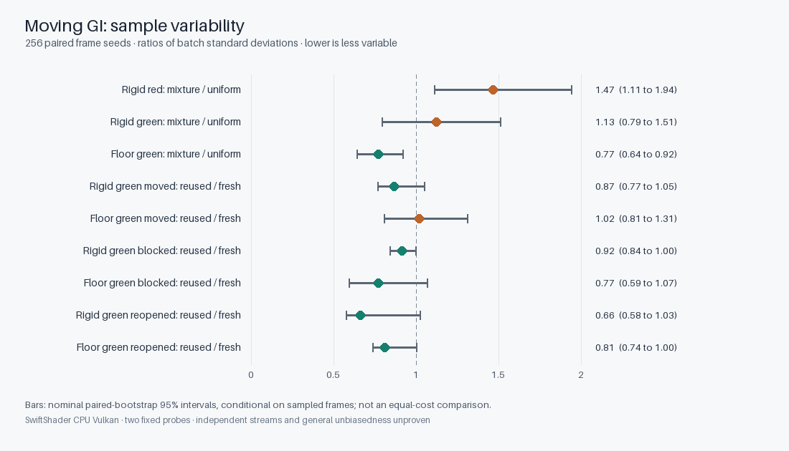

# Moving-primary GI: disjoint-seed repeat

This follow-up investigates the previous moving-primary fixture's noisy rigid-surface channel and
compares fresh and reused mixture samples after motion, blocker insertion and reopening. The Engine
shader is unchanged. Vulkan executes on **SwiftShader CPU**, not a physical GPU.



## Method

The `64 × 64` rough-textured scene, camera/rigid motion, translated unequal-power radiant triangles,
blocker, two independently selected primary probes and four-hit reference path are the same as the
[prior motion validation](ReplayFacetMixtureMotion.md). Fresh uniform and mixture proposals both use
spatial reuse, GGX directions and balanced MIS. Fresh mixture and cap-one temporal/spatial reuse are
also paired by frame seed for the moved, blocked and reopened scenes.

For speed, an exhibit-only compute dispatch retains two `13 × 13` primary-guide regions; the original
camera resolution, primary rays, selected pixel indices, textures and Engine replay shader remain
unchanged. A complete-versus-restricted audit compares both probes, seven modes, three seeds and RGBA
outputs: **168 float components were bit-identical**, and nine transition histories matched. This is a
finite parity check, not a proof for every seed or scene. Production submission never enables this audit.

The full repeat has four groups of 64 distinct frame seeds, none overlapping the previous 96-batch
sequence or its submission offsets. Six separately seeded CPU references use 240,000 paths each. All
42 RGB comparisons pass the existing `6 × hypot(CPU SE, batch SE) + 1% × |CPU mean| + 0.0001` tolerance.
Release and ASan/UBSan host runs both passed; their 256-row sample tables are byte-identical. The driver
and shader code are not sanitizer-instrumented.

## Dispersion and finite-sequence sensitivity

Ratios compare per-batch **standard deviations**, not variances or elapsed time. Parentheses are nominal
95% percentile bootstrap intervals from 2,000 resamples of paired frame seeds. They are conditional on
the observed samples and an independence assumption; they do not bound unseen rare events or prove
independent shader streams. Groups are disjoint seed sets, not proven independent realizations.

| Comparison | Probe/channel | SD ratio | Nominal interval | Four group ratios |
|---|---|---:|---:|---:|
| Mixture / uniform, fresh moved | Rigid red | `1.468` | `1.112–1.943` | `1.002–1.891` |
| Mixture / uniform, fresh moved | Rigid green | `1.125` | `0.793–1.512` | `0.716–1.480` |
| Mixture / uniform, fresh moved | Floor green | `0.772` | `0.642–0.919` | `0.675–0.837` |
| Reused / fresh mixture, moved | Rigid green | `0.869` | `0.765–1.050` | `0.803–1.097` |
| Reused / fresh mixture, moved | Floor green | `1.020` | `0.808–1.310` | `0.806–1.327` |
| Reused / fresh mixture, blocked | Floor green | `0.771` | `0.593–1.067` | `0.558–0.872` |
| Reused / fresh mixture, reopened | Floor green | `0.809` | `0.736–1.000` | `0.752–0.964` |

The earlier `1.515×` green-channel mixture/uniform ratio is not stable across these four groups; the
new aggregate is `1.125×` and its nominal interval includes one. The red channel is noisier under
mixture in this sequence. Neither result establishes a universal ordering or an equal-cost speedup.
Reuse performs extra work, and the four 64-batch estimates are themselves noisy.

## Red-channel discrepancy under investigation

The largest reference discrepancy occurs in **fresh uniform rigid red**: CPU
`0.00289420 ± 0.00002728`, Vulkan `0.00257524 ± 0.00007855`, or `3.84` nominal combined SE low.
It passes the pre-existing six-SE-plus-allowances assertion, but is too noticeable to dismiss as
convergence. Fresh mixture is `0.00294235 ± 0.00011531`. The previous independently seeded CPU red
estimate was `0.00281239 ± 0.00002872`, about `2.07` combined CPU SE from the new estimate. These
are stochastic estimates using the same CPU reference method, not separate physical measurements.
A [longer disjoint-seed, higher-path-count follow-up](ReplayRigidVarianceRepeat.md) does not reproduce
the low mean and exposes rare high-valued samples and reversal of the red SD ratio. The cause of this
original discrepancy remains unresolved; neither fluctuation, pseudorandom correlation nor an
implementation defect has been established.

Across all 256 masked submissions, transition temporal accepts total `75,776 / 86,528 / 86,528`;
spatial links total `319,488` per transition. Both selected probes retained a represented count of two
and cap-one history on each transition. This does not validate general reprojection or every image pixel.

[Release log](Results/ReplayFacetMixtureMotionRepeat-release.txt) ·
[sanitized-host log](Results/ReplayFacetMixtureMotionRepeat-sanitized.txt) ·
[all paired samples](Results/ReplayFacetMixtureMotionRepeatSamples.csv) ·
[SVG chart](Images/ReplayFacetMixtureMotionRepeat.svg). The smaller
[release smoke](Results/ReplayFacetMixtureMotionRepeatSmoke-release.txt),
[sanitized smoke](Results/ReplayFacetMixtureMotionRepeatSmoke-sanitized.txt) and
[smoke samples](Results/ReplayFacetMixtureMotionRepeatSmokeSamples.csv) are retained separately.

## Reproduce

```sh
# Structural smoke test; not a convergence measurement
CHECK=--replay-facet-mixture-motion-repeat-smoke Exhibits/LightCompute/RunReplayFacetMixtureMotionRepeat.sh

# Four disjoint seed groups × 64 batches; six independently seeded 240,000-path CPU references
Exhibits/LightCompute/RunReplayFacetMixtureMotionRepeat.sh
SANITIZE=1 BUILD_JOBS=1 Exhibits/LightCompute/RunReplayFacetMixtureMotionRepeat.sh

# SVG requires Python; PNG additionally requires Pillow 11.3 or compatible
python Exhibits/LightCompute/Code/ReplayFacetMixtureMotionChart.py \
  Exhibits/LightCompute/Results/ReplayFacetMixtureMotionRepeat-release.txt \
  Exhibits/LightCompute/Results/ReplayFacetMixtureMotionRepeatSamples.csv \
  Exhibits/LightCompute/Images/ReplayFacetMixtureMotionRepeat.svg \
  Exhibits/LightCompute/Images/ReplayFacetMixtureMotionRepeat.png
```

Prepare the pinned tools with `python3 Exhibits/LightCompute/Code/Prepare.py`. `CMAKE`, `VULKAN_TOOLS`,
`SLANGC`, `VULKAN_LIBRARY`, `BUILD_JOBS`, `RESULTS` and `TABLE` can select alternate tools and output
paths. This bounded two-probe experiment does not establish complete ReSTIR GI, production/editor
integration, physical-GPU performance, deforming-mesh coverage or general unbiasedness.
