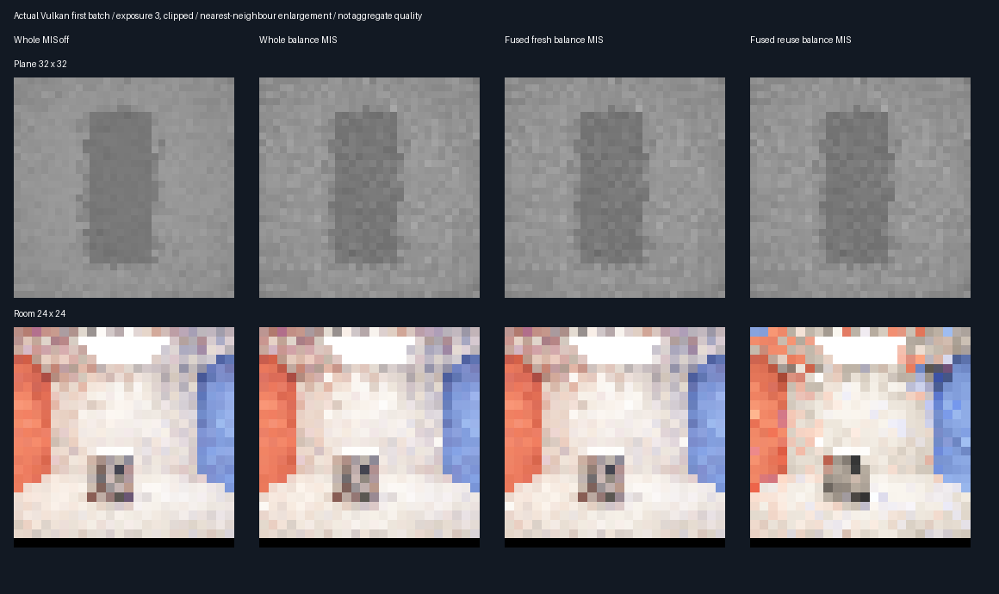

# Shared first hops and balance MIS — 2026-10-28

## Fixed implementation and experiment

| Concern | Choice fixed before measurement |
|---------|---------------------------------|
| Sampling | Balance MIS on for whole, fused fresh and fused indirect reuse; same source distribution |
| Additional control | Whole Fresh8 with MIS off, using paired seeds in this experiment |
| Optimization | Cache direct samples' current first closest-hit results; reuse only for identical indirect seeds |
| Cache lifetime | Generation invocation only; eight seeds/hit indices/strikes; no extra output buffers |
| Unchanged | Random draws, reservoir caps/weights, target floor 0.01, history length, direct eight-sample mean |
| Equivalence | 36 fused/unfused paired submissions: plane/room, one/four bounces, nine steps each |
| Quality | 32 paired batches per scene; eight warm submissions; four bounces |
| Seeds | MT19937-64 `0x693fab21 + condition * 0x1000193` |
| Reference | CPU seed `0x2f4ad817 + condition * 0x1000193 + pixel * 0x9e3779b97f4a7c15` |
| Coverage | Same geometry masks as split checkpoint: plane 32×32 / room 24×24 |
| CPU samples | 4096 per measured plane point; 2048 per room point |
| Correctness | Mean/reference within 4 combined nominal SE + 0.001; byte-equivalent fusion; split identity tolerance |
| Promotion | Reuse-vs-whole-MIS MSE difference + 3 nominal SE < 0 in both scenes, plus correctness |

This is an isolated validation derivation. No production shader/flag/default changes, no current-sample rejection,
no weight clipping, no extra packing. Transport-query counts are not physical-GPU frame times. Run release and
host sanitizers sequentially because the software driver's multiple shader contexts have high memory cost.

## Verified results: no promotion

All five CTests and the bounded-measure model passed. The 36-pair equivalence test passed with **49,664 fewer
closest-hit queries**, bit-identical RGB, all nine history slabs and primary strikes. Sampling and shadow counters
were unchanged. Matched fresh split and whole MIS have exactly equal total transport queries in both scenes;
RGB differs only by rounding (maximum 2.98e-8 plane, 4.77e-7 room). All eight mean/reference gates passed.

| Scene | Whole MIS RMSE | Fused fresh RMSE | Fused reuse RMSE | Whole no-MIS RMSE |
|-------|---------------:|----------------:|----------------:|-----------------:|
| Plane | 0.012765074 | 0.012765074 | 0.012895638 | 0.009786099 |
| Room | 0.141678421 | 0.141678420 | 0.201653665 | 0.278965530 |

| Scene | Whole MIS queries | Fused fresh queries | Fused reuse queries | Reuse − whole MIS MSE ± nominal SE |
|-------|------------------:|--------------------:|--------------------:|-----------------------------------:|
| Plane | 558,390 | 558,390 | 765,060 | +0.00000335037 ± 0.00000030300 |
| Room | 778,979 | 778,979 | 895,872 | +0.02059143 ± 0.00249137 |

These are measured final submissions across 32 batches, not warm-up-inclusive budgets. Each reuse method also
requires 256 warm-up submissions: 5,806,061 plane queries and 6,620,667 room queries, reported separately in the log.
Reuse increases RMSE about 1.02% on the plane and 42.33% in the room, with 37.01% and 15.01% more final queries.
Both reuse quality gates fail. Do not promote this reservoir configuration.

Balance MIS itself is scene dependent: its paired MSE change versus no-MIS is +0.0000671794 ± 0.00000107875
on the plane and −0.05774899 ± 0.05177061 in the room. The room's observed RMSE improvement is not strong paired
statistical evidence at this batch count. The stronger baseline eliminates the prior split checkpoint's apparent
room reuse advantage. Neither the old nor new experiment warrants a broad game-quality claim.

## Actual captures

Fixed exposure 3 and clipping are presentation only; metrics use unclamped red-channel readbacks against the
independent double CPU reference. Captures show the first batch, not the aggregate error. The previous split
checkpoint used different fixed seeds and MIS off: compare methods within this experiment, not cross-run RMSE.

## Limits and implementation findings

The initial shader compiled but the software driver rejected duplicated indirect-evaluator bodies with a local
stack-size-limit error. A single evaluator call after cache lookup fixed that problem without changing samples.
The rerun completed. The private eight-record cache introduces register/stack pressure; saved traversal counts
are not demonstrated GPU speedups. Resolve/spatial replay remains uncached and old bank seeds generally do not
match the current direct pool. No historical hit geometry is reused. No additional persistent memory is allocated.

Production shaders, defaults and layouts are unchanged. Output-only allocation stays **348.046875 MiB at 1080p**,
accepted for now; packing remains deferred. Diffuse/opaque fixtures only, software Vulkan, no Windows/editor,
physical-GPU timing or full-scene GI acceptance. Host sanitizers do not instrument the external driver or shaders.

Release evidence: [log](Results/ReplayFirstHopMIS-release.txt).
Host ASan/UBSan verification also exited zero, with all five CTests and the full comparison passing.
The [cross-build audit](Results/ReplayFirstHopMIS-parity.txt) verifies identical semantic results, all logged artifact
hashes against current files and ten byte-identical original RGB captures.
Sanitizer evidence: [log](Results/ReplayFirstHopMIS-sanitized.txt).
