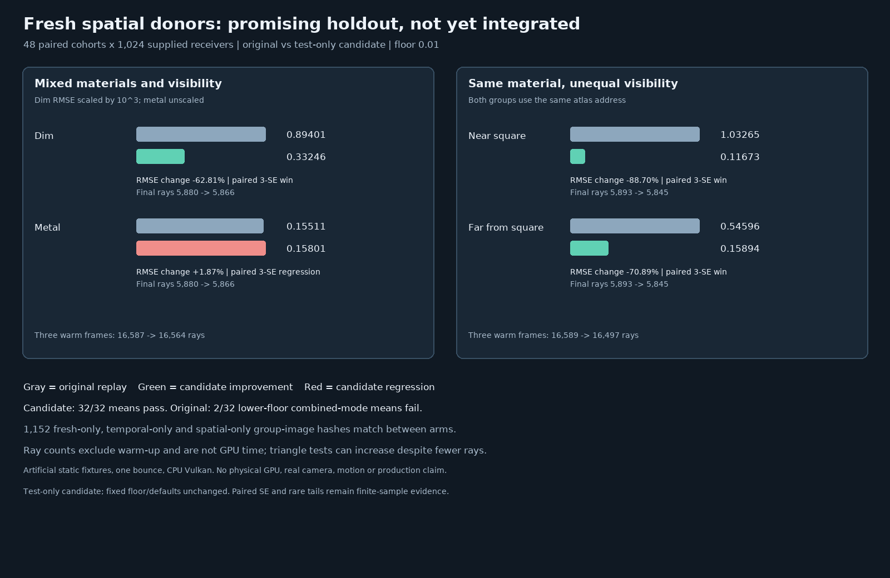

# Experimental fresh spatial donors

## Hypothesis and protocol fixed before measurement

The [held-out material guard](ReplayMaterialGuardCandidate.md) did not solve different visibility under the
same material. A separate **test-only** candidate retains the receiver's own temporal reservoir, but for each
spatial neighbor re-derives that neighbor's first fresh seed from the existing frame/pixel generator. It
retraces this seed at the receiver with unit proposal weight and represented count one, rather than importing
the neighbor's temporally selected reservoir and its possibly large normalization. It does not change Engine
source, defaults or range. It deliberately gives up cross-pixel temporal-history reuse.

For fixed, finite candidate counts, a fresh seed from the same seed domain contributes the receiver-evaluated
integrand without a ratio of donor and receiver targets. Reservoir selection remains target-weighted at the
receiver. This removes the tested source of large donor-normalization ratios; it is **not** a proof of general
unbiasedness. PRNG correlation, conditional donor validity, varying represented counts, moving history, invalid
numeric paths and rare tails still require investigation. The existing spatial compatibility rule is unchanged.

| Concern | Fixed protocol |
| --- | --- |
| Candidate construction | Generate a shader from the current Engine source by replacing only the non-self Resolve donor payload/weight with the donor's first fresh seed and unit count/normalization. Primary and Generate SPIR-V are identical between arms. |
| Holdout | 48 new paired 32 × 32 cohorts per scene; MT19937-64 base `0x529aed103fb9 + scene_index * 0x1000193`, four draws per cohort, identical between arms and floors. |
| Scenes | The earlier mixed dim/metal checkerboard and the same-metal, different-visibility checkerboard under the absorbing square. |
| Modes | Fresh1, temporal only, spatial disk only, and temporal + spatial disk at both accepted floors. Temporal modes have three warm frames. |
| Independent references | Double-precision hemisphere integral minus occluded-square area integral per receiver group, 1,024 steps and half-resolution check; dim values multiplied by `1e3`. |
| Correctness | Each scene/group/mode/floor/arm mean within `5 * nominal batch SE + .001` of its reference; pixels finite and nonnegative. Report every failure. |
| Controls | Fresh1, temporal-only and spatial-only image hashes must match between arms: spatial-only donors have a single fresh candidate and unit normalization already. |
| Link audit | Both arms use the unchanged actual compatibility/offset functions; GPU audit counts must equal Resolve's spatial-link counter, and both materials or positions must cross where applicable. |
| Paired quality | For temporal + disk, candidate minus original same-seed cohort MSE: win if `delta + 3 * nominal SE < 0`, regression if `delta - 3 * nominal SE > 0`, otherwise inconclusive. Do not treat a failed-mean baseline as a valid quality control. |
| Cost/tails | Record final rays, box/triangle tests, warm rays and maximum samples. Work counts are not GPU time or equal-time evidence. |
| Scope | Two artificial static supplied-receiver scenes, one bounce and one square occluder. No textures, physical GPU, Windows, real camera, moving scene, production viewport or game timing. |

The references independently integrate the same authored scattering model, not measured physical materials.
Nominal cohort errors can miss heavy tails and multiple testing limits inference. A pass is useful evidence for
this bounded candidate, not a justification for unconditional engine promotion.

## Outcome: promising candidate, incomplete production validation

The original arm passes **30/32** mean gates; its mixed dim and same-material far groups fail in combined
reuse at the lower floor. The fresh-neighbor arm passes **32/32**. All `1,152` prespecified Fresh1,
temporal-only and spatial-only group-image hashes match between arms. In this particular holdout the
original's 24 isolated-mode means all pass; the failures occur in combined temporal + spatial reuse. The GPU
audit confirms thousands of cross-material or cross-position links still participate in both arms.



| Temporal + disk case | Original RMSE → candidate RMSE | Paired MSE change ± nominal SE | 3-SE result |
| --- | ---: | ---: | --- |
| Mixed dim, default floor, × `1e3` | 0.894009 → 0.332460 | -0.688722 ± 0.117579 | Candidate win; both mean gates pass. |
| Mixed metal, default floor | 0.155111 → 0.158013 | +0.000909 ± 0.000281 | Candidate regression (+1.87% RMSE); both mean gates pass. |
| Mixed metal, lower floor | 0.268066 → 0.153886 | -0.048178 ± 0.001751 | Candidate win; both mean gates pass. |
| Same material near occluder, default floor | 1.032649 → 0.116732 | -1.052737 ± 0.140155 | Candidate win; both mean gates pass. |
| Same material far from occluder, default floor | 0.545959 → 0.158943 | -0.272808 ± 0.065734 | Candidate win; both mean gates pass. |
| Same material near occluder, lower floor | 5.993759 → 0.113777 | -35.912206 ± 35.903178 | Inconclusive: one very large original sample dominates the uncertainty. |

The original lower-floor mixed dim mean is `0.363180 ± 0.001156` (scaled) versus reference `0.439915`;
the candidate gives `0.440485 ± 0.001245`. The original same-material far mean is `0.591693 ± 0.001304`
versus `0.625657`; the candidate gives `0.622884 ± 0.001254`. These are finite-sample gate failures, not
proof of asymptotic bias: rare weights can make standard errors misleading. Two original/candidate quality
comparisons involving a failed original mean are not valid quality controls and are not promoted as wins.

At the default floor in the same-material scene, the near group's RMSE falls **88.70%**, with final ray counts
`5,893 → 5,845` and approximately `16,589 → 16,497` warm-up rays. However, final triangle tests rise from
`1,293 → 1,681` per cohort. Counts omit other operations and do not measure GPU time. The lower-floor near
case observed an original maximum pixel `578.84` versus a `0.780225` reference, explaining its extreme RMSE
and inconclusive paired gate. The candidate has genuine tradeoffs, including the measured metal regression.

The first candidate shader compiled to SPIR-V but aborted during SwiftShader pipeline preparation under the
3.9 GB virtual-memory bound; the exact cause was not established. A lean expression of the same intended
policy compiled and completed the held-out experiment. The initial abort is retained, not silently discarded.
The Engine shader/default was not changed, and this candidate has not been ported. A later
[moving supplied-receiver and Fresh4 holdout](ReplayFreshDonorMotion.md) found two candidate mean failures,
including temporal-only behavior unchanged by the candidate, and a 41.81% mixed-metal RMSE regression. It still
requires broader reprojected histories, seed banks, dynamic geometry, textured and transmissive materials,
realistic camera scenes, numerical extremes, physical-GPU/Windows and performance tests. Passing this static
fixture does not establish general unbiasedness or real-time suitability.

## Evidence and reproduction

The [baseline and initial abort](Results/ReplayFreshDonor-baseline-and-first-attempt.txt),
[lean candidate log](Results/ReplayFreshDonor-candidate-lean.txt), and
[paired summary, retaining failure](Results/ReplayFreshDonor-paired.txt) include source/SPIR-V hashes,
per-cohort measurements, link/work counters and all gates. Release and
[host-only ASan/UBSan CTests](Results/ReplayFreshDonor-host-sanitized.txt) passed 10/10; leak detection was
disabled. The chart is log-derived, not a camera image. Shaders, external driver and the new GPU harness were
not sanitizer-tested.

```bash
python3 Exhibits/LightCompute/Code/Prepare.py
# About two SwiftShader pipeline compilations; currently expected to exit nonzero because the baseline fails.
(ulimit -v 3900000; export MALLOC_ARENA_MAX=2; bash Exhibits/LightCompute/RunReplayFreshDonor.sh)
PYTHONPATH="$PWD/_ClaudeScratch/pytools${PYTHONPATH:+:$PYTHONPATH}" \
    python3 Exhibits/LightCompute/Code/ReplayFreshDonorImages.py
```

The reproduction writes a separate `ReplayFreshDonor-reproduced.txt` unless `RESULTS` is specified, preserving
the recorded original run and retry.
