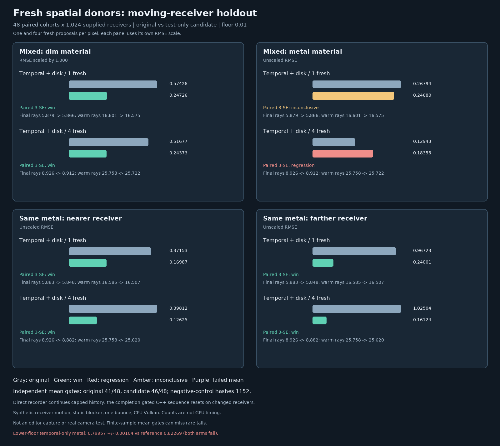

# Fresh spatial donors with moving receivers and multiple candidates

## Protocol fixed before measurement

The [static fresh-donor holdout](ReplayFreshDonorCandidate.md) found a promising but unpromoted test-only
candidate. This study asks whether it remains reliable when receiver visibility changes during temporal reuse
and when each pixel generates more than one fresh candidate.

| Concern          | Fixed protocol                                                             |
| ---------------- | -------------------------------------------------------------------------- |
| Arms             | Unchanged Engine Resolve; lean test-only fresh-neighbor Resolve.           |
| Scenes           | Dim/metal checkerboard and same-metal checkerboard under an absorber.      |
| Motion           | Four supplied-receiver frames; +0.2 world x per frame from -0.75/+0.75.    |
| History          | Exact previous-position guides; direct recorder uses changed-scene cap 1.  |
| C++ sequence     | Changed receivers must reset and match an explicit reset.                  |
| Reuse modes      | Fresh1, Fresh4, temporal1, spatial4, combined1 and combined4.              |
| Floors           | Existing default 0.01 and accepted lower bound 0.0001.                     |
| Cohorts          | 48 paired 32 × 32 images/scene, 512 receivers per checkerboard group.      |
| Reference        | Independent final-pose hemisphere minus blocked-square area integrals.     |
| Correctness      | Finite nonnegative pixels; every arm/group/mode/floor passes its gate.     |
| Activation       | Temporal accepts history without reset; spatial produces links.            |
| Negative control | Fresh1, Fresh4 and temporal1 group-image hashes match across arms.         |
| Quality          | Paired cohort MSE differences, qualified by correctness and 3-SE gates.    |
| Cost and tails   | Final/warm rays, box/triangle tests, maximum sample and cohort MSE.        |

The candidate uses a neighbor's first generated seed with represented count one; the receiver's own temporal
reservoir is unchanged. Primary and Generate binaries are identical. Neither the Engine shader nor its default
is changed. Original spatial4 donors represent four selected proposals, but candidate donors represent one, so
spatial4 image hashes need not match.

The seed generator is MT19937-64 with base `0x728fba194607 + scene_index * 0x1000193`; four draws are used per
cohort. Both arms use the same seed at each frame; non-temporal modes render only the final pose. The reference
uses double precision, 1,024 integration steps and a 512-step convergence check; dim values are scaled by `1e3`.
Each mean must be within `5 * nominal cohort SE + .001` of its reference. A candidate win or regression needs
a signed paired 3-SE gate and **both** corresponding means to pass; otherwise it is inconclusive or invalid.
Counts are not elapsed GPU time.

The direct-recorder stress test intentionally differs from completion-gated production sequencing: the latter
conservatively resets on changed receiver records. The first path exposes history behavior; it must not be
presented as a production camera-motion integration. Nominal errors may miss rare tails; the 96 mean checks
and multiple paired comparisons are not multiplicity-adjusted. A pass cannot prove arbitrary unbiasedness or
physical-material correctness. Scope is supplied receivers, static occluder, one bounce,
two artificial materials/scenes; no real camera, textures, moving occluder, seed bank, physical GPU, Windows,
editor or game benchmark.

## Outcome: do not promote the candidate

The original arm passed **41/48** independent mean gates; the fresh-neighbor arm passed **46/48**. All nine
failures occurred at the lower floor; all 48 default-floor arm/group/mode means passed. Both Vulkan arms and the
paired runner therefore exit `1` by design. Fresh1, Fresh4 and temporal-only1 supplied **1,152 matching
same-seed group-image hashes** across the arms. The candidate does not change temporal-only replay, so it cannot
repair that mode's failure. All results are finite-sample observations, not proof of asymptotic bias.

| Lower-floor failure | Mode      | Original mean ± SE  | Candidate mean ± SE  | Reference  |
| ------------------- | --------- | ------------------: | -------------------: | ---------: |
| Mixed metal         | temporal1 | 0.799567 ± 0.001038 | 0.799567 ± 0.001038  | 0.822689   |
| Mixed metal         | combined1 | 0.809268 ± 0.002420 | 0.813019 ± 0.001190  | 0.822689   |
| Mixed dim, × 1e3    | spatial4  | 0.295997 ± 0.001105 | passes               | 0.308725   |
| Mixed dim, × 1e3    | combined1 | 0.287357 ± 0.001113 | passes               | 0.308725   |
| Mixed dim, × 1e3    | combined4 | 0.293332 ± 0.001598 | passes               | 0.308725   |
| Visibility near     | spatial4  | 0.213911 ± 0.001190 | passes               | 0.222943   |
| Visibility near     | combined4 | 0.209558 ± 0.001172 | passes               | 0.222943   |

In the temporal-only metal case, Fresh1 instead gives `0.820930 ± 0.001674` against `0.822689`. That contrast
is not an equal-work speed comparison. A low observed SE can miss very rare high-weight paths; the evidence
establishes a failed fixed gate, not a diagnosed mathematical bias.



| Default floor, combined4 | Original RMSE | Candidate RMSE | Paired ΔMSE ± SE     | 3-SE outcome |
| ------------------------ | ------------: | -------------: | -------------------: | ------------ |
| Mixed dim, × 1e3         | 0.516767      | 0.243730       | -0.207644 ± 0.060535 | win          |
| Mixed metal              | 0.129431      | 0.183550       | +0.016938 ± 0.004668 | regression   |
| Visibility near          | 0.398123      | 0.126250       | -0.142563 ± 0.042968 | win          |
| Visibility far           | 1.025044      | 0.161236       | -1.024718 ± 0.065217 | win          |

Both means pass in every row. The mixed-metal candidate regression is **41.81%** in RMSE; the far-visibility
candidate improvement is **84.27%**. MSE differences are candidate minus original, with dim errors scaled
by `1e3` before squaring. The corresponding combined1 comparisons have three wins and one inconclusive result.
A passing mean is necessary but insufficient for a quality verdict; lower-floor comparisons involving a failed
mean are explicitly invalid in the [paired log](Results/ReplayFreshDonorMotion-paired.txt).

At the default floor in the same-metal scene, combined4 uses `8,926 → 8,882` final secondary rays plus
`25,758 → 25,620` warm rays per 1,024-receiver cohort. Final triangle tests rise `5,370 → 5,931`. These are
operation counts, not GPU time, and the candidate has not been shown faster.

A post-measurement, **exploratory** [mode comparison](Results/ReplayFreshDonorMotion-mode-contrasts.txt)
uses the same cohorts but unequal work and unadjusted nominal 3-SE gates. For near visibility at the default
floor, Fresh4 RMSE `0.175676 → 0.126250` for candidate combined4, with paired ΔMSE `-0.014923 ± 0.000838`;
it costs `4,044` final rays versus `8,882` final plus `25,620` warm rays. For far visibility Fresh4 `0.137410`
versus candidate combined4 `0.161236` has an **inconclusive** paired difference `+0.007115 ± 0.005450`, despite
its higher point estimate and work. These contrasts do not establish equal-time game performance.

Rare tails remain visible: lower-floor near/combined1 maximum pixels were `702.30 → 0.824`, yet its paired
ΔMSE `-63.592 ± 60.181` is inconclusive. Lower-floor far/combined1 maximum pixels were `218.42 → 343.09`.
Passing mean gates do not make either tail safe. The earlier static holdout's `32/32` candidate means used
different poses and seed streams; the later failures do not isolate motion as the sole cause.

## History and link controls

In each arm/scene, all `864` changed-pose temporal submissions continued without a silent reset at history
cap 1; every such submission accepted all `1,024` temporal histories. The final link probe had `3,858`
links including `2,195` cross-material links in the mixed scene, and `3,857` links including `2,200`
cross-position links in the same-material scene; both arms matched Resolve's link counter.

The completion-gated C++ sequence separately reset on each changed supplied-receiver record and matched
an explicit reset exactly; an unchanged receiver then continued with `1,024` accepted histories. The log's
`changed_resets=4` counts the initial explicitly forced reset plus **three** actual changed-pose transitions.
This validates conservative sequence invalidation, not real camera motion. It also does not prove spatial reuse
correct after reset: the original lower-floor spatial4 controls fail in two groups.

## Evidence and reproduction

[Full paired log](Results/ReplayFreshDonorMotion-paired.txt) retains all 4,608 cohort/group rows, 96 aggregate
rows, independent references, work/tail counters and both nonzero arm exits. The
[arithmetic audit](Results/ReplayFreshDonorMotion-evidence-audit.txt) recomputes 96 aggregates, 48 paired
comparisons and 64 exploratory mode contrasts. The
[synthetic parser tests](Results/ReplayFreshDonorMotion-summary-audit.txt) check complete, failed-mean,
changed-hash, truncated and nonzero/duplicate-exit cases. The
[interrupted setup](Results/ReplayFreshDonorMotion-interrupted.txt) was deliberately stopped before sampling to
align identifiers with repository naming; no measured result was discarded.

The paired run recorded source hashes at startup. During pipeline preparation the summary was hardened to
require explicit zero arm exits; it did not alter C++, shader or sampling. Its startup hash is therefore older;
the executed summary's hash is recorded in the two audits. The recorded paired summary regenerates byte for
byte with the current script and still exits `1`. The other 32 startup source/module hashes match.

Measured on Linux x86-64, GCC 12.2, Release, Slang 2026.14.1 (`-O0`), SwiftShader CPU Vulkan, Python 3.11,
CMake 4.1.3, Ninja 1.13.0 and Pillow 11.3.0. Release CTests and
[host-only ASan/UBSan CTests](Results/ReplayFreshDonorMotion-host-sanitized.txt) pass `10/10`; leak detection
was disabled. The first sanitizer command lacked `PYTHONPATH` and failed before testing; its corrected retry is
retained. The GPU validation host, external driver and shaders were not sanitizer-instrumented. No Windows or
physical-GPU run was available.

```bash
# Linux x86-64; Python 3, Node, a C++20 compiler and pip are prerequisites.
python3 -m pip install --target _ClaudeScratch/pytools cmake==4.1.3 ninja==1.13.0 pillow==11.3.0
python3 Exhibits/LightCompute/Code/Prepare.py
# Expect exit 1 while either arm fails a mean gate; the default output does not overwrite the retained run.
bash Exhibits/LightCompute/RunReplayFreshDonorMotion.sh
python3 Exhibits/LightCompute/Code/ReplayFreshDonorMotionSummaryAudit.py
python3 Exhibits/LightCompute/Code/ReplayFreshDonorMotionEvidenceAudit.py \
    Exhibits/LightCompute/Results/ReplayFreshDonorMotion-{paired,mode-contrasts}.txt
python3 Exhibits/LightCompute/Code/ReplayFreshDonorMotionModeSummary.py \
    Exhibits/LightCompute/Results/ReplayFreshDonorMotion-paired.txt
PYTHONPATH="$PWD/_ClaudeScratch/pytools${PYTHONPATH:+:$PYTHONPATH}" \
    python3 Exhibits/LightCompute/Code/ReplayFreshDonorMotionImages.py
```

To recreate the host-only sanitizer build, after restoring the same dependencies:

```bash
export PATH="$PWD/_ClaudeScratch/pytools/bin:$PATH"
export PYTHONPATH="$PWD/_ClaudeScratch/pytools${PYTHONPATH:+:$PYTHONPATH}"
SANITIZED="$PWD/_ClaudeScratch/build/replay-fresh-motion-sanitized"
cmake -S Exhibits/LightCompute -B "$SANITIZED" -G Ninja -DCMAKE_BUILD_TYPE=Debug \
    -DCMAKE_CXX_FLAGS='-O1 -fsanitize=address,undefined -fno-omit-frame-pointer -fno-pie' \
    -DCMAKE_EXE_LINKER_FLAGS='-fsanitize=address,undefined -no-pie'
cmake --build "$SANITIZED" --parallel 1 --target PathReplayDomainValidation PathReplayVulkanValidation \
    RadiantFacetValidation MediumRadianceValidation ReplaySeedCorrelationValidation ReplayVarianceFilterValidation \
    ReplayRayAccelerationValidation ReplayPbrReflectionValidation ReplaySubmissionSequenceValidation \
    PathReplayArchiveValidation
ASAN_OPTIONS=detect_leaks=0 UBSAN_OPTIONS=print_stacktrace=1 ctest --test-dir "$SANITIZED" --output-on-failure
```

The runner sets `MALLOC_ARENA_MAX=2` and a 3,900,000 KiB virtual-memory limit by default; pipeline compilation
is slow and the arms run serially. The chart regenerates from the **retained** log. This is not a rendered editor
image, physical-material validation, a hardware speedup or production-ready GI. The candidate and all Engine
defaults remain unchanged.
