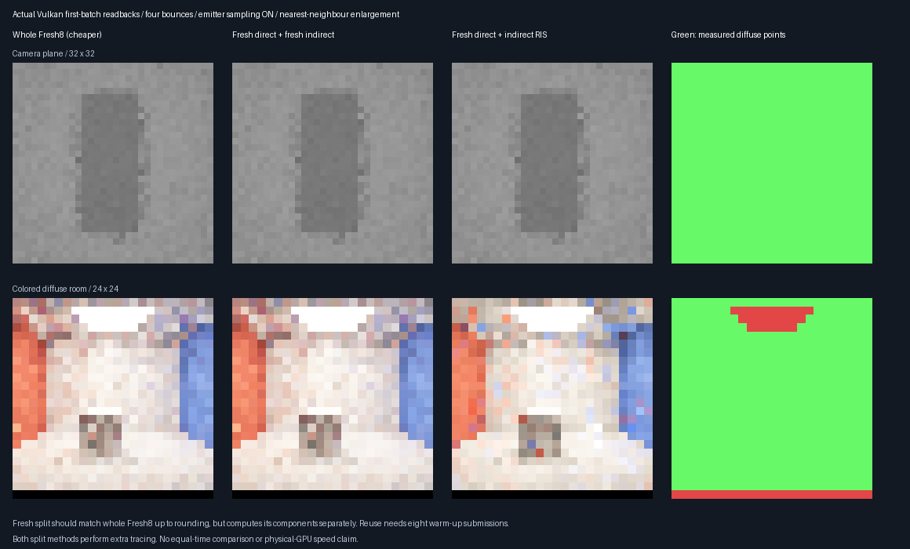
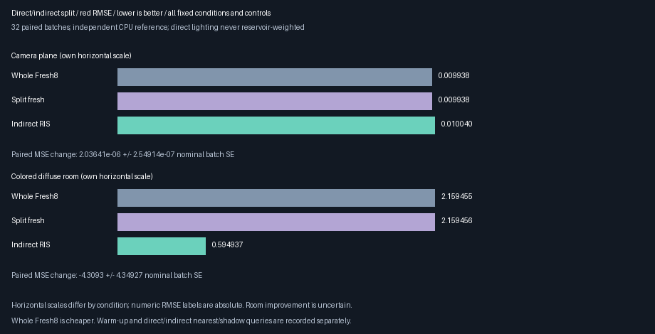

# Fresh direct lighting and indirect-only replay — 2026-10-28

**Implemented the isolated fresh-direct / indirect-only reservoir split.** Direct lighting is no longer
reservoir-weighted, and the decomposition/control gates pass. **Do not promote it yet:** the plane regresses,
the room's large observed improvement is uncertain, and transport work increases. Production defaults and the
accepted **348.046875 MiB output-only 1080p extrapolation** remain unchanged.

## Fixed experiment specification

| Concern | Decision |
|---------|----------|
| Decomposition | Direct = bounce-index 0 contributions; indirect = bounce indices 1 and later |
| Randomness | Consume first-bounce light-sampling draws in indirect evaluation, but skip its shadow trace |
| Direct estimator | Eight fresh samples, same seeds as whole Fresh8; never reservoir-weight direct RGB |
| Indirect estimator | Existing bounded count-matched cached RIS and Fresh8-on-reset, target floor 0.01 |
| Controls | Matched eight-direct/eight-indirect fresh split; cheaper eight-whole-path Fresh8 |
| Fixtures | Camera plane at 32×32; open colored diffuse room at 24×24, static camera |
| Measurement | All valid nonabsorbing diffuse primary points, independent of sample brightness/history admission |
| Sampling | 32 paired batches each; eight warm submissions for reuse |
| Seeds | MT19937-64 `0x24c59e71 + condition * 0x1000193` |
| Reference | Independent CPU: 4096 paths per plane pixel; 2048 per room pixel |
| Gates | Means within 4 combined nominal SE + 0.001; exact direct-only control; pathwise split within float tolerance |
| Promotion | Both paired total-MSE changes + 3 nominal SE below zero, versus whole Fresh8, plus correctness |
| Work | Separate direct/indirect calls, nearest queries and shadow queries; include all warm-up |

No cap/floor/history-length tuning after results. This prototype does extra tracing for the direct/indirect
separation. It must not be advertised as equal cost to whole Fresh8 or as a measured physical-GPU speedup.
Current output RGB is temporary direct-light scratch between Generate and Resolve; primary diagnostics,
persistent history and the accepted 11N output allocation are not repurposed or enlarged.


## Actual readbacks and all fixed comparisons



These are actual **32×32 plane and 24×24 colored-room** readbacks, enlarged with nearest-neighbour.
All use the native display exposure of 3 and display clipping; numerical errors below use **unclamped float RGB**.
The first batch was fixed in advance, not selected for appearance. It need not display the events responsible
for aggregate 32-batch RMSE. Green is the geometry/material measurement mask, not successful history admission.



Chart horizontal scales differ by condition and are labeled accordingly. RMSE labels are absolute.

| Condition | Whole Fresh8 | Matched split fresh | Fresh direct + indirect RIS | Observed change vs whole |
|-----------|--------------|---------------------|-----------------------------|--------------------------|
| Camera plane | 0.009938330 | 0.009938330 | 0.010040260 | **1.03% worse** |
| Colored room | 2.15945537 | 2.15945560 | 0.59493707 | **72.45% lower, uncertain** |

- Plane paired MSE change: **+0.00000203641 ± 0.00000025491** nominal batch SE, approximately 7.99 SE.
- Room paired MSE change: **−4.309297 ± 4.349273** nominal batch SE, only 0.99 SE. The large uncertainty does
  **not** support a reliable 72% quality-win claim. No promotion gate passes.
- All six mean/reference gates pass. Mean-gate success is not a variance/quality guarantee.
- CPU references: **4,194,304 paths / 1024 points** on the plane and **1,081,344 paths / 528 points** in the room.
  Reference means are 0.107962797 and 0.537988945; nominal reference-mean SE is 0.00013705 and 0.00173558.
- Batch SE does not include uncertainty of the fixed CPU reference. Large room RMSE/SE warrants tail diagnostics;
  these measurements do not identify a specific outlier's cause or establish stable second moments.
- Explicit facet sampling is enabled; balance MIS and power-weighted facet selection are **not** enabled here.
  A stronger MIS baseline must be tested before a practical game-quality claim.
- Masks/streams differ from earlier checkpoints. Do not interpret cross-phase percentages as paired causal gains.

## Measure and lifetime contract

```text
f(seed) = D(seed) + I(seed)
D = contributions at bounce index 0, including immediate environment escape
I = contributions at bounce indices >= 1
output = mean(D(X0)..D(X7)) + indirect_reservoir_estimate + primary_surface_radiance
```

The indirect evaluator consumes the same first-bounce light-selection random draws but skips its direct shadow
trace. It still traces the first closest hit to reach the next surface. The direct evaluator traces that closest
hit again to account for immediate environment escape. This duplication is explicit, not hidden as free work.

Only `I` enters the target, temporal/spatial weights and local evaluation cache. The positive target floor and
count-matched history normalization are unchanged. Under the existing conditional seed-measure contract,
linearity gives `E[mean(D)+W*I(Y)] = integral(D+I dμ)`; no independence of direct and indirect is required.
The matched fresh split uses the **same eight seeds** for both components, not sixteen independent samples.

During Generate, current output RGB temporarily stores the fresh direct mean. Resolve reads that mean and
adds it **outside** all reservoir weights, then writes final RGB. Existing compute barriers separate the writes
and reads. This does not overwrite primary-strike diagnostics, alter persistent history, or add an output slab.
On history reset, the earlier Fresh8 fallback now averages eight indirect samples plus the fresh direct mean;
only a uniform seed with unit weight/count is retained for subsequent history, never stale direct RGB.

## Actual current and warm-up work

All current counts are for **32 submissions** across the whole image, not only the measured mask.
`I/F calls` means indirect calls for split methods and full-path calls for the whole control.

| Scene / method | Direct calls | I/F calls | Transport queries |
|----------------|--------------|-----------|-------------------|
| Plane / whole Fresh8 | 0 | 262144 | 558782 |
| Plane / matched split fresh | 262144 | 262144 | 820926 |
| Plane / indirect RIS | 262144 | 236165 | **798106** |
| Room / whole Fresh8 | 0 | 141312 | 779318 |
| Room / matched split fresh | 141312 | 141312 | 914486 |
| Room / indirect RIS | 141312 | 130296 | **914621** |

- Indirect RIS uses **42.83% more transport queries on the plane** and **17.36% more in the room** than whole
  Fresh8. Query count is not frame time; traversal lengths, register pressure and hardware occupancy vary.
- The room executes fewer indirect path calls than matched split fresh but **135 more transport queries**.
  Importance-selected paths can be longer: fewer path calls alone is not a performance win.
- Each log separately records direct closest/shadow and indirect closest/shadow counts. The matched split has
  exactly the whole control's indirect closest-hit work and total shadow work, **plus its extra direct closest hits**.
- Reuse adds **256 warm submissions** per scene. Plane: 2,097,152 direct calls + 1,809,432 indirect calls,
  **6,293,070 transport queries**. Room: 1,130,496 direct + 971,456 indirect, **6,876,358 queries**.
- The whole control does not render preceding images in this independent-batch experiment. Warm-up totals
  are shown rather than assumed free; they are not measured steady-state game costs or an equal-time comparison.
- The allocation remains **176 output bytes/pixel**: actual descriptors are 180224 bytes at 32×32 and 101376
  bytes at 24×24. This is not total VRAM or a completed 1080p renderer acceptance test.

## Verification and provenance

| Check | Result |
|-------|--------|
| Same-seed `D + I = whole` | 25,600 diagnostic slots; max errors 1.49e−8 / 2.38e−7 |
| One-bounce indirect | Exactly zero in both conditions |
| Direct-only diagnostic | All direct RGB pixels byte-identical with versus without history in both fixtures |
| Indirect continuity during diagnostic | Nine slabs byte-identical to normal indirect replay |
| Matched split versus whole Fresh8 | Maximum absolute RGB differences 2.98e−8 / 3.05e−5; within relative tolerance |
| Scene-change source off | Exact black, reset confirmed, both conditions |
| Release + host ASan/UBSan | Both exit 0; five CTests each; all six mean gates pass |
| Evidence parity | 57 logged digests per configuration, 35 semantic rows and eight decoded captures match |
| Production shader/defaults | Six whole-control and five production-default shader binaries unchanged |

The log's `seed_paths` is a full-image diagnostic-slot count; primary misses return zero without tracing.
The room's larger absolute floating-point difference scales with bright path contributions, not a new estimator:
matched split and whole use the same samples but add their components in a different order.

- [Release log](Results/ReplayIndirectSplit-release.txt),
  [host-sanitizer log](Results/ReplayIndirectSplit-sanitized.txt),
  [source/work/shader/capture audit](Results/ReplayIndirectSplit-parity.txt).
- Authoring derives the split through fail-closed substitutions. Only exhibit orchestration/CLI and derived
  Generate/Resolve change; shared production shader source, gather, finalizer and output layout are untouched.
- An initial concurrent sanitizer attempt was externally killed with exit 137 before measurement output;
  that interrupted run is not counted as a pass. The final standalone rerun exits 0 and matches release.
- Host ASan/UBSan uses `-O1 -g` for the native benchmark; the small finite model retains its existing sanitizer
  settings. External Vulkan driver and shaders are not sanitizer-instrumented. SwiftShader is CPU Vulkan.
- Earlier main-C++ source hashes are historical after this CLI addition; earlier numerical logs are retained.
  No physical-GPU frame time, Windows/editor, rough/specular/textured material or complete game-GI claim is made.

## Decision and next acceptance boundary

**Keep the separated estimator as a correctness-tested prototype, not a production quality/performance win.**
The direct-lighting isolation target is implemented; end-to-end promotion is rejected by the fixed quality rule.

| Priority | Next rendering work | Acceptance purpose |
|----------|---------------------|--------------------|
| 1 | Enable/test existing balance MIS in both controls and split | Stronger baseline and better tail diagnostics |
| 2 | Avoid duplicated first-hop tracing / allocate direct and indirect budgets | Compare quality at matched real work |
| 3 | Independent batches and physical-GPU timings | Stable uncertainty and actual game-oriented cost |

Do not clip bright samples or tune history weights against these results to advertise a win. New sampling or
budget changes need separate seeded validation. The accepted output allocation remains unchanged; packing stays
out of scope, and production selected-temporal + seed-bank enablement remains forbidden.

## Reproduce

Run release and sanitizer **sequentially**, with pinned tools prepared, from the repository root:

```bash
bash Exhibits/LightCompute/RunReplayIndirectSplit.sh
SANITIZE=1 BUILD_JOBS=1 bash Exhibits/LightCompute/RunReplayIndirectSplit.sh
_ClaudeScratch/venv/bin/python Exhibits/LightCompute/Code/ReplayIndirectSplitImages.py \
  _ClaudeScratch/replay-indirect-split-capture-release \
  Exhibits/LightCompute/Results/ReplayIndirectSplit-release.txt Exhibits/LightCompute/Images
_ClaudeScratch/venv/bin/python Exhibits/LightCompute/Code/ReplayIndirectSplitParity.py
```

Use this CLI with its matching derived shader set; it is not a replacement for other exhibit shader modes.
Raw captures, builds and generated shader sources remain ignored. Eight PNG readbacks, two figures, numeric logs
and the final audit are retained.
