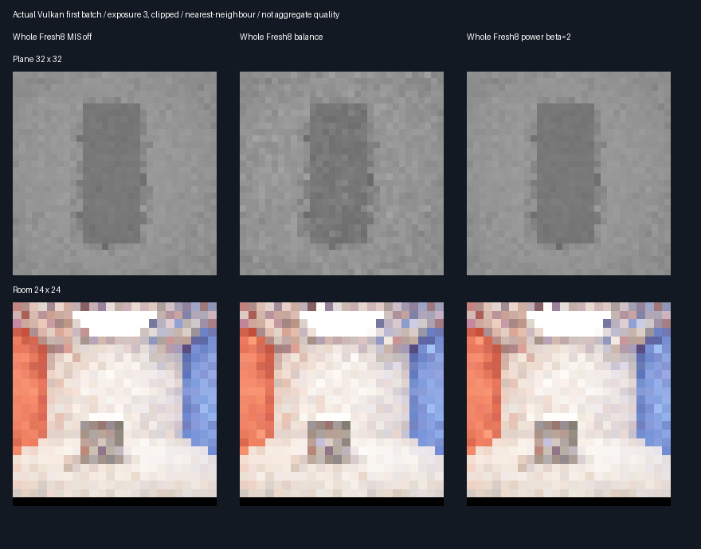

# Fixed power MIS control — 2026-10-28

## Investigation and fixed protocol

Source inspection found no missing complementary balance term in the tested diffuse domain. Facet NEE uses
`1/(1+r)` and BSDF emitter hits use `r/(1+r)` for `r = p_bsdf / p_facet` in solid angle. Both terms are needed:
removing the emitter-hit term while attenuating NEE would bias the result. Environment misses remain unweighted
because the facet proposal cannot sample environment. No defect is claimed from a variance regression alone.

The alternative is the standard power heuristic with **fixed beta=2**, chosen before measuring this phase.
For a broad, near emitter the BSDF technique can hit it frequently; balance weights still blend in the noisier
technique. Squared-density weights may reduce that mixture noise. This is a hypothesis, not a guaranteed gain.
The implementation branches on `r <= 1`, squaring only `min(r, 1/r)` to avoid large-ratio overflow.
Both weights are complementary; zero density correctly gives all weight to the available technique.

| Item | Predeclared choice |
|------|--------------------|
| Methods | Whole Fresh8: no MIS, balance, power beta=2 |
| Geometry | Plane 32×32, camera offset .03125; diffuse room 24×24 |
| Batches | 32 paired seeds, four bounces, no history/warm-up, no spatial selection |
| RNG | MT19937-64 `0x58a1df93 + condition * 0x1000193` |
| Reference | Independent double CPU, 4096 samples/plane point, 2048/room point |
| CPU seeds | `0x36de917b + condition * 0x1000193 + pixel * 0x9e3779b97f4a7c15` |
| Settings | Uniform facet selection, environment .025, same scene/materials as previous checkpoint |
| Identity | MIS-disabled power/control output byte-exact for all 32 seeds per scene |
| Budget | Actual nearest/shadow counts must match across all three methods per submission |
| Correctness | Each mean within 4 combined nominal SE + .001 of CPU reference |
| Quality | Power−control paired MSE + 3 nominal SE < 0 versus both controls, in both scenes |

No parameter tuning after observation, no reservoir changes and no production changes. Output allocation remains
348.046875 MiB at 1080p, output-only. No physical-GPU timing, Windows/editor or production acceptance is implied.

Reproduce sequentially with `bash Exhibits/LightCompute/RunReplayMISPower.sh` then
`SANITIZE=1 BUILD_JOBS=1 bash Exhibits/LightCompute/RunReplayMISPower.sh`. Uses the pinned Slang/SwiftShader tools
and CMake dependencies described by the preceding [checkpoint](ReplayFirstHopMIS.md).

## Verified outcome: stronger plane control, no broad promotion

| Scene | MIS off RMSE | Balance RMSE | Power RMSE | Power versus balance | Power versus off |
|-------|-------------:|-------------:|-----------:|---------------------:|-----------------:|
| Plane | 0.009947800 | 0.012762182 | 0.009677055 | −24.17% | −2.72% |
| Room | 0.164371453 | 0.139899668 | 0.139791135 | −0.08% | −14.95% |

| Scene | Power−balance MSE ± nominal SE | Power−off MSE ± nominal SE | Three-method queries each |
|-------|-------------------------------:|--------------------------:|--------------------------:|
| Plane | −0.0000692279 ± 0.00000134540 | −0.00000531332 ± 0.00000021676 | 558,531 |
| Room | −0.0000303556 ± 0.00015773168 | −0.00747641322 ± 0.00484505354 | 778,399 |

- Plane: both paired quality gates pass; improvement is supported at the fixed sample count.
- Room: neither paired quality gate passes; observed gains are uncertain, not evidence for broad promotion.
- All six mean/reference gates pass. Both scenes pass active-output and disabled-output identity checks.
- Query counts match exactly per seed, not just on average: plane 285,472 nearest + 273,059 shadow;
  room 396,373 nearest + 382,026 shadow, summed over 32 measured submissions per method.
- No warm-up work. The extra MIS-disabled power identity check costs 64 additional diagnostic submissions
  across both scenes, excluded from each method's measured work above; total experiment is 256 submissions.

Power weighting is retained as a **validation baseline**, not a production default. Fewer traversal queries are
not being claimed: counts are equal. Arithmetic cost and physical-GPU runtime have not been measured.
The earlier reuse failure is not reversed by this experiment: this phase measures whole Fresh8 only.

## Actual readbacks

These are six original GPU readbacks enlarged without interpolation, exposure 3 and clipped for presentation.
Metrics use unclamped red-channel radiance across all 32 batches; first-batch images cannot establish aggregate
quality. CPU reference means are 0.107951063 (plane) and 0.533460883 (room), with their uncertainty in the log.
Do not compare numerical changes against the previous checkpoint's different random batches/reference seeds.

## Verification and limitations

The first diagnostic run showed power and balance identical because `ReplayFreshBudgetPipeline` replaces the
Generate shader: changing only the derived reservoir evaluator did not affect the measured control. That inactive
run was discarded to scratch. The corrected derivation compiles `ReplayFreshPower.slang` against the power
transport evaluator as well. An explicit positive-control assertion now prevents this failure from passing again.
Maximum sampled red-channel difference versus balance is 0.051513359 (plane) and 0.753616720 (room).
Disabling MIS returns byte-identical output for both shader variants across all 64 paired seeds.

Release and host ASan/UBSan both completed with all five CTests passing and correctness=1/promote=0.
The [cross-build audit](Results/ReplayMISPower-parity.txt) passed: 27 identical semantic rows, 28 logged hashes per
build checked against current artifacts, six byte-identical captures and deterministic shader rederivation.
Independent CPU algebra checked 62 complementary density-ratio weight pairs. The external Vulkan driver and
shaders are not sanitizer-instrumented.
[Release evidence](Results/ReplayMISPower-release.txt) · [Sanitizer evidence](Results/ReplayMISPower-sanitized.txt).
Extreme density-ratio CPU algebra checks are not extreme-ratio GPU validation. Diffuse fixtures only; no rough,
textured, moving-scene, large-scene, editor or physical-GPU acceptance. Output allocation remains unchanged.
