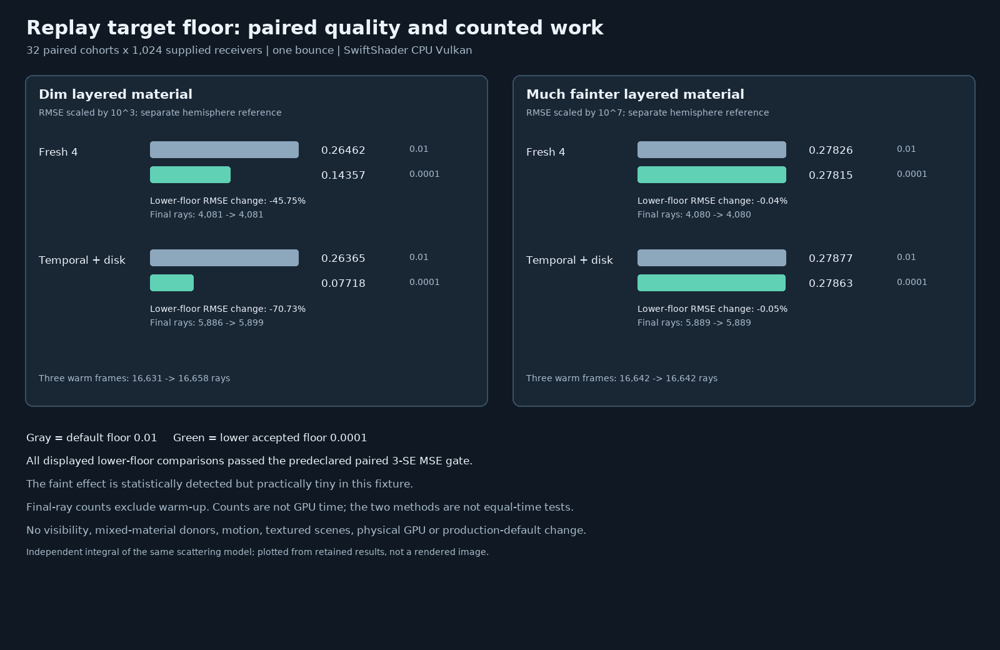

# Replay target-floor sensitivity audit

## Protocol fixed after the initial reuse finding, before this measurement

The previous [reuse audit](ReplayMaterialReuse.md) found that a `0.01` positive target floor dominates very
faint materials. This follow-up tests the **already accepted** lower bound, `0.0001`; it does not change the
Engine default or permit smaller values. A positive floor preserves proposal support and cannot safely be
removed merely to improve a uniform-material benchmark.

| Concern | Fixed protocol |
| --- | --- |
| Materials | Existing metal, coat and `1e-7` faint cases; a new two-layer `1e-3` coverage holdout. |
| Settings | Compare fixed target floors `0.01` and `0.0001`; one bounce, identical supplied receivers, unit environment. |
| Modes | Fresh1, Fresh4 and temporal + Vogel disk; each measured with both floors. |
| Cohorts | 32 paired 32 × 32 cohorts; independent seed stream from the earlier reuse audit. |
| Seed stream | MT19937-64 `0x4c2db7a90131 + case_index * 0x1000193`, four 32-bit draws per cohort. |
| History | Temporal + disk gets three warm submissions before measurement; fresh modes get no warm-up. |
| Reference | Separate double-precision hemisphere integral; 1,024 × 2,048 and half-resolution convergence check. |
| Correctness | Each mean within `5 * nominal batch SE + .001`; finite readbacks and active reuse counters required. |
| Paired quality | Lower minus default floor MSE, across cohorts; `difference + 3 * nominal SE < 0` is the win gate. |
| One-candidate identity | Same-seed Fresh1 must remain equal within `1e-5` in displayed/scaled units. |
| Floor revision | Completion-gated sequence must reset when the floor changes; compare with explicit reset. |
| Scope | Uniform supplied receivers, no textures, occlusion, motion, full-scene HDR, physical GPU or game timing. |

The work counters and warm-up are recorded independently of quality. Sampling counts and GPU cost are not
assumed equal. The selection floor is part of the estimator's proposal target; smaller floors can increase
variance or support problems when donors and receivers differ. No production-default change is justified by
this one homogeneous fixture.

## Outcome

All **24** material/mode/floor means pass the predeclared independent-reference gate, and the requested reuse
paths activate. Fresh1 is exactly equal between floors in all four materials. Changing the floor in the Engine's
completion-gated sequence invalidates history, accepts zero temporal donors on the next submission, and produces
exactly the same image as an explicit reset.



| Material | Display scale | Fresh4 RMSE, default → lower | Temporal + disk RMSE, default → lower | Paired 3-SE gate |
| --- | ---: | ---: | ---: | --- |
| Metal | 1 | 0.113760 → 0.113548 | 0.052532 → 0.051614 | Neither win established. |
| Coated | 1 | 0.061588 → 0.061214 | 0.029367 → 0.028217 | Both pass. |
| Faint | `1e7` | 0.278264 → 0.278148 | 0.278771 → 0.278629 | Both pass, with tiny effects. |
| Dim holdout | `1e3` | 0.264622 → 0.143570 | 0.263652 → 0.077177 | Both pass. |

For the dim holdout, the lower floor reduces RMSE by **45.75%** with Fresh4 and **70.73%** with temporal + disk,
compared with the same mode at the default floor. The mean final-frame ray counts are 4,081 → 4,081 and
5,886 → 5,899 respectively. The temporal case also uses 16,631 → 16,658 rays over its three warm frames. These
counts omit other work and do **not** measure elapsed GPU time or establish equal-time performance. For the
much fainter fixture the lower floor still dominates radiance, so the detected quality changes are only about
0.04–0.05% RMSE. Neither metal comparison passes the paired gate. These results are not a universal floor
recommendation: heterogeneous donors, visibility changes, temporal motion and numeric extremes may behave
very differently, and a positive floor is still needed for support.

The reference is an independent integration of the *same* material model, not a physical-material ground truth.
The standard errors are nominal across 32 cohorts and conditional on the finite quadrature; multiple comparisons
and rare high-weight paths still limit inference. This is software Vulkan on supplied homogeneous receivers,
not a camera render, physical GPU, production scene or game benchmark. The Engine default and valid range were
not changed.

## Reproduce

```bash
python3 Exhibits/LightCompute/Code/Prepare.py
# Linux sandbox bound; SwiftShader pipeline compilation takes several minutes.
(ulimit -v 3900000; export MALLOC_ARENA_MAX=2; bash Exhibits/LightCompute/RunReplayMaterialFloor.sh)
PYTHONPATH="$PWD/_ClaudeScratch/pytools${PYTHONPATH:+:$PYTHONPATH}" \
    python3 Exhibits/LightCompute/Code/ReplayMaterialFloorImages.py
```

The [complete measured rows, work counts, CTests, tool versions and source hashes](Results/ReplayMaterialFloor-release.txt)
are retained. Release host CTests passed 10/10. The chart is generated from those rows; it is not a rendered
scene. The earlier [host-only sanitizer results](Results/ReplayMaterialReuse-host-sanitized.txt) did not run this
floor harness, the external SwiftShader driver or its shaders.
