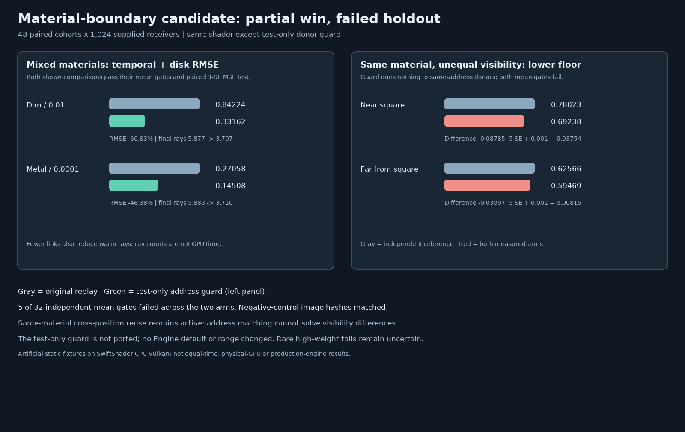

# Experimental material-boundary guard for replay

## Hypothesis and protocol fixed before the holdout measurement

The [first mixed-material/visibility audit](ReplayMixedMaterialVisibility.md) found severe temporal/spatial
variance and a significant lower-floor regression. A **test-only** candidate rejects a spatial donor when
its authored material-atlas address differs from the receiver's. This can exclude incompatible seed-domain
importance distributions without clipping reservoir weights. It is conservative: it also excludes different
addresses that happen to describe the same material, and it cannot detect texture, lighting or visibility
differences inside one material. It is not enabled or integrated in the Engine.

The candidate shader is generated mechanically from the exact current `PathReplayReservoir.slang` by inserting
one material-address comparison inside the existing spatial compatibility function. Only the Resolve shader
and its matching audit probe differ; Generate and Primary SPIR-V are byte-identical between arms. The Engine
source/default remains unchanged.

| Concern | Fixed protocol |
| --- | --- |
| Holdout seeds | 48 new 32 × 32 cohorts per scene; MT19937-64 base `0x14cd5b20b771 + scene_index * 0x1000193`, four draws per cohort, shared across both arms and floors. |
| Mixed scene | Same artificial checkerboard from the earlier stress test: dim and metal materials with different positions/visibility under a square occluder. |
| Visibility control | Both checkerboard groups use the same metallic material address but retain their different receiver positions and visibility. The material-only guard must not reject different-visibility neighbors. |
| Modes/floors | Fresh1 and temporal + Vogel disk at both accepted floors `0.01` and `0.0001`; temporal gets three warm frames. |
| References | Independent double-precision hemisphere minus occluded-square area integral per receiver group, 1,024 steps with half-resolution check. Dim values scaled by `1e3`; metal unscaled. |
| Mean gate | Each scene/group/mode/floor/arm mean within `5 * nominal batch SE + .001` of its integral; finite nonnegative pixels. |
| Paired quality | Candidate minus original MSE per same-seed cohort; `delta + 3 * nominal SE < 0` is an improvement and `delta - 3 * nominal SE > 0` is a regression. Report no conclusion otherwise. |
| Negative controls | Fresh1 images and same-material visibility-control images must have matching same-seed bit hashes between arms; no floor/default change. |
| Donor proof | Audit-only GPU kernel invokes each arm's actual Engine disk-offset and compatibility functions on the final frame. Eligible totals must equal the Resolve counter. Cross-material links must exist in the baseline mixed scene and be zero for the guard; different-position/same-material links must remain eligible in the visibility control. |
| Cost/tails | Record final rays, box/triangle tests, separate warm rays, maximum sample and cohort MSE/means. Counted work is not elapsed GPU time; guard changes donor counts. |
| Limits | Two artificial scenes, supplied static receivers, one bounce, one opaque occluder, no textures, production scene, physical GPU, Windows, editor, motion or real-time game benchmark. |

The paired estimates use nominal cohort errors and a finite reference to the same scattering model, not
independent physical material ground truth. Multiple tests and rare heavy-tailed paths limit inference. A
quality win here would justify further study, not promotion to production or a general unbiasedness claim.

## Outcome: failed holdout; do not promote

**Five of 32 independent mean gates failed** across the two arms. The unchanged Engine baseline failed for
the mixed dim group at the lower floor and for both same-material visibility groups at the lower floor. The
guard fixed the mixed dim *sample mean* in this run, but the two same-material failures remained unchanged.
The full paired study therefore **fails**; the candidate is not integrated or enabled.



| Temporal + disk case | Independent reference | Original mean ± nominal batch SE | Guard mean ± nominal batch SE | Result |
| --- | ---: | ---: | ---: | --- |
| Mixed dim, lower floor, × `1e3` | 0.439915 | 0.365603 ± 0.001124 | 0.440583 ± 0.001261 | Original fails; guard passes in this fixture. |
| Same-material near occluder, lower floor | 0.780225 | 0.692378 ± 0.007308 | 0.692378 ± 0.007308 | Both fail. |
| Same-material far from occluder, lower floor | 0.625657 | 0.594690 ± 0.001430 | 0.594690 ± 0.001430 | Both fail. |

Fresh1 passes in these groups. With rare high-weight samples, nominal batch SE can severely understate
unobserved tails, so the failed gate is evidence that the measured estimator is not reliable in this finite
fixture—not by itself a proof of asymptotic bias or its root cause. The near visibility group included a
sample as large as `63.62` against a `0.780225` reference. The test does not establish that the default floor
or other configurations are generally safe either.

The mixed-scene candidate nonetheless demonstrates a bounded opportunity. At the default floor the dim-group
RMSE falls `0.842243 → 0.331618` (60.63%); at the lower floor the metal-group RMSE falls
`0.270583 → 0.145082` (46.38%). Both comparisons pass the paired 3-SE MSE test and their mean gates. Their
final ray counts fall `5,877 → 3,707` and `5,883 → 3,710`; three warm frames cost about `16,593 → 10,068`
and `16,601 → 10,072` rays. Rejecting donors changes work and may discard useful proposals; these are not
elapsed-time or equal-time results. The separate mixed dim/lower original mean fails, so its smaller measured
MSE is not a basis for accepting that original configuration.

In the final audited mixed frame the original used `2,216` cross-material/cross-position links; the candidate
rejected those and retained `1,657` eligible links. In the same-material control, **2,197** different-position
links remained under both arms. All `576` prespecified negative-control group-image hashes matched between
arms, including the visibility control. Thus matching an atlas address does not solve unequal visibility.
These are synthetic receivers, not images from a real scene, and matching 64-bit hashes are a diagnostic rather
than a formal collision-free proof.

The [baseline failed log](Results/ReplayMaterialGuard-baseline-failed.txt),
[candidate failed log](Results/ReplayMaterialGuard-candidate-failed.txt), and
[paired failed summary](Results/ReplayMaterialGuard-paired-failed.txt) retain every cohort, source/SPIR-V
hash, links, work and failing result. The candidate was run separately after the original script stopped at the
baseline failure, using the same prebuilt artifacts; the script now runs both arms and still returns nonzero if
any gate fails. Release host CTests passed 10/10; SwiftShader, shaders and the new GPU harness were not
sanitizer-instrumented.

## Reproduce

```bash
python3 Exhibits/LightCompute/Code/Prepare.py
# This is expected to exit nonzero while the recorded mean gates remain failed.
(ulimit -v 3900000; export MALLOC_ARENA_MAX=2; bash Exhibits/LightCompute/RunReplayMaterialGuard.sh)
PYTHONPATH="$PWD/_ClaudeScratch/pytools${PYTHONPATH:+:$PYTHONPATH}" \
    python3 Exhibits/LightCompute/Code/ReplayMaterialGuardImages.py
```

The test-only candidate's address match should not be promoted on these results. A follow-up must isolate
spatial and temporal contributions, examine visibility-discontinuous donors and rare tails, and preserve
independent references. Physical-GPU timing, real scenes, motion and material variation remain open.
