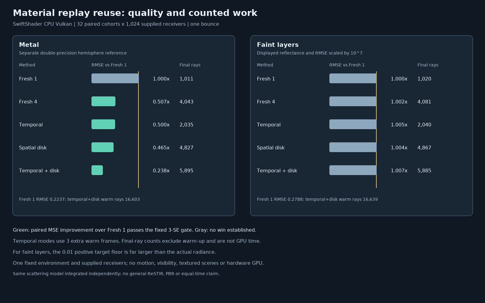

# Authored material replay reuse audit

## Protocol fixed before measurement

This audit exercises the Engine Generate/Resolve shaders and completion-gated C++ recorder on SwiftShader CPU
Vulkan. It is a bounded experiment, not physical-GPU performance or general ReSTIR acceptance.

| Concern | Fixed protocol |
| --- | --- |
| Materials | Existing matte, metal, two-stratum coat and faint-layer fixtures; grayscale red channel. |
| Transport | One bounce, supplied identical receivers, unit environment, no explicit source or visibility geometry. |
| Reference | Separate double-precision GGX/Charlie hemisphere quadrature at 1,024 × 2,048, with half-resolution check. |
| Modes | Fresh1, Fresh4, temporal, spatial Vogel disk, and temporal plus spatial Vogel disk. |
| Cohorts | 32 pseudorandom-seed cohorts of 32 × 32 receivers per material and method. |
| Seed stream | MT19937-64 `0xa317e4c59b01 + fixture_index * 0x1000193`; four 32-bit draws per cohort. |
| History | Temporal methods use three warm submissions and one measured submission; other modes use only the measured one. |
| Pairing | All methods use the same measured frame seed per cohort; temporal warm seeds come from the fixed cohort stream. |
| Correctness | Every method's mean must lie within `5 * nominal batch SE + .001` of the integral. |
| Activation | Temporal and spatial counters must confirm the requested paths ran; finite nonnegative readbacks required. |
| Quality | Per-cohort pixel MSE and paired differences versus fresh controls; a win needs `difference + 3 * nominal SE < 0`. |
| Work | Report final-frame traced rays and separate warm-up rays. Rejected directions may perform no ray query. |
| Revisions | Warm a material, change its atlas/receiver or environment through the C++ sequence, and compare with explicit reset. |
| Limits | No texture maps, visibility geometry, primary-camera hits, motion, denoising, full-scene materials or game timing. |

The references integrate the same scattering model via independent code, not independent physical materials.
A ray count is not GPU time; methods have unequal overhead and potentially unequal work. Nominal standard
errors are measured across cohorts, not independent pixels, and are conditional on the finite reference.

## Outcome

All 20 material/mode means pass the predeclared reference gate. Each requested temporal and spatial path is
active. Material and environment revisions reset the completion-gated C++ sequence, reject temporal history,
and match the same-seed explicit reset exactly; environment-off output is exactly zero in this fixture.



| Material | Reference | Fresh1 RMSE | Fresh4 RMSE | Temporal + disk RMSE | Fresh1 / temporal + disk final rays |
| --- | ---: | ---: | ---: | ---: | ---: |
| Matte | 0.574763 | 0.121259 | 0.061350 | 0.029960 | 999 / 5,881 |
| Metal | 0.848681 | 0.223684 | 0.113508 | 0.053221 | 1,011 / 5,895 |
| Coated | 0.267289 | 0.122122 | 0.061658 | 0.029331 | 1,009 / 5,890 |
| Faint, values × `1e7` | 0.538687 | 0.278785 | 0.279338 | 0.280667 | 1,020 / 5,885 |

Temporal + disk also used approximately 16,500 rays across its three warm frames per cohort. It passes the
paired quality gate against Fresh1 and Fresh4 for the first three materials, but uses more final-frame rays and
warm-up; this is not equal-time evidence. For the faint material no reuse or Fresh4 method establishes a paired
quality win. Its observed differences are not evidence of a statistically significant regression either.

The faint fixture's average **unscaled** radiance is approximately `5.39e-8`, while the fixed target floor is
`0.01`. The floor therefore dominates the selection target, making candidates nearly uniform regardless of
their contribution. A positive floor protects proposal support; removing it would be unsafe. The existing
recorder permits smaller positive floors down to `1e-4`, but even that is much larger than this example's
radiance. A separate bounded floor-sensitivity study is needed before changing the default or domain.

| Revision control | Outcome |
| --- | --- |
| Authored atlas and receiver changed | Sequence reset; `0` temporal accepts; exact explicit-reset output. |
| Environment changed to zero | Sequence reset; `0` temporal accepts; exact reset output and zero RGB. |
| Host tests | 10/10 Release and host-only ASan/UBSan CTests; the new reuse GPU suite was not run under sanitizers. |

The [measured rows and source hashes](Results/ReplayMaterialReuse-release.txt) and
[host-only sanitizer CTests](Results/ReplayMaterialReuse-host-sanitized.txt) are retained. Leak detection was
disabled; the sanitizer CTests do not execute the new reuse harness, external driver or shaders. All output uses
the same fixed material model/reference; no general temporal/spatial unbiasedness, real game speed or broad
material correctness is established.

## Reproduce

```bash
python3 Exhibits/LightCompute/Code/Prepare.py
# Linux sandbox bound; full SwiftShader pipeline preparation takes several minutes.
(ulimit -v 3900000; export MALLOC_ARENA_MAX=2; bash Exhibits/LightCompute/RunReplayMaterialReuse.sh)
export PATH="$PWD/_ClaudeScratch/pytools/bin:$PATH" PYTHONPATH="$PWD/_ClaudeScratch/pytools${PYTHONPATH:+:$PYTHONPATH}"
cmake -S Exhibits/LightCompute -B _ClaudeScratch/build/replay-material-reuse-sanitized -G Ninja \
    -DCMAKE_BUILD_TYPE=Debug '-DCMAKE_CXX_FLAGS=-O1 -fsanitize=address,undefined -fno-omit-frame-pointer -fno-pie' \
    '-DCMAKE_EXE_LINKER_FLAGS=-fsanitize=address,undefined -no-pie'
cmake --build _ClaudeScratch/build/replay-material-reuse-sanitized --parallel 2
ASAN_OPTIONS=detect_leaks=0 UBSAN_OPTIONS=halt_on_error=1 \
    ctest --test-dir _ClaudeScratch/build/replay-material-reuse-sanitized --output-on-failure
python3 Exhibits/LightCompute/Code/ReplayMaterialReuseImages.py
```

The run used Linux x86-64, GCC 12.2, Slang 2026.14.1, Vulkan headers 1.4.321 and SwiftShader. Shader, source,
compiler and device details are retained in the log. The graph is derived from those rows, not a camera image.
