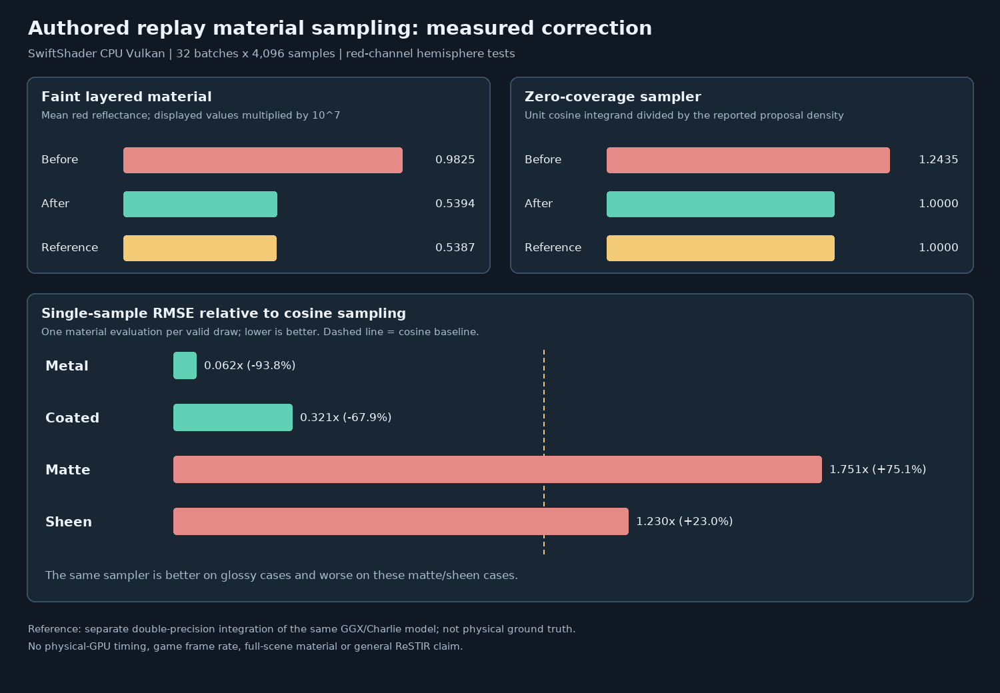

# Authored replay material sampling and bounded path checks

## Outcome and scope

A focused software-Vulkan probe found a normalization defect in the authored multi-stratum proposal in
`dcc1283`. The Engine shader now normalizes the actual positive lobe budget and uses a cosine-only proposal when
that budget is below `1e-20`. The material BRDF is not replaced. The cosine proposal retains hemisphere support,
though extremely faint sharp lobes can be noisy. Exact CDF boundaries skip zero-weight lobes, and rounding falls
back to the last positive lobe.

The fix passes 11 bounded material fixtures in the actual Engine sampler and, separately, through the Engine
`RecordPathReplay` Generate/Resolve passes. A two-bounce diffuse path also matches a separate area integral.
All GPU execution here is SwiftShader **CPU Vulkan**. This is not complete PBR, a general proof of ReSTIR GI,
physical-GPU validation, a game-frame measurement or an editor viewport.



## Defect and independent control

The previous shader used `max(SpecSum, 1e-6)` when computing multi-layer proposal weights. For a positive sum
smaller than `1e-6`, the normalized proposal weights no longer summed to the sampling probability of the
specular branch. With zero coverage, the branch still sampled a nominal lobe. Sampling and evaluation could return
the **same wrong PDF**, so their agreement alone was not sufficient.

The new probe calls the Engine sampler and BRDF directly. A separate scalar double-precision implementation
integrates the same GGX/Charlie layered model over a unit-lit hemisphere on a 1,024 × 2,048 midpoint grid;
a 512 × 1,024 grid checks convergence. It is independent code and RNG, **not a different physical material
model**. A second control estimates the known unit integral of `cos(theta) / pi`, accounting for rejected
draws as zero. The historical shader is compiled from `dcc1283` against the same present-day fixture.

| Case | Reference | Before mean ± nominal batch SE | After mean ± nominal batch SE |
| --- | ---: | ---: | ---: |
| Faint two strata, values × `1e7` | 0.538687090 | 0.982543375 ± 0.00404 | 0.539359573 ± 0.000873 |
| Faint coat only, values × `1e7` | 0.042922132 | 0.100528761 ± 0.000959 | 0.043079768 ± 0.000228 |
| Ultra-faint two strata, values × `1e24` | 0.538687110 | 1.178381640 ± 0.00615 | 0.540747383 ± 0.00272 |

For zero coverage, the independent unit-integral estimate changed from `1.24351501` to `1.00000002`
(reference `1`). For faint coverage it changed from `1.19815740` to `0.99950643`. The two density functions
reported no difference in either version, including the defective one. These estimates use 32 deterministic
batches × 4,096 attempts per material; nominal standard errors are across batches, not guaranteed confidence
intervals. The shader test accepts means within `5 * nominal SE + .001`, the unit control within
`5 * nominal SE + .01`, and relative sampled/evaluated density difference below `1e-5`.

The 11 grayscale red-channel cases cover matte, metal, coated and sheen materials, zero/positive coverage,
base-only and coat-only stacks, very small coverage and eight strata. Coverage below the `1e-20` proposal-sum
threshold uses cosine-only sampling; subnormal arithmetic on other GPU architectures remains untested. The
[baseline log](Results/ReplayMaterialSampling-baseline.txt) intentionally fails its gate. The
[repaired log](Results/ReplayMaterialSampling-release.txt) passes all cases and 10/10 host CTests.

## Quality comparison, equal sample count

| Case | Corrected material proposal RMSE | Cosine proposal RMSE | Relative change |
| --- | ---: | ---: | ---: |
| Metal | 0.224666 | 3.633785 | 93.8% lower |
| Coated | 0.122289 | 0.380724 | 67.9% lower |
| Matte | 0.121323 | 0.069275 | 75.1% higher |
| Sheen | 0.149273 | 0.121395 | 23.0% higher |
| Faint, values × `1e7` | 0.279299 | 0.956847 | 70.8% lower |

Both methods use the same number of attempted draws, at most one BRDF evaluation per attempt and the same
independent integral. They have different sampler overhead and rejection counts. This is not an equal-time or
physical-GPU speed comparison, and the matte/sheen regressions rule out a universal quality claim.

## Actual recorded replay paths

These tests construct real Engine atlas/buffer inputs, use the Engine Vulkan recorder and read back the actual
Generate/Resolve result. They use a unit environment, one fresh candidate, no temporal or spatial reuse, and a
fresh history each batch. All 11 authored cases use one bounce. `PrimaryVisibility` is off and input receivers
are supplied by the fixture; they are not rendered camera primary hits.

| Fixture | Independent red-channel reference | Recorded path mean ± nominal batch SE |
| --- | ---: | ---: |
| Matte, one bounce | 0.574762896 | 0.575151768 ± 0.000313 |
| Metal, one bounce | 0.848680634 | 0.848814829 ± 0.000642 |
| Faint layers, one bounce, values × `1e7` | 0.538687090 | 0.538497548 ± 0.000834 |
| Eight coated strata, one bounce | 0.267836678 | 0.268209182 ± 0.000354 |
| Diffuse square, one bounce | 0.311768776 | 0.312060542 ± 0.00122 |
| Diffuse square, two bounces | 0.467061263 | 0.467236323 ± 0.000731 |

For the diffuse fixture the receiver has albedo `0.7`, a square at `z=1` has albedo `0.4`, and the environment
is unit radiance. A separate double-precision area integral computes the square's projected cosine fraction
`F = 0.554616026`, using the same `0.001` ray-origin offset. The one- and two-bounce predictions are
`0.7 * (1 - F)` and `0.7 * (1 - F + 0.4 * F)`. The 512- and 1,024-step quadratures agree within `1e-5`.
Every measured path mean passes `5 * nominal batch SE + .001`. The complete rows, shader hashes and host
results are in the [recorded-path log](Results/ReplayMaterialPath-release.txt).

These fixtures do not test temporal/spatial energy conservation, moving/textured scenes, general multibounce
PBR, solid transmission, production material loading or editor resource ownership. The previously tested
[offscreen sequence](ReplaySubmissionSequence.md) covers history/recording parity, not independent
material-general energy correctness. The [thin-sheet regression](ReplayTransmission.md) was rerun with this
shader and still passes its independent area and overflow checks. Four KHR ray-query SPIR-V files were
[recompiled and opcode-checked](Results/ReplayRayQuery-spirv.txt), not executed on ray-query hardware.

## Sanitizers, resources and reproduction

GCC 12.2 on Linux x86-64, Slang 2026.14.1, Vulkan headers 1.4.321 and SwiftShader were used. Host ASan/UBSan
passed 10/10 CTests **and the material probe host/reference**; leak detection was disabled and neither the
external driver nor shader instructions were instrumented. See the [sanitizer log](Results/ReplayMaterialSampling-sanitized.txt).

An earlier, more complex version of the repair exhausted the roughly 3.8 GiB, no-swap sandbox during
SwiftShader pipeline preparation and emitted no path rows. The simplified, final shader passed the full test
under the virtual-memory cap and allocator setting below; this is not a GPU memory or runtime benchmark. Its
software pipeline preparation was expensive (approximately 11 minutes in this sandbox).

```bash
python3 Exhibits/LightCompute/Code/Prepare.py
# Requires CMake, Ninja and Pillow; see the pinned tool setup used by the other LightCompute exhibits.
# Historical shader: expected exit 1 after the failing numerical acceptance gate.
BASELINE=1 bash Exhibits/LightCompute/RunReplayMaterialSampling.sh
bash Exhibits/LightCompute/RunReplayMaterialSampling.sh
SANITIZE=1 bash Exhibits/LightCompute/RunReplayMaterialSampling.sh
# Linux-only resource bound used for the recorded-path run; limit is KiB, not a recommended GPU budget.
(ulimit -v 3900000; export MALLOC_ARENA_MAX=2; bash Exhibits/LightCompute/RunReplayMaterialPath.sh)
PYTHONPATH="$PWD/_ClaudeScratch/pytools${PYTHONPATH:+:$PYTHONPATH}" \
    python3 Exhibits/LightCompute/Code/ReplayMaterialSamplingImages.py
```

The historical run intentionally returns nonzero. Sanitizer mode uses `-fno-pie`/`-no-pie` on this Linux host;
toolchain options may need adjustment elsewhere. The chart is derived from the retained measured logs, not a
rendered material image. Physical-GPU/Windows runs and equal-time real-game benchmarks remain required.
