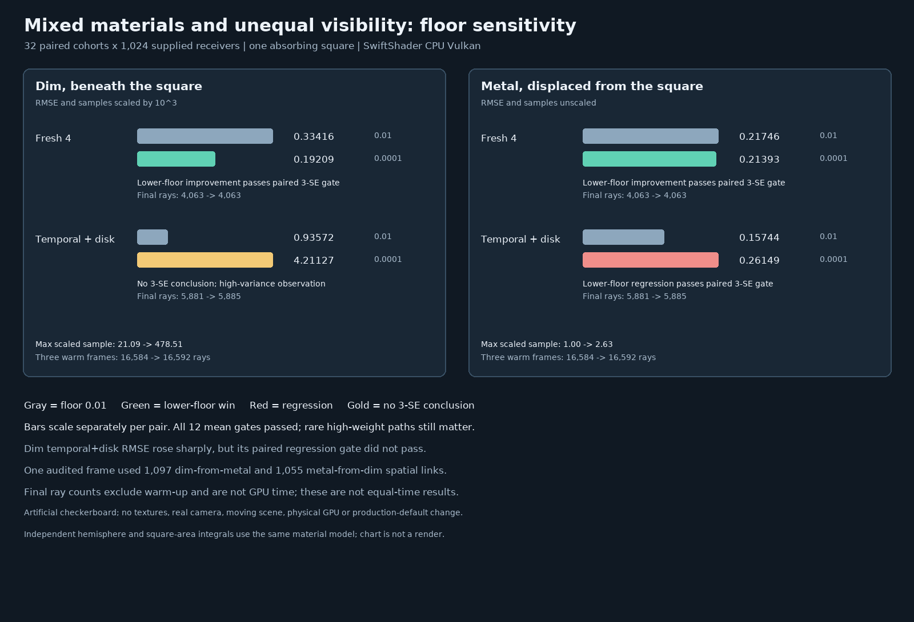

# Mixed-material replay with unequal visibility

## Protocol fixed before measurement

The homogeneous [target-floor follow-up](ReplayMaterialFloor.md) cannot establish what happens when reservoirs
from different materials and visible regions are mixed. This separate stress test changes both at once, with
explicitly computed per-group references. It tests the already accepted floors only; it will not change the
Engine default or acceptable range.

| Concern | Fixed protocol |
| --- | --- |
| Receivers | 32 × 32 supplied receiver records arranged as a checkerboard: dim two-layer material at x = -0.75, metallic material at x = +0.75, normal +z, both at z = 0. |
| Visibility | Unit environment and one absorbing 1 × 1 square at z = 1 centered over the dim material; software BVH, one bounce, no explicit emitter sampling. |
| Deliberate stress | Neighboring image pixels represent different materials and displaced positions; both satisfy the Engine's existing symmetric tangent-plane and roughness compatibility gate. This is artificial, not a realistic camera image. |
| Reference | Independent double-precision layered-material hemisphere integral minus an area integral of the blocked square, separately for each receiver group. Full 1,024- and half-resolution checks. |
| Reporting | Dim values multiplied by `1e3`; metal values unscaled. Evaluate group means and pixel MSE separately. |
| Modes | Fresh1, Fresh4 and temporal + Vogel disk at floors `0.01` and `0.0001`. |
| Cohorts | 32 paired 32 × 32 cohorts, 512 receivers per group; fixed MT19937-64 `0x318cd4a00761`, four 32-bit draws per cohort. |
| History | Fresh modes measured immediately; temporal + disk has three warm submissions. Paired floors use identical seeds. |
| Correctness | Each of the 12 group/mode/floor means must lie within `5 * nominal batch SE + .001` of its reference. Radiance must be finite and nonnegative. |
| Reuse activation | Counters must show temporal and disk reuse. An audit-only GPU kernel uses the Engine's disk-offset and compatibility functions to verify cross-material eligible links in both directions; its total eligible links must equal the last measured Resolve counter. |
| Quality | Paired lower-minus-default MSE over cohorts. A win needs `difference + 3 * nominal SE < 0`; a regression needs `difference - 3 * nominal SE > 0`. No equal-time claim. |
| Tail/work | Record maximum scaled pixel, maximum cohort mean, final-frame ray and BVH-test counts, and separate warm rays. Rare-event behavior beyond the finite experiment is unknown. |
| Limits | Supplied primary receivers, one square occluder, no textures, scene motion, HDR lighting, hardware RT, physical GPU, Windows, editor, game timings or independent physical BRDF. |

The area reference and hemisphere reference independently integrate the same implemented material model, not an
independently measured physical material. The nominal cohort standard errors are conditional on the finite
reference and can understate rare-path tails; multiple comparisons also limit inference. Any failure remains a
failure until investigated, not evidence to tune the protocol after the fact.

## Outcome

All **12** group/mode/floor means pass the prespecified gate and Fresh1 is exactly equal at both floors. This
does **not** mean that the lower floor is generally safe or that the estimator has been proved unbiased.
The actual final-frame GPU counter reports 3,853 accepted spatial links in the audited cohort; an audit kernel
using the Engine's exact disk and compatibility code matches that total and identifies **1,097 dim receivers
reusing metal donors and 1,055 metal receivers reusing dim donors**.



| Receiver and mode | RMSE, floor 0.01 → 0.0001 | Paired MSE difference ± nominal SE | Prespecified conclusion |
| --- | ---: | ---: | --- |
| Dim Fresh4, × `1e3` | 0.334158 → 0.192092 | -0.074762 ± 0.000830 | Lower floor wins. |
| Metal Fresh4 | 0.217465 → 0.213928 | -0.001526 ± 0.000183 | Lower floor wins. |
| Dim temporal + disk, × `1e3` | 0.935725 → 4.211272 | +16.859231 ± 14.351268 | **No 3-SE conclusion**; observed RMSE is 4.50× larger. |
| Metal temporal + disk | 0.157443 → 0.261493 | +0.043590 ± 0.002389 | Lower-floor regression: RMSE +66.09%. |

The dim temporal + disk maximum scaled pixel was `21.09` at the default floor versus `478.51` at the lower
floor; the independent scaled reference is `0.439915`. The lower-floor MSE is dominated by rare large values,
so the 3-SE regression test for that group is inconclusive despite the large observed difference. The normal
mean gate passed because its estimated uncertainty was correspondingly large. This is precisely why a passing
mean check alone is not a sufficient quality or tail guarantee.

For temporal + disk the default → lower final-frame counts are 5,881 → 5,885 rays, 5,881 → 5,885 box tests,
and 2,187 → 1,959 triangle tests, plus 16,584 → 16,592 rays across three warm frames. Fresh4 used 4,063 final
rays and no warm-up. These counts are per cohort and omit other work; they are **not** elapsed time. The dim and
metal references are `0.439915` (× `1e3`) and `0.625657`; finer versus coarser quadrature differs by less than
`1e-6` in each displayed unit.

This highly artificial checkerboard deliberately permits cross-material, differently occluded spatial donors.
Its observation motivates investigating stricter compatibility, not an automatic production change: blocking
all different materials may remove useful samples and will not address different visibility or textured
properties *within* the same material. A subsequent [held-out address-guard experiment](ReplayMaterialGuardCandidate.md) improved this
mixed case but failed independent means in a same-material visibility control; the guard was not promoted.
Other scenes, motion, real hardware and longer rare-tail tests remain necessary.

## Reproduce

```bash
python3 Exhibits/LightCompute/Code/Prepare.py
# Linux sandbox bound; SwiftShader pipeline preparation takes several minutes.
(ulimit -v 3900000; export MALLOC_ARENA_MAX=2; bash Exhibits/LightCompute/RunReplayMixedMaterial.sh)
PYTHONPATH="$PWD/_ClaudeScratch/pytools${PYTHONPATH:+:$PYTHONPATH}" \
    python3 Exhibits/LightCompute/Code/ReplayMixedMaterialImages.py
```

The [complete rows, audit counts, work, CTests, tools and source hashes](Results/ReplayMixedMaterial-release.txt)
are retained. Release host CTests passed 10/10. The diagram is generated from those measurements and is not a
rendered scene. SwiftShader and shaders were not sanitizer-instrumented.
