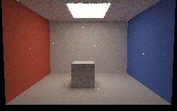
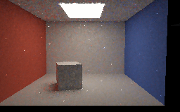
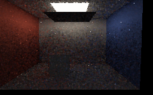
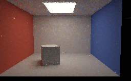

# Camera, rigid-object and occluder renders

Four unfiltered 256×160 **SwiftShader CPU Vulkan** readbacks from the bounded four-hit, explicit-facet path
replay experiment. They are authored triangle scenes, not editor or hardware-GPU screenshots.

| Before motion | Camera translated; cuboid rotated and translated |
|---|---|
|  [Filtered preview](Images/MotionRoomBeforePreview.png) |  [Filtered preview](Images/MotionRoomMovedPreview.png) |

| Blocker moved beneath light | Blocker moved away again |
|---|---|
|  [Filtered preview](Images/MotionRoomBlockedPreview.png) |  [Filtered preview](Images/MotionRoomReopenedPreview.png) |

The camera shifts 0.35 world units; the cuboid rotates 0.28 rad about Z and translates 0.224 units in X.
Previous-camera and previous-object transforms are supplied explicitly and the BVH is rebuilt. During the
three transition frames, the experiment accepted 34,922 / 34,470 / 34,470 temporal guides respectively,
without global resets and with previous represented history capped at one. All paths and shadow rays are
retraced against the current geometry.

Each image averages the last 12 of 24 frames **after** its corresponding transition, in linear RGB. Exposure
is 0.45 and display gamma is 2.2. These are settled views, not individual transition frames, so they do not
establish absence of temporal ghosting. The displayed raw images retain noise; the optional 9×9
geometry-guided filtered previews can blur shadows and spread bright outliers. The fixed lower-image region
had linear mean luminance 0.5393 / 0.5990 / 0.0216 / 0.5348, respectively; these are sanity checks rather
than independent photometric ground truth.

[Motion tests and limitations](ReplayMotion.md) · [facet sampling and independent references](FacetReplay.md) ·
[earlier four facet captures](FacetReplayCaptures.md) · [capture log and source hashes](Results/ReplayMotion-capture.txt).

Reproduce with `bash Exhibits/LightCompute/RunReplayMotionCapture.sh` after running
`python3 Exhibits/LightCompute/Code/Prepare.py`; Pillow is required for PNG conversion.
