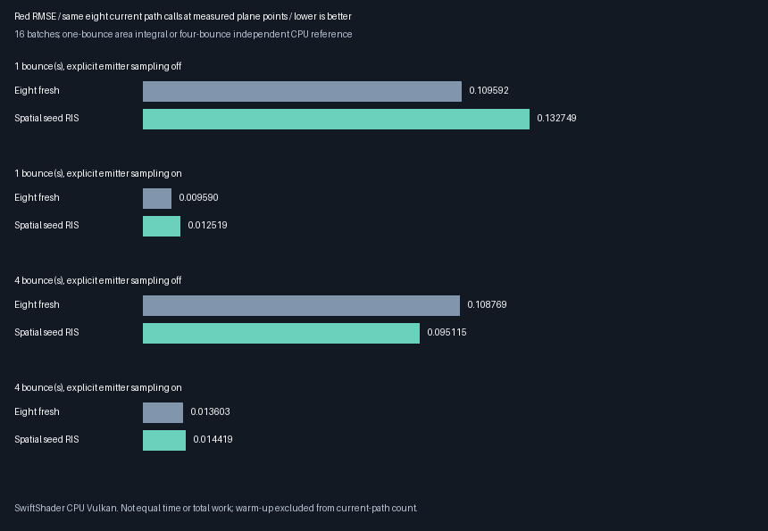
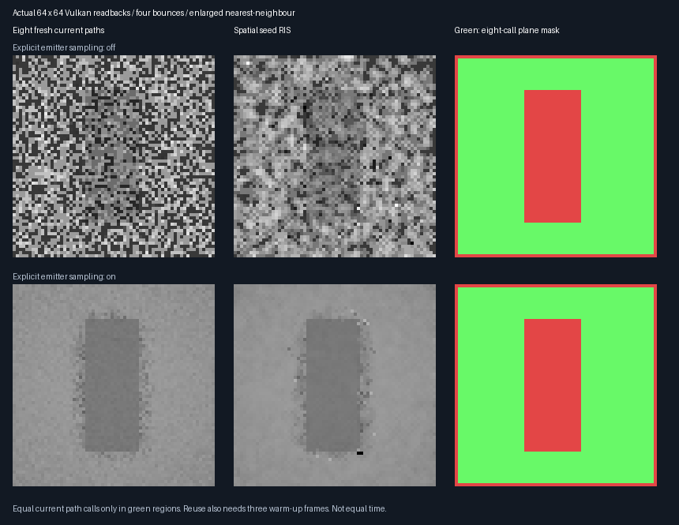

# Eight-current-path ReSTIR comparison — 2026-10-28

**Gate completed, not a general reuse win.** Spatial seed RIS has lower observed error in one of four conditions;
it loses the other three to eight fresh paths. Keep reuse opt-in; the accepted **348.046875 MiB output-only
1080p extrapolation** stays reported and unchanged. Further packing is deferred by the user.

**Historical checkpoint:** this report predates the [selected-history source safety repair](ReplayTemporalContract.md).
That repair intentionally changes default generation SPIR-V; its valid-output and compact regressions pass.
The hashes/parity statements below describe this checkpoint, not later source edits.

## Quality results

Linear red-channel RMSE, lower is better. Both methods launch **eight current path evaluations at every
measured point**: 16 batches, the same 702 floor points, one half-pixel camera move, fixed target floor `0.01`.
Ranks below describe observed RMSE only, not statistical significance or a general renderer ranking.

| Bounces | Explicit emitter sampling | Eight fresh | Spatial seed RIS | Reuse RMSE change | Observed lower |
|---------|---------------------------|-------------|------------------|-------------------|----------------|
| 1       | Off                       | 0.109592    | 0.132749         | 21.13% worse      | 🥇 Fresh       |
| 1       | On                        | 0.009590    | 0.012519         | 30.54% worse      | 🥇 Fresh       |
| 4       | Off                       | 0.108769    | 0.095115         | 12.55% lower      | 🥇 Reuse       |
| 4       | On                        | 0.013603    | 0.014419         | 6.00% worse       | 🥇 Fresh       |



### Uncertainty and independent references

Paired batch statistics use **spatial minus fresh**. A negative MSE difference favours reuse.
These are nominal standard errors over 16 seed batches, conditional on a fixed reference; not pixel-independent
confidence intervals, a heavy-tail guarantee, or a general unbiasedness proof.

| Bounces | Emitter sampling | Paired MSE difference | Nominal batch SE | Interpretation |
|---------|------------------|-----------------------|------------------|----------------|
| 1       | Off              | +0.00561184           | 0.00927307       | High uncertainty |
| 1       | On               | +0.0000647465         | 0.0000158677     | Fresh favoured in this fixture |
| 4       | Off              | -0.00278398           | 0.00190727       | Observed benefit is not a clear 2-SE result |
| 4       | On               | +0.0000228585         | 0.0000106809     | Modest conditional evidence for fresh |

- One bounce: independent 128×128 emitter-area quadrature; 64×64 convergence RMSE `0.000308311`.
  Reference mean `0.106954529`; environment zero in both GPU methods and the reference.
- Four bounces: **718,848 independent CPU paths**, 1,024 per point; reference mean
  `0.118167731 ± 0.000360449` nominal SE. GPU and CPU both use uniform environment `(0.025,0.025,0.025)`.
  RMS per-point reference SE is about `0.00955018`; four-bounce RMSE includes this finite-reference noise.
- Both modes pass the predeclared mean/reference and paired-mean gates: four nominal SE plus `0.001`.
  Passing validates this comparison's consistency, **not** a required quality advantage.

## What is equal, and what is not

| Quantity | Eight fresh | Spatial seed RIS |
|----------|-------------|------------------|
| Current calls at each measured point | 8 new seed evaluations | 4 local evaluations + 4 donor retraces |
| Current submission | One; all eight paths in one generation dispatch | One; shared production recording |
| Current dispatch chain | Primary, generate, gather, resolve, finalize | Primary, gather, generate, resolve, finalize |
| Prior radiance in measured estimate | None; cold reset every time | None; paths retraced at current receiver |
| Extra history preparation per batch | None | Three previous-camera submissions |
| Full 32×32 current path calls | 8,192 | 7,902; edges/rejected banks use fewer |
| Full-image warm-up path calls | 0 | **18,048**, before the measured current image |
| Current plus cold warm-up path calls | 8,192 | **25,950** |

The measurement mask is fixed from geometry and seed counts, not radiance/error. Every included point must
retain four local candidates and four valid in-bounds donor sources in every batch and condition. GPU counter
16 checks total `EvaluateReplayPath` calls against candidate counts plus spatial retraces. Counters 17 and 2
count indirect nearest-facet launches and shadow-segment queries respectively; primary rays are excluded.

**Actual indirect query totals over all 16 full-image current submissions:**

| Bounces | Emitter sampling | Fresh current | Reuse current | Reuse warm-up, additional |
|---------|------------------|---------------|---------------|--------------------------|
| 1       | Off              | 131,072       | 126,432       | 288,768                  |
| 1       | On               | 262,144       | 252,864       | 577,536                  |
| 4       | Off              | 142,640       | 135,703       | 312,333                  |
| 4       | On               | 279,076       | 269,221       | 617,872                  |

These are query launches, not triangle tests, equal whole-image budgets, equal time or physical-GPU speed.
Three warm-up images are reset/repeated per independent batch; steady-state amortization is not measured.

## Actual visible evidence



- Actual 64×64 four-bounce GPU readbacks, shared exposure `3`, enlarged nearest-neighbour; no generated artwork.
  Both emitter-sampling cases use environment `0.025`, matching the numerical four-bounce fixture.
- Green marks 3,088 floor points satisfying the eight-call contract; red areas are not the equal-call comparison.
  Full captures: 32,768 fresh versus 32,194 reuse current calls, plus **72,960** reuse warm-up calls each.
- Metrics use linear float readbacks, not display PNGs. Smoother-looking correlated noise is not necessarily
  lower RMSE; no reconstruction or denoising is applied.

## Implementation and verified scope

| Verification | Release | Host ASan + UBSan |
|--------------|---------|------------------|
| Native CTests | 5/5 | 5/5 |
| Independent eight-path rectangle intersections | 818 points, max RGB error 0 | Same |
| Rectangle boundary exclusions | 8 near-edge points, reported | Same |
| Cold fresh control after poisoning all old output/history | Bit-exact image | Same |
| Optional counting versus plain shaders | 4 frames: exact image, 9 logical slabs, other 22 counters | Same |
| Numerical/reference gates | All 4 conditions, 16 batches each | Same |
| Final parity | 23 budget rows and 6 decoded RGB captures exact across configurations | Same |
| Logged source/tool/SPIR-V hashes | All 39 match final files | All 39 match final files |

- The validation-only fresh pipeline includes the shared engine `PathReplayReservoir.slang` evaluator.
  It averages eight fresh seeds, routes the mean through unit-weight resolution, and always resets history.
  Its cached descriptor is **not** a production eight-candidate reservoir and must never be reused as one.
- Engine changes are optional path/query telemetry under `FRONTIER_REPLAY_PATH_BUDGET`. All five default
  SPIR-V binaries have identical SHA256 to the completed compact-storage checkpoint; default atomics/work do not grow.
- Compact footprint/recorder sources are unchanged. Numerical output descriptor: `180,224 B` at 32×32.
  Output remains `176 bytes/pixel`: **348.046875 MiB at 1920×1080**, extrapolated, not allocated/rendered here
  and not total VRAM. Accepting that quantity does not waive device storage-buffer range limits.

[Release log](Results/ReplayPathBudget-release.txt) · [Host sanitizer log](Results/ReplayPathBudget-sanitized.txt) ·
[Final hash, default shader and image parity](Results/ReplayPathBudget-parity.txt).

## Consequence for the next rendering phase

1. Keep seed RIS opt-in; do not promote the earlier eight-versus-four comparison as an equal-budget gain.
2. Use eight fresh paths with explicit emitter sampling as a strong baseline in these fixtures.
3. Expand seeds/scenes/motion and investigate resampling variance before a general reuse-quality claim.
   Specify temporal combination mathematically before enabling selected-reservoir history.
4. Physical-GPU equal-time quality, Windows/editor integration, broader materials and reconstruction remain open.
   SwiftShader CPU Vulkan is not hardware ray tracing, a game FPS result or complete ReSTIR GI acceptance.

## Reproduce

Linux x86-64, GCC 12.2.0, C++20; SwiftShader Device (Subzero), CPU type 4; Slang 2026.14.1.
Revision `68f3016` plus uncommitted recovery/continuation files on `arena/08e7de48-frontier`; exact hashes in logs.
Pinned prerequisites: [tool manifest](../../Automation/ReplayToolDependencies.json), Vulkan headers v1.4.321,
CMake and Pillow. Reuse the existing recovered tools; restore only if absent. No remote Actions are required.

```bash
python3 Automation/PrepareReplayTools.py --verify
CAPTURE=1 bash Exhibits/LightCompute/RunReplayPathBudget.sh
SANITIZE=1 CAPTURE=1 BUILD_JOBS=1 bash Exhibits/LightCompute/RunReplayPathBudget.sh
# Use a Python interpreter with Pillow; the recovered local interpreter is shown here.
_ClaudeScratch/venv/bin/python Exhibits/LightCompute/Code/ReplayPathBudgetParity.py
_ClaudeScratch/venv/bin/python Exhibits/LightCompute/Code/ReplayPathBudgetImages.py \
    _ClaudeScratch/replay-path-budget-capture-release/png \
    Exhibits/LightCompute/Results/ReplayPathBudget-release.txt Exhibits/LightCompute/Images
```

Driver/shader execution is **not sanitizer-instrumented**. No physical GPU, Windows, editor or 1080p runtime test.
