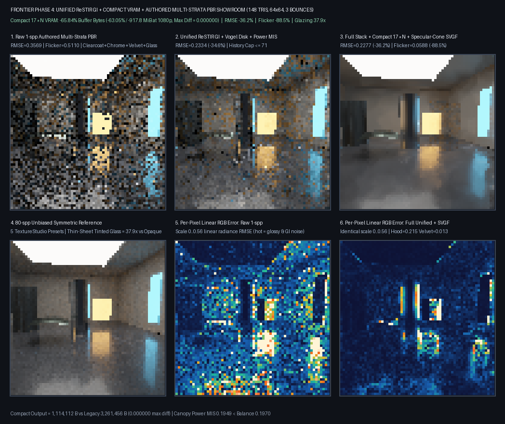

# Bounded PBR replay and reflection evaluation

## Status

The shared Engine replay shaders now accept an opt-in, bounded authored-material domain. The `64x64` showroom
executes on SwiftShader CPU Vulkan; this is **not** a completed production renderer or editor viewport. The earlier
report called this work complete, described its reference as unbiased and claimed statistical parity. Those claims
were not established and are superseded here. Later independent checks found and repaired double-counted light
through thin glass and a tiny-coverage authored sampler mismatch: [transmission audit](ReplayTransmission.md) and
[material hemisphere/recorded-path audit](ReplayMaterialSampling.md). The latter covers 11 bounded materials,
not general reflection correctness.



## What is implemented

| Component | Implemented scope |
| --- | --- |
| Compact output | 6 float4 slabs/pixel for base replay, 10 for seed history, 17 for SVGF. |
| Authored opaque PBR | Bounded atlas, opaque/coating strata, albedo/normal pyramids, paint and sheen. |
| Thin sheets | Category-2 transmission/reflection and complementary straight-path MIS. |
| Reflection filtering | Roughness-dependent spatial and temporal guards. |
| Power MIS | Optional beta=2; not the default and not a universal quality win. |
| Ray query | SPIR-V compiles; the new material path has not run on physical RT hardware. |

`PathReplayAuthoredMaterials` requires rough-opaque importance sampling. The showroom uses temporal/spatial
reservoirs, **not** the diffuse-only seed bank. Multi-pane and bounce-budget checks are described separately.

Compact storage requires all participating pipelines to use the compact address layout. A layout/allocation change
invalidates histories. The caller remains responsible for device limits, descriptors, synchronization and lifetime.
In particular, the output-only 1080p estimates below can exceed a device's storage-buffer range; resource splitting
and a real game budget have not been accepted.

## Measurements and limitations

The following are from a synthetic `148`-triangle, 3-bounce scene and one SwiftShader CPU Vulkan run. The PBR
materials are hand-built fixture records inspired by the existing material library; this is not an end-to-end test
of material-file loading or authoring. The 80-sample comparison is produced by the **same shader**, is finite, and
is not an independent ground truth. Raw, reused and filtered images have different warm-up and tracing work.

| Measurement | Control | Experimental result |
| --- | ---: | ---: |
| Output allocation, `64x64` | 3,261,456 B | 1,114,112 B |
| Replay + SVGF output formula, 1080p | 1,455.70 MiB | 537.89 MiB |
| Canopy balance / power RMSE | 0.196960 | 0.194935 |
| Showroom balance / power RMSE | 0.332646 | 0.336900 |
| Raw / spatial / spatial+SVGF RMSE | 0.346580 | 0.224831 / 0.226181 |
| Consecutive-frame RGB difference | 0.500742 | 0.058311 |
| Tinted / opaque pane luminance | 0.796379 | 0.021028 |

The `64x64` output was 65.84% smaller, with equal RGBA, 12 compared slabs and 24 counters over four frames.
1080p is a formula extrapolation, not an allocation or total VRAM. Canopy and showroom MIS comparisons use 16
and 8 paired batches respectively, with matching reported ray counts but no confidence gate. The image-quality
comparison uses different amounts of warm-up and spatial tracing. The pane row is a material-effect check over
289 pixels, not a physical calibration.

The SVGF result is slightly worse than spatial-only RMSE in this run. Smooth chrome and glass remain particularly
noisy in the finite reference (`0.735688` and `0.554361` masked RMSE respectively). No quality gate was promoted
from these exploratory comparisons. See [raw metrics](Results/ReplayPbrReflectionMetrics.txt) and
[execution log](Results/ReplayPbrReflection-release.txt). The capture was generated after the main glass-MIS
repair but before the subsequent nine-pane, unreachable-density and tiny-coverage sampler guards. Those guards
are tested separately; this older showroom image is not evidence of their visual effects.

## Verification and reproduction

The latest capture passed 10/10 Release host CTests, the `64x64` compact-layout checks and four SPIR-V 1.4
ray-query opcode checks. Separate host ASan/UBSan CTests passed 10/10; the external Vulkan driver and shaders are
not sanitizer-instrumented. No physical GPU, Windows editor, general deforming geometry, solid-dielectric GI,
SSS, complex-IOR or equal-time acceptance is claimed.

```bash
python3 Exhibits/LightCompute/Code/Prepare.py   # Pinned Linux Slang, Vulkan headers and SwiftShader
CAPTURE=1 bash Exhibits/LightCompute/RunReplayPbrReflection.sh
```

The peer-branch comparison and decisions are in [ReplayBranchComparison.md](ReplayBranchComparison.md). The
completion-gated C++ submission sequence is tested offscreen separately; live scene upload, image presentation and
editor wiring remain open: [submission evidence](ReplaySubmissionSequence.md).
