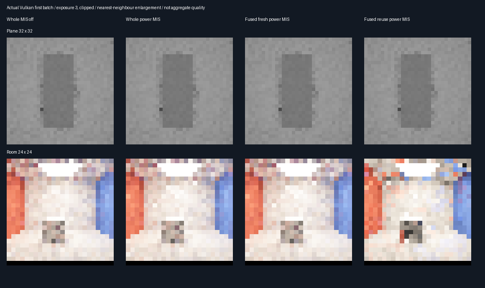

# Power MIS and shared-first-hop reuse — 2026-10-29

## Fixed experiment

This checkpoint tests the unchanged indirect reservoir under the stronger fixed beta=2 power-MIS transport
baseline. No reservoir weights, target floor, caps, bank selection or random-draw consumption are retuned.
Production is unchanged; the 348.046875 MiB output-only allocation at 1080p remains accepted and unpacked.

| Concern | Fixed choice before measurement |
|---------|---------------------------------|
| Methods | Whole power Fresh8; fused fresh D8/I8; fused D8/indirect reuse; paired whole MIS-off Fresh8 |
| MIS | Same beta=2 weights in direct NEE, indirect NEE, emitter hits and actual whole FreshBudget evaluator |
| Fusion | Invocation-local eight-record first-hit cache, exact current-seed matches only |
| Equivalence | 36 paired fused/unfused frames: two fixtures × one/four bounces × nine steps |
| Seeds | MT19937-64 `0x94cde17b + condition * 0x1000193` |
| CPU seeds | `0x1c57ea39 + condition * 0x1000193 + pixel * 0x9e3779b97f4a7c15` |
| Quality | 32 paired batches; eight warm frames per batch for reuse; four bounces, environment .025 |
| Reference | Independent double CPU: 4096 paths per measured plane point, 2048 per room point |
| Geometry | Plane 32×32 with camera offset .03125; diffuse room 24×24; same masks as earlier checkpoints |
| Correctness | Same-seed D+I identity, exact fusion/history parity, direct independence, source-off black |
| Mean gate | All method means within four combined nominal SE + .001 of reference |
| Quality gate | Reuse−whole-power MSE + three nominal SE < 0 in both fixtures |
| Cost | Actual nearest/shadow counters, with warm-up work separate; no physical-GPU timing claim |

The earlier [whole-only experiment](ReplayMISPower.md) found a supported plane improvement for power MIS but
uncertain room gains. This experiment does not assume power is universally optimal or alter those conclusions.
The whole control's actual FreshBudget evaluator must be power-weighted, not merely its unused Generate shader.
An active-output assertion and matched fresh decomposition guard the wiring; disabled control is paired by seed.

Reproduce sequentially: `bash Exhibits/LightCompute/RunReplayPowerReuse.sh`, then
`SANITIZE=1 BUILD_JOBS=1 bash Exhibits/LightCompute/RunReplayPowerReuse.sh`.
Requires pinned Slang/SwiftShader, Vulkan headers and CMake as in [the first-hop checkpoint](ReplayFirstHopMIS.md).
Base GitHub checkpoint: `4d39616`, plus this phase's working changes; each run records source/artifact hashes.

The measured configuration is rejected below. No production promotion or speedup is claimed.

## Reproduced rejection — no promotion

| Scene | Whole power RMSE | Fused fresh RMSE | Reuse RMSE | Reuse RMSE change | Reuse query change |
|-------|-----------------:|----------------:|-----------:|------------------:|-------------------:|
| Plane | 0.009649390 | 0.009649390 | 0.009762599 | +1.17% | +37.05% |
| Room | 0.138391983 | 0.138391982 | 0.243149047 | +75.70% | +15.07% |

| Scene | Whole/fresh queries each | Reuse queries | Reuse−whole MSE ± nominal SE | Quality gate |
|-------|-------------------------:|--------------:|-----------------------------:|--------------|
| Plane | 558,508 | 765,435 | +0.00000219761 ± 0.00000019328 | Rejected |
| Room | 778,840 | 896,229 | +0.03996912 ± 0.01185851 | Rejected |

These are final submissions summed over 32 batches; reuse additionally consumes 256 warm submissions per scene:
5,810,788 plane queries and 6,618,999 room queries. Extra diagnostic submissions are not charged to any measured
method: equivalence, D+I identity, direct-only isolation and source-off checks are verification work.

### Independent reference gate failure

The room's whole MIS-off control **failed** the fixed mean/reference gate:

| Quantity | Measured result |
|----------|----------------:|
| CPU reference mean | 0.539337324 ± 0.00174003904 nominal SE |
| Whole MIS-off mean | 0.526405870 ± 0.00101948708 nominal SE |
| Absolute difference | 0.012931454 |
| Allowed difference: 4 combined SE + .001 | 0.009066811 |

Seven of eight means pass, but that does not erase the failed eighth. Both release and host-sanitized benchmarks
exit **1** with
`correctness=0, promote=0`. Seeds, sample counts and thresholds were not changed after observing this result.
The room MIS-off RMSE is 0.132830909, but it cannot be accepted on lower observed RMSE while its mean gate fails.
A failed finite-sample nominal-SE gate is not alone a diagnosis of estimator bias; rare-path variance, reference
uncertainty and estimator mismatch need separate investigation. Current comparisons are descriptive rejection
evidence, not an accepted quality comparison suitable for production decisions.

### Structural checks that passed

- All five CTests and bounded-measure arithmetic validation passed in both host configurations.
- 36 fused/unfused paired frames: RGB, nine history slabs and primary diagnostics byte-exact;
  49,664 closest queries saved, unchanged sampling/shadow counters.
- Same-seed D+I identity: maximum error 1.49e-8 plane, 4.77e-7 room; one-bounce indirect exactly zero.
- Whole and fused fresh actual query counts match exactly, with rounding-only image differences.
- Current direct output and persisted indirect history are unchanged by the direct-only resolve diagnostic.
- Both source-off resets are black; actual whole MIS output differs from its disabled control.

[Release log](Results/ReplayPowerReuse-release.txt) · [Sanitizer log](Results/ReplayPowerReuse-sanitized.txt).
Both reproduced the same failed mean gate, with no ASan/UBSan diagnostic observed. The external driver/shaders
are not sanitizer-instrumented. This is **not** a passing full numerical validation.

The [rejection-evidence audit](Results/ReplayPowerReuse-parity.txt) passed: 44 identical semantic rows,
64 logged hashes checked per build, ten exact RGB captures, four source rederivations per build, and exact work
component sums. It explicitly requires the failed room MIS-off gate and correctness=0/promote=0; audit success
means the rejection is reproducible, not that the estimator passed acceptance.

## Actual captures

The eight method images show the first batch only, exposure 3 and clipped; measured metrics use unclamped red
radiance over 32 batches. Two additional mask captures identify measured diffuse points. No interpolation or
synthetic image generation is used. CPU references and random streams differ from earlier checkpoints: compare
paired methods within this experiment, not absolute RMSE across reports.

## Decision and next blocker

Keep invocation-local hit reuse as an equivalence-verified optimization candidate, not a claimed GPU speedup.
Reject the tested seed-reservoir reuse configuration; the stronger transport baseline does not rescue it.
Before further quality promotion, audit convergence and sampling agreement of the room's MIS-off/CPU controls
with independent, lower-variance reference evidence. Do not tune reservoir weights to mask this failed control.
Physical-GPU timing, Windows/editor integration, rough/textured/full-scene GI and memory packing remain untested
or deferred. No production shader, setting or persistent storage layout changed in this phase.
