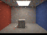
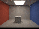
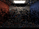

# Bounded temporal reconstruction for replayed GI

This adds an **opt-in**, GPU-executed colour-history stage after Engine replay resolve. It accumulates the
combined indirect diffuse and rough-opaque specular contribution produced by the existing software triangle-BVH
path. It is not a general reflection denoiser, hardware RT, a unified material system, or an editor viewport.
The existing reservoir temporal/spatial reuse and the new radiance history are different histories.

## Algorithm and safety boundary

`PathReplayReconstruction.slang` gathers the old colour and guides **before** replay resolve overwrites the
previous receiver guides; a second dispatch blends the current resolved colour and stores the next history.
The Engine Vulkan recorder inserts the required compute dependencies, including the gather-read → resolve-write
ordering. For a stable pixel, the first 16 frames are a running average. Thereafter the history length stays at
16 and the result is an exponential moving average with weight `1/16` for the new frame. This is not a sliding
16-frame window and does not make correlated reservoir samples independent.

A history is reused only when a positive surface token, motion coordinates, capped position radius, normal,
albedo/IOR, roughness/metallic/specular level, material identity, view and emission agree, and the old colour
and length are valid. Background and out-of-bounds pixels start fresh. The validation host also resets **all
colour history** by default on any tracked scene, camera, emitter, material or integrator-domain change, when
reconstruction is re-enabled, or when temporal/spatial reservoir policy changes. A separate, default-off
[strict diffuse camera mode](ReplayCameraReprojection.md) can retain colour at exactly matching static points
through a certified camera-only transition; it excludes rough and textured materials. The replay reservoirs can
still retain their existing cap-one history in these cases. Neither mode is a solution for arbitrary deforming
geometry, dynamic disocclusions, reflections of moving objects or visibility changes that a caller fails to report.
It may flicker as dynamic scenes reset and can lag rare bright samples even in a static scene. No general
unbiasedness or temporal-stability claim follows from these checks.

## Vulkan contract

Set `PathReplayReconstruct` in `LightComputeFootprint::Primary[3]`, supply `GatherReconstruction` and
`FinalizeReconstruction` pipelines compiled from the corresponding entry points, and provide at least
`PathReplayRequiredReconstructedOutputRecords(N)` float4 output records and
`PathReplayReconstructionCounterWords` uint counters. The recorder checks these sizes and the shader's uint
index limit. Counter 23 counts accepted colour histories. If reconstruction is first enabled, resized, switched
to a different history allocation, or any relevant input/reuse policy changes, set
`PathReplayResetReconstruction`; reset it only when a genuinely compatible previous result is available. The
[strict diffuse camera exception](ReplayCameraReprojection.md) has additional explicit requirements.
`PathReplayHistoryDomain::Resolve().Changed` provides a conservative bounded input-revision signal, but the
application must also track history allocation/enablement, sampling policy, changes external to that domain and
successful submission. A falsely unchanged revision can produce ghosting.

Keep all input/output resources and the persistent colour/guide slots alive. The caller still owns the input
and final-consumer barriers, cross-frame dependencies, queue ownership, descriptors, resource allocation,
submissions and fences. In particular, recordings that reuse these history slots must not execute concurrently.
The recorder neither validates GPU buffer contents nor allocates or clears histories. The longer
[recorder contract](PathReplayEngine.md) applies as well.

## Numerical checks

A `32 × 32` scene uses one-bounce replay, an emissive rectangle and an intervening half-plane blocker. The
reference integrates the unblocked emitter over area on a `512 × 512` grid; `256 × 256` agrees within `1e-5`.
The rough case uses an independently evaluated C++ GGX BRDF and `0.7` metallic receiver, but the mathematical
BRDF model is shared with the shader: this is not an independent measurement of real materials. Twenty paired
frames use identical seeds with and without reconstruction. Per-pixel results match a separate host recurrence
exactly in this fixture, including the frame-16 cap.

| Receiver | Reference RGB | Last fresh RGB RMSE | Reconstructed RGB RMSE | Ratio |
|---|---|---:|---:|---:|
| Diffuse | `0.119909, 0.119909, 0.119909` | `0.319339` | `0.0718366` | `0.225` |
| Rough opaque/specular | `0.220600, 0.0928487, 0.0346976` | `0.374009` | `0.0840051` | `0.225` |

These numbers are for one small static scene and different temporal costs; they are not equal-time speedups.
Independent noisy samples and a known reference make this a reconstruction test, not proof of fidelity in
moving or production scenes. With temporal **and** spatial reservoir reuse enabled, eight paired frames match
an independently accumulated raw output within `2.99e-8` and exercise 1,024 reservoir accepts, 3,968 spatial
links and 1,024 colour accepts in the final frame. A separate 32×32 **single-stratum textured rough-opaque**
primary fixture accepts 293 textured histories, matches a host recurrence within `5.97e-8`, and resets exactly
to fresh on an atlas edit. These tests check composition, not independent PRNG streams or a unified PBR material
pipeline.

Eleven deliberately corrupted histories (token, position, normal, material/optics/view/emission, non-finite
colour, and invalid length) are individually rejected; 1,013 unaffected histories remain accepted. An
out-of-bounds reprojected pixel, an extreme finite coordinate and a background pixel remain fresh in a later
regression; the same three also reject temporal reservoir reuse. Turning reconstruction off/on or changing
reuse policy resets colour. Blocker insertion, material changes and source-off revisions start from a non-dark
history; their first reconstructed output matches fresh exactly, and the source-off image is black. A `0.07`
camera shift retains 921 capped reservoir histories but accepts **zero**
colour histories; its first result also matches the un-reconstructed replay output with the same reservoir
history. Here “fresh” refers to colour reconstruction, not necessarily a fresh reservoir. These are controlled
negative tests, not proof of general disocclusion handling.

## Diagnostic room readbacks

These are direct `80 × 60` SwiftShader CPU-Vulkan readbacks, displayed with exposure `0.45`, exponential tone
mapping and gamma `2.2`. The same two-bounce rough-opaque room, seeds and temporal/spatial reservoir settings
are used on both sides. The right image contains 12 colour-history updates; the left is its last unaccumulated
submission. No separate spatial blur was applied. These are small diagnostic images, not photorealism, physical
GPU, or equal-cost performance evidence.

| Fresh | Temporal colour history |
|---|---|
|  |  |

The first frame after inserting the blocker resets all colour history and is intentionally noisy; it is
bit-identical to the un-reconstructed output for the same seed and reservoir history:



At the final stable frame 4,560 colour histories and 17,966 spatial reservoir links were accepted. Release and
ASan/UBSan-host captures produced byte-identical PNGs; the driver and shaders were not instrumented. With the
new pipelines present but reconstruction **disabled**, all 14 existing moving-radiant readbacks matched the
pre-recorder baseline byte-for-byte.

## Reproduce

Requires the prepared Slang/SwiftShader tools, Vulkan headers and CMake; Pillow is additionally needed for
captures. The ASan/UBSan configuration instruments the host only, not SwiftShader or the shader.

```sh
CAPTURE=1 bash Exhibits/LightCompute/RunReplayReconstruction.sh
CAPTURE=1 SANITIZE=1 BUILD_JOBS=1 bash Exhibits/LightCompute/RunReplayReconstruction.sh
# Optional default-off moving-scene regression after the release build:
export VK_ICD_FILENAMES="$PWD/ExternalPackages/VulkanCompute/SwiftShader/vk_swiftshader_icd.json"
OUT="$PWD/_ClaudeScratch/replay-default-check"
mkdir -p "$OUT"
_ClaudeScratch/build/replay-reconstruction-release/LightComputeValidation \
  "$PWD/ExternalPackages/VulkanCompute/SwiftShader/libvulkan.so.1" \
  "$PWD/_ClaudeScratch/build/replay-reconstruction-release" --capture-replay-mixture-motion "$OUT"
# Compare each PPM's decoded RGB to the matching committed ReplayRadiantMotion*.png.
```

[Release results](Results/ReplayReconstruction-release.txt) ·
[Sanitized host results](Results/ReplayReconstruction-sanitized.txt) ·
[Default-off regression](Results/ReplayReconstruction-default-regression.txt) ·
[Existing moving-light captures](ReplayFacetMixtureMotionCaptures.md).
