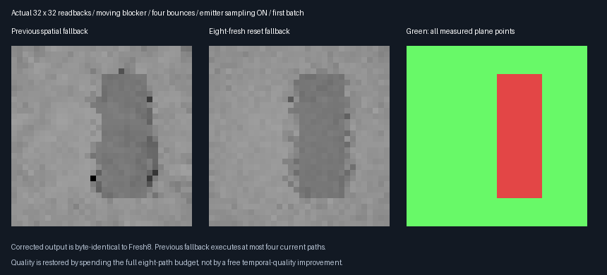
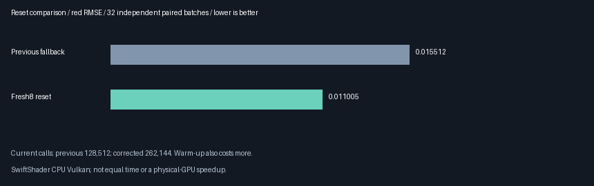

# Fresh-budget reset fallback — 2026-10-28

**Implemented the missing full-budget reset fallback in the isolated prototype.** Reset output is byte-identical
to Fresh8, and observed reset red RMSE is **29.05% lower** than the prior reduced-budget fallback. This spends
more paths, not a free temporal-quality or speed gain. **225 non-reset continuations remain byte-identical.**
Production defaults and the accepted **348.046875 MiB output-only 1080p extrapolation** stay unchanged.

## Fixed implementation and experiment

| Concern | Decision |
|---------|----------|
| Selection | Seed-RIS mode plus the existing request's reset-sample-history bit; no radiance predicate |
| Reset output | Arithmetic mean of eight fresh current paths, consumed once without spatial RIS |
| Persisted proposal | First uniform seed, weight 1, represented count 1; never store the RGB mean as a seed value |
| Fresh bank | Existing finalizer retains only the first unselected fresh draw |
| Non-reset code | Previous bounded cached estimator remains textually unchanged |
| Quality comparison | 32 independently seeded paired moving-blocker batches, four bounces, emitter sampling on |
| Random streams | MT19937-64 `0x416ce537`; CPU reference `0x7bea14f9 + pixel * 0x9e3779b97f4a7c15` |
| Reference | 4096 CPU paths per measured plane pixel; all visible plane pixels retained |
| Required parity | Reset output byte-identical to Fresh8; eight source/bank slabs match previous prototype |
| Continuation | All non-reset output and nine slabs byte-identical to previous prototype |
| Cost | Count current and warm-up path calls separately; no equal-time or physical-GPU speed claim |

This is an isolated validation-derived shader, not production enablement. Direct/indirect separation is not
included. No temporal weight, floor or history-length tuning is performed against the quality results.


## Actual readbacks and independent quality comparison



These are actual first-batch **32×32** readbacks, nearest-neighbour enlarged with identical display exposure.
The Fresh8 control is retained separately as `Images/ResetFresh.png`; its pixels equal `ResetFixed.png`.
Green includes **all 848 visible plane pixels**, not only points where history would have been accepted.
The whole-image Fresh8 identity also covers the blocker and newly exposed regions.



| Method | Red RMSE | Mean | Current path calls | Warm-up path calls |
|--------|----------|------|--------------------|--------------------|
| Previous reduced spatial fallback | 0.015512304 | 0.116638926 | 128512 | 1675782 |
| Fresh8 reset fallback | **0.011005205** | 0.116605155 | **262144** | **1809414** |

- 32 paired batches with new seeds, eight warm submissions per batch; four bounces and emitter sampling enabled.
- CPU reference: **3,473,408 independent paths**, mean `0.116363053`, nominal reference-mean SE `0.000162699`.
- Paired MSE change: **−0.0001195170 ± 0.0000034099** nominal batch SE. Both mean/reference gates pass.
- Current nearest-hit plus shadow queries: **275824 → 561167**. Primary visibility and all other frame costs are
  not represented by that transport-query counter; this is not a complete renderer timing measurement.
- This restores the requested eight-path budget after reset. The previous fallback used at most four current
  paths. Lower error is bought with **133632 extra current path calls**, not established at equal time.
- Initial warm-up resets also use eight fresh paths now, costing **133632 additional warm-up path calls**.
  All warm-up is shown; no history is assumed free in these independent-batch totals.

## Why the persisted source remains valid

```text
reset image = (f_now(X0) + ... + f_now(X7)) / 8
persisted source = (seed X0, weight 1, represented count 1)
pure fresh bank = existing finalizer's unselected X0
```

The current RGB mean is used once, without spatial reweighting. It is **not** claimed to equal `f_now(X0)`.
Only the first uniform seed and unit normalization survive as a selected-history proposal, so for every seed
function `g`, `E[1 * g(X0)] = integral(g dμ)`, under the existing base-seed-measure assumptions.
The seven additional samples improve the reset image but are not misrepresented as eight independent retained
history samples. No source normalization or weight is inferred from the RGB mean.

The selector uses the existing request-reset bit and seed-RIS mode. It does not inspect sampled brightness, visibility,
cache matches or reservoir winners. The existing finalizer still adds exactly one unselected fresh seed to the
bank. Non-reset target weights, represented-count caps, spatial omission and evaluation caching are unchanged.

## Verification

| Check | Result |
|-------|--------|
| Initial reset and moving-blocker reset | **64 full images byte-identical to Fresh8** |
| Explicit reset, emitter sampling off, source off, relight | **4 extra reset images byte-identical to Fresh8** |
| Ordinary and camera-only continuation | **225 outputs and nine slabs byte-identical to previous prototype** |
| Source/bank continuity | Eight checked slabs byte-identical on all **293 paired submissions** |
| Source off | Every corrected RGB pixel is exactly zero |
| Release and host ASan/UBSan | Both exit 0; **five CTests** pass per configuration |
| Provenance | **56 logged digests per configuration**, 11 semantic rows and four decoded captures pass audit |
| Production defaults | All five shader binaries unchanged; previous six-shader comparison also unchanged |

The eight checked source/bank slabs are `0,1,2,4,11,12,13,14`; these include persisted history plus generation/gather
scratch. On reset, only output RGB and current radiance/target slab `3` intentionally differ. Non-reset checks also
include slab `3`. Matching source/bank slabs verify that these sequences do not feed the improved reset image
back as stale RGB.

- [Release log](Results/ReplayResetBudget-release.txt), [host-sanitizer log](Results/ReplayResetBudget-sanitized.txt),
  [source/shader/capture audit](Results/ReplayResetBudget-parity.txt).
- Fail-closed authoring reproduces the derived shader exactly. Only prototype Generate/Resolve differ from the
  preceding shader set; shared production source, output layout, gather and finalizer remain unchanged.
- Adding this exhibit CLI makes earlier main-C++ source digests historical checkpoint snapshots. Earlier numerical
  logs remain retained; they are not silently relabeled as current executable hashes.
- ASan/UBSan instrument host code only. SwiftShader is CPU Vulkan; driver/shaders are not sanitizer-instrumented.
  No physical-GPU frame-time, Windows/editor, rough/specular/textured-domain or complete game-GI claim is made.

## Decision and remaining rendering work

**Retain this verified reset correction in the prototype.** It closes the demonstrated reset-budget deficit,
not the emitter-enabled steady-state temporal quality gap: non-reset results are deliberately unchanged.
Do not promote whole-path selected-temporal RIS on the strength of this reset-only improvement.

Next implement fresh direct lighting separated from **indirect-only** reservoir proposals, with explicit shadow-
query accounting and new independent quality tests. That split is not completed in this phase. Physical-GPU
quality at matched frame time remains a later acceptance gate; further output packing stays deferred.

## Reproduce

From the repository root, with pinned tools prepared:

```bash
bash Exhibits/LightCompute/RunReplayResetBudget.sh
SANITIZE=1 BUILD_JOBS=1 bash Exhibits/LightCompute/RunReplayResetBudget.sh
_ClaudeScratch/venv/bin/python Exhibits/LightCompute/Code/ReplayResetBudgetImages.py \
  _ClaudeScratch/replay-reset-budget-capture-release \
  Exhibits/LightCompute/Results/ReplayResetBudget-release.txt Exhibits/LightCompute/Images
_ClaudeScratch/venv/bin/python Exhibits/LightCompute/Code/ReplayResetBudgetParity.py
```

Raw captures, binaries and generated shaders stay ignored. Four PNG readbacks, two figures, result logs and
source/shader audit digests are retained. The host-sanitizer CPU reference can be slower than release.


### Subsequent checkpoint

The [direct/indirect split](ReplayIndirectSplit.md) implements the next isolated estimator and adds a CLI include.
This checkpoint's earlier main-C++ source hashes remain historical; its numerical/reset-parity evidence is retained.
The newer prototype still uses the verified fresh-budget reset principle, now on separated components.
