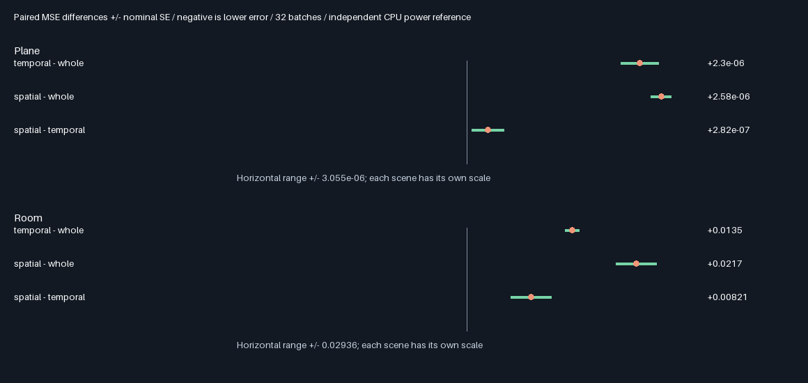
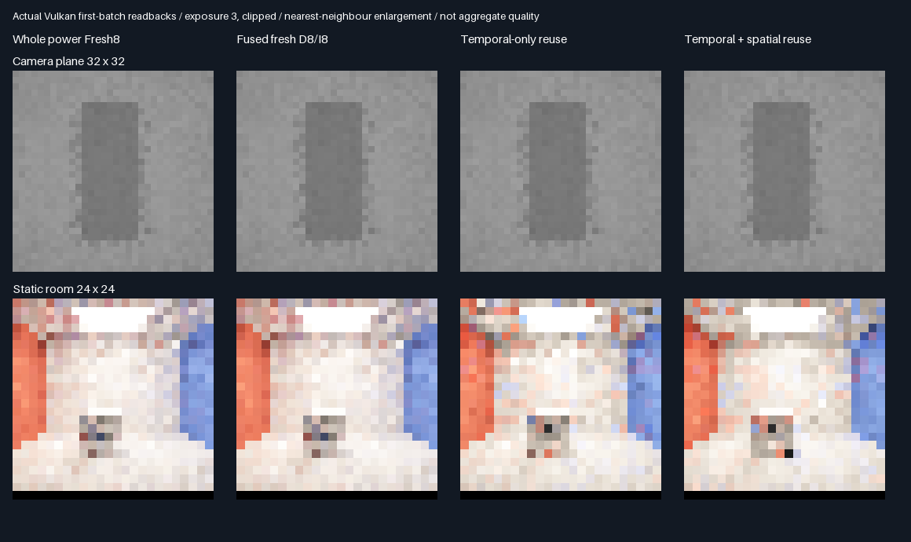

# Temporal / spatial reuse ablation — 2026-10-29

## Fixed experiment

This isolates temporal seed-bank/reservoir reuse from spatial receiver links under the same fixed power-MIS
transport. No weights, target floor, proposal bank, sample selection or random draws are retuned. The earlier
rejection is preserved. The independent double power reference checked by the
[convergence diagnostic](ReplayRoomConvergence.md) is used for this new experiment, not substituted into the old result.

| Concern | Choice fixed before measurement |
|---------|---------------------------------|
| Methods | Whole power Fresh8; fused fresh D8/I8; temporal-only D8/reuse; temporal+spatial D8/reuse |
| Fixtures | Plane 32×32, camera offset .03125 at measurement; static diffuse room 24×24 |
| Batches | 32 paired batches, eight warm submissions per reuse method per batch, four bounces |
| Temporal-only | Spatial disabled during both warm-up and measurement; temporal bank/reservoir remains enabled |
| Spatial | Same seeds/settings, spatial enabled during warm-up and measurement |
| GPU seeds | MT19937-64 `0x62be3197 + condition * 0x1000193` |
| CPU reference | Independent double uniform-area/BSDF power MIS, 4096 paths/plane point, 2048/room point |
| CPU seeds | `0x39a6fc21 + condition * 0x1000193 + pixel * 0x9e3779b97f4a7c15` |
| Settings | Environment .025, target floor .01, original caps, uniform facet proposals, no history hit caching |
| Structural checks | Cold spatial toggle: exact RGB/nine slabs; fresh/whole rounding parity and exact query budget |
| Feature checks | Temporal acceptance >0 in both reuse methods; spatial links=0 in temporal-only and >0 in spatial |
| Mean gate | Each method within four combined nominal SE + .001 of independent reference |
| Quality gate | Paired MSE difference + three nominal SE <0, for each reuse method vs whole in both scenes |
| Additional contrast | Spatial−temporal paired MSE, nominal uncertainty and separately counted query work |
| Promotion | None in this diagnostic; new holdouts/runtime evidence would still be required |

Each batch resets the two reuse submissions at warm step zero. History therefore cannot leak between paired
batches. Warm work is separate from final work, and the two submissions keep separate histories throughout.
Same current seeds do not force identical indirect proposals after the histories diverge; that is the feature
being isolated. No outlier clipping, seed rejection or sample-set filtering is applied.

Reproduce release then host sanitizers sequentially:
`bash Exhibits/LightCompute/RunReplayReuseAblation.sh` and
`SANITIZE=1 BUILD_JOBS=1 bash Exhibits/LightCompute/RunReplayReuseAblation.sh`.
Uses pinned Slang/SwiftShader and Vulkan headers from the previous checkpoints. This host used CMake 3.31.6;
the latest CMake wheel failed its registry checksum during tool recovery and was not installed or trusted.
Base source `ceebd8a`, plus the retained convergence diagnostic and this phase's working changes; logged hashes
identify tested content. No production/default/layout changes. Output remains 348.046875 MiB at 1080p, output-only.
No physical-GPU, Windows/editor, rough/textured/full-scene GI or memory-packing acceptance.

## Verified result: neither reuse arm passes quality

| Scene | Whole Fresh8 RMSE | Temporal-only RMSE | Temporal+spatial RMSE | Temporal / spatial RMSE change |
|-------|------------------:|-------------------:|---------------------:|-------------------------------:|
| Plane | 0.008546880 | 0.008680486 | 0.008696690 | +1.56% / +1.75% |
| Room | 0.135722821 | 0.178537105 | 0.200223478 | +31.55% / +47.52% |

Fused fresh matches whole RMSE to rounding. All eight mean/reference gates pass. Independent CPU reference means
are 0.107912792 ± 0.0000117004 nominal SE for the plane and 0.536548218 ± 0.000376440 for the room.
These are different fixed streams and references from earlier experiments; cross-report RMSE is not comparable.

| Scene | Contrast | Paired MSE difference ± nominal SE |
|-------|----------|----------------------------------:|
| Plane | Temporal − whole | +0.00000230168 ± 0.00000025124 |
| Plane | Spatial − whole | +0.00000258326 ± 0.00000013853 |
| Plane | Spatial − temporal | +0.00000028158 ± 0.00000021470 |
| Room | Temporal − whole | +0.013454814 ± 0.000880075 |
| Room | Spatial − whole | +0.021668757 ± 0.002563935 |
| Room | Spatial − temporal | +0.008213943 ± 0.002597753 |

Negative differences would favor the method on the left. Nominal SE is conditional on the finite CPU reference,
not a guaranteed confidence interval. Panels have separate horizontal scales. The small plane difference between
reuse arms is uncertain; do not attribute the plane failure specifically to spatial links. Temporal-only already
regresses against whole Fresh8 in both scenes. Spatial addition has a larger observed room penalty.

## Work and feature isolation

| Scene | Whole/fresh queries each | Temporal-only queries | Temporal change | Spatial queries | Spatial change |
|-------|-------------------------:|----------------------:|----------------:|----------------:|---------------:|
| Plane | 558,195 | 651,610 | +16.74% | 764,778 | +37.01% |
| Room | 779,151 | 621,062 | −20.29% | 896,201 | +15.02% |

These are final submissions summed over 32 batches, not physical-GPU frame times. Room temporal-only is a
**cost/quality tradeoff**, not a free improvement: fewer queries but 31.55% higher RMSE. It needs an equal-query
fresh-sampling control before calling it efficient. Shader arithmetic, register pressure and real GPU timing are
unmeasured. This experiment does not establish dominance at matched wall-clock budgets.

| Warm work, 256 submissions each | Temporal-only queries | Spatial queries |
|---------------------------------|----------------------:|----------------:|
| Plane | 5,004,803 | 5,802,699 |
| Room | 4,717,993 | 6,616,288 |

- Temporal-only uses exactly zero spatial links during warm-up and measurement.
- Both arms accept temporal sources: plane 31,040 / room 17,664 in final submissions per arm.
- Spatial uses 95,744 plane links / 51,104 room links in final submissions; warm links are separately logged.
- Cold spatial-on/off outputs and all nine history slabs are byte-identical in both fixtures.
- Whole/fused fresh query counts are identical; maximum RGB rounding differences are 2.98e-8 / 4.77e-7.
- Cold-equivalence checks add two diagnostic submissions per scene, excluded from measured work.

## Actual first-batch captures

Exposure 3 and clipping are display-only. Metrics use unclamped red-channel readbacks over all paired batches.
No sample, outlier or seed is rejected; no generated illustrations are used as rendering evidence.

## Decision and next discriminating control

Release and host ASan/UBSan both exit zero with correctness=1, temporal_quality=0, spatial_quality=0, promote=0.
Five CTests pass in each build; no host sanitizer diagnostic observed. External driver and shaders are not
sanitizer-instrumented. [Release log](Results/ReplayReuseAblation-release.txt) ·
[Sanitizer log](Results/ReplayReuseAblation-sanitized.txt) · [Audit](Results/ReplayReuseAblation-parity.txt).
The evidence audit passes 33 identical semantic rows, 66 logged artifact hashes per build, eight byte-identical
captures/retained PNG pixels, exact feature isolation and nearest/shadow work sums.

Disabling spatial links does not rescue the seed-reservoir estimator. Do not retune its weights based on these
results. Two candidate mechanisms remain unisolated: temporal proposal/resampling variance and the loss of current-seed
correlation between direct and indirect terms. A fresh independent-indirect-seed control would distinguish that
correlation cost from reuse selection. Room temporal-only also needs an equal-query fresh baseline to assess its
cost/quality tradeoff. Neither causal mechanism is proven by the present ablation alone.
Production remains unchanged and existing failed results remain preserved. No Windows/editor, material-general,
physical-GPU timing or production-promotion acceptance is claimed.
