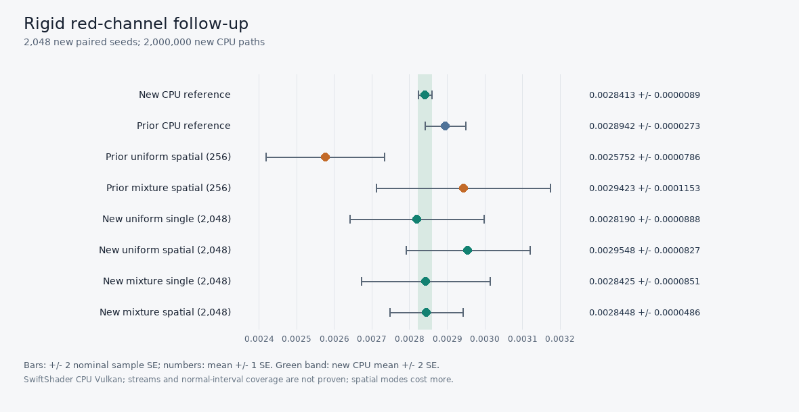

# Rigid-channel disjoint-seed investigation

The [256-batch motion repeat](ReplayFacetMixtureMotionRepeat.md) found a fresh uniform rigid-red
estimate `3.84` nominal combined standard errors below its separately seeded CPU reference, despite
passing the existing broad tolerance. This focused follow-up separates two possible effects: the
emitter proposal and spatial reservoir reuse. It changes no Engine code.



## Method and status

At the same moved textured receiver `(28, 38)` and `64 × 64` primary resolution, four fresh estimators
share each frame seed: uniform and uniform/power mixture proposals, each with spatial reuse off and
on. All use the same rough GGX paths, balanced MIS, four-hit budget and scene. The spatial variants
use the centre plus four orthogonal candidates; the single-receiver variants do not use spatial donors.
The CPU reference is a separately implemented four-hit tracer with four separately seeded groups.

The full run uses **2,048 distinct frame seeds** in eight groups and **2,000,000 CPU paths**. It excludes
the original 96 motion seeds and the previous 256 frame seeds, including their submission offsets. Seed
labels being distinct does not prove statistically independent streams. Both the release and
ASan/UBSan-host runs exited zero; their 2,048-row sample tables are byte-identical. The driver/compiler
and shader execution are not sanitizer-instrumented. All 12 RGB comparisons pass the pre-existing broad
six-SE-plus-allowances check; the largest new absolute nominal combined-SE difference is `1.36`.

For speed, the normal full primary-ray shader runs first, then an exhibit-only dispatch marks all but
the five spatial candidates as misses. The `64 × 64` projection and selected pixel are unchanged. For
eight seeds and all four modes, the complete and restricted submissions produce bit-identical selected
RGBA outputs (**128 components**) and bit-identical five-receiver guides (**5,760 components**). The
restricted spatial run confirms eight directed links among the retained receivers. This is a finite
parity check, not a universal proof or a production submission path.

## New red estimates

All `±` values are sample standard errors, not guaranteed confidence intervals. The CPU tracer uses a
different implementation, but its groups are pseudorandom rather than proven independent streams.

| Mode | Fresh rigid red | Nominal combined SE from new CPU |
|---|---:|---:|
| CPU, 2,000,000 paths | `0.00284127 ± 0.00000894` | — |
| Uniform, single receiver | `0.00281897 ± 0.00008878` | `−0.25` |
| Uniform, spatial | `0.00295479 ± 0.00008274` | `+1.36` |
| Mixture, single receiver | `0.00284246 ± 0.00008510` | `+0.01` |
| Mixture, spatial | `0.00284483 ± 0.00004856` | `+0.07` |

The four new CPU group means are `0.00284090 / 0.00283947 / 0.00284853 / 0.00283618`, each from
500,000 paths. The prior 240,000-path CPU estimate was `0.00289420 ± 0.00002728`, about `1.84`
nominal combined SE above the new CPU estimate. The earlier uniform spatial estimate remains `3.36`
nominal combined SE below the new CPU result; the new and old uniform estimates differ by `3.33`
nominal combined SE. The new study does **not reproduce a low mean**, but neither proves the old
observation was harmless nor identifies a defect.

The paired new red differences are `+0.00013582 ± 0.00011143` for uniform spatial minus uniform
single, and `−0.00010996 ± 0.00009535` for mixture spatial minus uniform spatial. The complete RGB,
eight group means, sample SEs and paired differences are in the logs and independent analysis below.

## Tail sensitivity and noise regression

The prior rigid-red mixture/uniform spatial SD ratio was `1.468` with nominal paired-bootstrap 95%
interval `1.112–1.943`. The new **untrimmed** ratio reverses to `0.587` with nominal interval
`0.423–0.879`; individual new 256-batch groups range from `0.306` to `1.203`. These opposing intervals
are a warning against treating either finite-sample bootstrap as guaranteed coverage.

Large samples materially affect the result: prior uniform spatial red peaked at `0.010835`, whereas
the new set peaked at `0.092756`. The largest rounded-up 1% of the new uniform samples contribute
`10.4%` of their total radiance (prior: `3.9%`). As an influence diagnostic **only**, removing the largest
one or three uniform sample pairs changes the new SD ratio to `0.692` or `0.829`, respectively; no
samples are removed from the primary results or pass checks. The estimates and their nominal intervals
are sensitive to tails, and more samples do not guarantee a monotonically smaller measured SE. These
observations motivate tracing rare paths and checking pseudorandom dependence rather than claiming a
universal variance win, a demonstrated bias, or a cause for the earlier discrepancy. A later
[rare-sample audit](ReplayRigidTailAudit.md) finds high replayed path values, rather than large final
reservoir scales, in the three largest uniform observations. A later mirrored bounce breakdown locates
large contributions at zero-based bounce 2 on the same bright emissive triangle; because it shares shader
helpers it does not independently validate those paths, PDFs/MIS, or PRNG behavior. Spatial modes also
perform more work, so the ratios are not equal-cost speedups.

[Full release log](Results/ReplayRigidVarianceRepeat-release.txt) ·
[full sanitized-host log](Results/ReplayRigidVarianceRepeat-sanitized.txt) ·
[2,048 paired samples](Results/ReplayRigidVarianceRepeatSamples.csv) ·
[independent CSV analysis](Results/ReplayRigidVarianceRepeat-analysis.txt) ·
[SVG chart](Images/ReplayRigidVarianceRepeat.svg).
The smaller [release smoke](Results/ReplayRigidVarianceRepeatSmoke-release.txt),
[sanitized smoke](Results/ReplayRigidVarianceRepeatSmoke-sanitized.txt) and
[smoke samples](Results/ReplayRigidVarianceRepeatSmokeSamples.csv) are retained separately. The smoke
sequence is the first 16 of the preconfigured full sequence, and is not a convergence result.

## Failed primary-wrapper attempt

An earlier audit-only [wrapper](Code/ReplayRigidProbePrimary.slang) tried to invoke the shared primary
entry only for the five receivers. Its Slang compilation succeeded, but SwiftShader crashed during
`vkCreateComputePipelines` in its SPIR-V optimization path; the release process exited `139` and the
sanitized process exited `1` with an external-driver stack trace. It was not used to generate any
reported samples. The precise responsibility between the generated SPIR-V and the optimizer has not
been established. The final fixture instead uses the full primary pass and a separately tested receiver
mask. [Release failure](Results/ReplayRigidProbePrimaryAttempt-release-failed.txt) ·
[sanitized failure](Results/ReplayRigidProbePrimaryAttempt-sanitized-failed.txt).

## Reproduce

```sh
# Structural smoke: 16 paired seeds and four 10,000-path CPU groups
CHECK=--replay-rigid-variance-repeat-smoke Exhibits/LightCompute/RunReplayRigidVarianceRepeat.sh
CHECK=--replay-rigid-variance-repeat-smoke SANITIZE=1 BUILD_JOBS=1 Exhibits/LightCompute/RunReplayRigidVarianceRepeat.sh

# Full: 2,048 paired seeds and four 500,000-path CPU groups
Exhibits/LightCompute/RunReplayRigidVarianceRepeat.sh
SANITIZE=1 BUILD_JOBS=1 Exhibits/LightCompute/RunReplayRigidVarianceRepeat.sh

# Python standard library generates the SVG and statistics; PNG additionally requires Pillow
python Exhibits/LightCompute/Code/ReplayRigidVarianceAnalysis.py \
  Exhibits/LightCompute/Results/ReplayRigidVarianceRepeat-release.txt \
  Exhibits/LightCompute/Results/ReplayFacetMixtureMotionRepeat-release.txt \
  Exhibits/LightCompute/Results/ReplayRigidVarianceRepeatSamples.csv \
  Exhibits/LightCompute/Results/ReplayFacetMixtureMotionRepeatSamples.csv \
  Exhibits/LightCompute/Images/ReplayRigidVarianceRepeat.svg \
  Exhibits/LightCompute/Images/ReplayRigidVarianceRepeat.png
```

The runner reads the prior 256-row sample table to exclude its seed offsets. See
[the previous report](ReplayFacetMixtureMotionRepeat.md) for setup and wider motion/occlusion results.
This focused check cannot establish general unbiasedness, physical-GPU performance, production
integration, or complete ReSTIR GI.
