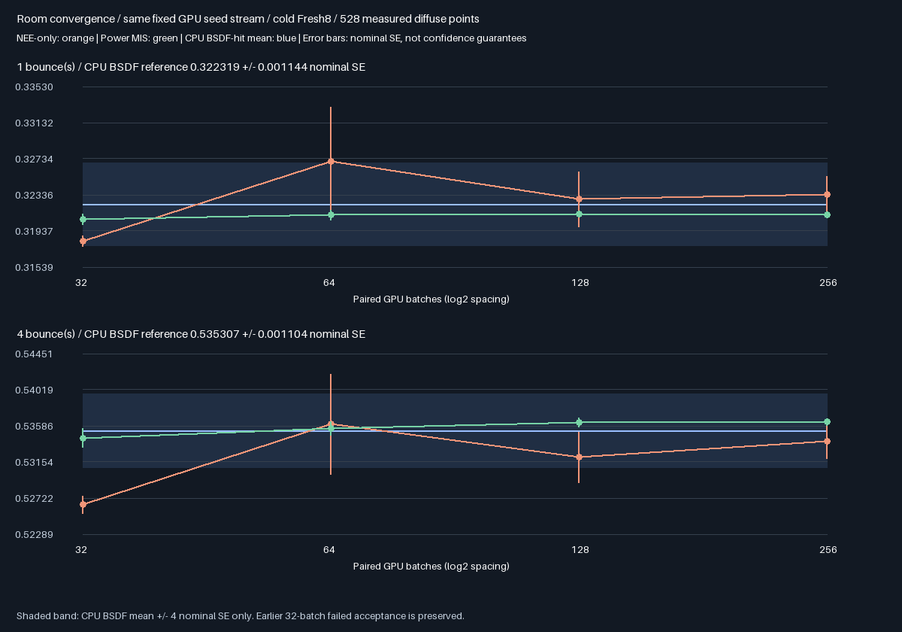
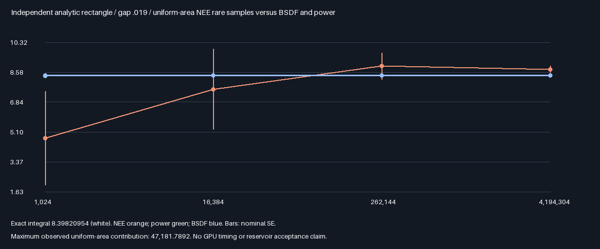

# Room control/reference convergence — 2026-10-29

## Fixed diagnostic protocol

This phase investigates the failed MIS-off mean gate from [power reuse](ReplayPowerReuse.md). It does not rerun
that acceptance decision with looser criteria. The original 32-batch rejection remains valid and preserved.
No production shader, reservoir weight, runtime default or memory layout is changed.

| Control | Fixed method / budget |
|---------|-----------------------|
| Independent reference | Existing double brute-force BSDF-hit reference, independent MT19937-64 draws |
| Independent NEE | New double brute-force triangle-area sampler, NEE only for emitter hits |
| Independent power | Same independent sampler with complementary fixed beta=2 NEE/BSDF weights |
| CPU batches | 64 independent cohorts × 64 paths per each of 528 measured points per method/depth |
| CPU total | 2,162,688 paths per method/depth; one and four bounces |
| CPU streams | `0x2ca971b5 + pixel*0x9e3779b97f4a7c15 + batch*0x1000193 + depth*0x19b5 + method*0x317f3` |
| GPU methods | Whole Fresh8 MIS off and power; cold/no history; one and four bounces |
| GPU budget | 256 paired submissions per method/depth; same query counts required |
| GPU streams | Previous room MT19937-64 stream `0x94cde17b + 0x1000193`, skipping eight warm seeds per batch |
| Seed purpose | First 32 four-bounce submissions reproduce previous measured seeds; extend the same stream |
| Prefixes | GPU means/nominal SE at 32/64/128/256 batches, every cohort mean retained |
| Tail evidence | CPU maximum path radiance and contribution from red samples >32; GPU maximum pixel mean |
| Agreement | CPU techniques vs original BSDF reference, GPU vs matching CPU technique: 4 combined SE + .001 |
| Promotion | Always zero; diagnostic only, no reservoir quality acceptance or GPU timing claim |

The CPU NEE implementation reuses vector types but independently computes double Möller–Trumbore intersections,
source proposals and visibility, without GPU RNG, packed BVH or shader extraction. The fixed opaque diffuse
room has two emissive triangles. Both implementations use the same .001 origin offsets and .025 environment.

## Near-emitter analytic control

The source lies at z=3.98, just below the ceiling at z=4. A ceiling bounce offsets to z=3.999, only about .019
from the source. This makes uniformly sampled source area a possible rare/high-contribution mechanism.
That is a hypothesis to test, not an explanation inferred merely from the failed gate.

An independent one-bounce rectangle test uses half-extents 1 and 1.6, separation .019, diffuse albedo .7 and
source radiance 12. The exact cosine-weighted rectangle integral is evaluated analytically. BSDF-hit, uniform
area NEE and power estimates use fixed 1024/16384/262144/4194304 sample prefixes, with the same final agreement
gate of 4 nominal SE + .001. No occluders or environment enter this isolated analytic control.

Reproduce sequentially with `bash Exhibits/LightCompute/RunReplayRoomConvergence.sh`, then
`SANITIZE=1 BUILD_JOBS=1 bash Exhibits/LightCompute/RunReplayRoomConvergence.sh`. Tools/prerequisites are those
of the [power baseline](ReplayMISPower.md). Source baseline `ceebd8a` plus this phase's working changes.
The restored checkout initially reported Git label `68f3016` in the run logs; its branch metadata was subsequently
aligned to the existing remote `ceebd8a` without overwriting files. Only this diagnostic/docs differ from it.
Source and compiled-artifact hashes in both logs identify the tested content.
Output-only allocation remains 348.046875 MiB at 1080p; packing remains deferred. Verified findings follow.

## Verified findings: agreement, not a retrospective promotion

| Four-bounce method | Mean red radiance | Nominal SE | Observed maximum CPU path |
|--------------------|------------------:|-----------:|--------------------------:|
| CPU BSDF-hit reference | 0.535307365 | 0.001103809 | 8.400 |
| CPU independent area NEE | 0.533978418 | 0.002135955 | 3897.096 |
| CPU independent power | 0.536126104 | 0.000247413 | 12.339 |
| GPU area NEE, 256 batches | 0.534046564 | 0.002109845 | Not a per-path readback |
| GPU power, 256 batches | 0.536323265 | 0.000372294 | Not a per-path readback |

- Both depths pass all eight nontrivial CPU-technique/GPU agreement comparisons. Two additional logged CPU
  self-reference rows are identities, not independent evidence. Both host configurations: five CTests passing.
- CPU power has 4.46× lower measured nominal SE than the BSDF reference at the same path count here. It uses
  an additional sampling technique; this is a reference-precision observation, not a CPU/GPU speed claim.
- Uniform-area CPU contributions above 32 supply 0.006620254 of the four-bounce mean, about 1.24% of its total.
  The BSDF and power controls observed no contributions above 32 in these fixed streams.
- The largest GPU four-bounce area-NEE cohort is batch 57: mean 0.881044197 and maximum eight-path pixel mean
  186.311020. That event was outside the original 32 measured batches. No outliers were clipped or rejected.

| Four-bounce GPU prefix | Area-NEE mean ± nominal SE | Power mean ± nominal SE |
|------------------------|---------------------------:|------------------------:|
| 32 batches | 0.526405870 ± 0.001019487 | 0.534406410 ± 0.001099363 |
| 64 batches | 0.536042860 ± 0.005971183 | 0.535549760 ± 0.000800850 |
| 128 batches | 0.532095222 ± 0.003028934 | 0.536280558 ± 0.000537436 |
| 256 batches | 0.534046564 ± 0.002109845 | 0.536323265 ± 0.000372294 |

The 32-batch means exactly reproduce the earlier failure. After rare events appear, the NEE uncertainty estimate
**increases** despite more samples. The old reference mean 0.539337324 ± 0.001740039 is also about 1.96 combined
nominal SE above the new independent BSDF reference. Thus the prior discrepancy combines a low short NEE sample
with finite reference uncertainty; a statistically stable, systematic CPU/GPU transport mismatch is not shown.
This is consistency evidence within this fixture, not a proof of zero estimator bias or reliable Gaussian tails.

Original first-batch readbacks: [one-bounce NEE](Images/RoomConvergence1Nee.png),
[one-bounce power](Images/RoomConvergence1Power.png), [four-bounce NEE](Images/RoomConvergence4Nee.png),
[four-bounce power](Images/RoomConvergence4Power.png). These use exposure 3/clipping for display only.

The graph plots unclamped red-channel means. Error bars and the BSDF shaded band are nominal standard errors,
not guaranteed confidence intervals. Prefixes are nested and correlated, not four independent experiments.

## Independent analytic result

| 4,194,304-sample method | Mean | Nominal SE | Exact rectangle integral |
|-------------------------|-----:|-----------:|-------------------------:|
| BSDF hit | 8.39831371 | 0.00005811 | 8.39820954 |
| Uniform-area NEE | 8.75319180 | 0.18410182 | 8.39820954 |
| Power MIS | 8.39781442 | 0.00049183 | 8.39820954 |

All three final analytic controls pass the fixed gate. Area NEE observes a single contribution of 47,181.7892.
This demonstrates the high-contribution mechanism independently of GPU visibility, RNG and reservoir arithmetic.
The separation is nonzero, so this example has a finite contribution bound; no infinite-variance claim is made.
The test supports a rare-event explanation but does not trace every room outlier to this exact rectangle point.
BSDF-only has the lowest variance in this isolated rectangle; power is not a universal variance optimum.

## Verification and decision

Release and host ASan/UBSan both exit zero; no host sanitizer diagnostic observed. The external driver and shaders
are not sanitizer-instrumented. [Release log](Results/ReplayRoomConvergence-release.txt) ·
[Sanitizer log](Results/ReplayRoomConvergence-sanitized.txt) ·
[Evidence audit](Results/ReplayRoomConvergence-parity.txt).
The audit passes 1454 identical numerical rows, 29 logged hashes per build, independently rederived cohort means
and standard errors, exact historical 32-batch means and four byte-identical original readbacks.
No production correction is justified by these results. Keep the old failed acceptance result and unpromoted
reservoir configuration unchanged. The independently checked, lower-variance CPU power estimator is available
for future fixed holdouts; do not silently replace the old reference or regrade its recorded pass/fail outcome.
Physical-GPU speed, Windows/editor, other geometry/materials and full-scene GI acceptance remain untested.
