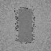
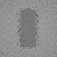
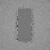

# Subpixel diffuse replay using retraced sample seeds

This **default-off** experiment keeps up to three previously generated, unselected random seeds. It retraces
those seeds at the **current** surface, then averages the resulting paths with one current fresh path. It does
not interpolate or accumulate old radiance, so a retained seed's shadow answer is recomputed in the current
triangle BVH. This is software ray tracing, not hardware RT, non-ray-traced GI, completed ReSTIR GI, an editor
viewport or general animated reconstruction. A later mode combines it with temporal/spatial reservoir reuse;
see [combined reservoir reuse](ReplaySampleCombined.md).

## Contract and cost

| Requirement | Scope |
|---|---|
| Scene | Validated, static, untextured opaque diffuse scene and primary visibility; changed geometry, lights, material, environment or sampling reset the seed bank. |
| Camera | The same `PathReplayDomainSpecification::DiffuseCameraReprojection` validation and `PathReplayHistoryDomain` camera-only decision used by [strict colour reprojection](ReplayCameraReprojection.md). The previous projection must identify the last completed frame. |
| Opt-in | `PathReplaySampleHistory`, with `PathReplayResetSampleHistory` on first use, reallocation, toggling, failed submission, incompatible revision or policy change. |
| Exclusions | No colour reconstruction, rough/textured mode or multi-candidate selection. One initial fresh candidate. In this mode temporal and spatial reservoir options are off; the combined contract is separate. |
| Recorder | Two additional pipelines, 24 counter words, and `PathReplayRequiredSampleHistoryOutputRecords(N)` float4 records. The recorder validates ranges and incompatible flags, but cannot validate GPU buffer contents or whether a submission succeeded. |
| Work | One current path plus up to three **new current-frame retraces**. The three old seeds are not free path results; the shader may trace four paths per pixel and adds buffer traffic. |

The gather accepts a previous pixel only if its surface token, bounded world-space distance and normal are
compatible, the current/motion world guides agree exactly, and every retained seed half/count is finite and
valid. It reads the old banks into scratch before resolve overwrites position/normal guides; finalize reads the
scratch and writes a shifted bank. A rejected pixel preserves the current fresh result bit-for-bit. Seeds are
stored as exact 16-bit halves, not NaN-prone float bitcasts. The radius is capped at `0.25` world units and is
scale-dependent. A matching token and position are not a general disocclusion proof.

The bank holds fresh draws, not reservoir-selected samples or previous path colours. This avoids reusing a
selection based on old radiance, but neither the seed generator nor cross-pixel/frame streams are proven
independent. Multiple pixels may trace the same donor seed. Correct caller-managed scene revisions, history
ownership, buffer barriers and reset after failed submission remain mandatory; the domain snapshot alone cannot
certify every external resource. This is not a claim of unbiasedness, an equal-time improvement, arbitrary
camera/scene support, real-time performance or physical-GPU validation.

## One-bounce subpixel check

A `32 × 32` fixture contains a diffuse plane, an opaque blocker and a two-triangle emissive rectangle. After
three stationary frames, the camera translates by half a pixel (`0.03125` world units). The current frame uses
one cosine-sampled path and no explicit facet sampling. An independent C++ rectangle-intersection oracle mirrors
the PRNG only to reconstruct each seed; it does not use the shader's BVH. Separately, a numerical emitter-area
integral provides a per-point mean reference. The comparison remains a model fixture, not measured light.

| Check | SwiftShader CPU Vulkan result |
|---|---:|
| Accepted seed banks / rejected pixels | `970 / 54` |
| Changed-token disocclusions | `22`, all rejected to fresh output |
| Accepted full three-seed banks | `970` |
| Independent per-seed oracle | `783` plane pixels agree; maximum RGB error `0`; `11` edge-ambiguous pixels excluded |
| Retained seeds whose visibility changes between donor and current point | `10`; evaluated using the **current** answer |
| Plane red RMSE vs area integral, 794 accepted points | one fresh path `0.292290`; up to four retraced paths `0.154939` |
| `128×128` vs `64×64` quadrature RMSE | `0.000290` |
| Blocker + camera change, reopening and wrong previous projection | bank reset; all results bit-identical to fresh |
| Corrupt seed-bank fields | seven rejected to fresh; `1,017` unaffected histories retained |
| Invalid requests / mode re-enable | seven rejected before submission; history sequence unchanged; re-enable resets |

The RMSE numbers are **not equal work**: the second image retraces three additional paths and uses prior frames.
Near a source edge, SwiftShader's direction approximation shifted one tested intersection by approximately
`0.00028 m` relative to host trigonometry. The individual-path oracle consequently excludes points within
`0.001 m` of a rectangle edge; the excluded count is reported above. This threshold is specific to this fixture,
not a bound on other hardware or scenes.

## Four bounces and equal current-path count

Sixteen deterministically generated batch seed sets drive the same half-pixel transition. The fixture has four diffuse bounces, a
uniform `0.025` RGB environment, no facet next-event sampling and three earlier warm-up frames. An independent
C++ tracer uses brute-force triangle intersections, `mt19937_64` and a different cosine-sampling frame. It
traces `1,024` paths at each of the `794` plane points that retained three prior seeds: `813,056` paths.
Per-point CPU RMS standard error is `0.009526`; the same finite reference is used across batches.

| Red result | CPU model | One fresh path | Four fresh paths | Four current-surface paths, three seeded from history |
|---|---:|---:|---:|---:|
| Mean ± nominal SE | `0.117593 ± 0.000338` | `0.119595 ± 0.002927` | `0.117524 ± 0.001870` | `0.117498 ± 0.001560` |
| Per-output RMSE vs CPU point means | — | `0.307596` | `0.153027` | `0.151685` |

The four-fresh control averages four separate one-candidate renders; its first current seed is paired with the
retraced mode, and its other seeds are additional draws from the batch generator. The retraced-minus-fresh
mean is `−0.000026 ± 0.002614` nominal batch SE. Both perform four current paths at these retained points,
but the retraced method also needs earlier frames and bank traffic, and the control uses four submissions.
**Equal path count is not equal time or equal total work**; this fixture does not demonstrate a speedup.
CPU and batch SEs use finite-sample corrections but remain nominal: correlations and rare tails are unresolved.
Neither implementation is observed physical radiance or proof of unbiasedness.

## Explicit facet sampling and relighting

A separate 16-batch, one-bounce check enables uniform emissive-triangle next-event sampling and compares the
same 794 points to the independent `128×128` emitter integral. The integral's red mean is `0.106269`, with
`0.000290` per-point RMSE against a `64×64` integral. Four fresh paths give mean `0.106175 ± 0.000102` and
RMSE `0.013592`; the retraced four give `0.106165 ± 0.000113` and `0.013665`. The paired difference is
`−0.000010 ± 0.000142` nominal batch SE. Turning the emitter off resets the bank and produces black; turning
it back on resets again and matches the fresh frame bit-for-bit. This checks one light geometry and one sampling
policy, not all direct-light distributions or dynamic-scene reuse.

## Diagnostic readbacks

These are direct `64×64` SwiftShader readbacks from a separate four-bounce, half-pixel translation with three
warm-up frames, explicit uniform emitter sampling, environment `0.025`, exposure `3` and the same display tone
mapping. No denoising is applied. Green marks a full three-seed bank; red marks a rejected bank. The transition
retained `3,990` banks and rejected `106` pixels, all bit-identical to the one-fresh image. Only green pixels
use four current paths in the retraced image. These small synthetic captures are diagnostics, not editor or
visual-fidelity evidence.

| One fresh path | Four fresh paths | Retraced seeds | Seed-bank acceptance |
|---|---|---|---|
|  |  |  |  |

Release and host ASan/UBSan numerical rows and decoded PNGs agree on SwiftShader CPU Vulkan; the external driver
and shader are not sanitizer-instrumented. Five CTests pass. Existing strict camera-reconstruction numerical
rows match the previous release results, and a 20-image default-mode comparison against the `b0cf5c9` replay
shader has no differing float components. These checks do not cover Windows, physical GPUs, continuous arbitrary
motion or editor integration.

## Reproduce

Requires Slang, Vulkan headers, SwiftShader, CMake and a C++20 compiler. The retained logs identify the exact
source and driver hashes.

```sh
CAPTURE=1 bash Exhibits/LightCompute/RunReplaySampleHistory.sh
SANITIZE=1 CAPTURE=1 BUILD_JOBS=1 bash Exhibits/LightCompute/RunReplaySampleHistory.sh
```

[Release](Results/ReplaySampleHistory-release.txt) · [Host ASan/UBSan](Results/ReplaySampleHistory-sanitized.txt) ·
[Existing camera regression](Results/ReplaySampleHistory-regression.txt).
