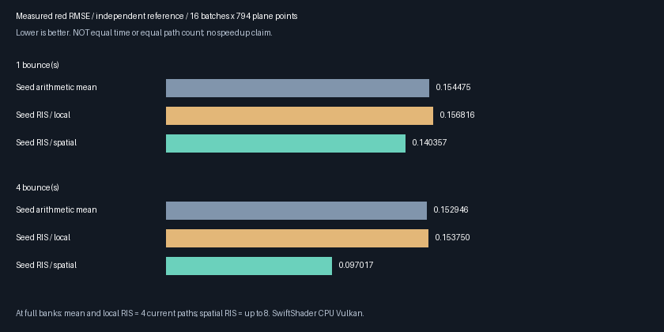
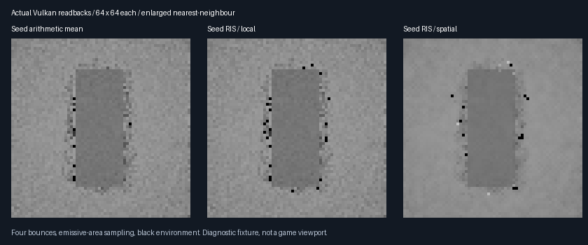

# Retained-seed reservoirs and current-surface spatial replay

Follow-on [compact storage](ReplayCompactStorage.md) now removes the legacy all-feature prefix with identical
output/history. The large memory figure below describes the preserved legacy layout, not the opt-in compact one.


**Default-off native C++/Slang continuation, not completed general ReSTIR GI.** Retained unselected seeds can
now enter local reservoir selection and then spatial replay. Prior-frame path colours are never reused.

## Mechanism and scope

| Step | Implementation |
| --- | --- |
| Validate | Shared `PathReplayVulkan.*` accepts `PathReplaySeedReservoir` only with `PathReplaySampleHistory` |
| Primary visibility | Existing triangle-BVH primary shader supplies current and motion guides |
| Gather | Read compatible old seed banks into scratch **before generation**; reject corrupt/incompatible banks |
| Generate | Trace one fresh seed plus up to three gathered seeds at the current surface; stream into local RIS |
| Resolve | Optionally replay up to four neighbouring local-reservoir seeds at the current surface |
| Finalize | Shift only fresh, unselected seed draws into the bank; never overwrite the resolved image with an average |

This is still software ray tracing, not hardware ray queries, path-vertex reconnection, non-ray-traced GI or a
production editor viewport. Current intake remains primary-visible, static, opaque, untextured diffuse geometry.
Validated camera-only motion can retain seeds. Geometry, lighting, material and sampling revisions reset them.
Selected-reservoir temporal reuse, colour reconstruction, rough/textured materials and multiple fresh candidates
remain incompatible with this mode. It is deliberately not enabled by default.

The command recorder needs the existing two seed-history pipelines, 24 counter words and the existing
`PathReplayRequiredSampleHistoryOutputRecords(N)` range. No descriptor, pipeline or allocation was added.
The caller still owns queue submission, barriers to external resources, allocation history and resets after
failed submission. The recorder cannot verify buffer contents or a successful GPU completion.

## Normalization, not just a relaxed compatibility guard

For current-surface candidate contributions `f_i`, use positive targets `t_i = luminance(f_i) + floor`.
Local RIS selects candidate `k` proportionally to `t_k` and retains:

```text
M = number of current path evaluations
W = sum_i(t_i) / (M * t_k)
output = f_k * W
```

With ideal proportional selection, the conditional expectation over this local selection equals
`sum_i(f_i)/M` for the fixed candidate set. This is not evidence of independent PRNG streams or a general
unbiased motion/reuse estimator. The implementation is finite-precision with discrete random draws.

Spatial resolution uses the existing recipient target times donor `W * M`, retraces the donor winner at the
recipient, and normalizes the merged reservoir. The donor's old radiance is not its current visibility answer.
Only pre-spatial reservoirs are persisted. The seed bank remains **unselected draws**, not reservoir winners.
Cross-pixel and cross-frame seeds can be correlated or duplicated; broad unbiasedness is not established.

## Verification results

Both final Release and host ASan/UBSan runs completed successfully on SwiftShader CPU Vulkan.
The external driver/shaders are not sanitizer-instrumented.

| Focused check | Result |
| --- | --- |
| Native CTests, Release and host sanitizer | ✔️ 5/5 in each configuration |
| Local RIS rectangle/selection oracle | ✔️ 2,445 comparisons, maximum error 0 |
| Spatial recipient oracle | ✔️ 2,425 comparisons, maximum error 0 |
| Target-floor settings | ✔️ 0.0001, 0.01, 1; no tuning to force a result |
| Changed-visibility paths | ✔️ 10 per floor setting, 30 accumulated checks evaluated at the current point |
| Corrupt seed banks | ✔️ 7 rejected to bit-exact fresh output; 1,017 unaffected banks retained |
| Mode/spatial-policy and scene revisions | ✔️ Bank resets; scene reset matches fresh output |
| Selected-reservoir temporal reuse | ✔️ Rejected without advancing submission history |
| Old default-mode regression | ✔️ 15 numerical/device/capture rows and 4 decoded PNGs match pre-change baseline |
| Final Release/sanitizer agreement | ✔️ Numerical rows and all 3 decoded captures match |

The rectangle oracle mirrors seed/selection RNGs only; it uses independent analytic intersections rather than
shader BVH code. Edge exclusions total 53 across floor/oracle checks, not 53 unique rejected pixels.
This finite fixture validates the stated arithmetic, not arbitrary scenes or general unbiasedness.

### Independent reference comparisons

16 deterministic batches, 794 retained plane points, no facet next-event sampling in these numerical rows.
One bounce uses a 128×128 area integral; four bounces use 1,024 independent CPU paths per point (813,056 total),
a different PRNG and sampling frame, and brute-force triangle intersections. The finite four-bounce reference
has mean red `0.117593032 ± 0.000338078` nominal SE. One-bounce mean reference is `0.106268904`.

| Mode | 1-bounce red RMSE | 4-bounce red RMSE | Current paths at full banks |
| --- | ---: | ---: | ---: |
| Retained-seed arithmetic mean | 0.154475 | 0.152946 | 4 |
| Retained-seed RIS, local only | 0.156816 | 0.153750 | 4 |
| Retained-seed RIS + spatial | 0.140357 | 0.097017 | Up to 8 |

Spatial RMSE is 9.14% / 36.57% lower than the four-path seed-average fixture, **with additional tracing**.
Local RIS alone is slightly worse. These are not equal-work, eight-fresh-path, equal-time or speed comparisons.
Do not infer a general quality advantage over spending the same game budget on fresh paths.

Four-bounce means ± nominal batch SE: arithmetic `0.117886441 ± 0.001261805`, local RIS
`0.117493815 ± 0.001255254`, spatial `0.117688907 ± 0.001331441`. All pass the matched-reference mean gate.
Finite CPU noise, correlated streams and unresolved rare tails limit these standard-error interpretations.



[Release](Results/ReplaySeedReservoir-release.txt) ·
[Host sanitizer](Results/ReplaySeedReservoir-sanitized.txt) ·
[Final hash/image parity](Results/ReplaySeedReservoir-parity.txt) ·
[Default regression](Results/ReplayContinuation-regression.txt) ·
[Default baseline parity](Results/ReplayContinuation-parity.txt).

## Actual readbacks



Captures are synthetic 64×64 diagnostics,
not a game viewport or final visual-quality acceptance. Each image uses four bounces, explicit facet sampling,
black environment, three warm-up frames, a half-pixel translation, exposure 3 and identical display mapping.
The multibounce numerical reference uses environment RGB 0.025 instead; it is a separate experiment.
Spatial output is smoother in this capture but visible dark outliers remain; no denoising is applied.

## Game cost and remaining work

| Concern | Current boundary |
| --- | --- |
| Current paths at full banks | Arithmetic mean and local RIS: 4; spatial RIS: up to 8 |
| Prior work | All seed-bank modes also require warm-up history and buffer traffic |
| Timings | No physical-GPU timing, equal-time or speedup claim |
| Memory | Existing general exhibit output footprint is `640*N + 246800` bytes, before inputs and other buffers |
| 1080p example | That output range alone is about 1.24 GiB; not an acceptable final game-renderer memory budget |
| Denoising | Not combined with this seed-reservoir mode |
| Motion/materials | Static diffuse bounded domain; scene revisions reset, not arbitrary animated reuse |
| Integration | Shared C++ recorder and shaders; production scene/frame submission and editor viewport still open |
| Platforms | Linux host verification, Slang 2026.14.1, SwiftShader CPU Vulkan; no Windows/physical-GPU acceptance |

The next game-facing work is to split the replay storage from the all-feature exhibit buffer, validate the
broader temporal/moving-scene estimator, and integrate the verified path into production submission. A small
fixture's lower RMSE does not establish a deployable game renderer or an equal-cost quality advantage.

## Reproduce

Use Linux x86-64, Python 3, Node.js (Brotli decompression only), CMake, C++20, Vulkan headers v1.4.321 and Pillow.
Compiler and runtime binaries stay ignored under `ExternalPackages/VulkanCompute/`.
The setup does not install or execute Chromium, import torch, trigger Actions or download Windows deliverables.

```bash
python3 Automation/PrepareReplayTools.py
python3 Automation/PrepareReplayTools.py --verify
CAPTURE=1 bash Exhibits/LightCompute/RunReplaySeedReservoir.sh
SANITIZE=1 CAPTURE=1 BUILD_JOBS=1 bash Exhibits/LightCompute/RunReplaySeedReservoir.sh
```

The scripts fall back to `_ClaudeScratch/venv/bin/{cmake,ctest,python}` when available. Otherwise provide those
commands on PATH and Pillow in the selected Python environment. `SLANGC`, `VULKAN_TOOLS`, `VULKAN_LIBRARY`,
`RESULTS`, `OUTPUT` and `IMAGES` retain explicit overrides. Only host code is sanitizer-instrumented; neither
SwiftShader nor the shaders are instrumented. Leak detection is disabled for the external driver.

Generate the retained presentation from actual captures and the completed log:

```bash
_ClaudeScratch/venv/bin/python Exhibits/LightCompute/Code/ReplaySeedReservoirImages.py \
  _ClaudeScratch/replay-seed-reservoir-capture-release/png \
  Exhibits/LightCompute/Results/ReplaySeedReservoir-release.txt Exhibits/LightCompute/Images
```

The runtime/compiler archives and extracted files are checksummed in `Automation/ReplayToolDependencies.json`.
Fresh isolated tool recovery and rejection of a tampered runtime file were verified:
[tool recovery log](Results/ReplayToolRecovery.txt).

## Test-fixture correction retained

During review, the first new four-bounce comparison was found to submit a black GPU environment against the
existing CPU oracle's fixed RGB 0.025 environment. The initial loose statistical threshold did not reject that
mistake. Those rows are **not valid matched-reference results**:
[historical mismatch log](Results/ReplaySeedReservoir-fixture-mismatch.txt).

The fixture now supplies matching RGB 0.025 to all four-bounce GPU modes, with zero environment retained for the
one-bounce area-integral comparison. The mean gate was tightened from `6*combined_SE + 0.003` to
`4*combined_SE + 0.001`; all three old mismatched rows exceed the new bound. The interrupted first sanitizer
run is not claimed complete. No shader change was made to disguise the mismatch or force the reference mean.

Source base: upstream `3de9061`, recovered onto destination base `68f3016`, with uncommitted continuation changes
on `arena/08e7de48-frontier`. Logs retain exact source, shader-binary and runtime hashes. Recovery history:
[initial audit](PortAudit.md). No commit, push or remote workflow was initiated in this continuation.
