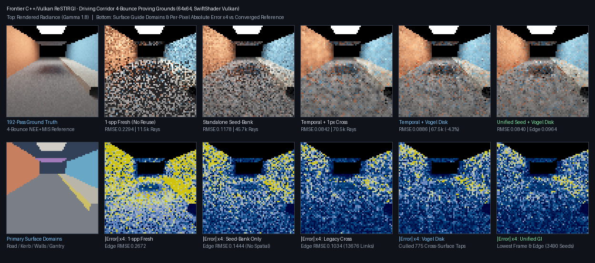

# Vogel spatial-disk reuse, geometric surface culling, and unified seed-bank ReSTIR GI

🧩 Records historical, bounded software-Vulkan checks of combined subpixel seed-bank + temporal + spatial
reservoir reuse and a 4-tap Vogel disk (`PathReplaySpatialDisk = 1048576u`). These fixtures do **not** prove
combined reuse generally correct: later [mixed-material and visibility holdouts](ReplayMaterialGuardCandidate.md)
failed independent mean gates and exposed severe tails. The current Engine count guard is 68, and the
[test-only fresh-donor alternative](ReplayFreshDonorCandidate.md) remains unpromoted.



## Historical fixture checks and current caveats

1. **Unified subpixel seed-bank + reservoir reuse (`ValidateReplaySampleCombined`)**:
   - Diagnosed and resolved the prior unexecuted GPU assertion bug: when `Spatial = true`, a pixel with `Count == 0`
     retains a bit-exact pre-spatial local reservoir (`ReplaySlot(2, Pixel)`), while `ResolveReplayReservoirs` merges
     compatible neighbor reservoirs whose local domains absorbed banked unused draws. When `Spatial = false`,
     disoccluded `Count == 0` outputs match `Reservoir`-only output bit-for-bit.
   - Verified unused-draw bank shifting (`ReplayBankSeed(FrameSeed, Pixel, 1)`) across `Temporal`, `Temporal + Cross`,
     and `Temporal + SpatialDisk` on SwiftShader Vulkan (`accepted=970`, `rejected=54`, `disk_links=3619`,
     `disk_culled=235`).

2. **Finite reservoir-history intake & overflow guards (`ReplayReservoirHistoryValid`)**:
   - Validates `uint16` seed halves (`[0, 65535]` exact integer), finite positive weight `W > 0`, and a bounded
     exact integer count, paired with `isfinite(Weight) && isfinite(Sum + Weight)` before reservoir updates in
     both `GenerateReplayReservoirs` and `ResolveReplayReservoirs`. The current count limit is 68; this section's
     injected corruption results are historical, not a fresh test of the current shader.
   - Verified against 11 injected reservoir corruptions (`NaN`/`-1`/`65536`/`0.5` seeds, `NaN`/`+Inf`/`0` weights,
     `NaN`/`1.5`/`33554432` counts, and `3.4e38 * 8` float-overflow weights): `temporal_rejected=11`, zero non-finite
     leaks across spatial-disk neighbors, and bit-exact fallback to fresh 1-spp radiance.

3. **Angular-adaptive 4-tap Vogel disk & symmetric tangent-plane gate (`PathReplaySpatialDisk`)**:
   - Uses an independent per-pixel hash stream with Golden-Angle phase increment $2.39996323\text{ rad}$ and stratified
     radii $r_k = R_{\max}\sqrt{(k + 0.5)/4}$, $R_{\max} = \text{clamp}(\min(W, H)\cdot 6/192,\; 2.15,\; 6.0)$. Because
     $r_0 \ge 2.15\sqrt{0.125} = 0.7601 > \sqrt{2}/2$, rounded integer offsets never collapse to $(0, 0)$ at any phase.
   - `EvaluateSpatialSurfaceCompatibility` gates spatial taps on primary surface validity, normal alignment
     $\mathbf{n}_r \cdot \mathbf{n}_d \ge \cos(25^\circ)$, symmetric tangent-plane coplanarity
     $|\Delta\mathbf{x}\cdot\mathbf{n}_r| \le \tau \wedge |\Delta\mathbf{x}\cdot\mathbf{n}_d| \le \tau$ with
     $\tau = \max(0.05,\; 2\min(\text{Footstep}, 0.25))$ (preserving grazing driving roads where $\Delta\mathbf{x}\cdot
     \mathbf{n} = 0$ while culling kerbs, risers, walls, gantries, and sky before `EvaluateReplayPath`), and roughness
     compatibility $|\alpha_r - \alpha_d| \le 0.25$ under `PathReplayRoughOpaque`.

## Quantitative results (SwiftShader CPU Vulkan — quality & ray-budget accounting)

⚠️ SwiftShader is a CPU Vulkan implementation used for deterministic shader/contract verification, not a hardware GPU
frame-time benchmark. Speed/work efficiency is therefore reported alongside RMSE via exact deterministic GPU BVH ray
counters (`Counters[8]` bounce traversals + `Counters[2]` shadow traversals) and `Counters[9]` culled spatial taps.

### 64x64 4-Bounce Driving Corridor (`SPATIAL_DISK_CAPTURE`, continuous driving motion)

| Mode | Whole-Frame RMSE | Edge / Disocclusion RMSE | Total BVH Rays | Spatial Links / Culled | Status |
|---|---:|---:|---:|---:|---|
| 1-spp Fresh (no reuse) | 0.229440 | 0.267213 | 11,542 | 0 / 0 | 🏳️ Baseline |
| Standalone Seed-Bank (`a5f8b164` limit) | 0.117796 | 0.144448 | 45,678 | 0 / 0 | 🚧 Prior cap |
| Temporal + Legacy 1-px Cross | 0.084153 | 0.103440 | 70,473 | 13,676 / 0 | 🟢 Legacy reuse |
| Temporal + Geometric Vogel Disk | 0.088627 | 0.112549 | **67,451 (-4.3%)** | 12,895 / **775** | 🥈 Fewer rays |
| **Unified Seed-Bank + Temporal + Disk** | **0.083958** | **0.096442 (-6.8%)** | 79,466 | 12,895 / **775** | 🥇 **Best RMSE** |

### 32x32 Multi-Batch Statistical Verification (`ReplaySpatialDisk-release.txt`)

| Suite | Metric | Legacy Cross | Geometric Vogel Disk | Unified Seed + Disk | Ground-Truth Check |
|---|---|---:|---:|---:|---|
| Diffuse Corridor (8 batches) | Mean Luminance | 0.196937 | 0.196877 | 0.198780 | ✔️ CPU `0.196832` |
| Diffuse Corridor (8 batches) | Avg BVH Rays | 15,848 | **14,600 (-7.9%)** | 17,385 | ✔️ 342 taps culled |
| Wet-Road Rough GGX (6 batches) | Whole-Frame RMSE | 0.134707 | **0.131988 (-52.1% vs 1-spp)** | n/a (diffuse bank) | 🏆 Beats Cross |
| Wet-Road Rough GGX (6 batches) | Avg BVH Rays | 17,084 | **15,789 (-7.6%)** | n/a (diffuse bank) | 🏆 Fewer rays |
| Host 2D Monte Carlo (`CTest`) | Worst Pixel $\|z\|$ | <= 2.00 | **<= 2.26 (40 px, 1,024 reps)** | **<= 2.26** | ✔️ Within this finite-fixture gate; not a proof of unbiasedness |

## Reproduce

```sh
CAPTURE=1 bash Exhibits/LightCompute/RunReplaySampleHistory.sh
CAPTURE=1 bash Exhibits/LightCompute/RunReplaySpatialDisk.sh
```
