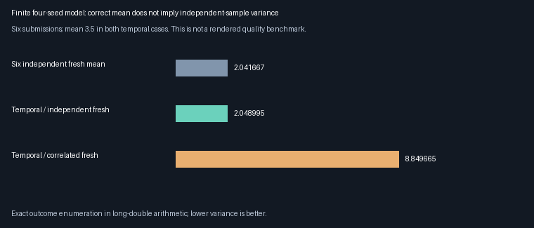
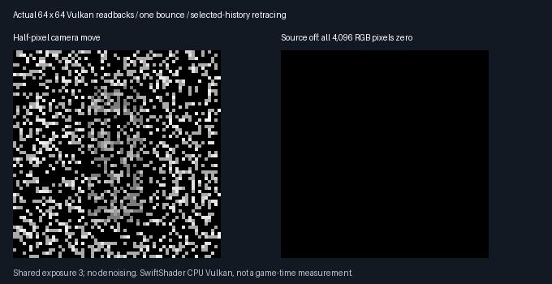

# Temporal replay measure and source safety — 2026-10-28

**Temporal weighting is specified and tested; a real NaN-producing history defect is repaired.** This is a
mathematical/safety gate, not a new quality or speed win. Combining selected temporal history with seed-bank RIS
remains disabled. The accepted **348.046875 MiB output-only 1080p extrapolation** stays unchanged.

## Exhaustive finite-model comparison

All outcomes are enumerated in long-double arithmetic, not estimated from a few random draws.
The ordinary test integral is `3.5`; the source-off test integral is `0`. Markers: ✔️ correct, 🔴 deliberately biased.

| Temporal method | Expected output | Correct integral | Outcome |
|-----------------|-----------------|------------------|---------|
| Current retrace, retained-count weight and matching normalization | 3.5 | 3.5 | ✔️ |
| Drop history when its current radiance is zero | 3.649741705 | 3.5 | 🔴 Bias +0.149741705 |
| Clip the stored normalization to 1 | 3.377828706 | 3.5 | 🔴 Bias -0.122171294 |
| Cap the denominator count but keep the uncapped history weight | 5.25 | 3.5 | 🔴 Bias +1.75 |
| Reuse previous RGB after the source turns off | 1.75 | 0 | 🔴 Stale light |

- **120 sequence configurations**, six submissions each; **6,868,800 outcome visits** over four possible seeds.
- Floors `0.0001`, `0.01`, `1`; history caps `0`, `1`, `3`, `64`; stationary/changing targets, source off/on,
  and independent or deliberately correlated fresh proposals.
- Every weighted seed-basis expectation matches the original uniform measure: maximum error
  **1.36880524276e-17**, below the fixed `2e-12` gate. Testing the basis checks all functions on this finite space.

## Temporal contract

For fixed rendering inputs, let `μ` be the normalized base-seed measure, `f_now(s)` the current path radiance,
and `t_now(s) > 0` its scalar selection target. A valid source `(Y,W,M)` must satisfy
`E[W g(Y) | eligibility/count metadata] = integral(g dμ)` for every seed function `g`.

For one new base-measure draw `X` and a retained count `m = min(M, cap)`:

```text
a = t_now(X)                         b = m * W * t_now(Y)
S = a + b                           M_new = 1 + m
choose Z = X or Y with probabilities a/S and b/S
W_new = S / (M_new * t_now(Z))       estimate = W_new * f_now(Z)

E_selection[estimate | X,Y,W] = [f_now(X) + m*W*f_now(Y)] / (1+m)
```

- A geometry/metadata-dependent, sample-independent cap scales history's **selection weight and count**
  together; stored per-sample `W` is not clipped. For a valid compressed fresh block `(Y_f,W_f,n)`, use
  `a = n * W_f * t_now(Y_f)`, the same history weight `b`, and `M_new = n+m`.
- Retaining or rejecting history must preserve the conditional source-measure identity. Visibility/radiance
  filtering can violate it; deterministic rejection of all history is safe. A positive target floor preserves support
  when a previously dark seed becomes bright. Reevaluate current radiance; do not reuse old RGB.
- Proposal independence is not needed for this first-moment identity if each proposal has the required measure
  identity and the mixture coefficients are fixed by eligible metadata. **Independent-sample variance does not follow.**
- This is seed-space replay, not endpoint/path-vertex reuse. No claim about an untested geometric shift Jacobian.
  The ideal selection randomness assumption is not a proof of independence for the renderer's finite PCG streams.



Both temporal cases have mean `3.5` and represented count `6`, but variance changes from **2.048994586** to
**8.849664862** with correlated fresh draws. Six independent fresh samples average to variance `2.041666667`.
These are finite-model results, **not** equal-work rendered quality or GPU timing measurements.

## GPU arithmetic, motion and source changes

The existing shared production temporal branch is tested directly, without enabling temporal seed-bank mode.
Each row runs at all three target floors; the CPU independently intersects the emitter/blocker rectangles and
predicts current radiance, selected seed, represented count and normalization.

| 32×32 sequence | Accepted history | Rejected in bounds | History cap | Compared floor pixels per floor |
|----------------|------------------|--------------------|-------------|---------------------------------|
| Stationary | 1,024 | 0 | 64 | 841 |
| Half-pixel camera move | 970 | 22 | 1 | 816 |
| Camera cut | 0 | 0; reprojections out of bounds | 1 | 512 |
| Blocker translated | 914 | 110 | 1 | 821 |
| Source off | 1,024 | 0 | 1 | 848 |
| Source on | 1,024 | 0 | 1 | 842 |

- **18 conditions, 14,040 pixel comparisons**, 84 reported near-edge exclusions. Maximum scaled RGB error is **0**.
  Geometric acceptance/rejection counters match CPU predictions. All outputs in these conditions are finite.
- Checked and unchecked shaders match bit-for-bit for valid warm-up/current images, all five used current
  reservoir/guide slabs and current counters. No thresholds were relaxed to accept the repair.
- Eighteen four-fresh submissions reach the legitimate upper represented count **68** on all 289 pixels of a
  17×17 scene. All history is accepted, with output identical to the unchecked control.

## Reproduced defect and repair

The [pre-repair run](Results/ReplayTemporalContract-before.txt) exits **1**, as expected: an infinite positive
history normalization passes the old `W > 0` predicate, gets represented count `4`, and produces **NaN** output
instead of the expected fresh-only fallback. This is malformed input, not a claim that normal scenes generate it.

| Selected-source corruption | Repaired behaviour |
|----------------------------|--------------------|
| Infinite/NaN/negative normalization | Reject history; keep local fresh estimate |
| Infinite/fractional/oversized count | Reject history before decoding/replaying its seed |
| NaN/fractional/out-of-range seed halves | Reject before float-to-uint seed decoding |
| Finite normalization whose target/count product overflows | Reject the contribution before accumulation |

Shared `PathReplayReservoir.slang` now requires finite, canonical 16-bit seed halves; positive finite `W`;
and integral `M` in `[1,68]`. The bound is the recorder's maximum four fresh plus 64 retained candidates.
The contribution and accumulated sum must also remain finite and positive where required.

- **10 corruption cases** use a fresh-only fallback at the damaged receiver. The unchecked control violates the
  contract in **8 cases**, including **2 nonfinite images**; the repaired cases pass without contaminating that output.
- `FRONTIER_REPLAY_UNCHECKED_HISTORY` is an exhibit-only negative-control compile definition, never a runtime option.
  All five unchecked SPIR-V digests equal the completed pre-repair compact checkpoint, retaining the actual old code.
- Invalid/overflow fallback is a numerical safety action, **not** authorization to clip high weights or a general
  unbiasedness guarantee for arithmetic overflow. General floating-point, material and scene coverage remains open.

## Actual Vulkan evidence and verification



64×64, one bounce, no denoising, common display exposure `3`. The half-pixel image accepts 3,990 history sources;
after turning the source off, **all 4,096 linear RGB pixels are exactly zero** before display conversion.
This capture is a correctness fixture, not a newly improved game-quality image.

| Verification | Release | Host ASan + UBSan |
|--------------|---------|------------------|
| Native finite-measure identities and four negative controls | Pass | Pass |
| Existing native CTests | 5/5 | 5/5 |
| 18 GPU arithmetic/motion/source conditions | Pass | Pass |
| Ten corrupted sources and valid count-68 boundary | Pass | Pass |
| Cross-configuration results | 48 temporal rows exact | Same |
| Logged source/tool/shader digests | 39 match final files | Same |
| Actual captures | Both decoded RGB images exact | Same |

[Release](Results/ReplayTemporalContract-release.txt) · [Host sanitizer](Results/ReplayTemporalContract-sanitized.txt) ·
[Final parity](Results/ReplayTemporalContract-parity.txt) ·
[Compact regression](Results/ReplayTemporalContract-regression.txt).

The Release compact regression retains all seven compact result rows, 14 paired 17×17 frames and four paired
64×64 frames; both decoded captures exactly match the previous checkpoint. The footprint/recorder is unchanged;
only the default generation shader changes for the new selected-history checks. The unchecked shader remains the
old binary. Earlier [eight-current-path results](ReplayPathBudget.md) are a historical pre-repair checkpoint.

## Memory and remaining rendering work

- No new buffer, layout, estimator flag or C++ runtime interface. Compact output remains **176 B/pixel**,
  **348.046875 MiB at 1920×1080**, extrapolated—not allocated/rendered here or total VRAM. Packing stays deferred.
- This temporal audit uses the existing **legacy layout** at small resolutions. It does not establish compact
  selected-temporal + seed-bank integration; that combination remains rejected by host/recorder contracts.
- Next: a bounded combined-proposal validation prototype, with explicit opt-in and broader moving-scene tests.
  Match its actual current-call count against fresh/emitter-sampling controls; do not call nine versus eight equal work.
  Correct mean/count does not establish lower variance or speed.
- Production viewport, broader materials/reconstruction, physical-GPU equal-time testing and Windows acceptance
  remain open.

## Reproduce

Linux x86-64, GCC 12.2.0/C++20, Slang 2026.14.1, SwiftShader Device (Subzero), CPU type 4, Vulkan 1.3.0.
Revision `68f3016` plus uncommitted recovery/continuation files on `arena/08e7de48-frontier`; source digests in logs.
Use the already recovered pinned tools, Vulkan headers v1.4.321, CMake and a Python interpreter with Pillow.

```bash
python3 Automation/PrepareReplayTools.py --verify
CAPTURE=1 bash Exhibits/LightCompute/RunReplayTemporalContract.sh
SANITIZE=1 CAPTURE=1 BUILD_JOBS=1 bash Exhibits/LightCompute/RunReplayTemporalContract.sh
bash Exhibits/LightCompute/RunReplayTemporalRegression.sh
_ClaudeScratch/venv/bin/python Exhibits/LightCompute/Code/ReplayTemporalContractParity.py
_ClaudeScratch/venv/bin/python Exhibits/LightCompute/Code/ReplayTemporalContractImages.py \
    _ClaudeScratch/replay-temporal-contract-capture-release/png \
    Exhibits/LightCompute/Results/ReplayTemporalContract-release.txt Exhibits/LightCompute/Images
```

The sanitizer instruments host code only, not the driver/shaders. No Windows binary, physical GPU, 1080p runtime,
full-renderer or game-FPS acceptance is claimed. No remote Actions, commit or push was performed.
