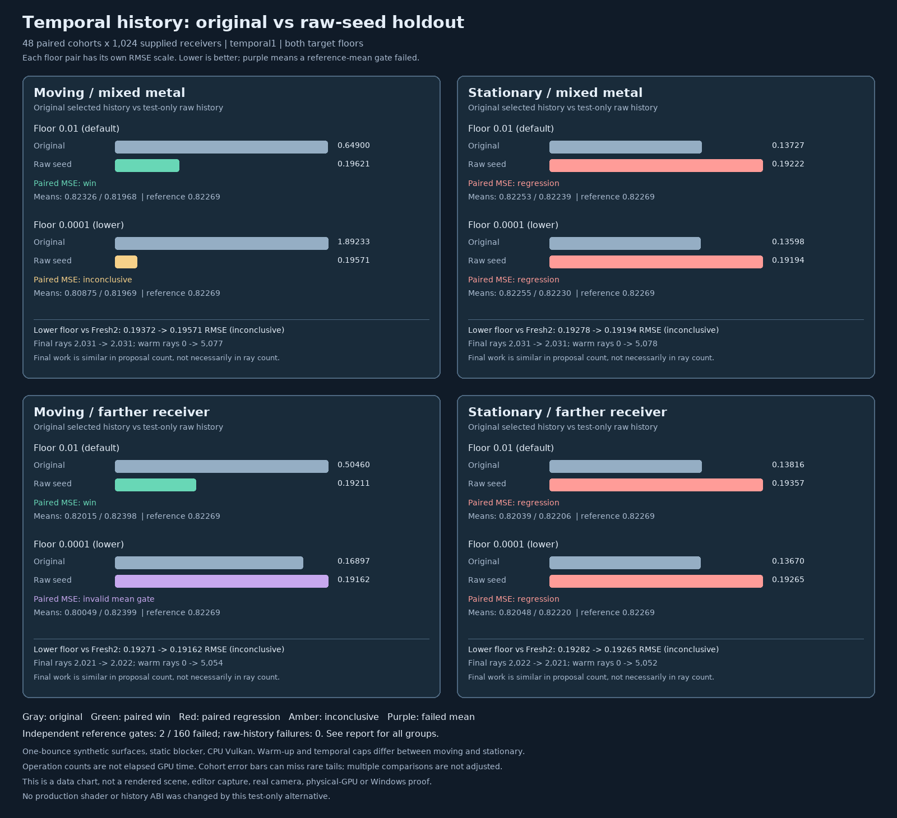

# Raw-seed temporal history under changing visibility

## Protocol fixed before measurement

The previous [moving-receiver holdout](ReplayFreshDonorMotion.md) failed the lower-floor temporal-only metal
mean, even though the spatial candidate did not alter that mode. This study diagnoses the retained-history
weight and evaluates a **test-only** alternative: persist the pixel's first raw fresh seed for one submission,
with normalization and represented count both one. The current receiver retraces that seed. This replaces,
rather than extends, selected-reservoir history; it discards older temporal proposals and is not an Engine port.

| Concern       | Fixed protocol                                                               |
| ------------- | ---------------------------------------------------------------------------- |
| Scenes        | Mixed dim/metal and same-metal visibility checkerboards under one absorber. |
| Trajectories  | Four supplied-receiver poses, +0.2 x per step; stationary final-pose control. |
| History       | Direct recorder; changed-scene cap 1 for motion, normal cap 64 when stationary. |
| Arms          | Instrumented original versus test-only raw-seed history, serial Vulkan runs. |
| Modes         | Fresh1, Fresh2, Fresh4, temporal1, temporal4; spatial reuse and seed bank off. |
| Floors        | Existing default 0.01 and lower bound 0.0001.                                |
| Cohorts       | 48 paired 32 × 32 images per trajectory/scene; 512 pixels per group.         |
| Seeds         | MT19937-64 base `0xa92f10d4b731 + scenario_index * 0x1000193`; four per cohort. |
| Reference     | Independent final-pose hemisphere minus blocked-square area integration.    |
| Mean gate     | Every arm/group/mode/floor within `5 * nominal cohort SE + .001`; finite pixels. |
| Comparisons   | Same-seed candidate minus original cohort MSE; signed paired 3-SE plus both mean gates. |
| Controls      | Fresh-mode hashes match; original diagnostic shader matches prior uninstrumented hashes. |
| Diagnostics   | Record prior normalization, replayed radiance/target and previous selected target. |
| Work / tails  | Final and warm rays, triangle tests, conditional means and maximum samples.   |
| Promotion     | No automatic promotion or change to Engine defaults or history ABI.          |

All arms share an Engine-derived Generate shader with an extra write to an unused, noncompact audit slab;
the candidate changes only what Resolve persists in temporal slot 0. Primary and Generate binaries are
identical across arms. The first eight old-seed cohorts in each moving scene reproduce Fresh1/Fresh4 and
original temporal1 group hashes from the prior uninstrumented log. Candidate fresh hashes must match those
same controls. Fresh2 additionally provides a two-path final-submission comparison with no warm-up.

For temporal1, the GPU diagnostic exposes the selected history's source normalization and its replayed
radiance/target. The host independently checks that every output equals one of the two allowed weighted
reservoir selections, and computes their conditional mean. For the original arm only, the prior selected
target identifies almost-dark historical winners that became visible. The candidate must persist exactly the
first raw seed with unit normalization/count, and both arms must reject altered motion guides. A finite
enumeration separately illustrates rare positive-target weights and the effect of clipping; it does not assert
that the GPU's observed failure has the same cause.

Reference quadrature uses 1,024 steps plus a 512-step convergence check. Nominal errors can miss rare tails;
multiple gates are not multiplicity-adjusted. Operation counts are not elapsed GPU time. These are supplied
primary receivers, one bounce, artificial materials and a static square, not a real camera, textured scene,
production resource path, physical GPU, Windows or editor. The completion-gated C++ sequence currently resets
changed receiver records; this direct-recorder stress test deliberately continues them.

## Outcome: useful diagnosis, alternative not promoted

The instrumented original passed **78/80** independent mean gates; the raw-history alternative passed
**80/80**. Both original failures were the lower-floor moving-visibility far group, in temporal1 and temporal4.
The overall runner intentionally exited **1** because the baseline and paired correctness gates failed. The
independent evidence audit exits **0** because it verifies that rejection, not because it hides it.

The test-only raw policy substantially reduces some observed moving-scene tails and passes the two failing
holdout means. However, it regresses every stationary temporal1 comparison, loses accumulated history, and
shows no decisive quality advantage over Fresh2 at similar final proposal count. It is **not** a production
fix, default, Engine change, or general unbiasedness proof. The earlier lower-floor failure remains open.



The image is a chart of measured data, not a rendered scene or editor screenshot. Each floor's pair uses its
own RMSE scale. Purple marks an invalid quality comparison when either independent mean gate failed.

### The reproduced lower-floor problem

Farther receiver, moving same-metal visibility fixture; independent reference `0.822689105`:

| Estimator | Mean ± nominal cohort SE | RMSE | Mean gate |
| --------- | ------------------------: | ---: | --------- |
| Original temporal1 | `0.800493768 ± 0.000883233` | `0.168965` | fail |
| Raw-history temporal1 | `0.823987859 ± 0.001120594` | `0.191621` | pass |
| Fresh2 | `0.823138427 ± 0.001151501` | `0.192711` | pass |
| Original temporal4 | `0.816080741 ± 0.000969054` | `0.154069` | fail |
| Raw-history temporal4 | `0.823536699 ± 0.000743020` | `0.120771` | pass |
| Fresh4 | `0.823605377 ± 0.000902934` | `0.135376` | pass |

Do not rank the failed original arm by its apparently lower temporal1 RMSE: it misses the reference. The
original's temporal1 **conditional selection average**, computed from the actual fresh and historical GPU
replays assuming an independent selection draw, was `0.800491285 ± 0.000883282`. That is nearly the observed
`0.800493768`, so a bad final selection alone is not an adequate explanation for this cohort. This observation
does not prove why the historical proposals differ from the reference: deterministic RNG correlations,
finite samples and rare tails remain possible.

### Paired quality and real-time work controls

Paired MSE differences are raw minus original, with nominal cohort SE. The win/regression labels require
both reference means to pass and a signed 3-SE difference; multiple comparisons are not adjusted.

| Temporal1 fixture / floor | Original → raw RMSE | ΔMSE ± SE | Decision |
| ------------------------- | ------------------: | --------: | -------- |
| Moving mixed metal / default | `.649001 → .196213` | `−.382703 ± .074854` | win |
| Moving visibility far / default | `.504602 → .192111` | `−.217716 ± .043288` | win |
| Moving mixed dim / lower | `.185643 → .190901` | `+.001980 ± .000411` | regression |
| Moving visibility near / lower | `.222345 → .247050` | `+.011596 ± .000383` | regression |
| Stationary mixed metal / default | `.137268 → .192220` | `+.018106 ± .000443` | regression |
| Stationary visibility far / lower | `.136699 → .192646` | `+.018426 ± .000438` | regression |

Moving mixed metal at the lower floor observed `1.892334 → .195706` RMSE, but one large original sample
makes the paired ΔMSE `−3.542627 ± 3.551259`: **inconclusive**, not an established quality improvement.
Across the eight moving temporal1 group/floor combinations there are two wins, two regressions, three
inconclusive results and one invalid comparison. All eight stationary temporal1 group/floor combinations are
regressions. Temporal4 shows two moving wins, two regressions, three inconclusive and one invalid; stationary
temporal4 has seven regressions and one inconclusive. Original stationary history can retain three older
proposals at the final frame under the normal cap 64; the raw policy retains only one. Thus these are honest
policy comparisons, **not** identical history counts.

All **16** raw temporal1 versus Fresh2 paired quality contrasts are inconclusive. For the lower-floor moving
far group, Fresh2 versus raw temporal1 uses `2021 → 2022` final ray operations, `0 → 5054` warm ray
operations and RMSE `.192711 → .191621`. Raw temporal4 beats Fresh4 in 14 of 16 contrasts, but it performs
one extra final replay and three warm submissions. In the same lower-floor far group, final rays are
`4044 → 5055` and warm rays `0 → 14156`, so the measured `.135376 → .120771` RMSE reduction is **unequal
work**, not a speedup. Ray and triangle counts are software-Vulkan operations, not physical-GPU time or FPS.

### Why low targets can hide important samples

For one fresh path `F`, history replay `H`, prior normalization `W`, and retained count `r`, the two possible
reservoir outcomes have ideal selection-average `(F + r W H) / (1 + r)`. The GPU output for all
**393,216 temporal1 pixels per arm** matched one of the two independently calculated outcomes, with maximum
relative error `1.10e-7`. This checks the selected-output arithmetic; it does not establish that the
selection stream is independent of the path stream.

In the moving mixed-metal lower-floor group, the original's maximum observed prior normalization was
`679.338`, maximum weighted historical contribution `591.600`, and maximum final pixel `296.248`. Six of
24,576 retained selected winners had previous target at most `1.01 * floor` and replayed scaled red above
`.01`; that count does not measure all dark-to-visible opportunities. The raw arm's normalization was exactly
one in all audited pixels. In the moving far lower-floor group the original's sampled mean normalization was
`.899420`; no inference of a true expected normalization follows from this finite, correlated sample.

A separate exact two-direction enumeration makes the tail risk concrete, without asserting that the real
fixture has the same distribution. At a positive floor of `1e-4`, a previously dark winner in a mixed pair
has probability `0.00004999`, normalization up to `5001`, and carries 25% of the expected historical
contribution. Under independent draws there is a `29.27%` chance of seeing none in 24,576 trials. A hypothetical
clamp of **normalization** at 64 changes that toy's expected history from `1` to `.753199`; this is not the
Engine's existing **represented-count** cap of 64. Small nominal SEs can therefore miss rare but material
contributions; a positive floor is not by itself a practical variance guarantee.

### Controls, provenance and reproduction

- Release CTests **10/10**, host-only ASan+UBSan CTests **10/10**. Leak detection was disabled; the Vulkan
  driver and shaders were not sanitizer-instrumented.
- `2,304/2,304` fresh group hashes match between arms. Another `320/320` historical controls reproduce the
  prior uninstrumented moving run, including `192/192` original Fresh1/Fresh4/temporal1 hashes and `128/128`
  candidate fresh hashes. Both arms use the same extra Generate diagnostic write, so this is instrumented
  SPIR-V, not a claim that instrumentation is free.
- Across eight arm/scenario runs, each has 576 continued submissions and at least 1,024 accepted temporal
  histories per continued frame; changed inputs use cap 1 and stationary inputs cap 64. Two deliberately
  invalid motion guides per arm reject exactly and match explicit Fresh1. The candidate's
  **786,432** temporal history readbacks exactly match the first generated seed with count/normalization one.
  Invalid receiver and arbitrary multi-pixel remapping coverage remain separate work.
- The independent Python audit recomputed **160** result aggregates, **80** paired comparisons, **32**
  Fresh2/Fresh4 contrasts, **7,680** cohort rows and all controls; it verified 31 startup source/module
  hashes, both regenerated test shaders, references, continuation, guide and arithmetic controls. Three exact
  startup inputs are archived because the Markdown report and two Python/C++ sources received later outcome or
  whitespace-only edits. Release and host-only ASan+UBSan were rebuilt after the C++ formatting cleanup; both
  still pass `10/10`. The audit does not reconstruct every GPU pixel or independently verify RNG independence.
  Seven synthetic parser checks cover incomplete, duplicate, wrong-hash, failed-mean and failed-exit cases.
- The frozen pre-measurement protocol is [retained separately](Results/ReplayTemporalFreshHistory-protocol-frozen.md),
  so its original hash remains auditable after adding the outcome. Full serial software-Vulkan evidence is in
  [the paired log](Results/ReplayTemporalFreshHistory-paired.txt); see the
  [independent audit](Results/ReplayTemporalFreshHistory-evidence-audit.txt) too.
  and [host sanitizer log](Results/ReplayTemporalFreshHistory-host-sanitized.txt).

```bash
# Needs the pinned Slang 2026.14.1, SwiftShader and CMake/Ninja dependencies; the expected exit is 1.
bash Exhibits/LightCompute/RunReplayTemporalFreshHistory.sh
python3 Exhibits/LightCompute/Code/ReplayTemporalFreshHistoryEvidenceAudit.py \
  Exhibits/LightCompute/Results/ReplayTemporalFreshHistory-paired.txt \
  Exhibits/LightCompute/Results/ReplayFreshDonorMotion-paired.txt
```

The peer's differently parameterized geometry-target [weighted pair](ReplayBranchComparison.md) passes its
mean gates but fails two temporal-quality gates; it is not a direct benchmark of this seed-history alternative.
Neither design has been imported into production. This fixture excludes spatial reuse, arbitrary scene motion,
textured production resources, physical RT hardware, Windows, and the live editor. The completion-gated C++
sequence still resets changed receiver records; the direct-recorder stress test deliberately continued them.

### Follow-up: selection-stream isolation

A paired 128-cohort moving-visibility experiment changes only the reservoir-selection stream to a deterministic decorrelated hash, verifies the path-seed readbacks remain identical, and evaluates Fresh1/2/4 plus temporal1/4 at both floors. The alternative fails one temporal4/lower independent-mean gate; although its RMSE is lower in that cell, the paired contrast is inconclusive and the mean is outside tolerance. No stream is promoted or ported. See the [complete report, quantitative comparisons and visual proof](ReplayTemporalSelectionStream.md), with its [raw cohort log](Results/ReplayTemporalSelectionStream.txt).
