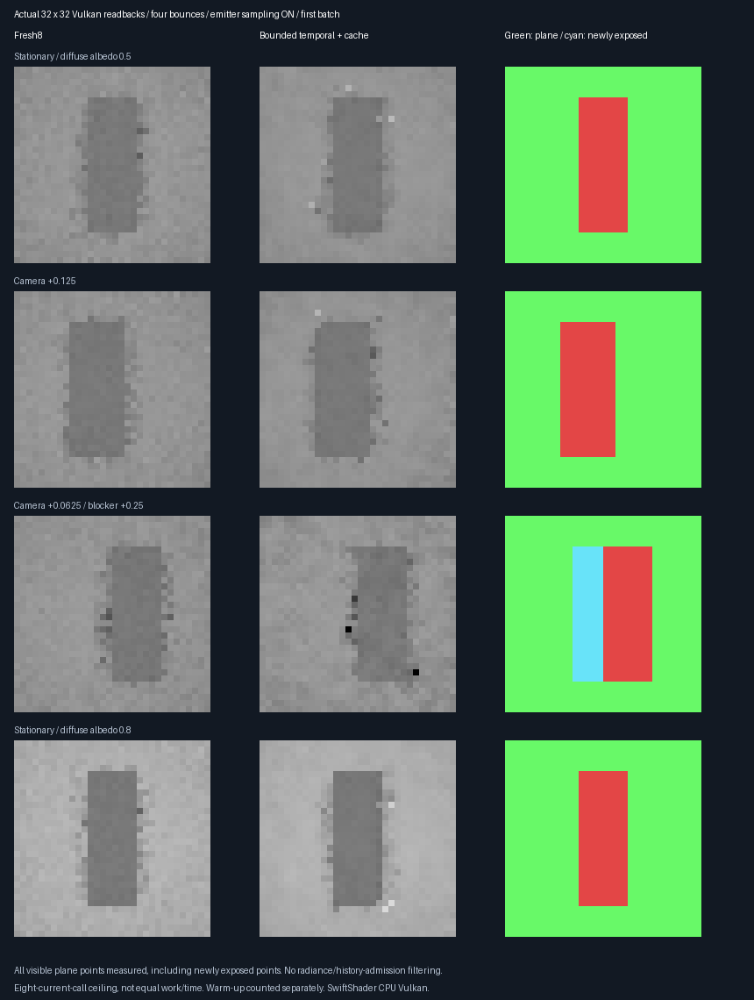
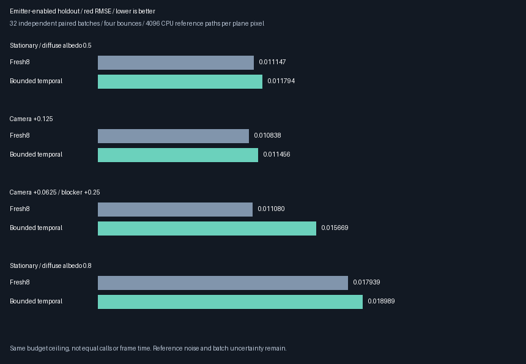

# Emitter-enabled temporal holdout — 2026-10-28

**The independent emitter-enabled holdout does not justify production promotion.** All mean gates pass,
but none of the four fixed conditions beats Fresh8 on observed red RMSE. The moving-blocker condition also
exposes a reset-budget issue: it runs approximately four rather than eight paths, not broken temporal weighting.
Production defaults and the accepted **348.046875 MiB output-only 1080p extrapolation** stay unchanged.

## Fixed experiment specification (written before running)

| Parameter | Fixed choice |
|-----------|--------------|
| Methods | Fresh8 versus unchanged bounded temporal + current-evaluation cache |
| Transport | Four bounces, explicit emitter sampling on, environment RGB 0.025 |
| Weighting | Previous phase unchanged: floor 0.01, count-matched history, three spatial donors |
| Sampling | 32 independent paired batches, eight warm submissions per batch |
| Seeds | MT19937-64 `0x6d248193 + condition * 0x1000193`; independent of previous phase |
| Reference | 4096 independent CPU paths per measured pixel; brute-force triangle intersections |
| Measurement | All visible plane pixels, selected only by deterministic primary geometry |
| Fixtures | Stationary; camera +0.125; camera +0.0625 and blocker +0.25; stationary plane albedo 0.8 |
| Capture | First batch of each fixture, not best-looking batch |
| Correctness | Means within 4 combined nominal SE + 0.001; paired means within 4 SE + 0.001 |
| Promotion | Every fixture's paired MSE upper bound `difference + 3 nominal SE < 0`, plus correctness |

- Print all conditions before evaluating aggregate acceptance. A negative quality result is valid evidence.
- Quality is under an eight-current-call ceiling, **not equal work/time**. Motion/reset can reduce the candidate
  count. Include newly exposed plane pixels; never restrict reporting to accepted temporal history.
- Count actual path calls, nearest/shadow queries, cache hits, resets and history admissions separately.
- Weighting, history length, target floor, fixtures and acceptance thresholds are not tuned after results.
- This expands motion and diffuse-albedo coverage only. No rough/specular/textured-material coverage is claimed.
- SwiftShader can validate correctness and quality, not physical-GPU frame time. Production remains unchanged.


## Results: all conditions, not a selected winner



All images are actual **32×32 readbacks**, nearest-neighbour enlarged, with the same display exposure.
Green is measured plane; cyan is the newly exposed subset; red is excluded geometry. Selection uses primary
geometry, not radiance, source weight, cache hits or successful history admission.



| Condition | Fresh8 RMSE | Temporal RMSE | Change | Paired MSE change ± nominal SE |
|-----------|-------------|---------------|--------|-------------------------------|
| Stationary | 0.0111473 | 0.0117939 | +5.80% | +0.0000148328 ± 0.0000069794 |
| Camera | 0.0108383 | 0.0114562 | +5.70% | +0.0000137775 ± 0.0000063584 |
| Camera + blocker | 0.0110803 | 0.0156693 | +41.42% | +0.0001227544 ± 0.0000044068 |
| Albedo 0.8 | 0.0179391 | 0.0189885 | +5.85% | +0.0000387533 ± 0.0000309635 |

These are observed differences, not universal inferiority claims. Batch SE excludes uncertainty of the fixed
CPU reference. The 3-SE filter is a conservative engineering promotion rule, not a formal tail-probability bound.
Stationary/camera differences are approximately 2.1 nominal SE; high-albedo is only 1.25 SE.
All eight method/reference mean gates and four paired-mean gates pass. **No quality gate passes.**

Reference coverage: 848, 826, 848 and 848 measured pixels, respectively; **13,803,520 independent CPU paths**
in total. Reference-mean nominal SE is 0.0001625, 0.0001650, 0.0001630 and 0.0002603.
The larger all-plane mask deliberately includes borders and points without accepted history; this is not the
previous phase's 702-pixel eight-proposal plateau. Do not combine the two experiments as identical samples.

### Moving blocker: separate reset fallback from temporal weighting

- **110 newly exposed plane pixels** are included in every batch, not filtered out of error statistics.
- All 3520 exposed pixel/batch checks have no selected-history contribution. The request globally resets history;
  this is not evidence of fine-grained local rejection while other pixels keep their banks.
- All 32 current submissions reset banks; selected-history admissions, bank admissions and cache hits are zero.
- Spatial RIS then uses roughly **one local + three spatial evaluations**, versus eight fresh evaluations.
- Newly exposed RMSE is **0.0153323 → 0.0222280**, about **45.0% worse**.
- The full-plane 41.4% RMSE increase is close to the square-root-of-two penalty of halving independent samples.
  This is a useful budget diagnosis, not a causal attribution of that loss to temporal weighting.

## Actual work and warm-up

| Condition | Fresh current calls | Temporal current calls | Temporal warm-up calls | Current cache hits |
|-----------|---------------------|------------------------|------------------------|--------------------|
| Stationary | 262144 | 242264 | 1675663 | 17320 |
| Camera | 262144 | 232519 | 1676246 | 16057 |
| Camera + blocker | 262144 | 128512 | 1675927 | 0 |
| Albedo 0.8 | 262144 | 242175 | 1675518 | 17409 |

Each condition has 32 current submissions per method and **256 additional warm submissions** for temporal.
Counts cover the whole 32×32 image, including excluded blocker pixels. The log separately records transport
nearest-hit plus shadow queries; one path evaluation is not one ray or a fixed cost.
The reset condition pays for history generation that it subsequently discards. Existing game history may amortize
startup differently, but no steady-state game timing was measured. Fewer current calls is not an FPS claim.

## Validation and provenance

- **48 logged digests per configuration, 42 semantic rows and all 12 decoded captures** pass parity.
- Release and host ASan/UBSan execute the same fixed conditions, plus five CTests and the earlier controls:
  exact fresh rectangle/poison control, four corrupt-source fallbacks, and 18-frame current-cache output parity.
- [Release log](Results/ReplayTemporalHoldout-release.txt),
  [host-sanitizer log](Results/ReplayTemporalHoldout-sanitized.txt),
  [source/shader/capture parity](Results/ReplayTemporalHoldout-parity.txt).
- The derived shader's weighting is unchanged: **all 13 prototype, uncached-control and default shader binaries**
  match the preceding phase. Only exhibit CPU orchestration and a CLI entry were added.
- The earlier bounded-phase source manifest is a historical checkpoint after the main CLI source changes;
  its numerical results and shader digests are retained, not silently regenerated or relabeled.
- Driver and shaders are not sanitizer-instrumented. SwiftShader is CPU Vulkan. Physical GPU, Windows/editor,
  hardware ray queries, rough/specular/textured materials and full-game GI remain unverified here.

## Decision: change the next implementation target

**Do not promote whole-path selected-temporal RIS.** Do not tune the history cap or floor against these holdout
results, and do not disable explicit emitter sampling to obtain a favorable comparison.

| Priority | Next mechanism | Reason |
|----------|----------------|--------|
| 1 | Fresh-budget fallback when history resets | Avoid spending only four of an eight-call budget after invalidation |
| 2 | Fresh direct lighting + indirect-only reservoir | Avoid reweighting already low-variance direct lighting |
| 3 | Indirect-rich scenes and physical-GPU equal-time tests | Planar fixtures do not establish game GI benefit |

These are **next implementation targets, not claimed completed features**. A direct/indirect split must preserve
seed-measure identities and account for all direct shadow queries. Reset fallback must be selected from known
request metadata, not radiance-dependent rejection. Both need independent validation before production integration.

## Reproduce

With pinned tools prepared, from the repository root:

```bash
bash Exhibits/LightCompute/RunReplayTemporalHoldout.sh
SANITIZE=1 BUILD_JOBS=1 bash Exhibits/LightCompute/RunReplayTemporalHoldout.sh
_ClaudeScratch/venv/bin/python Exhibits/LightCompute/Code/ReplayTemporalHoldoutImages.py \
  _ClaudeScratch/replay-temporal-holdout-capture-release \
  Exhibits/LightCompute/Results/ReplayTemporalHoldout-release.txt Exhibits/LightCompute/Images
_ClaudeScratch/venv/bin/python Exhibits/LightCompute/Code/ReplayTemporalHoldoutParity.py
```

The unoptimized host-sanitizer CPU reference can take substantially longer than release. Raw captures/builds
remain ignored; twelve first-batch PNGs, two summaries, text logs and audit digests are retained.


### Subsequent checkpoint

The [fresh reset-budget correction](ReplayResetBudget.md) implements the first next target in an isolated
prototype and adds another CLI include. This holdout's source hashes remain historical checkpoint digests;
its quality results are retained. The reset correction does not change its non-reset weighting conclusions.
