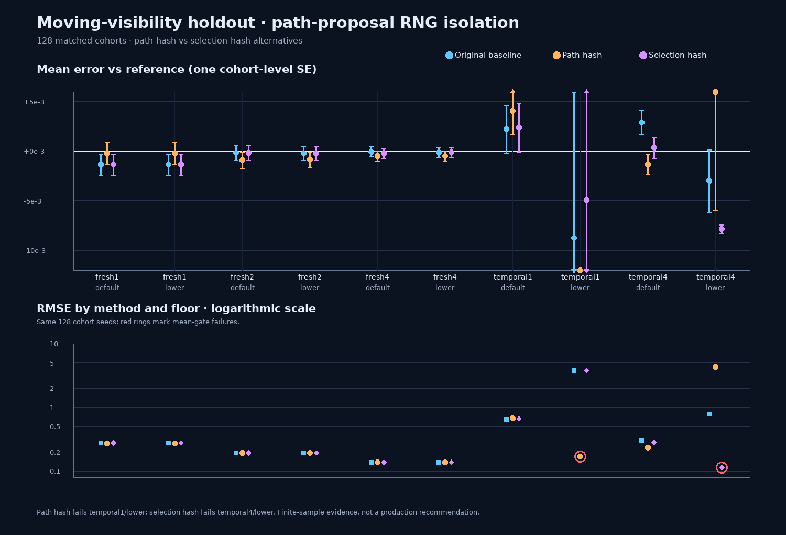

# Replay-temporal path-proposal RNG isolation

**Decision: do not adopt the path-hash candidate.** It changed the path samples as intended while preserving the original selection stream, but failed the targeted temporal1/lower mean gate by a wide margin. Its much lower RMSE in that cell is not an acceptable trade while the independent mean is out of tolerance. Temporal4/lower retained a very heavy tail. All changes remain Exhibit-only.

## Question and controlled comparison

The prior holdout altered only reservoir-selection randomness and did not produce a gate-passing replacement. This next test asks whether the **path-proposal seed mapping** is the sensitive stream instead. The candidate replaces only the `SeedBits` initialization with a deterministic integer hash. The original reservoir-selection stream, temporal weighting/reuse, moving-visibility fixture, reference and sample schedule remain fixed.

- Same moving mixed-metal far group, 32×32 receivers, 512 far-group pixels, modes Fresh1/2/4 and temporal1/4, and firefly floors `0.01` and `0.0001`.
- 128 matched cohorts per arm, reusing the exact cohort seed schedule from the preceding selection-stream study.
- Selection-stream readback was verified unchanged in each arm; path-seed outputs were checked against the host implementation of each mapping.
- **Strong baseline reproduction:** baseline image hashes match the prior selection-stream study in all **1,280/1,280** mode/floor/cohort rows. Candidate path hashes differ in **1,280/1,280** paired rows; selection hashes match in **1,280/1,280**.
- The independent reference remains `0.82268910511`; the 512-resolution convergence estimate is `0.822689540307`.
- Mean gate: `|sample mean − reference| ≤ 5 × cohort SE + 0.001`. Reported errors are cohort-level standard errors; RMSE is from squared pixel error.

## Temporal results, with the prior selection-hash candidate

| Mode / floor | Original mean ± SE; RMSE; gate | **Path-hash** mean ± SE; RMSE; gate | Prior **selection-hash** mean ± SE; RMSE; gate |
|---|---|---|---|
| temporal1 / default | 0.824915 ± 0.002371; 0.642869; pass | 0.826770 ± 0.002375; 0.674546; pass | 0.825069 ± 0.002495; 0.658382; pass |
| temporal1 / lower | 0.813958 ± 0.014657; 3.766765; pass | **0.800349 ± 0.000623; 0.169220; fail** | 0.817775 ± 0.014881; 3.802742; pass |
| temporal4 / default | 0.825614 ± 0.001229; 0.302505; pass | 0.821358 ± 0.000994; 0.233277; pass | 0.823045 ± 0.001050; 0.279372; pass |
| temporal4 / lower | 0.819691 ± 0.003130; 0.787031; pass | 0.833565 ± 0.016878; 4.313781; pass | **0.814838 ± 0.000429; 0.112751; fail** |

For path-hash temporal1/lower, the mean is `0.022340` below reference (about **35.9 SE**); the gate allows about `0.004114`. RMSE falls sharply versus the baseline, but the gate failure rejects it. In temporal4/lower its RMSE instead increases to `4.314`, while the large uncertainty makes the mean gate permissive. The previous selection-hash candidate moves the failure to temporal4/lower and has a different tail profile. These contrasting outcomes show sensitivity to deterministic stream mapping in this finite cohort; they do **not** prove asymptotic bias or establish either RNG as a fix.

The current path-hash temporal4/default paired MSE contrast is `−0.03709 ± 0.01461 SE`, while temporal1/lower is `−14.15988 ± 14.15941 SE` and temporal4/lower is `+17.98929 ± 18.52299 SE`. These are diagnostic paired outcomes across multiple explored cells, not pre-registered production quality claims. The Fresh modes remained within the mean gate; their RMSE changes were small (for example Fresh2/lower `0.193133 → 0.192567`). Ray-operation counts were effectively unchanged; no physical-GPU or wall-clock speed comparison was made.

## Validation and scope

- Release C++ build succeeded; Exhibit CTest passed **10/10**.
- The baseline arm exactly replays the prior study’s 1,280 image hashes, validating the matched seed/fixture setup before evaluating the changed path stream.
- Both Vulkan arms completed on SwiftShader CPU Vulkan. The original baseline passed all ten mean gates; path-hash failed exactly temporal1/lower. The paired runner and audit return nonzero for that measured failure.
- Shaders and SwiftShader were not sanitizer-instrumented. No physical GPU, Windows, live editor, production scene, or real-time frame-time validation was run.
- No production shader, renderer default, or engine behavior was changed. C++ additions dispatch only this opt-in Exhibit validation.

### Evidence and reproduction

- [Raw run and per-cohort evidence](Results/ReplayTemporalPathStream.txt)
- [Cross-study summary and audit](Code/ReplayTemporalPathStreamSummary.py)
- [Focused C++/Vulkan harness](Code/ReplayTemporalPathStreamValidation.h)
- [Test-only shader generator](Code/ReplayTemporalPathStreamCandidate.py)
- [Runner](RunReplayTemporalPathStream.sh)
- [Chart source (SVG)](Code/ReplayTemporalPathStreamChart.py)
- Prior comparator: [selection-stream study](ReplayTemporalSelectionStream.md) and its [raw log](Results/ReplayTemporalSelectionStream.txt)

**Conclusion:** changing only the path-proposal stream also fails the lower-floor moving-visibility holdout—now at temporal1, with a low-RMSE but strongly out-of-reference mean. Keep the production baseline unchanged. The data motivates further scrutiny of finite tails, support and deterministic stream interactions, not a default change.
