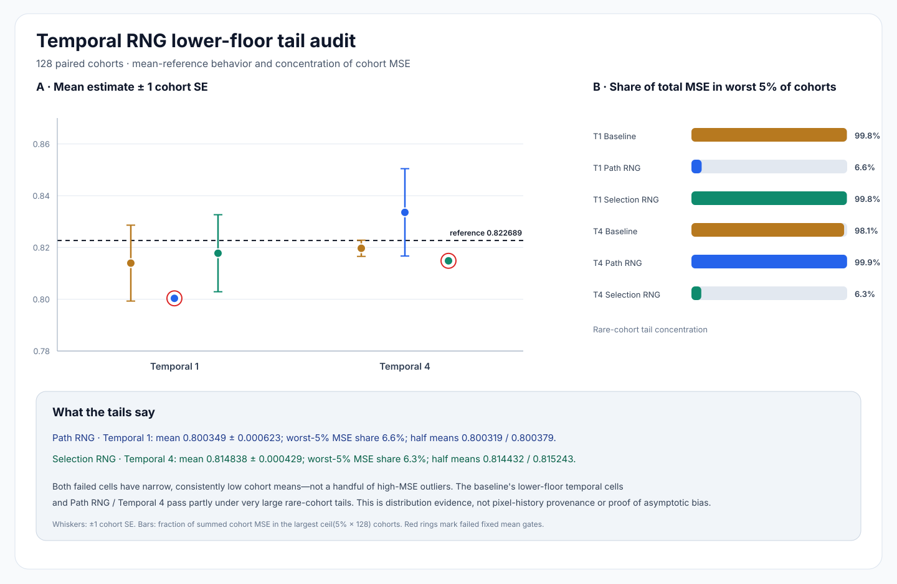

# ReSTIR temporal RNG studies: paired cohort-tail audit

**Outcome:** the two RNG alternatives fail their fixed lower-floor mean gates for different reasons than a few catastrophic cohorts. In the failing alternative/cell, cohort errors are comparatively quiet and consistently low. Conversely, several baseline/pass cells have aggregate MSE almost entirely concentrated in rare, extreme cohorts. This is a distributional diagnosis of the existing study outputs—not pixel-history provenance, a proof of asymptotic bias, or a renderer fix.

## Scope and evidence boundary

This audit re-reads the committed 128-cohort baseline, selection-hash, and path-hash study logs. It does not compile shaders, execute Vulkan, modify production RNG behavior, or generate a scene render. The requested moving-visibility reservoir-provenance instrumentation remains unrun: this checkout has no Slang compiler, Vulkan headers/runtime, or SwiftShader. The SVG below is a data visualization, not visual proof of rendered-image quality.

Inputs:

- `Results/ReplayTemporalSelectionStream.txt`
- `Results/ReplayTemporalPathStream.txt`

Each log contains 128 cohort aggregates for five modes and two floors per arm. The shared reference is `0.82268910511`. `ReplayTemporalRngTailAudit.py` validates complete coverage, recomputes logged summary statistics from cohort rows, and checks cross-study stream/hash controls before reporting results.

## Method

- Recompute the cohort mean and mean standard error (SE) from 128 cohort means; independently recompute cohort MSE, RMSE, and SE.
- The fixed mean gate is the study gate: `abs(mean − reference) <= 5 × cohort_SE + 0.001`.
- `worst-5% MSE share` is the sum of MSE in the largest `ceil(0.05 × 128) = 7` cohort rows, divided by total cohort MSE. It measures concentration across **cohort aggregates**, not a pixel-level tail probability.
- The two half means are descriptive cohort-index splits (0–63 and 64–127), not independent holdout estimates.
- Paired differences subtract candidate and baseline within each matching cohort. The printed `±` is one paired SE; intervals shown are normal-approximation `delta ± 1.96 SE`, exploratory and not multiplicity-adjusted. Heavy-tailed baseline rows make normal approximations especially fragile.

## Main lower-floor temporal results

| Arm / cell | Mean ± SE | Reference error | Gate | RMSE | Worst-5% MSE share | Largest cohort MSE | Half means |
|---|---:|---:|:---:|---:|---:|---:|---:|
| Baseline / Temporal 1 | 0.813958 ± 0.014657 | −0.008731 | PASS* | 3.766765 | 99.8% | 1812.4 | 0.798664 / 0.829252 |
| Path RNG / Temporal 1 | 0.800349 ± 0.000623 | −0.022340 | **FAIL** | 0.169220 | **6.6%** | 0.035096 | **0.800319 / 0.800379** |
| Selection RNG / Temporal 1 | 0.817775 ± 0.014881 | −0.004914 | PASS* | 3.802742 | 99.8% | 1691.1 | 0.835641 / 0.799908 |
| Baseline / Temporal 4 | 0.819691 ± 0.003130 | −0.002998 | PASS* | 0.787031 | 98.1% | 67.142 | 0.814466 / 0.824916 |
| Path RNG / Temporal 4 | 0.833565 ± 0.016878 | +0.010876 | PASS* | 4.313781 | 99.9% | 2369.5 | 0.851336 / 0.815793 |
| Selection RNG / Temporal 4 | 0.814838 ± 0.000429 | −0.007851 | **FAIL** | 0.112751 | **6.3%** | 0.014773 | **0.814432 / 0.815243** |

`*` The baseline and Path RNG / Temporal 4 passes are not evidence of tight convergence: their cohort SEs and MSE tails are very large, which makes the 5-SE gate permissive. In particular, the baseline Temporal 1 allowance is `0.074287`, and Path RNG / Temporal 4's allowance is `0.085389`.



### Interpretation

- **Path RNG / Temporal 1:** the failed mean is not carried by one or two giant-MSE cohorts. Its worst seven cohorts contribute only 6.6% of total MSE, maximum cohort MSE is 0.035096, and the two cohort-index halves agree to about `0.000060`. Its mean is about 35.9 cohort SE below the reference. This is strong evidence of a stable low estimate in this finite run, not a diagnosis of why it is low.
- **Selection RNG / Temporal 4:** likewise, the worst-seven share is 6.3%, maximum cohort MSE is 0.014773, and both halves remain low. Its mean is about 18.3 cohort SE below the reference.
- **Baseline / Temporal 1 and Temporal 4, plus Path RNG / Temporal 4:** their apparent gate passes coexist with tail concentration from 98.1% to 99.9%. The baseline Temporal 1's largest cohort MSE is 1812.4; Path RNG / Temporal 4's is 2369.5. A small number of rare, huge errors dominate these aggregate losses and inflate the mean SE.
- Thus, the two RNG variants are **not accepted fixes**. Their mean-gate failures are in different cells, and their low RMSE in those cells does not override the reference-mean failure. The tail pattern is consistent with a persistent estimator/support difference, but this audit cannot distinguish that from other causes or establish asymptotic bias.

## Paired comparison caution

The matched-cohort difference intervals include zero in both failing cells:

| Candidate vs baseline | Paired mean delta ± SE | Approx. 95% interval | Delta MSE ± SE | Candidate RMSE − baseline RMSE |
|---|---:|---:|---:|---:|
| Path RNG / Temporal 1 lower | −0.013609 ± 0.014690 | [−0.042402, +0.015184] | −14.159882 ± 14.159407 | −3.597545 |
| Selection RNG / Temporal 4 lower | −0.004853 ± 0.003024 | [−0.010781, +0.001074] | −0.606705 ± 0.526383 | −0.674280 |

So these paired comparisons do not establish a 95%-level mean improvement over baseline. The baseline's extreme tail makes paired uncertainty enormous. Separately, each candidate's own narrow cohort distribution still fails its fixed reference-mean gate. Those are distinct questions and should not be conflated.

## Reproduction and controls

From repository root:

```sh
python3 Exhibits/LightCompute/Code/ReplayTemporalRngTailAudit.py \
  Exhibits/LightCompute/Results/ReplayTemporalSelectionStream.txt \
  Exhibits/LightCompute/Results/ReplayTemporalPathStream.txt \
  Exhibits/LightCompute/ReplayTemporalRngTailAudit.svg
python3 -m unittest Exhibits/LightCompute/Code/ReplayTemporalRngTailAuditTest.py
```

Verified controls: all **1,280/1,280** baseline image hashes match across the two studies; path-RNG-arm selection hashes match baseline in **1,280/1,280** pairs while path hashes change in **1,280/1,280**; the earlier selection-RNG arm changes selection hashes in **1,280/1,280** pairs. The audit also recomputes all per-arm/per-cell logged mean, SE, MSE, RMSE, and gate outcomes from the 128 cohort rows.

Tests: **6/6** audit unit tests pass, including synthetic tail-concentration controls, complete recorded-log/hash checks, SVG generation, and rejection of incomplete input. Python compilation and `git diff --check` pass. These are host-side analysis checks only; they do not exercise C++, Slang, Vulkan, a physical GPU, Windows, or the editor.

## Integration status

No production shader, reservoir default, renderer, or Frontier C++ behavior was changed. The RNG alternatives remain test-only; no provenance instrumentation was compiled or run. The fair peer-branch review remains as previously recorded in the selection/path-stream reports; this audit neither imports nor claims new peer-branch code.
