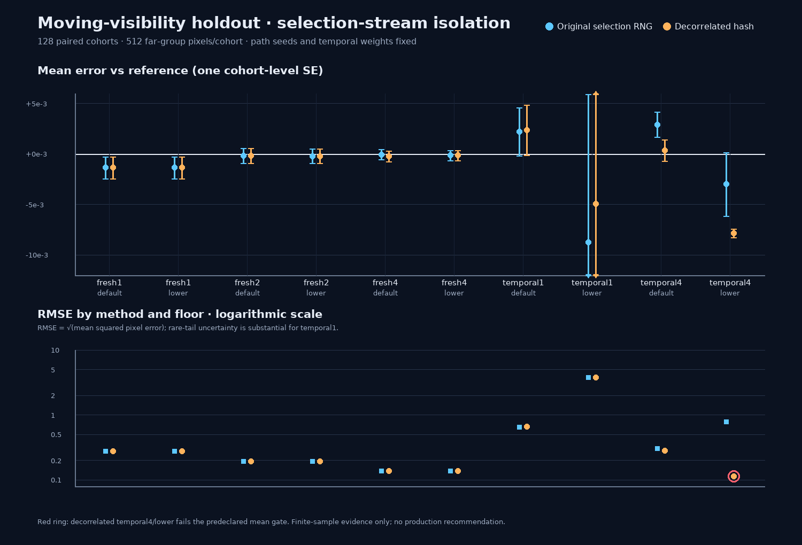

# Replay-temporal selection-stream isolation

**Decision:** do not port or promote the alternative selection RNG. On this fixed moving-visibility holdout it changed results measurably, but it also failed the predeclared independent-reference mean gate in temporal4 at the lower firefly floor. Its apparently much lower temporal4/lower RMSE is not sufficient evidence to accept it: the paired MSE contrast is noisy and its mean is out of tolerance. The test remains Exhibit-only.

## Question and frozen comparison

Does changing **only** the reservoir-selection random stream alter the lower-floor moving-visibility temporal-history failure? The original stream and a deterministic integer-hash “decorrelated” stream were compared with the same Vulkan/C++ fixture, path proposals, temporal weights, motion history, receiver mask, reference integral, cohort seeds, pixel dimensions and work settings. The hash is a reproducible mixing function, not a proof of statistical independence.

- One mixed-metal moving-visibility far group; 32×32 receivers and 512 reported far-group pixels per cohort.
- 128 paired, fixed seed cohorts per arm; 5 modes × 2 firefly floors: Fresh1, Fresh2, Fresh4, temporal1 and temporal4; default `0.01` and lower `0.0001` floors.
- 2,560 arm/mode/floor/cohort images in total. All samples are from the same sequence in both arms.
- Independent reference: `0.82268910511`; 512-resolution convergence check: `0.822689540307` (difference `4.35e-7`).
- Mean gate: `|sample mean − reference| ≤ 5 × cohort SE + 0.001`. RMSE is computed against that reference from the cohort/pixel squared error.
- Test-only shader instrumentation read back and checked 1,310,720 path-seed and 1,310,720 preselection-stream values **per arm**. Path proposal seeds matched their exact host reconstruction. Selection hashes differed in 1,280/1,280 paired rows; Fresh1 output hashes remained identical in 256/256 controls. The candidate-generation guard also asserts the source diff is confined to selection-stream initialization plus explicit test diagnostics.

## Results

| Mode / floor | Original mean ± SE | Decorrelated mean ± SE | Original RMSE | Decorrelated RMSE | Paired ΔMSE (decorrelated − original) ± SE | Mean gate |
|---|---:|---:|---:|---:|---:|---|
| temporal1 / default | 0.824915 ± 0.002371 | 0.825069 ± 0.002495 | 0.642869 | 0.658382 | +0.020186 ± 0.072340 | pass / pass |
| temporal1 / lower | 0.813958 ± 0.014657 | 0.817775 ± 0.014881 | 3.766765 | 3.802742 | +0.272331 ± 19.480211 | pass / pass |
| temporal4 / default | 0.825614 ± 0.001229 | 0.823045 ± 0.001050 | 0.302505 | 0.279372 | −0.013460 ± 0.018684 | pass / pass |
| temporal4 / lower | 0.819691 ± 0.003130 | **0.814838 ± 0.000429** | 0.787031 | **0.112751** | −0.606705 ± 0.526383 | pass / **fail** |

For temporal4/lower, the decorrelated mean is `0.007851` below reference—about **18.3 of its cohort SE**—and exceeds the gate’s allowed error (`0.003143`). The original arm passes this particular 128-cohort mean gate, but only with `RMSE 0.787`; temporal1/lower in both arms has very heavy tails (RMSE about `3.8` and very large MSE standard errors). These are new fixed cohorts, not the earlier 48-cohort seed schedule: this baseline pass does not erase the earlier two lower-floor failures (78/80 original mean gates). In this holdout the original temporal1/lower uncertainty is so large that the permissive `5 × SE` gate can pass despite the poor RMSE. The candidate’s lower temporal4 RMSE is therefore a **quality trade-off with a clear gate failure**, not a fix. The paired temporal4/lower MSE change is `−0.607 ± 0.526` at one standard error; a rough 95% interval still spans zero. The paired mean change is `−0.004853 ± 0.003024` at one standard error. These finite-sample contrasts do not establish an asymptotic bias or identify the original failure’s root cause.

Fresh-mode controls were stable: Fresh2 RMSE was `0.193514` (original) versus `0.193512` (decorrelated) at default and `0.193133` versus `0.193112` at lower. Fresh4 was `0.137260` versus `0.138036` at default and `0.136634` versus `0.136598` at lower. One of several exploratory paired contrasts (Fresh4/default ΔMSE `+0.000214 ± 0.000086`) is small relative to scene error and is not a material-quality acceptance gate.

Ray-operation counters were effectively unchanged for temporal4/lower (`5,067.336` vs `5,067.312` final rays/cohort; `14,182.375` vs `14,182.312` warm-up rays/cohort). This is a CPU SwiftShader counter comparison, **not physical-GPU timing or a speed claim**. Temporal warm-up work is substantial: temporal1 incurred about `5,065` warm-up rays for about `2,033` final rays per cohort, while Fresh2 incurred none.

## Validation and scope

- Release C++ build succeeded; Exhibit CTest suite passed **10/10**.
- Both shader variants compiled to distinct `GenerateReplayReservoirs` SPIR-V modules; the primary and resolve modules were identical between arms.
- Both Vulkan arms completed on **SwiftShader Device (Subzero)**. The baseline passed all 10 mean gates. The decorrelated arm failed exactly one: temporal4/lower. The paired runner and report therefore correctly return nonzero; failure must not be silently reclassified as success.
- Vulkan shaders and the SwiftShader driver were not sanitizer-instrumented. This is not Windows, editor, physical-GPU, production-scene or real-time frame-time validation.
- No production shader, renderer default or engine behavior was changed. C++ additions are under `Exhibits/LightCompute` and only dispatch the opt-in validation mode.

### Reproduction and evidence

- Raw run, cohort metrics, checksums and arm exits: [`Results/ReplayTemporalSelectionStream.txt`](Results/ReplayTemporalSelectionStream.txt)
- Focused validation: [`Code/ReplayTemporalSelectionStreamValidation.h`](Code/ReplayTemporalSelectionStreamValidation.h)
- Test-only shader generator: [`Code/ReplayTemporalSelectionStreamCandidate.py`](Code/ReplayTemporalSelectionStreamCandidate.py)
- Frozen-run script: [`RunReplayTemporalSelectionStream.sh`](RunReplayTemporalSelectionStream.sh)
- Recomputed cohort/result audit and paired contrasts: [`Code/ReplayTemporalSelectionStreamSummary.py`](Code/ReplayTemporalSelectionStreamSummary.py)
- Visual summary source: [`Code/ReplayTemporalSelectionStreamChart.py`](Code/ReplayTemporalSelectionStreamChart.py)

**Conclusion:** the independent selection hash materially changes the observed tail/mean behavior, but the comparison does not produce a quality-neutral, gate-passing replacement. Keep the baseline unchanged; continue investigating proposal/history support, finite tails and random-stream interactions separately. Do not generalize this one holdout or use it to promote a production RNG.
