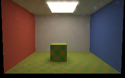
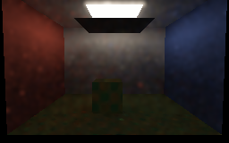
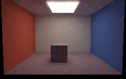
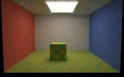
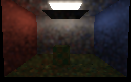
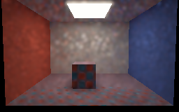

# Textured replay: Vulkan readbacks

Four settled views and three first-transition views were rendered with the guarded diffuse texture mode on
**SwiftShader CPU Vulkan**, not a hardware GPU or the editor. The 256×160 synthetic room uses a texture pyramid on
its floor and cuboid, four hits, balanced facet/BSDF sampling, temporal reuse and spatial replay.

## Settled views

Each image averages the last 12 of 24 submissions. The displayed previews use a geometry-, normal- and
albedo-aware blur; [raw initial](Images/TextureRoomInitial.png), [raw texture change](Images/TextureRoomChanged.png),
[raw blocker](Images/TextureRoomBlocked.png) and [raw reopening](Images/TextureRoomReopened.png) retain the noisy
unfiltered readbacks.

| Initial palette | In-place texture change |
| --- | --- |
|  |  |

| Blocker inserted | Blocker removed and initial palette restored |
| --- | --- |
|  |  |

## First submission after each change

These are individual submissions, not the settled averages above. They are visibly noisy; the previews are
filtered for display only. Raw readbacks: [texture change](Images/TextureRoomChangedFirst.png),
[blocker](Images/TextureRoomBlockedFirst.png), [reopening](Images/TextureRoomReopenedFirst.png).

| Texture change | Blocker inserted |
| --- | --- |
|  |  |

Simultaneous reopening and texture change:



| Transition | Accepted temporal candidates | Spatial links | Reset | History cap |
| --- | ---: | ---: | ---: | ---: |
| Palette change | 37,148 | 147,778 | 0 | 1 |
| Blocker inserted | 35,886 | 147,770 | 0 | 1 |
| Reopen + restore palette | 35,886 | 147,778 | 0 | 1 |

The corresponding settled lower-room linear luminance means are `0.212305`, `0.361245`, `0.014083` and
`0.212252`. They are scene sanity checks, not calibrated image measurements. These first-transition images
show the actual noisy readback; they do not prove the absence of ghosting or establish equal-time quality.
The preview filter rejects large albedo differences but can still blur shadows or spread bright speckles.
Exposure is 0.45 with `1-exp(-L×exposure)` and gamma 2.2; none of the previews are used for numerical tests.

```bash
bash Exhibits/LightCompute/RunReplayTextureCapture.sh
```

[Capture log and image hashes](Results/ReplayTexture-capture.txt) ·
[release regression](Results/ReplayTextureCapture-regression.txt) ·
[sanitized texture checks](Results/ReplayTexture-sanitized.txt) ·
[sanitized preview-filter checks](Results/ReplayTextureCapture-filter-sanitized.txt) ·
[texture reference and scope](ReplayTexture.md).

The refreshed captures used source revision `ba385ae`, Linux x86-64, GCC 12.2 and Slang 2026.14.1
(`-O0` SPIR-V, release C++ host). All 14 PNG files are byte-identical to `4ed4ef6` despite correcting that
fixture's ignored reserved optics component; the corrected host now rejects the old layout. The external Vulkan
driver is not sanitizer-instrumented. This is not full ReSTIR GI, a measured material or optical result, editor
integration, hardware-GPU validation, or a real-time benchmark.
