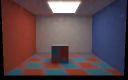
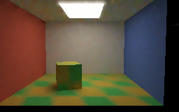
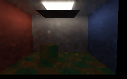
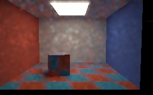

# Textured camera, object and blocker renders

Four settled views and three first-transition views are actual **SwiftShader CPU Vulkan** readbacks of the
bounded four-hit diffuse replay experiment. They are synthetic scenes, not editor or hardware-GPU screenshots.
The checker texture follows the cuboid's rigid motion; the camera, object and palette change together.

## Settled views

Each image averages the last eight of 16 submissions in linear RGB. Previews use a geometry-, normal- and
albedo-aware display blur. Unfiltered readbacks: [before](Images/TexturedMotionBefore.png),
[moved](Images/TexturedMotionMoved.png), [blocked](Images/TexturedMotionBlocked.png),
[reopened](Images/TexturedMotionReopened.png).

| Before motion                                      | Camera and cuboid moved; palette changed        |
| -------------------------------------------------- | ----------------------------------------------- |
|  |  |

| Blocker inserted                                    | Blocker removed; initial palette restored             |
| --------------------------------------------------- | ----------------------------------------------------- |
|  |  |

## First submission after each change

These are individual, visibly noisy submissions, not the settled averages. The preview filter can spread bright
samples and blur shadows. Raw readbacks: [motion](Images/TexturedMotionMovedFirst.png),
[blocker](Images/TexturedMotionBlockedFirst.png), [reopening](Images/TexturedMotionReopenedFirst.png).

| Camera, object and palette    | Blocker inserted                |
| ----------------------------- | ------------------------------- |
| ![First motion][first-motion] | ![First blocker][first-blocker] |

[first-motion]: Images/TexturedMotionMovedFirstPreview.png
[first-blocker]: Images/TexturedMotionBlockedFirstPreview.png

Blocker removed and palette restored:



The camera shifts `0.35` world units; the cuboid rotates `0.28` rad and translates `0.224` units. The host
supplies both the current and previous rigid/camera transforms and rebuilds the BVH. In all three transitions,
old paths are retraced against current geometry, with represented history capped at one.

| Transition                 | Temporal candidates accepted | Spatial links | Reset | History cap |
| -------------------------- | ---------------------------: | ------------: | ----: | ----------: |
| Camera, cuboid and palette | 34,922                       | 142,226       | 0     | 1           |
| Blocker inserted           | 34,470                       | 142,148       | 0     | 1           |
| Reopen and restore palette | 34,470                       | 142,226       | 0     | 1           |

The fixed lower-image linear luminance means were `0.211452`, `0.361572`, `0.014354` and `0.210945`, respectively.
They are scene sanity checks, not measured photometric ground truth. Exposure is 0.45 with
`1-exp(-L×exposure)` and gamma 2.2. These pictures do not prove an absence of ghosting, realistic appearance,
or real-time performance. The separate [independent motion reference](ReplayTextureMotion.md) uses smaller
camera and object motions and compares two actual pixels; it does not validate every pixel of these captures.

```bash
bash Exhibits/LightCompute/RunReplayTextureMotionCapture.sh
```

[Capture log, source and decoded RGB hashes](Results/ReplayTextureMotion-capture.txt) ·
[sanitized replay, texture and preview-filter regressions](Results/ReplayTextureMotionCapture-sanitized.txt) ·
[previous texture captures](ReplayTextureCaptures.md) · [bounded texture scope](ReplayTexture.md).
The images used Linux x86-64, GCC 12.2, Slang 2026.14.1 (`-O0` SPIR-V), and a release host; the external driver
is not sanitizer-instrumented.
