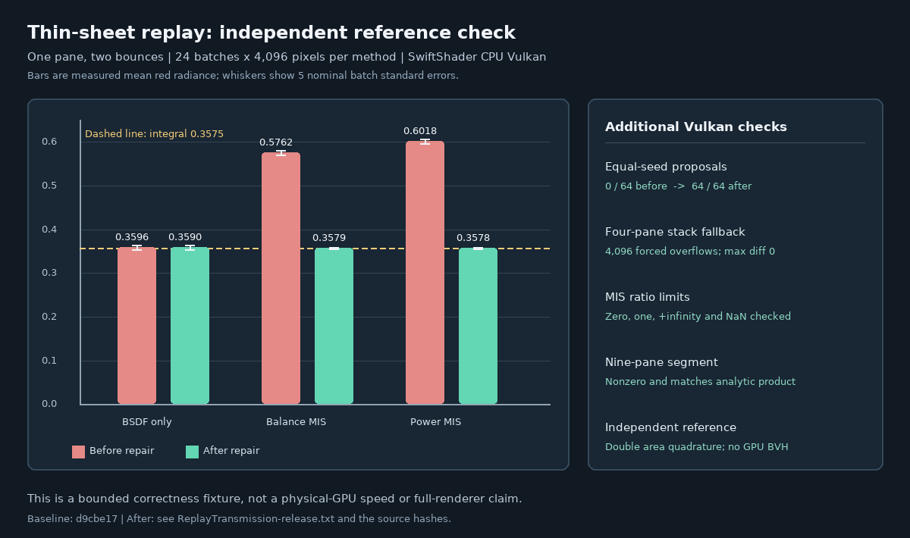

# Replay transmission and reservoir intake audit

## Outcome

An independent area integral exposed double-counted direct light through a thin sheet in commit `d9cbe17`.
The repaired software-Vulkan replay agrees with that integral in the bounded fixtures below. Equal temporal/bank
seeds also retain both weighted proposals, and a pane-traversal overflow no longer reapplies already visited panes.
These are focused correctness checks, not general ReSTIR GI, full-material or physical-GPU acceptance.



## Reproduced defect and repair

The fixture has an opaque rough receiver, a category-2 parallel sheet and a rectangular source. A separate
512-by-512 double-precision area quadrature integrates the receiver BRDF, solid-angle conversion and sheet
transmittance. It does not reuse shader RNG or triangle-BVH code. The 256-by-256 quadrature differs by less than
`1e-5`. Each red-channel GPU mean uses 24 deterministic batches of 4,096 receivers; reported standard errors are
nominal batch estimates and do not prove independence of all underlying random streams.

| Two-bounce method | Before `d9cbe17` | Repaired | Independent integral |
| --- | ---: | ---: | ---: |
| BSDF only | 0.359579 | 0.359000 | 0.357501 |
| Balance MIS | 0.576151 | 0.357859 | 0.357501 |
| Power MIS | 0.601777 | 0.357846 | 0.357501 |

The original source-sampling path included pane transmittance while the BSDF path added the same source at full
weight after transmission. The new calculation compares the source density with the originating BSDF density
multiplied by the probability of each straight-through sheet selection. The BSDF-hit contribution carries the
complementary weight. A reflected sheet path has no straight source competitor. When the bounce limit prevents a
BSDF path from reaching the emitter through all sheets, the source proposal receives full weight.

Additional checks cover no pane, one pane at one and two bounces, and two panes at two and three bounces. They
include source-only, BSDF-only when reachable, balance and power MIS; each passes the fixed `5 * batch SE + .006`
reference gate. Results and hashes are in the [Release log](Results/ReplayTransmission-release.txt); the
[before log](Results/ReplayTransmission-before.txt) and [baseline rerun](Results/ReplayTransmission-baseline.txt)
retain the failing results and exit condition.

## Other guards exercised

| Check | Result |
| --- | --- |
| Same temporal and bank seed | Both proposal counts retained: `0/64` before, `64/64` after. |
| Four-pane BVH overflow | `4,096` forced fallbacks; full/fallback maximum difference `0`. |
| Nine-pane segment | Full and fallback traversals retain a nonzero analytic transmittance. |
| MIS limit weights | Both shader modes match zero, one, positive infinity and NaN limits. |
| Receiver material address | Host rejects infinity; shader bounds the conversion. |
| Host checks | 10/10 Release and host ASan/UBSan CTests. |

The overflow results differ from the analytic four-sheet product by `1.18e-7`. Equal seeds cache only their
current-surface radiance evaluation. The external driver and shaders are not sanitizer-instrumented.

The reservoir count validator now admits at most 68 represented candidates: at most four fresh plus a capped 64
history candidates. The seed-bank domain has tighter admission rules. The new duplicate check proves the arithmetic
for the injected equality case; it does not establish the conditional seed-measure identity for arbitrary reuse.

## Reproduce

Linux x86-64, GCC 12.2, Slang 2026.14.1, Vulkan headers 1.4.321 and SwiftShader CPU Vulkan were used. Dependencies
are restored into ignored storage with `python3 Exhibits/LightCompute/Code/Prepare.py`; CMake, Ninja and Pillow are
also needed. No GitHub Actions run is required.

```bash
bash Exhibits/LightCompute/RunReplayTransmission.sh
# Expected to exit 1: compiles the historical d9cbe17 shaders against the current comparison fixture.
BASELINE=1 bash Exhibits/LightCompute/RunReplayTransmission.sh
PYTHONPATH="$PWD/_ClaudeScratch/pytools" python3 Exhibits/LightCompute/Code/ReplayTransmissionImages.py
```

The before and baseline logs intentionally exit nonzero. The after log records shader and fixture hashes for the
passing run; the separately hashed [Vulkan sequence log](Results/ReplaySubmissionSequence-release.txt) exercises
replay with the new completion-gated C++ path. Physical RT execution, arbitrary materials, complex visibility
and equal-time performance remain untested.
The segment now visits every intersected sheet rather than silently blacking out after eight; its cost grows with
scene complexity, and inter-pane multiple reflections are outside this thin-sheet approximation.
