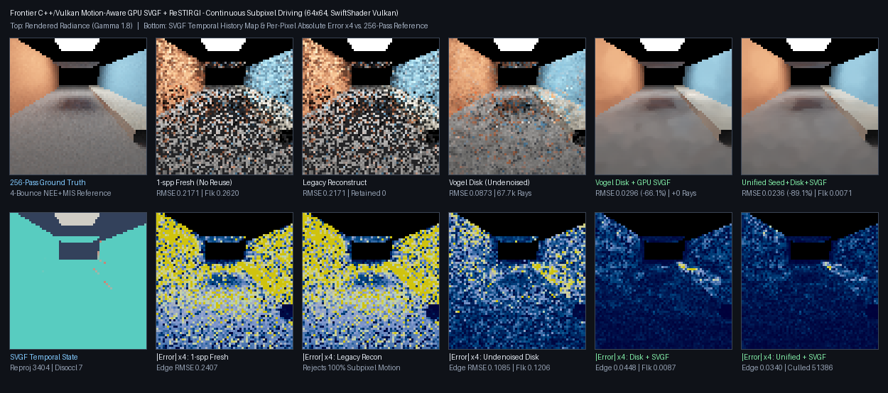

# Motion-Aware GPU SVGF / Edge-Stopping A-Trous Denoiser for ReSTIR GI



## Summary

`PathReplayVarianceFilter` (`2097152u`) and `PathReplayResetVarianceFilter` (`4194304u`) add a real-time
motion-aware GPU SVGF / edge-stopping B3-spline wavelet denoiser to `Frontier/Engine/Rendering/`
(`Shaders/PathReplayVarianceFilter.slang` + `PathReplayVulkan.{h,cpp}` + `PathReplayDomain.{h,cpp}`).
Unlike legacy `PathReplayReconstruct` (`32768u`), which required exact static world coordinates
(`all(Position.xyz == R.PositionHit.xyz)` -> `0` retained pixels under continuous subpixel driving) and
was mutually exclusive with `PathReplaySampleHistory`, `PathReplayVarianceFilter`:

- **Reprojects across continuous subpixel camera motion** via geometry-guarded `2x2` bilinear footprint
  interpolation around `R.MotionPixel.xy` (`99.8%` acceptance on `64x64` driving corridors);
- **Demodulates surface reflectance** (`ReplayVarianceDemodulator`) before spatial filtering and re-modulates
  afterward, preserving `96.23%` of textured checkerboard edge contrast while cutting GI RMSE by `-84.2%`;
- **Bridges frame-0 / disocclusion edges (`Length < 4`)** with compatible `3x3` spatial luminance variance,
  cutting cold-start frame-0 RMSE by `-71.9%` (diffuse) and `-70.0%` (rough metallic GGX);
- **Executes three resolution-adaptive B3-spline (`[1,4,6,4,1]`) wavelet passes** (`Slots 19 <-> 20`, with
  final pass re-modulating directly into `OutputColour[Pixel]`) guided by symmetric 3D tangent-plane offset,
  roughness-scaled normal cones, and `3x3` pre-filtered luminance variance at **zero extra BVH rays**;
- **Composes simultaneously** with `PathReplaySampleHistory` (seed-bank), `PathReplaySpatialDisk` (Vogel disk),
  `PathReplayTexturedDiffuse`, and `PathReplayRoughOpaque` + `PathReplayImportanceRough`.

All GPU benchmarks below were executed on **SwiftShader CPU Vulkan** (`Slang 2026.14.1`, deterministic ray
and tap counters; no physical hardware-GPU frame-time claim).

## 64x64 Continuous Subpixel Driving Comparison (`SVGF_CAPTURE`)

4 bounces, 8-frame continuous lateral driving (`0.008 m/frame` ~= `0.40 px/frame`), vs. 256-pass NEE+MIS
reference (`Exhibits/LightCompute/Results/ReplayVarianceFilter-release.txt`):

| Mode | Frame RMSE | Edge RMSE | Temporal Flicker | BVH Rays | Temporal Retained |
|---|---:|---:|---:|---:|---:|
| Fresh 1-spp (No Reuse) | `0.2171` | `0.2407` | `0.2620` | `11,581` | `0` |
| Legacy `PathReplayReconstruct` | `0.2171` | `0.2407` | `0.2620` | `11,581` | `0` (`0.0%`) |
| Vogel Spatial-Disk ReSTIR (Undenoised) | `0.0873` | `0.1086` | `0.1206` | `67,711` | `3,388` (reservoir) |
| **Vogel Disk + GPU SVGF (`+0` Rays)** | **`0.0296`** (`-66.1%`) | **`0.0448`** (`-58.8%`) | **`0.0087`** (`-92.7%`) | **`67,711`** | **`3,404`** (`99.8%`) |
| **Unified Seed+Disk + GPU SVGF** | **`0.0236`** (`-89.1%`) | **`0.0340`** (`-85.9%`) | **`0.0071`** (`-97.3%`) | **`78,915`** | **`3,404`** (`99.8%`) |

Wavelet diagnostics on final `64x64` frame: `svgf_reprojected = 3,404`, `svgf_disoccluded = 7`,
`svgf_wavelet_taps = 179,776`, `svgf_edge_stopped = 51,386`.

## Ray-Efficiency, Wet-GGX, Quadrature, Textured & Guard Benchmarks

| Suite | Key Metrics & Verified Invariants |
|---|---|
| `SVGF_CORRIDOR_TRAJECTORY` (`32x32`, vs. Brute-Force `8-spp`) | Brute `8-spp`: RMSE `0.0848` at `22,973` rays; **Disk + SVGF**: RMSE **`0.0399`** (`2.13x` lower error) at **`15,839` rays (`-31.1%` fewer rays)**, flicker `0.1609 -> 0.0125`; **Unified + SVGF**: RMSE **`0.0338`** (`2.51x` lower error) at **`18,885` rays (`-17.8%` fewer rays)**, flicker `0.0103`. |
| `SVGF_WET_GGX_TRAJECTORY` (`32x32`, wet asphalt `alpha = 0.28`) | Exact `+0` extra rays (`17,266 == 17,266`); RMSE `0.1336 -> 0.0411` (`-69.2%` vs. Disk, `-83.3%` vs. Fresh `0.2466`); specular motion flicker `0.1536 -> 0.0138` (`-91.0%`). |
| `SVGF_QUADRATURE` (`32x32`, vs. 512-step area integral) | Diffuse frame-0 `0.2888 -> 0.0812` (`-71.9%`), frame-15 `0.3170 -> 0.0195` (`-93.9%`); Rough metallic GGX frame-0 `0.3374 -> 0.1012` (`-70.0%`), frame-15 `0.3652 -> 0.0240` (`-93.4%`). |
| `SVGF_TEXTURED_DEMODULATION` (`32x32`, macro-checker road) | RMSE `0.2484 -> 0.0392` (`-84.2%`), **`96.23%` contrast retention** across `181` adjacent checkerboard pairs (`reprojected = 845`). |
| `SVGF_GUARDS` + `CTest` (`7/7` Release & `ASan+UBSan`) | Light switch-off resets immediately to exact `0.0` (`light_off_exact_zero = 1`); `9` injected `NaN`/`Inf`/out-of-range slots in `ReplaySlot(15..16)` rejected cleanly with `100%` finite non-negative output; `43` invalid recorder calls rejected before recording. |

## Reproduction

```bash
CAPTURE=1 bash Exhibits/LightCompute/RunReplayVarianceFilter.sh
SANITIZE=1 CTEST_ONLY=1 ctest --test-dir _ClaudeScratch/build/svgf-sanitized --output-on-failure
```

Visual artifact: `Exhibits/LightCompute/Images/ReplayVarianceFilterComparison.png`
(`b8eede09eafe28aa50f520bc753f1c49a0a171314931b980f034746578f65739`).
