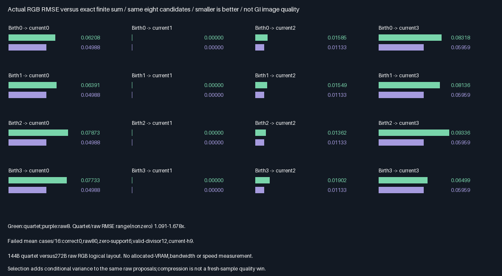
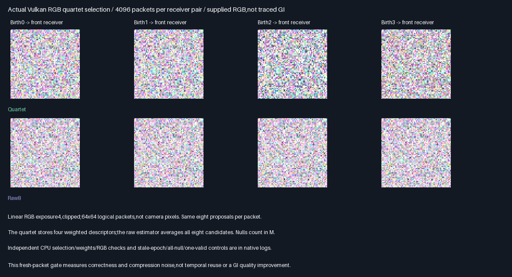

# Integrated RGB quartet selection

## Outcome — 2026-10-29

**GPU selector correctness passes;fresh-packet quality promotion is rejected.** Four weighted RGB descriptors are
written by one compute dispatch,then read and reconstructed by a second dispatch after a shader memory barrier.
The implementation agrees with an independent double-precision CPU selector/evaluator. Against the same eight
raw proposals,the quartet has **9.06–67.82% higher RGB RMSE** on the12 nonzero receiver-pair cases.

| Verification                                        | Result                                       |
|-----------------------------------------------------|----------------------------------------------|
| Release / host ASan+UBSan Vulkan                     | Both exit0;five CTests each                   |
| Packet evaluations / descriptor comparisons per build| 81,920 /327,680                               |
| Selected identity disagreements / rounding ambiguity | 0 /0                                         |
| Max normalized estimate / birth-normalizer error     | 1.486e-7 /1.793e-7                            |
| Max absolute computed RGB component error            | 5.960e-8                                     |
| Fixed precision ceiling                             | 2e-5                                         |
| Release / sanitized parity                          | 38 semantic rows,20 captures,two SPIR-V files |
| Runtime source,tool,module,readback hashes verified  | 68 per build                                 |
| Correct quartet / raw8 RGB mean gates                | 96 passed,including24 zero-reference gates   |
| Stale epoch / rebuild / all-null / one-valid packet  | All pass                                     |
| Production output allocation / defaults              | Unchanged348.046875MiB / unchanged            |

There are4,096 distinct seed packets,reused across conditions for matched comparisons—not81,920 independent
seed packets or20 independent scene fixtures. Mean gates use `6*SE+2e-5` as frozen;passing empirical gates is
not a general unbiasedness theorem. No physical GPU,ray-visibility or full-renderer quality result is claimed.

## Decision and comparison

Stars rate **fresh-packet accuracy in this bounded test**,more is better. Logical sizes come from the separately
compiled [descriptor/layout gate](FacetReservoir.md),not measured VRAM allocations or runtime history sizes.

| Option                          | Logical packet | RGB RMSE vs raw8 | Accuracy | Decision                       |
|---------------------------------|----------------|------------------|----------|--------------------------------|
| Same eight raw RGB candidates   | 272B           | 1.000×           | ⭐⭐⭐ | 🏆 Equal-draw accuracy winner   |
| Four weighted RGB descriptors   | 144B           | 1.091–1.678×      | ⭐⭐   | Correct;compression only |
| Zero birth-geometry target      | Same quartet   | Biased cases     | —        | Reject                         |
| Valid-count or current-h divisor| Same quartet   | Biased cases     | —        | Reject                         |

The quartet saves47.06% of the **logical RGB packet** versus raw8,but does not improve this fresh estimator.
No speed,bandwidth or allocated-memory saving is measured. Both arms consume the same eight candidate draws;
this kernel also computes diagnostic controls,so its combined work must not be presented as quartet timing.



| Birth receiver → current receiver | Quartet RGB RMSE | Raw8 RGB RMSE | Quartet increase |
|-----------------------------------|------------------|---------------|------------------|
| Front → front                     | .0620775         | .0498755      | 24.46%           |
| Back → front                      | .0639057         | .0498755      | 28.13%           |
| Lateral → front                   | .0787330         | .0498755      | 57.86%           |
| Oblique → front                   | .0773301         | .0498755      | 55.05%           |
| Oblique → oblique                  | .0649915         | .0595916      | 9.06%            |
| Oblique → lateral                 | .0190151         | .0113307      | 67.82%           |

RMSE is per-packet RGB error against the exact discrete finite sum,not camera-image RMSE. It is an observed
comparison on this fixed seed bank,not a confidence interval or an independently replicated scene-quality study.
All80 case/method rows,RGB means,standardized mean errors and gates are in the
[generated comparison table](Results/RgbQuartet-comparison.md). Four back-side current-receiver cases have zero
geometry and zero error in both correct arms;they are not evidence of a quality improvement.

### Comparison with earlier results

- [Scalar weighted quartet](WeightedQuartet.md):the prior rotate2w arm passed5/5 restricted quality/query gates,
  with17.51–24.00% fewer queries and8.60–16.12% lower temporal RMSE than corrected Fresh8. That experiment
  includes persistent scalar histories;this new fresh RGB packet test does not. Its80B format and quality result
  cannot be transferred to general RGB descriptors or used to hide the present fresh-packet noise increase.
- [Facet/support prerequisite](FacetReservoir.md):32B descriptor/144B quartet and positive-support contract carry
  forward unchanged. This phase adds actual GPU selection and a second-dispatch descriptor decode/evaluation;
  the prior phase supplied the birth normalizer and tested finite selection only in Python.

## Actual GPU readbacks



Top row:quartet;bottom:raw8. Each64×64 panel is an array of logical packets,not camera pixels. Linear exposure4
is clipped for display. Eight original64×64 PNG arrays are checked byte-for-byte before creating the montage.
These are actual Vulkan output buffers,not generated illustrations or a GI render.

## What was implemented and checked

- Eight noncoplanar facets reuse production `FacetSurface` interpolation. Proposals select one of eight fixed
  interior facet points or null,with nominal discrete density `q=1/9`. This is not area-density surface sampling.
- Each packet makes eight proposal draws,partitioned into four independent-pair reservoir constructions. Birth
  target is `h=1/64+nonnegative geometry`. Selection uses `h/q`;stored weight is `sum(h/q)/(2*h_selected)`.
  Null proposals contribute zero weight but still count in the two-draw divisor.
- The first dispatch writes four shared32B descriptors through eight float4 output slots. The second dispatch
  decodes those slots,validates index/revision/barycentrics/finite RGB/weight,and evaluates the selected descriptors
  at the current receiver. The existing native host provides the shader-write→shader-read barrier between them.
- The CPU independently reconstructs positions and normals in double precision,replays the integer hash stream,
  predicts selected identity,checks descriptor fields and normalizers,and evaluates both quartet and raw8 outputs.
  Computed floating RGB is compared under the declared precision contract,not bitwise across different arithmetic.
- Sixteen birth/current receiver pairs test unchanged geometry. Additional scenarios reject epoch7 at epoch8,
  rebuild descriptors at epoch8,force eight null proposals,and force exactly one valid proposal among eight.
  The epoch scenarios test metadata rejection/rebuild,not persistent history or production mutation hooks.
  Forced null/one-valid scenarios test arithmetic only,not mean correctness under their altered draw distribution.
- RGB is an explicit deterministic supplied per-facet function,not traced outgoing radiance. No visibility query,
  cached-light tracing,temporal/spatial reuse or area-to-solid-angle Jacobian is implemented by this gate.

For fixed two-draw proposals `a,b`,let `F` be RGB times current geometry. With positive support:

```text
p(select s) = h_s/(h_a+h_b)
W_s         = 9*(h_a+h_b)/(2*h_s)
E[F_s*W_s | a,b] = 9*(F_a+F_b)/2
E[average of four reservoirs | eight draws] = raw8 average
```

The identity assumes ideal independent proposal and selection draws;the hash-based GPU stream is checked
empirically,not certified independent by these tests. Nulls have zero `F` and selection weight;all-null pairs
contribute zero. Selection adds conditional
variance to the raw estimator. Smaller storage can be useful for future reuse,but cannot by itself be called
an equal-draw fresh-quality win. The previous [finite positive-support checks](FacetReservoir.md) establish the
bounded normalization prerequisite;the present GPU mean checks are empirical validation of this implementation.

## Negative controls and initial test correction

| Deliberately incorrect estimator | Failed receiver-pair mean gates /16 | Why rejected                        |
|---------------------------------|------------------------------------|-------------------------------------|
| Zero birth-geometry support      | 6                                  | Cannot select later-visible samples  |
| Divisor counts valid draws only  | 12                                 | Null draws incorrectly disappear    |
| Current-target denominator       | 9                                  | Replaces required birth normalizer  |
| Correct quartet / raw8           | 0 /0                               | All frozen mean gates pass          |

The initial native run failed an **over-strict exact equality assertion for computed RGB**,not the frozen2e-5
precision gate. CPU division and shader arithmetic differ by up to5.960e-8. The assertion was corrected to the
already-declared tolerance;both full builds then passed. No target floor,seed bank,mean threshold or fixture was
tuned. The [initial failure log](Results/RgbQuartet-initial-failure.txt) is retained,not relabelled as a pass.

Protocol terminology correction:the frozen table below called proposal points “facet-centroid outcomes”. The
executed points use fixed barycentrics `u=.2,v=.3`,not the centroid. Neither points nor probabilities changed after
measurement;the CPU and GPU both test those same interior points. This wording error does not establish coverage
of arbitrary within-triangle sampling,which remains future work.

## Progress and next bounded problem

| Scope                    | Complete | Remaining | Interpretation                              |
|--------------------------|----------|-----------|---------------------------------------------|
| RGB GPU selector gate    | 100%     | 0%        | Code,tests,comparisons,evidence and report   |
| Overall ReSTIR/GI effort | ~46%     | ~54%      | Planning estimate,not measured acceptance    |

Done:scalar quartet experiment;facet/RGB descriptor and support prerequisite;actual GPU quartet selection,
wire transport and current-receiver evaluation. **Fresh-quality promotion is rejected**,not silently deferred.

Next bounded problem:persistent RGB quartet reuse across receiver changes,with revision resets and matched
fresh/raw quality/query comparisons. Remaining afterward:traced RGB suffixes,visibility/reconnection,arbitrary
surface proposals,dynamic/camera/TAA and general-scene acceptance,physical GPU measurement,and production C++
integration only if quality or speed acceptance is demonstrated. Further packing,editor/vehicle/Jolt remain deferred.

## Reproduction and evidence

| Configuration | Tested condition                                                           |
|---------------|----------------------------------------------------------------------------|
| Source        | Basefbda76d56ef7c7cc0039ac2549b39705b5341adf + hashed exhibit changes         |
| Host          | Linux x86-64,Debian GCC12.2,CMake3.31.6;local validation only                 |
| Shader        | Slang2026.14.1,direct SPIR-V1.3,-O0                                          |
| Vulkan        | Pinned SwiftShader CPU Vulkan device;not a physical GPU                     |
| Sanitizers    | Host ASan+UBSan only;driver/SPIR-V are not instrumented                      |
| Untested      | Windows/MSVC,physical GPUs,editor,production renderer and persistent history |

Use pinned tools from `Automation/ReplayToolDependencies.json`,Vulkan-Headers v1.4.321,and Python with Pillow.
The runner compiles both compute entry points,builds the native host,runs five CTests and executes20 scenarios.
The evidence generator verifies all68 logged hashes per build,all semantic rows,all capture bytes,all mean gates
and required negative failures. It retains20 lossless `.f32.gz` captures and both compiled `.spv.gz` modules under
Results,plus generated tables,audit and hashes. Debug output uses the existing large exhibit buffer;it does not
allocate a144B-per-packet production history. No Windows or Linux application binary is delivered.

```bash
BUILD_JOBS=1 bash Exhibits/LightCompute/RunRgbQuartet.sh
SANITIZE=1 BUILD_JOBS=1 bash Exhibits/LightCompute/RunRgbQuartet.sh
_ClaudeScratch/venv/bin/python Exhibits/LightCompute/Code/RgbQuartetEvidence.py
```

- [Release log](Results/RgbQuartet-release.txt),[host-sanitized log](Results/RgbQuartet-sanitized.txt).
- [Final audit](Results/RgbQuartet-parity.txt),[evidence hashes](Results/RgbQuartet-evidence-hashes.txt).
- [GPU selector and decoder](Code/RgbQuartetGpu.slang),[native reference](Code/RgbQuartetValidation.h).
- [Evidence generator](Code/RgbQuartetEvidence.py).

Production348.046875MiB/layout/defaults and prior scalar/descriptor reports remain unchanged. No packing,PR or Actions.

## Frozen protocol — 2026-10-29,before measurements

One bounded correctness gate:generate four independent two-proposal RGB reservoirs on Vulkan,reconstruct their
selected shared32B descriptors,and evaluate them at another receiver. Cached RGB is supplied,not traced.
Production348.046875MiB/defaults and previous descriptor/scalar-quartet results remain unchanged.

| Concern | Fixed acceptance |
|---------|------------------|
| Geometry | Same eight noncoplanar facets and production FacetSurface interpolation as descriptor gate |
| Sampling | Eight independent draws uniform over eight facet-centroid outcomes plus null;q=1/9 |
| Quartet | Four independent pairs;positive target1/64+birth geometry;normalizer sum(h/q)/(2*h_selected) |
| Evaluation | Average four RGB*normalizer*current geometry estimates;null draws count in divisor2 |
| CPU | Independent double reconstruction,hash RNG replay,selected identity and descriptor normalizer |
| Precision | Absolute/relative max(1,reference)*2e-5;selection ambiguity only if probability margin<2e-6 |
| Ambiguity | At most16 ambiguous comparisons across whole run;record count,never silently drop discrepancies |
| Cases | 16 birth/current pairs;stale epoch;rebuilt epoch;all-null and exactly-one-valid packets |
| Mean | For16 regular cases,each RGB mean within6 standard errors+2e-5 of exact eight-outcome sum |
| Controls | Same eight raw proposals;zero birth support,valid-count divisor,current-target denominator |
| Negative | Each deliberately wrong estimator must fail at least one RGB mean gate across16 regular cases |
| Builds | Release and host ASan+UBSan;five CTests each;exact semantic and raw-capture parity |
| Evidence | Native logs,lossless readbacks,source/module hashes,generated comparison table/chart/report |
| Limits | No traced suffix,visibility rays,temporal/spatial reuse,GI quality or physical-GPU timing claim |

Storage stays144B logical quartet versus272B raw RGB octet;debug output slabs are not a compact history allocation.
Protocol results are reported above. Next after acceptance is persistent RGB reuse and traced-transport comparisons,
not production promotion.
