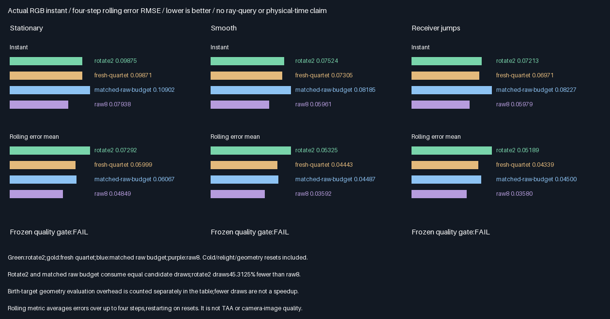
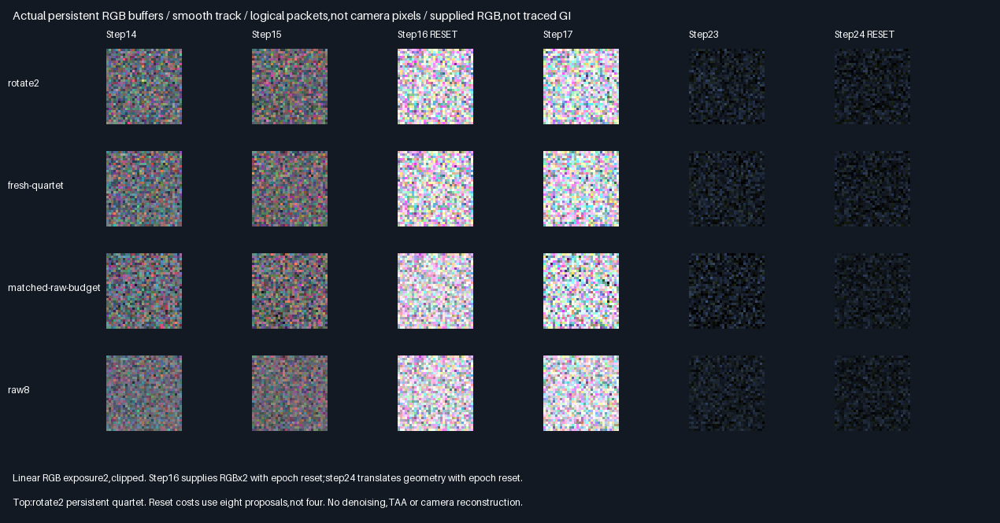

# Persistent RGB quartet reuse

## Outcome — 2026-10-29

**Persistence correctness passes;the frozen quality promotion fails on all three tracks.** Retaining two RGB
reservoirs improves instant error versus the matched raw budget,but correlates errors across steps and worsens
the four-step rolling metric. Keep this isolated prototype out of production;do not relabel candidate draws as rays.

| Verification                                | Result                                    |
|---------------------------------------------|-------------------------------------------|
| Release / host ASan+UBSan Vulkan             | Both exit0;five CTests each                |
| Quartet descriptor comparisons per build    | 786,432                                   |
| Retained32B descriptors compared bitwise     | 178,176;all unchanged                      |
| Selected-identity rounding exceptions        | 0                                         |
| Max normalized CPU estimate / weight error  | 3.124e-7 /3.165e-7,ceiling2e-5             |
| Cold / relight / geometry rebuilds           | Steps0 /16 /24;all four reservoirs rebuilt |
| Empirical RGB mean gates                    | 1,152 passed                              |
| Cross-build parity                          | 578 rows,96 captures,two SPIR-V files      |
| Source/tool/module/readback hashes          | 146 verified per build                    |
| Production allocation / defaults            | Unchanged348.046875MiB / unchanged         |

## Quality and work comparison

Stars rate suitability within these bounded estimator tests,more is better—not measured game/GI quality.

| Arm                    | Draws/track | Rating      | Decision                                       |
|------------------------|-------------|-------------|------------------------------------------------|
| Fresh raw8             | 262,144     | ⭐⭐⭐ 🏆 | Best instant and rolling accuracy;more draws    |
| Matched raw budget     | 143,360     | ⭐⭐      | Equal-draw rolling-error winner versus reuse    |
| Rotate2 RGB quartet    | 143,360     | ⭐⭐      | Instant win;reject overall promotion            |
| Fresh RGB quartet      | 262,144     | ⭐⭐      | Selection/compression reference,not winner      |

| Track          | Instant reuse / budget | Instant change | Rolling reuse / budget | Rolling change | Frozen gate |
|----------------|------------------------|----------------|------------------------|----------------|-------------|
| Stationary     | .098755 /.109023       | −9.42%         | .072918 /.060674       | +20.18%        | Fail        |
| Smooth motion  | .075242 /.081853       | −8.08%         | .053246 /.044875       | +18.65%        | Fail        |
| Receiver jumps | .072126 /.082267       | −12.33%        | .051895 /.044999       | +15.32%        | Fail        |



The rolling metric averages per-packet errors over up to four steps and restarts on resets. It is **not TAA,
camera reconstruction or image-quality measurement**. Eight paired seed-block MSE intervals exclude zero for
both the instant improvement and rolling regression on all tracks;these are approximate Student-t intervals,
not independent-scene confirmation. Full twelve-arm/track metrics and intervals are in the
[generated comparison](Results/RgbReuse-comparison.md);all step means are in the
[mean-gate table](Results/RgbReuse-means.md).

| Logical work per track,including resets | Rotate2 | Matched raw budget | Raw8    |
|----------------------------------------|---------|--------------------|---------|
| Candidate draws                        | 143,360 | 143,360            | 262,144 |
| Current geometry evaluations           | 129,404 | 127,350            | 232,886 |
| Birth-target geometry evaluations*     | 127,350 | 0                  | 0       |
| Total geometry evaluations*            | 256,754 | 127,350            | 232,886 |

*Birth-score counts are derived from identical proposal IDs in the matched raw arm;current counts are shader
telemetry verified by the CPU. These are logical operations,not physical instructions or GPU timings. Rotate2
uses45.3125% fewer candidate draws than raw8 but10.25% MORE total geometry evaluations. All96 dispatch pairs
include diagnostics and controls. **No ray-query saving or speedup is measured.**

## Actual readback evidence



These are32×32 logical packet arrays from the smooth track,at linear exposure2,clipped for display—not camera
pixels. Twenty-four original PNG arrays are checked byte-for-byte before composing the labelled figure. Step16
supplies doubled RGB and rebuilds epoch8;step24 translates facets and rebuilds epoch9. All96 full raw buffers
are retained losslessly under Results,not only screenshots or hashes.

## Implementation and acceptance scope

- Four shared32B descriptors persist in GPU output storage across32 compute dispatch pairs. A warm step replaces
  two lanes and retains two;the retained bytes include the original birth normalizer and RGB. The second dispatch
  decodes and validates descriptors before evaluating them at the current receiver;native barriers order access.
- Packet epoch metadata triggers full regeneration before evaluation. Only the initial step is force-reset by the
  input;step16/24 resets are detected from the stored epoch. Relight changes supplied RGB×2;geometry moves+.125X.
  The CPU independently verifies epochs,RGB,weights,reset/work counters and every retained byte.
- Four arms share current proposal IDs:rotate2,fresh quartet,matched raw8-on-reset/raw4-warm,and raw8. The matched
  budget uses the same four warm proposals injected into rotate2,not a cheaper reset baseline. Each track includes
  three full8-draw reset steps and29 warm4-draw steps for rotate2 and the matched budget.
- One eight-facet noncoplanar scene runs three receiver tracks:stationary,smooth front/lateral,and front/back/
  lateral jumps. Each has1,024 paired seed packets over32 steps,split into eight blocks of128 seeds. Tracks share
  seeds;they are not independent scenes. First-moment gates are empirical6SE+2e-5 checks,not unbiasedness proofs.
- Proposal points remain fixed barycentrics(.2,.3),with nominal discrete q=1/9 over eight points plus null. Cached
  RGB is supplied analytically,not traced. Visibility,BVH refits,area proposals and real scene invalidation hooks
  are not tested. The moved facet geometry is reconstructed directly;the unused BVH is not validated after motion.
- The144B logical quartet and272B logical raw RGB packet remain the prior native layout comparison. Debug wire
  slabs are not a compact history allocation. No production C++ port,editor integration or physical GPU test ran.

### Earlier results and decision

The [fresh RGB selector](RgbQuartet.md) passed correctness but increased fresh RMSE9.06–67.82% versus same-eight
raw candidates. Persistence now recovers instant accuracy versus the equal-current-draw raw budget,but introduces
a measured rolling-error penalty. This does not transfer the earlier [scalar quartet](WeightedQuartet.md)5/5
quality/query acceptance to general RGB. The [positive-support descriptor contract](FacetReservoir.md) remains
unchanged;no floor,seed bank,trajectory or promotion threshold was tuned after measurement.

## Progress and remaining work

| Scope                         | Complete | Remaining | Meaning                                  |
|-------------------------------|----------|-----------|------------------------------------------|
| Bounded persistence experiment | 100%     | 0%        | Implementation,tests,comparisons,evidence |
| Frozen quality promotion      | 0/3      | Blocked   | Rolling-error regressions on every track |
| Overall ReSTIR/GI effort       | ~49%     | ~51%      | Planning estimate,not acceptance fraction |

Done:descriptor/support,actual RGB GPU selection,persistent rotation,revision rebuilds and fair reset-inclusive
comparisons. Next bounded work:traced RGB suffix/visibility reconnection with fresh/raw controls,keeping reuse
experimental. Correlation-aware reuse must pass acceptance before promotion. Arbitrary surface proposals,
dynamic/camera/TAA and general-scene acceptance,physical GPU measurements and production integration remain.
Further packing and editor/vehicle/Jolt work stay deferred. Production348.046875MiB/defaults remain unchanged.

## Reproduction

| Configuration | Tested condition                                                              |
|---------------|-------------------------------------------------------------------------------|
| Source        | Basecaed30362f6ef2e1e3d5f8c0d7ceae5ade830e28 + hashed exhibit changes            |
| Host          | Linux x86-64,Debian GCC12.2,CMake3.31.6;local validation only                    |
| Shader        | Slang2026.14.1,direct SPIR-V1.3,-O0                                             |
| Vulkan        | Pinned SwiftShader CPU Vulkan;not physical-GPU performance                     |
| Sanitizers    | Host ASan+UBSan;external driver/SPIR-V not instrumented                         |
| Untested      | Windows/MSVC,physical GPUs,traced RGB/visibility,production renderer and editor |

Prerequisites:pinned tools in `Automation/ReplayToolDependencies.json`,Vulkan-Headers v1.4.321,Python and Pillow.
No Windows or Linux application executable is delivered. Retained compiled modules are portable SPIR-V evidence.

```bash
BUILD_JOBS=1 bash Exhibits/LightCompute/RunRgbReuse.sh
SANITIZE=1 BUILD_JOBS=1 bash Exhibits/LightCompute/RunRgbReuse.sh
_ClaudeScratch/venv/bin/python Exhibits/LightCompute/Code/RgbReuseEvidence.py
```

- [Release](Results/RgbReuse-release.txt),[host-sanitized log](Results/RgbReuse-sanitized.txt).
- [Final audit](Results/RgbReuse-parity.txt),[retained evidence hashes](Results/RgbReuse-evidence-hashes.txt).
- [GPU persistence](Code/RgbReuseGpu.slang),[native double/byte reference](Code/RgbReuseValidation.h).
- [Evidence generator](Code/RgbReuseEvidence.py).

No PR or Actions. Commit/push backup is authorized;the working branch stays unchanged.

## Frozen protocol — 2026-10-29,before measurements

Bounded test:persist four shared RGB descriptors in actual GPU output storage across32 dispatch pairs;retain two
and refresh two on warm steps. On epoch/reset,refresh all four. Cached RGB remains supplied,not traced.

| Concern | Fixed acceptance or comparison |
|---------|--------------------------------|
| Fixture | Eight noncoplanar facets;fixed interior proposals(.2,.3),eight outcomes plus null;q=1/9 |
| Motion | Three32-step tracks:stationary front,smooth front/lateral motion,front/back/lateral jumps |
| Mutation | Step16 relight RGB×2+epoch8;step24 translate facets+.125X+epoch9;full rebuild before evaluation |
| Arms | Rotate2 quartet;fresh quartet8;matched raw budget(8 reset/4 warm);fresh raw8 |
| Seeds | 1024 packet seeds/arm,paired current proposals;separate frame salts;8 blocks of128 seeds |
| Target | Unchanged positive floor1/64+birth geometry;stored birth normalizer never recomputed on retain |
| CPU | Independent double reconstruction/selection/weights and full per-pixel RGB evaluation |
| Precision | max(1,reference)*2e-5;identity exception only at probability margin<2e-6;at most16 exceptions |
| Persistence | Every retained descriptor byte unchanged;step0/16/24 full rebuild;no old epoch contribution |
| Mean | Every step/arm/RGB mean within6 SE+2e-5 of exact finite sum |
| Work | Count candidate draws and retained/current evaluations,including cold/mutation resets;not ray queries |
| Quality | Instant RGB RMSE;four-step rolling error-mean RMSE,restart windows on reset |
| Promotion | All3 tracks:rotate2 no worse instant AND rolling RMSE than matched raw budget;fewer draws than raw8 |
| Builds | Release and host ASan+UBSan;five CTests each;exact semantic/capture/module parity |
| Evidence | Native logs,CPU checks,all raw-capture hashes,lossless captures,generated charts/report,GitHub backup |
| Limits | No traced suffix,visibility,camera/TAA,physical timing or production integration claim |

The statistical promotion decision is independent of implementation correctness. No threshold/trajectory/floor
will be changed after seeing results. Production348.046875MiB/defaults and previous reports stay unchanged.
Results and rejection are reported above.
