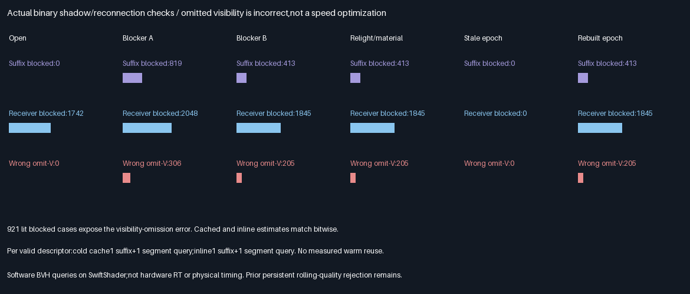
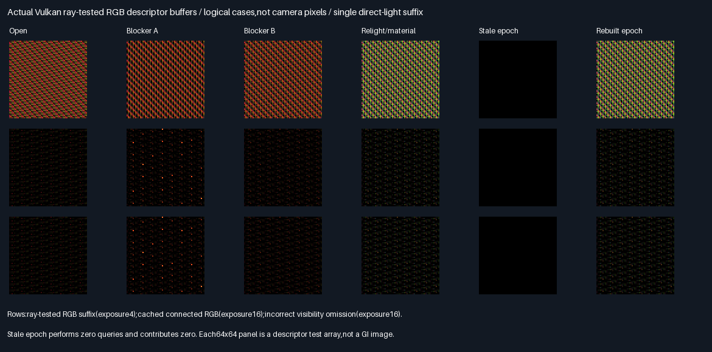

# Ray-tested RGB suffix and visibility reconnection

## Outcome — 2026-10-29

**The bounded ray-tested RGB suffix/reconnection gate passes.** A production software-BVH shadow query now
controls Lambertian RGB stored in the shared32B descriptor;another query tests its connection to a receiver.
Cached and inline-retraced results agree bit-for-bit,and both match independent CPU intersection/lighting checks.
This is one direct-light suffix,not multibounce GI or a quality/speed promotion.

| Verification                                  | Result                                    |
|-----------------------------------------------|-------------------------------------------|
| Release / host ASan+UBSan Vulkan               | Both exit0;five CTests each                |
| Valid / rejected stale descriptors per build   | 20,480 /4,096                             |
| Independent CPU binary reference rays          | 40,960;all GPU visibility answers agree    |
| Cached / inline RGB                            | Bitwise equal for all24,576 records        |
| Max normalized connected-RGB CPU error         | 3.1493e-8,below fixed2e-5 ceiling           |
| Wrong visibility omission                     | Detected on921 evaluated lit/blocked cases |
| Stale consumer with nonzero RGB poison         | Zero output and zero query calls           |
| Cross-build parity                            | Eight rows,six buffers,two SPIR-V modules  |
| Runtime source/tool/module/readback hashes     | 54 verified per build                     |
| Production allocation / defaults               | Unchanged348.046875MiB / unchanged         |

## Choice and honest cost comparison

Stars rate correctness/fitness for the next integration step—not renderer quality or speed.

| Choice                          | Fitness   | Cold calls/descriptor | Decision                          |
|---------------------------------|-----------|-----------------------|-----------------------------------|
| Cached RGB + current visibility  | ⭐⭐⭐ 🏆 | 1 suffix +1 segment   | Carry forward the tested contract |
| Inline retracing + visibility    | ⭐⭐⭐    | 1 suffix +1 segment   | Equal-result/equal-cost reference  |
| Omit reconnection visibility     | —         | Not a valid comparison| Reject;produces light leaks       |

Each correct arm makes40,960 query calls across valid records;the combined diagnostic run makes81,920.
These are instrumented `NearestFacet` software-BVH calls,not hardware-RT dispatches,primitive-intersection counts
or physical timing. Cache construction runs for every valid descriptor here;**no warm cache saving is measured**.
The debug buffer is not a compact GPU history allocation.



| Phase            | Valid | Suffix blocked | Receiver blocked | Wrong omission detected |
|------------------|-------|----------------|------------------|-------------------------|
| Open blocker     | 4096  | 0              | 1742             | 0                       |
| Blocker A        | 4096  | 819            | 2048             | 306                     |
| Blocker B        | 4096  | 413            | 1845             | 205                     |
| Relight/material | 4096  | 413            | 1845             | 205                     |
| Stale epoch      | 0     | 0              | 0                | 0                       |
| Rebuilt epoch    | 4096  | 413            | 1845             | 205                     |

Counts cover evaluated records,some repeated across states—not independent scenes or921 unique light paths.
Many blocked receiver segments are already backfacing with zero geometry;only lit,positive-geometry blocked
connections expose the incorrect omission. Rebuild restores the relit state exactly;phases3/5 buffers match.

## Actual Vulkan readbacks



Rows show ray-tested RGB suffix,correct connected RGB,and incorrect visibility omission. Linear exposures are4
for the suffix and16 for connected estimates,clipped. Each64×64 panel maps logical descriptors,not camera pixels.
Eighteen original PNG arrays are verified byte-for-byte before building the labelled figure. Six full buffers and
both compiled SPIR-V modules are retained losslessly,alongside their source/module/readback hashes.

## Implementation and limits

- The first compute dispatch reconstructs the selected facet point using production `FacetSurface`,casts a shadow
  ray with production `NearestFacet`,and stores the resulting material-dependent RGB in the shared descriptor.
  The second dispatch reads it after the existing host barrier,then traces receiver-segment visibility.
- Suffix RGB is `albedo/pi * directional RGB intensity * max(0,n·light) * shadow visibility`. Direction is(.8,0,.6),
  RGB intensity is(1,.7,.4),and the relit states double intensity and halve red albedo. This is explicitly
  Lambertian:direction-independent cached RGB does not establish validity for glossy/specular transport.
- Connection output is cached RGB times source-side cosine/distance² and binary visibility. Descriptor weight is1.
  No receiver BRDF,area PDF,Jacobian/RIS weighting,secondary bounce or full GI integral is tested by this kernel.
- Eight noncoplanar facets plus two blocker triangles exercise geometry changes with a rebuilt BVH. Facet points
  vary barycentrics;four receiver positions include both sides. Packed-facet RGB materials are explicit inputs.
  These are correctness records,not an area-sampling or controlled camera-quality benchmark.
- The independent CPU uses double Moller-Trumbore intersections over all packed triangles,not the GPU BVH or
  watertight intersection implementation. It checks binary hit/no-hit,interpolation,RGB and query counts;it does
  not establish nearest-hit identity/distance coverage or arbitrary edge/singular-ray robustness.
- Stale requests perform no suffix work;their encoded descriptors contain RGB poison(9,8,7),which the consumer
  must reject before any query or contribution. This strengthens rejection coverage;it is not persistent warm
  history. Production mutation hooks and cache-refresh policy remain outside this gate.

The initial native build rejected an unused CPU function under `-Werror`;the unused function was removed,
without weakening warnings or changing the protocol. The [initial build log](Results/RgbTrace-initial-build.txt)
is retained. No acceptance thresholds or scene parameters were tuned after measurements.

### Comparison with previous work

The [prior RGB selector](RgbQuartet.md) and [persistent rotation](RgbReuse.md) used analytically supplied RGB and
no visibility rays. This gate adds material-dependent,ray-tested direct RGB and actual reconnection occlusion,
but does not wire them into quartet selection/refresh yet. The prior reuse rolling-error penalty15.32–20.18%
and all-three-track quality rejection remain valid and unchanged. Correctness here does not reverse that decision.

## Progress and remaining work

| Scope                      | Complete | Remaining | Interpretation                               |
|----------------------------|----------|-----------|----------------------------------------------|
| This bounded ray gate      | 100%     | 0%        | Code,tests,comparisons,evidence and report    |
| Overall ReSTIR/GI effort    | ~52%     | ~48%      | Planning estimate,not acceptance fraction     |

Done:RGB descriptor/support,selection,persistence/reset tests,and now ray-tested direct suffix/reconnection.
Next bounded problem:wire this suffix/visibility contract into the RGB quartet and compare actual query budgets
against fresh/raw controls,including reset costs. Correlation-aware reuse still needs acceptance. Remaining:
multibounce traced suffixes,arbitrary surface proposals,dynamic/camera/TAA/general-scene quality,physical GPU
measurements and production integration only after quality or speed acceptance.
Packing/editor/vehicle/Jolt stay deferred.

## Reproduction and evidence

| Configuration | Tested condition                                                              |
|---------------|-------------------------------------------------------------------------------|
| Source        | Base1b86c1d0abb7e70cf00b521c41da09b8898f7efa + hashed exhibit changes            |
| Host          | Linux x86-64,Debian GCC12.2,CMake3.31.6;local validation only                    |
| Shader        | Slang2026.14.1,direct SPIR-V1.3,-O0                                             |
| Vulkan        | Pinned SwiftShader CPU Vulkan;software triangle BVH,not hardware RT            |
| Sanitizers    | Host ASan+UBSan only;driver/SPIR-V are not instrumented                         |
| Untested      | Windows/MSVC,physical GPUs,editor/production renderer,multibounce GI            |

Prerequisites:pinned tools in `Automation/ReplayToolDependencies.json`,Vulkan-Headers v1.4.321,Python and Pillow.
No Windows or Linux application executable is delivered. Re-run locally:

```bash
BUILD_JOBS=1 bash Exhibits/LightCompute/RunRgbTrace.sh
SANITIZE=1 BUILD_JOBS=1 bash Exhibits/LightCompute/RunRgbTrace.sh
_ClaudeScratch/venv/bin/python Exhibits/LightCompute/Code/RgbTraceEvidence.py
```

- [Release log](Results/RgbTrace-release.txt),[host-sanitized log](Results/RgbTrace-sanitized.txt).
- [Final audit](Results/RgbTrace-parity.txt),[generated table](Results/RgbTrace-comparison.md).
- [Evidence hashes](Results/RgbTrace-evidence-hashes.txt),[evidence generator](Code/RgbTraceEvidence.py).
- [GPU suffix/reconnection](Code/RgbTraceGpu.slang),[CPU reference](Code/RgbTraceValidation.h).

Production348.046875MiB/defaults/layout and earlier results remain unchanged. No packing,PR or Actions.

## Frozen protocol — 2026-10-29,before measurements

Bounded correctness gate:replace analytic supplied RGB with a ray-tested Lambertian directional-light suffix,
store it in the shared32B descriptor,and reconnect at another receiver using a second triangle query.
No persistent reuse/quality promotion;the prior rolling-error rejection remains unchanged.

| Concern | Frozen test |
|---|---|
| Scene | Eight noncoplanar triangles plus two movable blocker triangles;rebuilt BVH per geometry change |
| Suffix | RGB material/pi × incoming directional RGB irradiance × max(0,n·light) × binary shadow visibility |
| Reconnection | Cached RGB × nonnegative cos/distance² × independent receiver-segment visibility |
| Controls | Inline retraced suffix/reconnection;deliberately omitted visibility must differ on blocked lit cases |
| CPU | Independent double Moller-Trumbore all-triangle intersection and interpolation reference |
| Cases | Open blocker,two blocker positions,relight/material change,stale epoch rejection,rebuild |
| Records | 4096 descriptors/case,ten facet indices,four receivers,barycentric variation |
| Precision | max(1,reference)*2e-5 for RGB/geometry;binary visibility must agree exactly |
| Work | Instrument suffix and receiver-segment calls per stage;CPU verifies counts;calls are not time |
| Evidence | Release/host ASan+UBSan,five CTests each,exact cross-build captures/source/module hashes |
| Limits | Direct-light only;no multibounce GI,RIS selection,physical timing or production port |

Ray offsets .002 along interpolated normal,minimum .00001,receiver segment distance-.004,light far100.
Production348.046875MiB/defaults unchanged;no packing,PR or Actions. Results are reported above.
