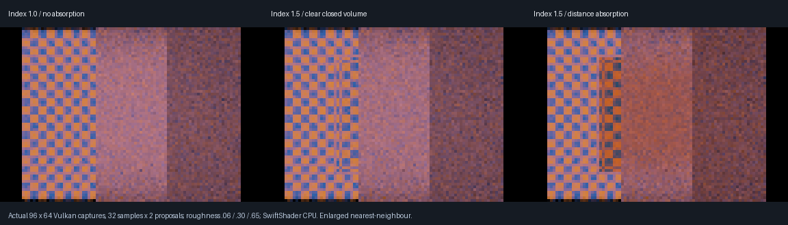

# Rough reflections through smooth closed glass — 2026-10-25

> Historical checkpoint: [VehicleGlazing](VehicleGlazing.md) subsequently adds derived vehicle panes,
> shared-edge evaluation and a 2,048-interaction bound. Earlier 32-step descriptions below refer to the
> original checkpoint, not the current runtime limit.

**Sampled cosine/GGX reflection rays can now traverse smooth closed dielectric volumes.** This extends the
camera and planar-mirror paths. It does **not** implement rough/frosted glass boundaries or general multibounce scattering.



Actual **96×64 software-Vulkan readbacks**, enlarged nearest-neighbour. Each image contains reflector
roughness **0.06 / 0.30 / 0.65**, left to right. The checker and closed glass box are behind the camera;
primary rays see only the reflectors. The three images use index-matched glass, index-1.5 clear glass and
index-1.5 absorbing glass. Thirty-two samples × two BRDF proposals produce visible finite-sample noise.
These are optical verification captures, not final-quality vehicle renders.

The subsequent [window phase](WindowDielectric.md) also supports primary thin-sheet-to-solid paths.
Historical exclusions below describe this rough-reflection checkpoint.

## Changed mechanism

| Mechanism | Implementation |
|-----------|----------------|
| One shared volume-trace site | Camera glass, mirror rays and sampled material rays share `IntegrateBoundaryRays` |
| Flat proposal sequence | `Path % Proposals` replaces nested sample/proposal loops; no nested material-to-volume call site |
| Existing material sampling | Cosine plus per-stratum GGX proposals, full shared BRDF, existing summed proposal-density weighting |
| Independent branching | Volume Fresnel random draws do not alter subsequent BRDF proposal directions |
| Screen proposal | Verified opaque screen hits retained; glass is not substituted with screen-colour shading |
| BVH fallback | Samples encountering closed glass trace Snell/Fresnel/TIR and actual interior-distance Beer absorption |
| Diagnostics | Non-screen sampled material marker 6, `y = capped`, `z = unsupported`; existing mirror/glass/screen layouts retained |

The flattened, single-site arrangement compiles and executes on the tested SwiftShader driver. This is an
empirical avoidance of the previous crashing shader arrangement, not a repair or diagnosis of driver internals.
No timing or speedup claim. No descriptor-layout or serialized material-format change. Sampled rays now use the shared 32-interaction
tracer, including its small geometric offset and in-air thin-sheet approximation, rather than the previous
eight-pane secondary loop. Primary thin-sheet-camera behaviour remains on the legacy path.

## Acceptance

| Check | Result |
|-------|--------|
| Device | SwiftShader Device (Subzero), CPU type 4; **not physical GPU** |
| Closed glass, index matched, RGB absorption 0.2 / 0.6 / 1.2 | **11,118 colour channels** decrease by more than 0.01 |
| Absorbed / clear total RGB ratios | **0.924979 / 0.813363 / 0.710670** |
| Beer monotonicity | Every channel asserts absorbed ≤ clear + 1e-6; red > green > blue totals |
| Seeded repeat | Exactly equal output |
| Valid BVH fixture bounds | Every tested reflector pixel asserts zero capped and unsupported paths |
| Screen-enabled vs full BVH | Three optical configurations compared for exact equality; off-screen glass must fall back |
| Emitter removal | All 6,144 output pixels exactly black without an explicit history-reset request |
| Existing screen/BVH regression | 14,941 screen rays, 204,392 fallbacks; exact RGB equality; moving-source/fresh and source-off pass |
| Build and native regression | 13 production compute entry points compiled; strict C++20 Release host; 4/4 native CTests |
| Previous shader negative control | Pinned `213f050` transport shaders: **zero changed channels**, absorption ignored, exact repeated output |

The negative control compiles the previous three transport shader files with unchanged shared scattering
math and the current native fixture. It demonstrates the former rejection of rough-reflection glass paths;
it is not a replay of the entire old application. The volume's index-matched case deliberately separates
Beer absorption from Fresnel noise and bending. Proposal random streams remain identical when absorption changes.

These checks do not constitute independent analytic GGX-plus-volume quadrature, an unbiased infinite-bounce
solution or complete material/PDF acceptance. Existing native/GPU boundary and slab checks provide separate
Snell/Fresnel/TIR validation. The emitter-removal test exercises fresh transport, not a new full temporal-denoising claim.
The volume remains bounded to 32 interactions; camera/mirror sampling remains capped at 128. Generic
material sampling retains the caller's existing sample budget and the existing maximum eight strata.

## Reproduce and inspect

```bash
bash Exhibits/LightCompute/RunRoughDielectric.sh
# Reuse an explicitly completed build:
ROUGH_DIELECTRIC_BUILD=0 bash Exhibits/LightCompute/RunRoughDielectric.sh
```

The wrapper compiles the pinned negative control and also runs primary glass, mirror glass, boundary math,
opaque reflection-history acceptance, native CTests and the previous rough screen/BVH/source-refresh suite.
Pinned compiler, SwiftShader and Pillow setup follow the existing LightCompute exhibits. The negative control
requires commit `213f050` in local Git history.

- [Rough glass-path log](Results/RoughDielectric.txt)
- [Pinned negative control](Results/RoughDielectricOriginal.txt)
- [Existing rough-reflection regression](Results/RoughDielectricReflectionRegression.txt)
- [Captures, hashes and scope](Results/RoughDielectric.json)
- [Done and remaining](RendererProgress.md)

Remaining: saved closed-glass authoring and actual ControlVehicle bindings; primary thin-sheet-window-to-solid
paths; legacy compact-only diffuse transport integration; rough glass boundaries; nested media/inside cameras;
caustics and transmitted direct-light shadows; complete denoising/sampling acceptance; unified moving scene;
physical RTX/GTX, Windows editor and device timing. Existing thin-sheet windows, analytic/emissive lighting,
cellular flakes and sun/flare/stars are preserved. No complete-renderer claim.
