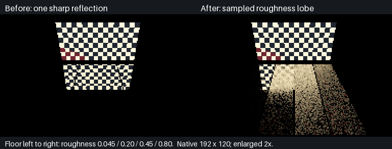
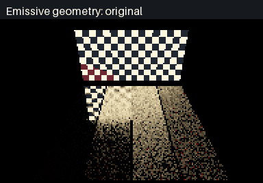

# Rough-lobe screen/BVH reflections

**Plastic now integrates its authored roughness through the full shared BRDF.** The old single sharp reflection plus separate legacy diffuse estimator is removed from this material route. Cellular paint, delta mirrors, thin-sheet glass and both analytic/emissive lighting remain.

## Actual before / after



Both images use the same real checkerboard emitter geometry and four metallic floor strips, roughness **0.045 / 0.20 / 0.45 / 0.80** from left to right. Left executes the pinned `05e4090` sharp-reflection shader; right executes the new sampled lobe. The old reflection does not broaden with authored roughness. New broadening is produced by traced directions, **not image blur**.

Native extent is **192×120**, enlarged 2× with nearest-neighbour for the comparison. Sixteen samples per cosine/GGX proposal, at most 32 attempted directions per floor pixel: visible Monte Carlo noise is retained, not denoised or concealed. This is iteration evidence, not final reflection quality or a real-time performance claim.



Two actual source positions, shifted 0.5 m; 900 ms GIF display duration is **not measured renderer frame time**. [Fresh ControlVehicle material renders](MaterialScene.md) separately exercise the green coat, rubber, glass, mirrors and plastic cones.

## Executed checks

**SwiftShader Device (Subzero), Vulkan CPU software device, Linux.** C++ creates and uploads geometry/materials, compiled Slang traces and shades, and C++ checks the actual HDR readback. Physical RTX/GTX/Windows/editor viewport remains untested.

| Check | Observed result |
|---|---:|
| Reflective floor pixels | 7,250 |
| Accepted screen-routed rays | **14,941** |
| BVH fallback rays | **204,392** |
| Identical seeded BVH-only control | **Maximum and mean RGB difference 0** |
| Repeated HDR output | **Exactly equal** |
| Off-screen red emitter primary pixels | **0** |
| Removing that emitter | Reflected red sum decreases **35.1084** |
| All sources switched off in reused submission | **Exactly black**, no retained radiance |
| Moved geometry, reused versus fresh submission | **Exactly equal** |
| Uniform white illumination, four roughness strips | Mean red **0.811770 / 0.788795 / 0.737523 / 0.471216**, all ≤1.02 |
| Rebuilt native CTest | **4/4 passed** |
| Retained energy checks rerun | **384 native + 34 Vulkan passed** |

The uniform test uses unit illumination and metallic reflectance 0.8, not white albedo 1. Its means cover 200–204 pixels per strip at the finite sampling budget; it is a targeted transport sanity check, not a complete sampler/PDF or continuous-parameter energy guarantee. The previous [energy acceptance](../TextureStudio/MaterialEnergyAcceptance.md) remains separately scoped.

Raw [targeted log](Results/RoughReflection.txt), [original shader capture log](Results/RoughReflectionSharp.txt), [native regression](Results/RoughReflectionNative.txt), [machine-readable results and hashes](Results/RoughReflection.json).

## Mechanism

| Previous plastic route | Current plastic route |
|---|---|
| One mirror direction, Schlick amplitude | Cosine/GGX deterministic mixture, full shared BRDF and matching mixture density |
| Roughness does not broaden reflection | Authored roughness shapes sampled half vectors |
| Screen-depth point reconstructed from primary camera ray | Screen depth proposes a facet; intersect the actual reflected ray with that facet |
| Possible mismatched point/visibility | Verify the segment before accepting; thin glass candidates/attenuating intervening sheets use BVH fallback |
| Sharp reflection plus independent legacy diffuse estimator | One integrated diffuse/specular budget through the retained evaluator |
| Unavailable screen geometry | BVH fallback retained per sampled ray, including off-screen radiance |

Accepted screen hits are reshaded for the reflected view using current material, emission and analytic lighting. The verification query has a cost: **no speedup is claimed**, and this is not a geometry-free screen lookup. Ray origin/intersection/visibility epsilons remain finite. Clear-segment checks and BVH fallback use existing native triangle queries; no physical hardware ray-query execution is asserted.

## Reproduce

```bash
python3 Exhibits/LightCompute/Code/Prepare.py
python3 -m pip install --target _ClaudeScratch/tmp/MaterialTools Pillow==12.0.0
# Existing pinned CMake or a supported system CMake is required.
bash Exhibits/LightCompute/RunRoughReflections.sh
bash Exhibits/LightCompute/RunMaterialScene.sh
ENERGY_BUILD=0 bash Exhibits/LightCompute/RunMaterialEnergy.sh
```

`RunRoughReflections.sh` prepares the material atlas, compiles all 13 normal compute entries and the C++ executable, compiles a pinned old transport entry in a separate ignored directory, executes both and writes the retained images/reports. Source-off, off-screen, moved-source/fresh comparison, deterministic repeat and BVH equality are assertions: failures return nonzero. No archive edits, new runtime ABI or material library import.

## Still incomplete

- Roughness-mip **screen-colour history** and temporal specular reconstruction are not implemented here. This is sampled spatial/angular roughness integration, not a claim those features are finished.
- No full motion/disocclusion/filtering acceptance, multi-bounce specular transport, solid-volume refraction, or finished noise reduction.
- The BVH-only comparison validates routing against the same integrator, not an independent path tracer. The four uniform means do not establish complete sampling/PDF acceptance.
- No physical GPU, hardware-speed, Windows, editor viewport or fresh full-application sanitizer claim. Existing legacy transport results remain historical unless explicitly rerun.

## Subsequent history work

The results above describe the `65939de` rough-lobe checkpoint. The later
[shadow diagnosis and limited rough-reflection history](ShadowHistory.md) adds angular-aware reconstruction,
smooth-lobe bypass, a geometry-history invalidation repair, camera/disocclusion probes and new actual captures.
It does not complete roughness-mip colour history or general-purpose specular denoising.
