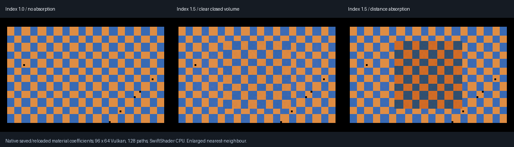

# Saved smooth closed-glass materials — 2026-10-26

> Historical checkpoint: [VehicleGlazing](VehicleGlazing.md) subsequently adds derived vehicle panes,
> shared-edge evaluation and a 2,048-interaction bound. Earlier 32-step descriptions below refer to the
> original checkpoint, not the current runtime limit.

Native material documents now retain a distinct **closed-volume IOR and RGB absorption spectrum** through
TOML decoding, disk save/reload and `CompileSurfaceMaterial`. The exhibit uploads those compiled coefficients
to the existing category-4 atlas and traces the actual Vulkan slab fixture. No shader descriptor layout changed.



Actual 96×64 readbacks, 128 paths/pixel, enlarged nearest-neighbour. The images show index matching, clear
refraction and absorbing refraction, using native saved/reloaded material coefficients rather than Python
interpretation of the source. This is a bounded slab validation, not a finished vehicle or studio preview.

## Authoring

```toml
[DielectricVolume]
Ior = 1.5
Absorption = [0.2, 0.6, 1.2]
```

- `Ior`: finite 1..3, relative to the exterior medium.
- `Absorption`: three finite, nonnegative coefficients, each 0..100 **inverse metres**.
- Thickness comes from the closed geometry in metres, not the coating `Thickness` field.
- Both fields are mandatory when the table is present; unknown fields are rejected.
- Absence preserves existing opaque/coating material behaviour. Crystal Glass is not silently reclassified.
- Existing `Strata` remain the studio surface approximation. Their IOR/roughness/texture settings do not
  override the distinct smooth volume spectrum. This does **not** add rough glass or glass studio rendering.
- `MaterialScattering` remains 1760 bytes. `ClosedVolume` is optional native host metadata in the source and
  compiled material structures, not a new shader-buffer field. Native host structures require recompilation.

Source: [authored specimen](Materials/ClosedGlass.material). Four disk round trips are retained under
`Materials/RoundTrips/`; their compiled float32 IOR/absorption values are consumed by the existing exhibit adapter.
The 64-byte scratch coefficient capture is validation interchange, not a new runtime material file format.

## Verification

| Check | Result |
|-------|--------|
| Native authoring | 39 assertions; four disk save/reload/compile cases |
| Invalid input | 11 malformed/range/unknown-field cases rejected; invalid native encode/compile rejected |
| Compatibility | Five existing scene presets decode and round-trip without acquiring volume metadata |
| Sanitizers | AddressSanitizer + UndefinedBehaviorSanitizer: 39 assertions passed |
| Retained native regressions | Four existing CTests passed |
| Pinned previous decoder | `cec27e4` rejects `DielectricVolume` as unsupported; no false previous support claim |
| Vulkan | SwiftShader Device (Subzero), CPU type 4; actual triangle-BVH execution |
| Analytic slabs | Four cases, 100 central pixels each; maximum mean RGB error **0.00346691** |
| Valid-volume diagnostics | Zero capped or unsupported paths |
| Seeded repeat / removed source | Exact repeats; all 6,144 pixels black with the source disabled |
| Rejected geometry | Inverted winding and inside-camera cases diagnosed, not accepted as supported media |

The existing slab analytic calculation uses the uploaded coefficients, exact Fresnel/Snell evaluation and the
infinite internal-reflection series. The pinned negative is the old native material decoder compiled against
current compatible declarations, not an entire old application. No shader arithmetic changed in this phase.

## Vehicle geometry check

| Retained vehicle glass subset | Exact-position incidence |
|------------------------------|--------------------------|
| Triangles | 74 |
| Single-incidence boundary edges | 68 |
| Paired edges | 77 |
| Closed-volume assignment | **Rejected / not applied** |

An exact-position edge audit is not general tolerant welding, self-intersection, orientation or thickness
acceptance. It demonstrates why these retained panes must not be blindly assigned a closed-solid medium.
Their existing thin-sheet transport remains intact. Actual vehicle volume integration requires constructing
and validating outward, finite-thickness glazing first; no geometry was fabricated or silently replaced here.

## Reproduce

```bash
bash Exhibits/LightCompute/RunSavedDielectric.sh
```

Tested on Linux with GCC 12.2, strict `-O1 -Wall -Wextra -Werror` (existing aggregate-initializer
warning exemption), ASan/UBSan and the existing Release native Vulkan executable. Shader binaries are the
unchanged Slang `-O0` artifacts from `cec27e4`; this phase changes native authoring/validation only.
The authoring/render wrapper exited 0 on the `cec27e4` working tree plus these changes. Four native CTests
were also run successfully and are now included in the reproduction script.

Prerequisites: C++20 compiler, pinned toml++/stb from `Automation/UIDependencies.json`, existing prepared
LightCompute/Slang/SwiftShader/Pillow setup and the retained `VehicleMotion0.bin` archive. Build tools and
binary captures remain ignored. The wrapper builds strict and sanitizer native executables, checks the pinned
decoder, audits vehicle edges, rebuilds the native Vulkan executable, renders and hashes the evidence.

- [Native authoring](Results/SavedDielectricAuthoring.txt)
- [Sanitizers](Results/SavedDielectricSanitized.txt)
- [Four native CTests](Results/SavedDielectricNative.txt)
- [Pinned previous decoder](Results/SavedDielectricPrevious.txt)
- [GPU slabs/repeat/reset/rejections](Results/SavedDielectricGpu.txt)
- [Vehicle edges](Results/VehicleGlassEdges.json)
- [Capture hashes and scope](Results/SavedDielectric.json)

## Still unverified or incomplete

- No native material-editor controls, glass studio rendering, full renderer importer or vehicle volume assignment.
- No physical RTX/GTX, Windows editor, real-time performance or completed renderer claim.
- Existing single-medium/exterior-camera, outward winding and 32-interaction restrictions remain.
- Nested/rough glass, caustics, transmitted direct shadows and full glass temporal filtering remain outside acceptance.
