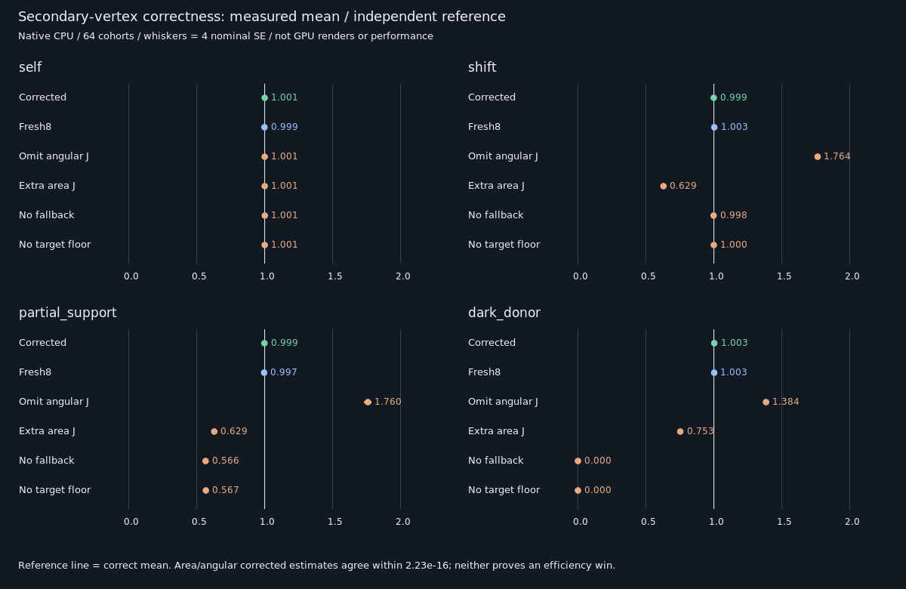

# Secondary-vertex reconnection — fixed native correctness gate

This checkpoint tests a bounded two-diffuse-vertex integral, not a full GI renderer or GPU speedup.
It reuses production `Frontier::Reservoir`; production shaders, layouts and defaults are unchanged.

## Fixed protocol before measurement

| Concern            | Fixed choice                                                                    |
|--------------------|---------------------------------------------------------------------------------|
| Secondary surface  | Unit square at z=1, normal −Z; diffuse albedo .7, not an emitter                   |
| Illumination       | Directional irradiance π; shadowed for secondary x < −.1; outgoing radiance .7     |
| Primary receiver   | Normal +Z, diffuse albedo .6; donor x=0, target x=0 or 1, y=z=0                   |
| Occlusion          | Optional opaque strip at z=.5; half-width .12 or .6, infinite extent along y      |
| Proposal           | .75 donor cosine first-hit proposal + .25 uniform secondary area, with null mass |
| Source target      | Solid-angle integrand + .01; floor supports target-visible/source-invisible area  |
| Reservoir          | Eight candidates; production Update/Finalize/Combine; no M clamp                 |
| Cohorts            | 64 independent batches of 4096 reservoirs per fixture; fixed separate RNG seeds  |
| Reference          | Independent midpoint area quadrature at 1024² and 2048² over exact visible bounds |
| Acceptance         | Corrected means within 4 nominal SE + .0001; reference refinement < 1e-7          |
| Exact identities   | Area/angular estimates within 1e-12; self-shift J=1; valid/null counts preserved   |
| Negative controls  | Omitted angular J, extra area J, absent fallback, absent source target floor     |
| Negative gates     | Shifted J controls and occluded support controls differ by >6 nominal SE + .005 I |
| Decision           | No promotion; GPU, multibounce, material-general and temporal acceptance not run  |

All candidate draws, including misses and blocked donor cosine rays, count toward M. The fallback can sample
secondary points invisible to the donor; their illumination is evaluated independently of donor visibility.
This is deliberate support coverage, not a claim of free cached illumination or an efficient general scene proposal.

## Measures and Jacobian

For secondary point y, let g(x,y) = |n_y·ω| / distance² and h(x,y) = ρ_x L(y) cos_x V(x,y) / π.
The integral is ∫ h(x,y) g(x,y) dA. The proposal area density is
q_A(y) = .75 V_d cos_d g_d / π + .25 / area. The remaining probability is a null candidate.

| Stored measure | Source target                 | Source proposal | Reconnection factor | Final contribution |
|----------------|-------------------------------|-----------------|---------------------|--------------------|
| Solid angle    | h_d + .01                     | q_A / g_d       | J = g_r / g_d       | h_r                |
| Surface area   | (h_d + .01) g_d               | q_A             | 1                   | h_r g_r            |

These encodings have identical candidate weights. Their final estimates must agree pointwise. Applying J again
in the area encoding double-counts the measure conversion. Omitting J in angular coordinates misses it.
A positive source target cannot repair a zero proposal density; both fallback and target support are tested.

## Reproduction

```sh
bash Exhibits/LightCompute/RunSecondaryReconnection.sh
SANITIZE=1 bash Exhibits/LightCompute/RunSecondaryReconnection.sh
```

Requires a C++20 compiler and Bash. This native mathematical gate does not require Vulkan tools.
Both runs pass. This establishes only this restricted static diffuse estimator's transport math.

## Verified results

| Fixture         | Independent integral | Corrected mean ± nominal SE | Without fallback | Without target floor |
|-----------------|---------------------:|----------------------------:|-----------------:|---------------------:|
| Self            | 0.061760591          | 0.061793496 ± 0.000075282     | 0.061839248      | 0.061799856           |
| Shift           | 0.028281023          | 0.028258534 ± 0.000043136     | 0.028235657      | 0.028272752           |
| Partial support | 0.028281023          | 0.028239025 ± 0.000077819     | 0.015999083      | 0.016046076           |
| Dark donor      | 0.017934607          | 0.017989269 ± 0.000064512     | 0                | 0                     |



- Area and angular encodings agree pointwise within 2.23e-16, including shifted visibility and all-null inputs.
- Omitting angular J gives shifted mean 0.049880389 instead of 0.028281023; applying J twice gives 0.017792350.
- Removing either proposal fallback or source target floor loses roughly 43% in the partial-support fixture.
  In the dark-donor fixture it loses the entire signal. Both match the independently clipped support integral.
- A correct Jacobian cannot recover contributions absent from the candidate distribution or selection support.
- The two support mechanisms are sufficient here, not universally necessary: other full-support proposals,
  receiver-conditioned selection or properly normalized multiple proposals could supply the missing support.

## Verification and limitations

| Check                       | Outcome                                                           |
|-----------------------------|-------------------------------------------------------------------|
| Optimized native build      | Exit 0, GCC 12.2.0, Linux, C++20, warnings treated as errors         |
| ASan + UBSan native build    | Exit 0, no reported sanitizer diagnostics                         |
| Cross-build parity          | 37 identical semantic rows; four measured-source hashes each       |
| Corrected/fresh reference   | All 12 required means pass; quadrature refinement at most 5.10e-9   |
| Deliberate negative tests   | All six required controls expose the error                         |
| Candidate accounting       | 2,097,152 draws per fixture; nulls count in M; represented M stays 8 |
| Production                 | No changes; no promotion; output stays 348.046875 MiB/1080p         |
| Vulkan/Windows/editor      | Not run for this new estimator                                    |

The experiment reuses production ReservoirSampling.cpp/h without modifying them. It uses analytic plane/strip
geometry and deterministic secondary illumination, not the triangle BVH, Slang, material stacks or a stochastic
cached multi-bounce suffix. The secondary patch is nonemissive but the test computes only its restricted indirect
contribution, not complete scene lighting. Irradiance/visibility are idealized; donor/receiver normals agree.

[Full comparison](Results/SecondaryReconnection-comparison.md), [release](Results/SecondaryReconnection-release.txt),
[sanitizer](Results/SecondaryReconnection-sanitized.txt), [parity](Results/SecondaryReconnection-parity.txt).
Tested base: `ceebd8a925a929ecaee535869ddc0fdbfe7c1da1` plus retained prior phases and current working changes.
Exact measured-source hashes, compiler and options are logged; scratch binaries are not deliverables.

Regenerate/audit with the standard-library-only script:

```sh
python3 Exhibits/LightCompute/Code/SecondaryReconnectionEvidence.py
# Optional PNG uses ImageMagick convert with DejaVu-Sans; SVG/table require no external Python packages.
python3 Exhibits/LightCompute/Code/SecondaryReconnectionEvidence.py --png
```

Native per-reservoir RMSE is lower than Fresh8 for the unoccluded proposal fixtures but slightly worse for partial
support and substantially worse for the dark donor. Proposal mixes differ; illumination evaluation, visibility,
cache generation/storage, warm-up and GPU timing are unmeasured. This is not an equal-cost efficiency comparison.
The reference is finite quadrature and uncertainty is nominal, not a guaranteed confidence interval.

## Next gate

The subsequent [analytic Vulkan checkpoint](SecondaryReconnectionGpu.md) now verifies this restricted transport
on SwiftShader. Real triangle/suffix and persistent-history work remains pending.


Carry the area-coordinate encoding into an isolated Vulkan secondary-surface exhibit: area densities already
include the angular-to-area conversion, so do not apply another reconnection Jacobian. Preserve explicit null
mass and support coverage, re-evaluate visibility at the receiver, and retain the missing/double-J and support
negative controls. Only after that passes should real triangle/suffix transport, temporal history, held-out
quality/cost comparisons against both Whole6/Whole8 and physical-GPU timing be attempted. No general GI port
or game-speed claim is accepted at this checkpoint.
