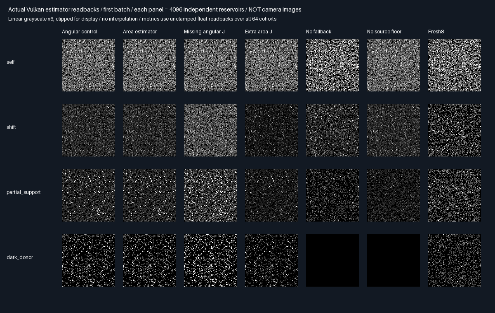

# Secondary-vertex reconnection — isolated Vulkan gate

## Protocol fixed before measurement

Carry the [native gate](SecondaryReconnection.md) into Slang using the existing Vulkan exhibit uploader/submitter.
This is analytic secondary-square transport on Vulkan, not BVH camera rendering or general GI.

| Concern | Fixed choice |
|---------|--------------|
| Geometry/illumination | Native unit secondary square, diffuse .7 under irradiance π; x < −.1 shadowed |
| Receivers | Donor x=0; receiver x=0 or 1; normals +Z; primary diffuse .6 |
| Blockers | None, half-width .12, or half-width .6 at z=.5, infinite y extent |
| Proposal/support | .75 donor cosine first-hit + .25 uniform area; source target h + .01 |
| Methods | Angular reference, area, missing angular J, extra area J, no fallback, no floor, Fresh8 |
| Samples | 64 batches × 4096 eight-candidate reservoirs per method/fixture |
| GPU seeds | Host MT19937-64 seed 0x296ad713 + fixture × 0x1000193; separate production PCG per reservoir |
| Pairing | Shared GPU seed/reservoir index for all methods, independent PCG across reservoir indices |
| Reference | Independent double area midpoint quadrature 1024²/2048² with exact strip clipping |
| Correctness | All 12 area/angular/fresh means within 4 nominal SE + .0001 of reference |
| Negative tests | Shift missing/extra J and occluded no-fallback/no-floor: >6 nominal SE + .005 integral |
| Identity | Maximum GPU area/angular difference < 2e-6; all draws, including nulls, retain M=8 |
| Evidence | First-batch raw readbacks, measured plots and release/sanitized host parity |
| Promotion | Zero; no equal-cost, physical-GPU, temporal, BVH/material-general or Windows/editor acceptance |

Area coordinates already include the angular-to-area conversion in target/proposal densities. Their reconnection
factor is one; the angular control needs g_receiver/g_donor. The GPU test explicitly re-evaluates receiver strip
visibility rather than reusing donor visibility. Outgoing secondary radiance is deterministic/static/diffuse.
The two-dispatch transport uses the rectangle exhibit's validated host upload/submit path; its two emissive
carrier triangles are not read by this shader. It does not claim those triangles are nonemissive secondary BVH hits.
No production validation, shaders, memory layout or defaults are changed. Output stays 348.046875 MiB/1080p.

## Verified result

| Fixture         | Area mean ± nominal SE      | Independent reference | Missing angular J | Extra area J |
|-----------------|----------------------------:|----------------------:|------------------:|-------------:|
| Self            | 0.061691593 ± 0.000074414     | 0.061760591           | 0.061691593       | 0.061691593   |
| Shift           | 0.028351211 ± 0.000039376     | 0.028281023           | 0.049984083       | 0.017870239   |
| Partial support | 0.028345619 ± 0.000066967     | 0.028281023           | 0.050074565       | 0.017839165   |
| Dark donor      | 0.017932988 ± 0.000071566     | 0.017934605           | 0.024719971       | 0.013476177   |

- All 12 required reference gates and six required negative controls pass in both builds.
- GPU area/angular maximum difference: **1.49e-7**, below the fixed 2e-6 gate. Self-shift also agrees.
- No fallback/no source floor produce partial-support means 0.016077994/0.016039670, versus 0.028281023.
  Both match the independently clipped-domain prediction. Both produce zero for the dark donor.
- All 28 CPU/GPU mean comparisons pass a 4 combined nominal SE + .0001 audit. GPU PCG and native MT19937
  streams differ; this is statistical agreement, not bitwise CPU/shader equivalence.

## Actual readbacks



Each tile is a 64×64 array of independent reservoir estimates for one receiver configuration, **not a camera
image**. Exposure 6 and clipping are display-only. The metrics use unclamped float readbacks over all 64 cohorts.
The two black bottom-row tiles are the intentional support failures, not accepted zero-light solutions.

## Verification

| Check                        | Outcome                                                        |
|------------------------------|----------------------------------------------------------------|
| Device                       | SwiftShader Device (Subzero), CPU Vulkan type 4                 |
| Release and ASan/UBSan host   | Both exit 0; five CTests pass each                              |
| Cross-build semantic parity  | 38 identical rows; 31 logged hashes verified per build          |
| Actual raw GPU readbacks     | Four byte-identical captures; 28 retained PNG pixel arrays exact |
| Samples/null accounting      | 2,097,152 draws per method/fixture; M=8 even on misses/zero groups |
| Reference refinement         | At most 5.10e-9; clipped-domain support controls pass             |
| Production acceptance        | None; no production source/default/layout change                |

[Release](Results/SecondaryReconnectionGpu-release.txt), [sanitized](Results/SecondaryReconnectionGpu-sanitized.txt),
[parity](Results/SecondaryReconnectionGpu-parity.txt), [complete means](Results/SecondaryReconnectionGpu-comparison.md).
The shared exhibit host gained a CLI/header only. Older correlation logs remain historical measurements;
their live-source hash audit is not relabeled as passing after this host edit.

## Reproduce

```sh
python3 Automation/PrepareReplayTools.py
bash Exhibits/LightCompute/RunSecondaryReconnectionGpu.sh
SANITIZE=1 BUILD_JOBS=1 bash Exhibits/LightCompute/RunSecondaryReconnectionGpu.sh
_ClaudeScratch/venv/bin/python Exhibits/LightCompute/Code/SecondaryReconnectionGpuEvidence.py
```

Tested Linux/GCC 12.2.0, C++20, release and ASan+UBSan host, Slang 2026.14.1/SPIR-V 1.3, CMake 3.31.6,
Vulkan headers 1.4.321. Tool restoration is pinned by Automation/ReplayToolDependencies.json; supply Vulkan
headers separately as in prior checkpoints. The evidence script needs Python/Pillow, using the local venv here.
CMAKE/CTEST/SLANGC/VULKAN_LIBRARY can override tool locations. Tests ran sequentially.

Base `ceebd8a925a929ecaee535869ddc0fdbfe7c1da1` plus retained prior phases and current working changes;
measured shader, host, headers, SPIR-V and tool hashes are logged. First-batch raw captures/builds are ignored
scratch inputs; logs, image arrays, composite and generating code are retained. Later source edits require a new
measurement checkpoint. Host sanitizers do not instrument shaders or the external Vulkan driver.

## Limits and next gate

No efficiency win is established. The area proposal changes candidate coverage; secondary illumination, ray
queries, cache storage, warm-up and GPU execution time are not measured here. Per-reservoir RMSE remains worse
than Fresh8 for the occluded fixtures. This program builds and reconnects a source reservoir inside each GPU
invocation; it does **not** persist vertex payloads across pixels or frames. The second host dispatch is inert.
Reference geometry uses the uploaded float blocker widths, explaining tiny differences from the prior double
native reference. No acceptance threshold, cap or production validation was weakened.

Next: replace analytic intersections/visibility and deterministic illumination with actual triangle secondary
hits and a separately validated outgoing suffix, retaining explicit PDFs, geometry normals and full support.
Then test persistent reuse, history invalidation and fixed held-out quality/cost against both Whole6 and Whole8.
Do not treat this analytic Vulkan gate as real-scene GI, temporal/material-general support, Windows/editor
acceptance or physical-GPU performance. Production output remains 348.046875 MiB at 1080p.
