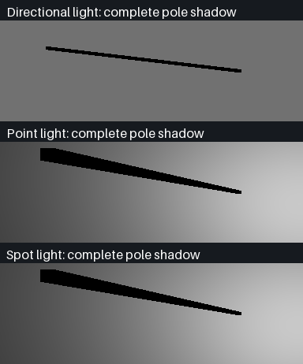
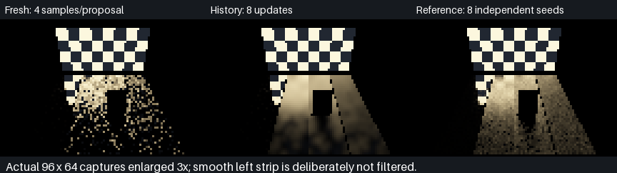

# Pole-shadow diagnosis and rough-reflection history

**The reported old-project shadow cutoff is not reproduced here; it is not labelled fixed.** The remaining reflection phase now has angular-aware reconstruction and a separately reproduced/fixed moving-geometry history defect in the native Vulkan submission.

## Complete pole shadows



These are actual Vulkan lighting readbacks on a top-down **384×128 receiver grid**, not primary-camera beauty renders. A closed six-metre pole casts onto the grid. An independent CPU ray/axis-aligned-box interval predicts the complete silhouette, rather than using the renderer's triangle queries as the reference.

| Coverage | Executed result |
|---|---:|
| Directional / point / spot | All three |
| Receiver viewing directions | Three per light |
| Caster shadow routes | Legacy opaque BVH and authored-material transmission traversal |
| Light selection | Exact, clustered exact, fresh RIS, cold-start history-mode selection; reconstruction disabled |
| Combinations | **72** |
| Analytic visibility comparisons | **3,538,944** |
| Shadowed comparisons | **173,928** |
| Comparisons in the shadow's far half (`x < −6 m`) | **111,408** |
| Visibility mismatches / missing far half | **0 / 0** |

This checks the current native compute renderer and this closed-pole fixture. It does **not** identify the cause in an unspecified earlier project, validate every imported pole asset or shadow-map implementation, or test shadow filtering. A screenshot plus the old project/file/commit is needed to reproduce that report. No speculative shadow-distance, culling or light-range change was made.

[Raw pole checks](Results/PoleShadow.txt).

## Actual reflection reconstruction



Native **96×64** captures, enlarged 3× without denoising the presentation image. Source geometry, a foreground occluder and four roughness strips are rendered through the shared Slang path. Four samples per cosine/GGX proposal feed eight history updates; the separate finite reference averages eight independent seeds at sixteen samples per proposal. It is not converged ground truth.

| Check | Observed result |
|---|---:|
| Fresh RGB RMSE to independent finite reference | **0.246571** |
| Reconstructed RGB RMSE | **0.0927787**, approximately **62.4% lower** |
| Accepted temporal / spatial pixels | **2,401 / 2,401** |
| Very smooth strip retained exactly | **520 pixels**, no temporal/spatial blur |
| Independent native angular-filter probes | **88**, maximum RGB error **1.19058e-6** |
| Camera movement | **1,339 accepted / 17 rejected** rough-surface history pixels |
| Smooth reflection after camera movement | **427 pixels exactly match fresh rays** |
| Source switched off with history active | **Exactly black** |
| Native CTest | **4/4 passed** |

A foreground plank is intentional: a camera-only fixture viewing an unobstructed plane initially exercised no disocclusion rejection. Adding the plank produced genuinely newly visible floor pixels, instead of weakening the coverage assertion. Camera checks establish finite output, acceptance/rejection coverage and smooth-lobe preservation—not complete moving-camera quality acceptance.

### Separately reproduced geometry-history defect

The previous submission tracked light parameters, material coefficients and unique emitter radiance/token pairs, but not changes to the packed facets. Moving an emitter without changing its colour/token could therefore keep old indirect lighting on a stationary reflecting floor.

| Same seeded moved scene | Geometry revision disabled, reproducing prior behaviour | Corrected submission |
|---|---:|---:|
| Retained old history pixels | **1,521** | **0** |
| RGB RMSE versus a freshly prepared moved scene | **0.156373** | **0** |

The negative control disables **only geometry revision tracking**, while retaining the current angular filter. It is not presented as an unmodified historical shader. This defect concerns reflected-light history, **not a reproduced explanation of the user's truncated pole shadow**.

## Mechanism and cost

- Authored mirror/glass routes and roughness below 0.12 bypass this reconstruction to preserve directional detail.
- Rough authored surfaces receive reflected-direction weights with GGX roughness-squared spread. Camera-view changes reduce temporal influence; incompatible position, normal, token and material checks remain.
- Spatial filtering retains the existing compatible-surface neighbourhood, adding angular weights instead of treating specular radiance as diffuse colour.
- For scenes containing authored transport, the native exhibit submission conservatively compares complete packed-facet snapshots. Geometry, normal, material assignment or emission changes invalidate indirect history, including changes with an unchanged radiance/token palette. Mixed scenes reset the shared indirect history; the retained compact-only diffuse moving-history policy is deliberately unchanged and has a separate host-policy guard.
- The snapshot costs **144 bytes per retained facet** plus comparison/copy work; no memory or speed improvement is claimed. The default is enabled; disabling it exists only for the explicit negative-control test mode.
- Legacy non-authored reconstruction arithmetic is retained. No shadow equations, cellular flakes, archived material assets, Sun/flare/stars or analytic/emissive lighting source types were removed.

## Reproduction

```bash
python3 Exhibits/LightCompute/Code/Prepare.py
python3 -m pip install --target _ClaudeScratch/tmp/MaterialTools Pillow==12.0.0
# Supported CMake/CTest required; the existing pinned installation is also accepted.
bash Exhibits/LightCompute/RunShadowHistory.sh
```

The script builds all 13 normal compute entries and strict C++20 Release code, executes pole checks, the geometry-revision negative control and corrected history, rebuilds/runs native CTests and produces the retained captures. Failures return nonzero. Exact numbers, source/capture hashes and compiler/device scope: [machine-readable report](Results/ShadowHistory.json), [current log](Results/SpecularHistory.txt), [negative control](Results/SpecularHistoryOriginal.txt), [native tests](Results/ShadowHistoryNative.txt).

Device: **SwiftShader Device (Subzero), Vulkan CPU software device, Linux; GCC 12.2.0, Slang 2026.14.1.** No physical RTX/GTX, hardware ray query, Windows/editor viewport or fresh full-application sanitizer claim.

## Remaining boundaries

This is limited rough-reflection history through the native exhibit, not a finished general-purpose specular denoiser or editor integration. Roughness-mip screen-colour history, reflection-hit motion vectors, complete disocclusion/animated-normal/texture acceptance, multiple specular bounces, solid-volume refraction and physical-device/Windows acceptance remain. The older [rough-lobe routing evidence](RoughReflections.md) and [material scene](MaterialScene.md) are retained historical checkpoints unless explicitly regenerated.
