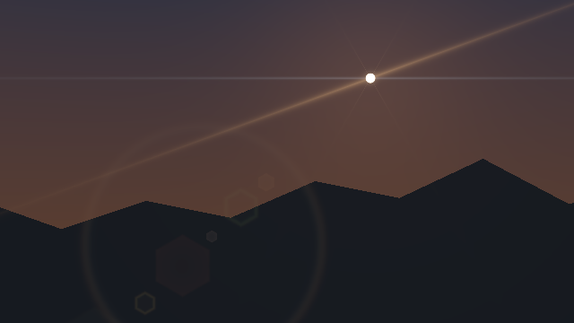

# Vulkan solar optics and reuse audit

## Status

| Area | Status |
|---|---|
| Sun disc and mixed flares | Opt-in Vulkan compute in the **LightCompute validation host**, not the editor viewport. |
| Calibration | Angular-size check against NASA; the Gaussian sensor-FWHM conversion is provided, but no measured lens PSF or flare data has been supplied or fitted. |
| ReSTIR GI | Incomplete. One isolated diffuse-path reservoir supports identical-domain pooling and multiple hits; another reconnects moved endpoints for a single unobstructed rectangle. Neither supplies general-scene GI, production-frame integration or editor presentation. |
| Device | Linux SwiftShader CPU Vulkan, not a physical GPU, Windows, hardware ray tracing, performance or real-time acceptance. |

## Solar optics

`ResolveSolarVisibility` tests 1,536 limb-weighted source samples against the triangle BVH. `CompositeSolarOptics`
adds a finite-pixel Sun and all enabled flare layers to HDR output. Small discs integrate a Gaussian over each
pixel; resolved discs use a four-by-four midpoint approximation to a blurred limb. The caller supplies
atmospherically attenuated source irradiance, scalar cloud transmission and an optional geometric planet
horizon. Opaque triangles, not glass, fog, per-ray cloud extinction, lunar occlusion or terrain refraction,
are modeled. Off-axis pixel shear is approximated. The PSF and flare parameters are unmeasured.

The six radii `0.4–16 px` gave worst flux error `0.000328`; small-disc samples agreed with an independent
500×500 Cartesian integration within `0.001183` of peak. A half-disc horizon returned `0.50000006`; multiplying
by cloud transmission `0.3` gave flux `0.150000005`. An opaque half-plane at half a solar radius returned
visibility `0.824410`, versus independent chord integration `0.821583`. Warm and anamorphic layers were both
nonzero and additive within `3e-8` of peak. An illuminated scene test preserved the checked geometry pixel
while adding solar light to the sky. These are model/invariant tests, not photographic fidelity or lens
measurements. Exact output and source hashes: [release](Results/SolarOptics-vulkan-release.txt) and
[sanitized host](Results/SolarOptics-vulkan-sanitized.txt); the external driver is not sanitizer-instrumented.
The later [isolated starburst audit](SolarStarburst.md) checks six- and five-blade spike counts, rotation,
opaque cover, and simultaneous starburst/warm/blue layers, with three SwiftShader readbacks.

The default solar diameter is `1919.253` arcseconds, consistent with NASA's mean `1919` arcseconds at 1 AU
([NASA Sun fact sheet](https://nssdc.gsfc.nasa.gov/planetary/factsheet/sunfact.html)). Size varies with distance.
For an on-axis Gaussian core, `CalibrateSolarBlur` converts sensor FWHM to angular sigma using
`FWHM_pixels × pitch_mm / (focal_length_mm × 2√(2 ln 2))`. The 50 mm, 4 µm, 2-pixel example is synthetic.
No lens calibration is implied. Payload normalization and invalid-domain checks passed in
[release](Results/SolarPayload-release.txt) and [ASan/UBSan](Results/SolarPayload-sanitized.txt).

The normal validation buffer ABI reserves `25 × pixelCount + 13889 + 1536` float4s: 1,536 source samples
follow the old `24 × pixelCount + 13889` region, followed by one prior-view float4 per pixel. The isolated
diffuse experiment reserves seven additional pixel-sized slabs. The solar payload follows the camera's 12
float4s in the angle buffer; counters 20–22 contain RGB visibility (reused as diagnostics in the isolated
diffuse and rectangle experiments). A future host must allocate these regions and perform dispatches and barriers.

## What measured lens calibration would require

The current lens layers are **not calibrated to a measured lens**. A named camera/lens, focal length, aperture,
focus, sensor pixel pitch and linear, unsaturated point-source images at multiple field angles and exposure
levels are needed to fit and independently validate the blur core, ghost positions/colour, streaks and glare.
Dark frames and exposure-normalized samples help separate sensor noise from optical signal. An on-axis Gaussian
FWHM alone does not identify off-axis ghosts or glare tails. [Imatest's veiling-glare guidance](https://www.imatest.com/docs/veilingglare/)
recommends linear RAW-derived measurements rather than camera JPEGs; the
[DxOMark flare measurement description](https://corp.dxomark.com/wp-content/uploads/2021/05/3468890-iqsp.pdf)
uses a reproducible bright source and RAW capture. The present code does not yet fit these datasets or claim
agreement with either measurement system. [Flare7K++](https://github.com/ykdai/Flare7K) includes real captured
scattering patterns as well as synthetic patterns, but its public description alone does not provide a measured
fit for this particular model.

## Synthetic Vulkan capture



This 640×360 image is a readback of the primary-visibility and solar-composite Vulkan passes on **SwiftShader
CPU Vulkan**, not a physical GPU or an editor screenshot. The sky cube, mountain triangles, disc irradiance and
flare strengths are deliberately authored for visibility; they are not atmospheric observations or measured
lens parameters. The default apparent solar diameter is retained. Warm streaks and a blue horizontal anamorphic
layer are both enabled. A fixed exposure (`0.45`) and display gamma (`2.2`) are applied to the linear readback;
PNG packaging verifies the decoded RGB bytes against the generated PPM. No flare or Sun was painted onto the
image after rendering. Source, parameters and hashes: [capture code](Code/SolarCaptureGpu.h) and
[capture log](Results/SolarCapture-vulkan.txt).

## Vulkan direct-light reservoir audit

The previous spatial pass omitted zero-weight domains and normalized by winning donors. The new pass retains
their counts, normalizes by domains supporting the selected light and persists pre-spatial history. A direct
history is reused only when stored float receiver position, normal, view and material match exactly; an epsilon
can cross a discontinuous light-support or visibility boundary. Changed domains fall back to fresh sampling,
not general dynamic reconnection. Geometry revisions, arbitrary visibility and all proposal supports remain
unproven.

| Fixture, 1,024 groups | Previous / exact | Current / exact |
|---|---:|---:|
| Sparse spatial | 2.29642 | 0.99844 |
| Eight-frame static temporal | 1.23601 | 1.01514 |
| Unequal clustered support | 0.26782 | 1.01193 |
| Receiver moved into local light | 5,053 pixels differ from cold | 5,120 domains rejected, 0 differ |

A synthetic pixel-grid shift between identical world domains accepted 5,120 histories and reduced standard
deviation from `3.148e-9` cold to `1.022e-9`. Position change `5e-7` and albedo change `5e-5` are each rejected
for all 5,120 live pixels. [Detailed Vulkan results](Results/DirectSpatial-vulkan.txt) compare the same host and
device with the shader pinned to `98fbc76`. These are direct-light fixtures, not ReSTIR GI.

## Restricted GPU diffuse path reservoirs

`StaticDiffuseReservoir.slang` is an isolated Vulkan experiment. It traces up to eight cosine-sampled,
Lambertian triangle hits and reservoir-resamples path **contributions**, with host-supplied initial receivers.
The contract is opaque, untextured, nonmetallic diffuse triangles and two-sided emissive surfaces; no environment,
analytic lights, glass, specular paths, volumes or texture transport. The selected contribution has no path
vertices, so it cannot reconnect to a moved receiver. Temporal reprojection and spatial pooling require exact
float receiver domains; the spatial fixture deliberately uses duplicated world receivers arranged in crosses,
not neighboring scene surfaces. History is pre-spatial and scene/BVH bytes or bounce-budget changes reset it.

The independent square-emitter area integral is `0.239818`. Across 4,096 seeded cross centres, fresh estimate
was `0.249512 ± 0.006761` and spatial estimate `0.244922 ± 0.003011` standard error; spatial standard deviation
was `0.445×` fresh. Eight static temporal frames gave `0.234253 ± 0.004513`, standard deviation `0.334×` fresh.
A symmetric red/blue emitter checked RGB weighting. A nearly infinite parallel-plane test returned zero for one
hit and `0.5` for two hits. Identical-domain pixel reprojection reduced variance; changed receivers, including
`5e-7` motion, were rejected and matched cold output. In-place emission and geometry revisions reset history.
These fixtures are not an all-scene bias or variance guarantee. [Release](Results/StaticDiffuse-vulkan-release.txt)
and [sanitized-host](Results/StaticDiffuse-vulkan-sanitized.txt) logs identify the shader and test sources.

## Restricted moving-vertex reconnection on Vulkan

`RectangularReconnection.slang` is a second isolated experiment, separate from the multihit static diffuse
prototype. It generates cosine-sampled paths to a uniform, two-triangle rectangular emitter and stores the
selected endpoint. A moving receiver or rigidly translated rectangle reuses a previous endpoint with the
area-to-solid-angle Jacobian

`J = (|nₛ·ωcurrent| / rcurrent²) / (|nₛ·ωprevious| / rprevious²)`.

All accepted receivers face +Z below the horizontal rectangle. The host validates common proposal support:
exactly two coplanar emissive triangles forming the rectangle, one enclosing BVH leaf, no other geometry or
analytic lights, finite bounded positions and a uniform unchanged RGB source. The rectangle can translate,
but not rotate, deform, change size or change radiance without a reset. Different receiver albedo/identity
rejects history per pixel. Spatial donors may be at **different world positions** within this restricted
common-support scene; their pre-spatial reservoirs are shifted to the receiver. The estimator traces one hit
on the rectangle: it does **not** perform general indirect multibounce reconnection or visibility through
occluders. `OmitJacobianForAudit` is an explicit negative control, not a production option.

| Vulkan fixture, 4,096 centre samples | Area-integral reference | With Jacobian ± SE | Omitted Jacobian ± SE |
|---|---:|---:|---:|
| Receiver shifts 1 m | 0.0843765 | 0.0840934 ± 0.0011878 | 0.169676 ± 0.0016765 |
| Four spatial donors at shifted positions | 0.0843765 | 0.0831476 ± 0.0014176 | 0.159085 ± 0.0021853 |
| Moved-receiver temporal and spatial reuse together | 0.0843765 | 0.0833124 ± 0.0005427 | Not run |
| Emitter translates 1 m | 0.0843765 | 0.0857310 ± 0.0011728 | 0.172514 ± 0.0016516 |
| Receiver and emitter move; emitter height changes | 0.1183704 | 0.1167998 ± 0.0011858 | 0.229702 ± 0.0021974 |

The receiver-shift fixture accepted 20,480 pixel histories across four batches; the spatial test counted 48,640
links, and the endpoint fixture carried 20,480 histories. RGB selection, sub-tolerance material invalidation,
shape/radiance/viewport resets, and rejection of extra geometry were checked. SE is the empirical centre-sample
standard deviation divided by √4,096, assuming independent centres; pseudorandom samples are not a formal
independence guarantee. The area integral uses midpoint quadrature; for the joint-motion fixture the
500/1,000-grid difference was `3.75e-8`. These are bounded tests, not proof for arbitrary scenes or hardware. [Release](Results/RectangleReconnection-vulkan-release.txt) and
[sanitized-host](Results/RectangleReconnection-vulkan-sanitized.txt) logs contain the exact fixtures and hashes.

## Retained demo temporal counterexample

The retained temporal WGSL merges `Target × Prior.Weight × Tally` without the reconnection Jacobian used in its
spatial pass. An independently area-integrated unit-height square emitter gives receiver shift 1 m: exact
`0.265005`, without the Jacobian `0.563210` (`+112.5%`), with it `0.265005`.
[Release](Results/TemporalReconnection-release.txt) and [ASan/UBSan](Results/TemporalReconnection-sanitized.txt)
are mathematical audits of the retained equation, **not WGSL execution and not a completed GI fix**.

## Reproduce

```bash
python3 Exhibits/LightCompute/Code/Prepare.py  # pinned tools, ignored locally
bash Exhibits/LightCompute/RunSolarOptics.sh
SANITIZE=1 bash Exhibits/LightCompute/RunSolarOptics.sh
bash Exhibits/LightCompute/RunSolarCapture.sh
bash Exhibits/LightCompute/RunSolarPayloadValidation.sh
SANITIZE=1 bash Exhibits/LightCompute/RunSolarPayloadValidation.sh
bash Exhibits/LightCompute/RunDirectSpatialGpu.sh
bash Exhibits/LightCompute/RunStaticDiffuseGpu.sh
SANITIZE=1 bash Exhibits/LightCompute/RunStaticDiffuseGpu.sh
bash Exhibits/LightCompute/RunRectangleReconnectionGpu.sh
SANITIZE=1 bash Exhibits/LightCompute/RunRectangleReconnectionGpu.sh
bash Exhibits/LightCompute/RunTemporalReconnectionAudit.sh
SANITIZE=1 bash Exhibits/LightCompute/RunTemporalReconnectionAudit.sh
```
