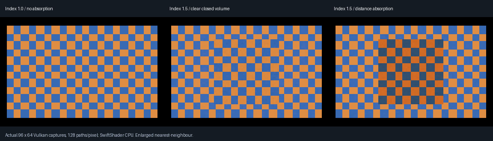

# Closed-volume dielectric transport — 2026-10-25

> Historical checkpoint: [VehicleGlazing](VehicleGlazing.md) subsequently adds derived vehicle panes,
> shared-edge evaluation and a 2,048-interaction bound. Earlier 32-step descriptions below refer to the
> original checkpoint, not the current runtime limit.

**This checkpoint covers primary-camera smooth closed volumes.** Subsequent [mirror transport](MirrorDielectric.md)
adds a verified primary-mirror-to-volume route. A later [rough-reflection phase](RoughDielectric.md) adds
sampled rough reflector paths through smooth glass. Historical secondary-blocker notes below refer to this original checkpoint. Actual C++/Slang Vulkan captures and analytic checks;
not completed general glass, material authoring, editor integration or physical-GPU acceptance.



The checker is emissive triangle geometry behind the same outward-wound closed box in every capture. Left:
index 1.0, no absorption. Middle: index 1.5, no absorption; the box visibly displaces the checker. Right: index
1.5 with RGB absorption coefficients 0.2/0.6/1.2 per scene-length unit. Native captures are **96×64**, 128 paths
per glass pixel; the comparison enlarges them with nearest-neighbour sampling. No generated imagery.

A subsequent [window phase](WindowDielectric.md) adds primary thin-sheet-to-solid paths.

## Measured acceptance

| Test | Result |
|------|--------|
| Device | SwiftShader Device (Subzero), CPU type 4; software Vulkan |
| Boundary GPU/native parity | 199 cases; maximum scalar/direction/Fresnel error **2.18084e-6** |
| Independent native reciprocal identities | 149; reverse Snell direction, reciprocal Fresnel, cancelling radiance index factors |
| Boundary total internal reflection / invalid inputs | 45 TIR cases, 5 invalid cases; flags agree |
| Closed slab, index 1.0, no absorption | 1,444 glass pixels; 100 central analytic pixels; mean error **0** |
| Closed slab, index 1.0, absorption | Maximum central RGB mean error **4.7391e-8** |
| Closed slab, index 1.5, no absorption | Maximum central RGB mean error **0.00346691** |
| Closed slab, index 1.5, absorption | Maximum central RGB mean error **0.00281872** |
| Valid index-1.5 paths | 57,689 TIR interactions per slab case; **zero capped / unsupported** paths |
| Inverted winding / camera inside | 1,444 / 6,144 pixels explicitly diagnosed and terminated black |
| Opaque reflection regression | 88 native probes; moved/fresh equality, source-off black, smooth preservation and compact-only policy pass |
| Builds / native regression | 13 production compute entry points compiled; strict C++20 Release host; 4/4 native CTests |

The slab comparison uses the independently computed series
`T = (1-F)^2 A / (1-F^2 A^2)`, with `A = exp(-sigma * thickness / cos(theta_transmitted))`.
It compares **central means**, not per-pixel or whole-image convergence. Finite box edges and finite Monte
Carlo sampling are not an infinite slab oracle; tolerances are 0.0001 for index matching and 0.025 for index
1.5. This is a declared fixture acceptance, not an unbiased infinite-bounce result or full material-library test.

## Implementation and boundaries

| Mechanism | Detail |
|-----------|--------|
| Boundary math | Snell direction, exact unpolarized Fresnel, TIR; radiance scaling `(n_incident/n_transmitted)^2` |
| Path | Stochastic Fresnel branch selection; up to 32 interactions and 128 primary samples |
| Absorption | Beer attenuation over traced interior travel, with projected numerical-origin correction |
| Corner intersections | Geometric-normal origin offset 0.00002; local lower bound -0.000005 admits coincident adjacent-face hits |
| Diagnostics | Receiver marker 5; `y = capped*65536 + TIR`, `z = unsupported`; no shared ray-counter reuse |
| Existing windows | Category-2 parallel thin-sheet code retained; not silently converted to closed volumes |
| Lighting | Analytic and emissive routes retained; no opaque BRDF added to category-4 surfaces |
| History | Category-4 directional transport bypasses diffuse/rough reconstruction |
| Binding | Runtime float-atlas category 4, first-stratum index at offset 13 and RGB absorption at offset 16 |

Category 4 is an **explicit native-exhibit coefficient override**, not saved TOML/preset authoring support.
The existing opaque-stratum absorption validator and serialized material library are unchanged. The fixed
origin tolerances are scene-scale-dependent; meshes thinner than that scale are not accepted by this study.
The inherited triangle-edge checker-background specks are visible; watertight arbitrary-mesh intersection
acceptance is not claimed. General open/nested/overlapping geometry is unsupported, not prevalidated.

**Historical blocker at checkpoint 8a1f38f:** secondary solid refraction was blocked. Integrating the 32-step solid path inside the existing sampled
material-ray loop compiled to SPIR-V but reproducibly segfaulted SwiftShader during pipeline construction.
Moving terminal opaque shading outside the solid loop did not resolve it. That candidate was removed; the
checkpoint implementation explicitly terminated secondary category-4 hits black rather than presenting opaque
surface shading as refraction. This affected reflection/rough-material rays encountering these opt-in volumes; the mirror route is now extended separately.
The primary path was runtime-tested. A subsequent [single-site mirror extension](MirrorDielectric.md) now works;
rough sampled secondary paths remain blocked. No speed, frame-time or physical-device conclusion follows from this crash.
The isolated command was `LightComputeValidation <SwiftShader-library> <DielectricCandidateGpu-folder>
--dielectric-boundaries`: exit **139**, segmentation fault before boundary output, during construction of the
production transport pipeline. The identical numerical suite passes when that pipeline contains only the
primary solid route. That mirror implementation and reflected-volume captures are now verified separately; the rough sampled path,
a driver repair and a hardware-device alternative have not been verified.

Not included: inside-camera transport, nested media, rough glass, transmitted direct-light shadow/caustic
solving, completed denoising, editor controls or Windows/RTX/GTX execution. Direct shadows remain conservative
opaque occlusion for these volumes. Sun, flare, stars and the cellular-flake material implementation are unchanged.

## Reproduce and inspect

```bash
bash Exhibits/LightCompute/RunSolidDielectric.sh
# Reuse an explicitly completed build:
SOLID_BUILD=0 bash Exhibits/LightCompute/RunSolidDielectric.sh
```

Requires the repository's pinned Slang/SwiftShader/CMake setup and Pillow under the existing ignored
`_ClaudeScratch/tmp/MaterialTools` path. The wrapper fails on any rejected assertion or process failure.

- [Boundary readback](Results/DielectricBoundary.txt)
- [Slab and rejection readback](Results/SolidDielectric.txt)
- [Capture hashes and scope](Results/SolidDielectric.json)
- [Native regression](Results/SolidDielectricNative.txt)
- [Opaque reflection regression](Results/SolidDielectricOpaqueRegression.txt)
- Native source: `Code/DielectricBoundaryValidation.h`, `Code/SolidDielectricValidation.h`.
- Production shader: `../../Frontier/Engine/Rendering/Shaders/SolidDielectricTransport.slang`.
