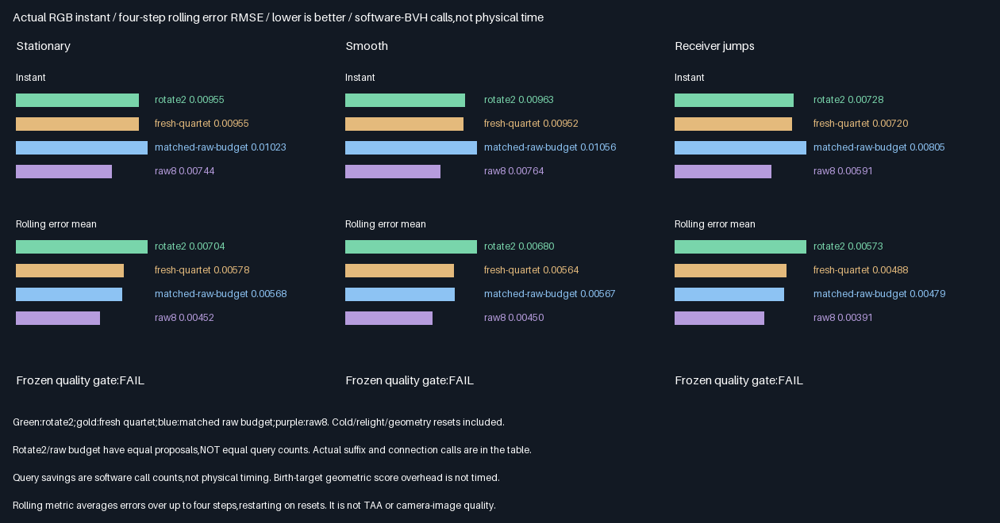
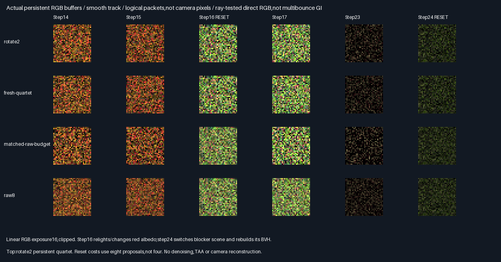

# Traced RGB quartet integration

## Outcome — 2026-10-29

**Traced RGB quartet integration passes correctness;the frozen quality promotion fails on all three tracks.**
Selected descriptors now store ray-tested Lambertian RGB and reconnect with current visibility. Rotate2 makes
57.02% fewer software-BVH calls than raw8 and21.41% fewer than the proposal-matched raw budget,but its rolling
error remains higher. This is a measured query-count tradeoff—not a physical speedup or equal-query quality win.

| Verification                                | Result                                      |
|---------------------------------------------|---------------------------------------------|
| Release / host ASan+UBSan Vulkan             | Both exit0;five CTests each                  |
| Quartet descriptor comparisons per build    | 786,432                                     |
| Retained32B descriptors compared bitwise     | 178,176;all unchanged                        |
| Selector rounding exceptions                | 0                                           |
| Max normalized CPU RGB / birth-weight error | 3.430e-8 /8.863e-7,below2e-5 ceiling          |
| Empirical RGB mean gates                    | 1,152 passed                                |
| Cross-build parity                          | 578 rows,96 buffers,two SPIR-V modules        |
| Runtime source/tool/module/readback hashes  | 146 verified per build                      |
| Cold / relight / blocker rebuilds           | Steps0 /16 /24;full quartet rebuild verified |
| Production allocation / defaults            | Unchanged348.046875MiB / unchanged           |

## Actual query and error comparison

Stars rate accuracy in these bounded tests,more is better—not universal GI quality or physical performance.

| Arm                    | Suffix calls | Segment calls | Total/track | Accuracy | Decision                        |
|------------------------|--------------|---------------|-------------|----------|---------------------------------|
| Raw8                   | 232,886      | 232,886       | 465,772     | ⭐⭐⭐ 🏆 | Best instant and rolling error  |
| Proposal-budget raw    | 127,350      | 127,350       | 254,700     | ⭐⭐   | Lower rolling error than reuse |
| Fresh quartet          | 129,435      | 129,435       | 258,870     | ⭐⭐   | No-history selection reference |
| Rotate2 quartet        | 70,763       | 129,404       | 200,167     | ⭐⭐   | Query/error tradeoff;not promoted|

Counters include all32 steps and three full resets per track. Counts are equal across tracks because paired
proposal/null patterns are shared and this protocol always queries non-null candidates,even zero RGB/geometry.
Both suffix-shadow and receiver-segment calls are instrumented inside the actual trace wrappers and independently
verified against CPU-predicted work. Ray types can have different costs;birth-target math and history storage are
additional untimed work. A call count is neither elapsed GPU time nor a primitive-intersection count.

| Track          | Instant rotate2 / budget | Instant change | Rolling rotate2 / budget | Rolling change | Gate |
|----------------|--------------------------|----------------|--------------------------|----------------|------|
| Stationary     | .009545 /.010225         | −6.65%         | .007040 /.005679         | +23.97%        | Fail |
| Smooth motion  | .009634 /.010560         | −8.76%         | .006802 /.005670         | +19.95%        | Fail |
| Receiver jumps | .007279 /.008052         | −9.60%         | .005727 /.004787         | +19.64%        | Fail |



These are point-estimator RGB RMSEs,not camera-image errors. Rolling error averages per-packet errors over up to
four steps and restarts on resets;it is **not TAA**. Eight paired seed-block MSE intervals are retained in the
[generated full comparison](Results/TracedQuartet-comparison.md);all per-step RGB means are in the
[mean-gate table](Results/TracedQuartet-means.md). Tracks share seed packets and are not independent scenes.

### Baseline limitations — no speed promotion

- The raw budget matches rotate2 **proposals**,not query count:8 proposals on reset,4 warm. Raw8 and fresh quartet
  use8 every step. No equal-query fresh control or equal-time comparison is established by this experiment.
- As frozen,every non-null candidate/descriptor executes its rays,including zero-geometry/zero-RGB cases. Exact
  duplicate-query reuse and global memoization of the eight fixed points are absent. These are **not optimized
  renderer baselines**. The measured savings must not be advertised as savings over a fully optimized baseline.
- All arms sample the first eight packed facets at fixed barycentrics(.2,.3),plus null,with nominal q=1/9. Ten
  triangles participate in occlusion. This finite point problem is not a surface-area or full GI integral.

The next acceptance comparison must apply safe zero-contribution elision and duplicate-query reuse fairly and
include query-matched fresh controls. The present quality rejection remains in force;no threshold was retuned.

## Actual buffers and integration



These32×32 logical packet arrays use exposure16,clipped—not camera pixels. Twenty-four original arrays are checked
byte-for-byte before the labelled montage. All96 full buffers and both compiled modules are retained losslessly.

- The existing RGB quartet code path now traces the direct-light suffix **after selection**,only for each selected
  non-null new reservoir. Selection uses positive `h=1/64+unoccluded birth geometry`,so the target does not require
  a suffix/visibility ray for each proposal. The stored normalizer remains `9*sum(h)/(2*h_selected)`.
- A second dispatch reads shared32B descriptors and traces current receiver visibility. Rotate2 retains two
  descriptors byte-for-byte and refreshes two;fresh quartet refreshes four. Stored birth normalizers are never
  recomputed merely because the receiver moves. Nulls remain in proposal divisors.
- Source RGB is now material-dependent directional Lambertian lighting with actual shadow visibility,using the
  production `FacetSurface`/`NearestFacet` contract tested by [the ray gate](RgbTrace.md). It is one direct-light
  suffix,not multibounce tracing;direction-independent caching is not validated for glossy/specular transport.
- Three ten-triangle scene/track combinations use stationary,smooth and jumping receivers. Step16 halves red
  albedo and doubles light intensity;step24 switches blocker layout and rebuilds the BVH. Epoch changes trigger
  full refresh before evaluation. All reset work is counted;production mutation hooks are not installed.
- The CPU independently reconstructs geometry,casts double all-triangle Moller-Trumbore reference rays,replays
  integer RNG/selection and stored weights,checks traced RGB and every output/work counter,and compares retained
  bytes. First-moment gates are empirical6SE+2e-5 checks—not formal general unbiasedness or RNG-independence proof.

### Earlier results

[Supplied-RGB persistence](RgbReuse.md) had a15.32–20.18% rolling penalty versus its proposal-budget raw control.
The new traced/occluded scenes also reject promotion,now with19.64–23.97% rolling penalties. These are different
scene/output problems,not a numerical regression comparison. Unlike earlier draw counts,the new suffix/segment
counts measure actual software-BVH calls. The [ray gate](RgbTrace.md) had equal cold cached/inline call counts;
this integrated sampler now traces only selected suffixes and amortizes retained ones. None of these results
transfers the historical scalar quartet5/5 quality acceptance to general RGB GI.

## Progress and next bounded work

| Scope                         | Complete | Remaining | Meaning                                  |
|-------------------------------|----------|-----------|------------------------------------------|
| Bounded integration experiment | 100%     | 0%        | Code,tests,comparison,evidence and report |
| Frozen quality promotion      | 0/3      | Blocked   | Rolling regression on every track        |
| Overall ReSTIR/GI effort       | ~55%     | ~45%      | Planning estimate,not acceptance fraction |

Done:descriptor/support,RGB selection/persistence,ray-tested suffix/visibility,and their integrated CPU-verified
query/error comparison. Next:fair query-budget controls with safe query elision and duplicate handling before
promotion. Remaining:correlation-aware acceptance,continuous area proposals/PDFs,multibounce suffixes,
dynamic/camera/TAA/general-scene acceptance,physical GPU timing and production integration only after acceptance.
Packing/editor/vehicle/Jolt remain deferred. Production348.046875MiB/defaults remain unchanged.

## Reproduction

| Configuration | Tested condition                                                               |
|---------------|--------------------------------------------------------------------------------|
| Source        | Base210025b126bb1cac0da1d17614b62dd2ea3101d6 + hashed exhibit changes             |
| Host          | Linux x86-64,Debian GCC12.2,CMake3.31.6;local validation only                     |
| Shader        | Slang2026.14.1,direct SPIR-V1.3,-O0                                              |
| Vulkan        | Pinned SwiftShader CPU Vulkan,software BVH;not hardware RT                       |
| Sanitizers    | Host ASan+UBSan;driver/SPIR-V not instrumented                                   |
| Untested      | Windows/MSVC,physical GPUs,editor/production renderer,multibounce GI              |

Prerequisites:pinned tools in `Automation/ReplayToolDependencies.json`,Vulkan-Headers v1.4.321,Python and Pillow.
No Windows or Linux application executable is delivered. Local reproduction:

```bash
BUILD_JOBS=1 bash Exhibits/LightCompute/RunTracedQuartet.sh
SANITIZE=1 BUILD_JOBS=1 bash Exhibits/LightCompute/RunTracedQuartet.sh
_ClaudeScratch/venv/bin/python Exhibits/LightCompute/Code/TracedQuartetEvidence.py
```

- [Release](Results/TracedQuartet-release.txt),[host-sanitized log](Results/TracedQuartet-sanitized.txt).
- [Final audit](Results/TracedQuartet-parity.txt),[evidence hashes](Results/TracedQuartet-evidence-hashes.txt).
- [Integrated GPU code](Code/TracedQuartetGpu.slang),[CPU reference](Code/TracedQuartetValidation.h).
- [Evidence generator](Code/TracedQuartetEvidence.py).

No packing,PR or Actions. Commit/push backup authorized;all work remains on the current session branch.

## Frozen protocol — 2026-10-29,before measurements

Integrate the tested Lambertian shadow-ray suffix and current receiver-segment query into fresh/persistent RGB
quartets. Preserve prior sources/results and production348.046875MiB/defaults. One bounded integration gate.

| Concern | Fixed test |
|---|---|
| Arms | Rotate2,fresh quartet,matched proposal-budget raw(8 reset/4 warm),raw8;not equal-query/equal-time arms |
| Scene | RgbTraceScene ten triangles;proposals cover first8 packed facets plus null,q=1/9,interior(.2,.3) |
| Tracks | Same stationary/smooth/jumping receiver tracks,1024 packets/arm,32 steps,three scenes |
| Mutation | Step16 red albedo×.5/intensity×2;step24 switch blocker scene and rebuild BVH;epoch reset/full8 proposals |
| Target | Unchanged1/64+unoccluded birth geometry;trace suffix only for selected non-null reservoir |
| Receiver | Always trace connection for every non-null selected/raw candidate,even zero RGB/geometry |
| Reference | Independent CPU double all-triangle rays,selection/weights/cached RGB and full output replay |
| Precision | max(1,reference)*2e-5;selector exception only at margin<2e-6,maximum16 exceptions |
| Persistence | 178176 retained descriptors bitwise unchanged;epochs rebuild before contribution |
| Means | Every track/step/arm/RGB mean within6SE+2e-5 of exact eight-point visible-light sum |
| Queries | Actual suffix/connection wrapper counts,CPU verified;all cold/relight/blocker rebuild costs included |
| Quality | Instant and four-step rolling error RMSE,restart rolling window at resets |
| Acceptance | All3 tracks no worse instant AND rolling than matched proposal-budget raw;fewer calls than raw8 |
| Builds | Release/host ASan+UBSan,five CTests each;exact semantic/capture/module parity |
| Limits | One direct-light suffix;no multibounce,area sampling,camera/TAA,physical timing or production promotion |

Counts are software-BVH query calls,not physical GPU timings. Previous reuse rolling-quality rejection remains
until this separate frozen acceptance passes. Results and rejection are reported above. No packing,PR or Actions.
