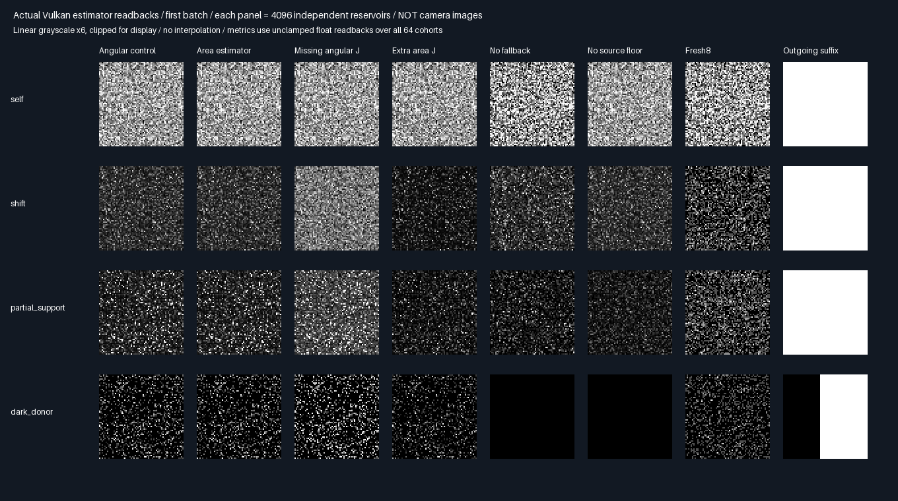

# Triangle secondary-vertex reconnection — fixed Vulkan transport gate

## Protocol before measurement

Replace the prior analytic hit/visibility functions with production `NearestFacet` over an actual triangle BVH.
Keep persistence out until this restricted two-vertex transport passes. Production defaults/layouts stay unchanged.

| Concern | Fixed choice |
|---------|--------------|
| Secondary geometry | Two nonemissive unit-square triangles at z=1, normal −Z, diffuse .7 |
| Occluder | Two opaque triangles at z=.5, y=±8; half-width 0/.12/.6 |
| Receiver | Point at x=0 or 1, normal +Z, diffuse .6; donor x=0 |
| Outgoing suffix | Directional light toward (.8,0,−.6), intensity π/.6; actual BVH shadow query |
| Proposal | .75 cosine first-hit BVH + .25 uniform-area barycentric triangle samples |
| Coverage | Nulls retain M; source target floor .01; explicit mixture density and receiver visibility |
| Cohorts | 64×4096 eight-candidate reservoirs per method/fixture; prior seed schedule retained |
| Transport controls | Angular, area, missing J, extra J, no fallback, no floor, Fresh8 |
| Suffix check | 4096 deterministic surface probes/batch versus independent oblique-strip intersection |
| Suffix negative | Unshadowed suffix .7 must differ from blocked probes by >.6 |
| Reference | Double 1024²/2048² clipped quadrature including directional-light shadow intervals |
| Gates | 12 means within 4 nominal SE+.0001; six negatives >6 nominal SE+.005 integral |
| Additional gates | Area/angular maximum difference <2e-6; suffix pointwise error <1e-6; M=8 |
| Promotion | Zero; no persistence, general materials/multibounce suffix or physical-GPU timing claim |

Unlike the prior mask-lit analytic square, all unoccluded secondary points are lit. The real strip can block both
receiver connections and the oblique directional source. References therefore change; prior results are not regraded.
Uniform fallback samples actual packed triangle vertices; cosine candidates must actually hit the secondary surface.
The source suffix is restricted diffuse reflection of a directional light, not arbitrary cached multi-bounce radiance.

## Verified outcome

Both release and host-sanitized runs pass: **12 required mean gates, six required transport negatives**,
and separate outgoing-lighting checks. Maximum area/angular discrepancy is **1.79e-7**.

| Fixture         | Area mean ± nominal SE      | Independent integral |
|-----------------|----------------------------:|---------------------:|
| Self            | 0.100431058 ± 0.000065350     | 0.100571720          |
| Shift           | 0.035501154 ± 0.000049598     | 0.035428539          |
| Partial support | 0.035382484 ± 0.000096976     | 0.035428539          |
| Dark donor      | 0.017995020 ± 0.000070655     | 0.017934605          |

The directional-light suffix passes 1,048,576 pointwise probe evaluations: 4096 fixed surface points per fixture,
repeated across 64 submissions. These are 16,384 unique fixture/point pairs, not a million unique directions.
There are 114,688 blocked evaluations; the deliberately unshadowed .7 suffix differs at every blocked point.
The suffix uses uploaded albedo/normals and actual BVH occlusion, not the prior hard-coded lighting mask.

## Actual Vulkan evidence



The first seven columns are independent reservoir estimates, not camera images. The final column maps the
secondary surface's outgoing lighting; its dark strip is an actual BVH source shadow. Display uses grayscale
exposure 6 and clipping; statistics use unclamped float output. No interpolation or denoising is used.

## Query/error result: do not promote the literal implementation

| Fixture         | Area RMSE | Fresh8 RMSE | Area BVH queries | Fresh8 BVH queries |
|-----------------|----------:|------------:|-----------------:|-------------------:|
| Self            | 0.041364  | 0.063298    | 6,881,898        | 4,695,160          |
| Shift           | 0.026700  | 0.041223    | 6,885,117        | 4,370,607          |
| Partial support | 0.052989  | 0.041340    | 5,959,756        | 4,371,355          |
| Dark donor      | 0.035812  | 0.030092    | 4,735,419        | 4,284,143          |

- Unoccluded RMSE improves 34.65%/35.23%, but query work rises 46.57%/57.53%.
- Partial-support RMSE worsens **28.18%**, with **36.34% more queries**.
- Dark-donor RMSE worsens **19.01%**, with **10.53% more queries**.
- These are observed restricted-component query/RMSE comparisons, not GPU timings or guaranteed population results.

Fresh8 here estimates only this restricted secondary-surface component using eight cosine paths. It is **not**
the four-bounce whole-power Fresh8 from prior room experiments; full Whole6/Whole8 holdouts remain outstanding.
Queries count actual calls to production NearestFacet, including repeated source/receiver/suffix validation work.
This is intentionally not an optimized cache: source illumination/targets are repeatedly evaluated, no vertex
payload is reused across invocations, and the second dispatch remains inert. Query counts are not hardware cost.

## Verification and provenance

| Check                   | Outcome                                                           |
|-------------------------|-------------------------------------------------------------------|
| Vulkan device           | SwiftShader Device (Subzero), CPU type4                            |
| Release/sanitizer host  | Both complete; five CTests each                                    |
| Cross-build parity      | 42 identical semantic rows; 33 logged hashes checked/build          |
| Actual captures         | Four byte-identical raw captures; 32 PNG pixel arrays exact         |
| Shader derivation       | Regenerated source exactly matches both measured builds             |
| Null/support accounting | M=8 including nulls; all four support/measure identities pass       |
| Reference refinement    | Maximum 8.56e-9; clipped-domain predictions pass for support failures |
| Production              | No engine source/layout/default change; no promotion                |

[Release](Results/TriangleReconnection-release.txt), [sanitizer](Results/TriangleReconnection-sanitized.txt),
[parity](Results/TriangleReconnection-parity.txt), [means](Results/TriangleReconnection-comparison.md),
[query/error table](Results/TriangleReconnection-cost.md).

The optimized release passed before and after adding descriptive query counters; all logged lighting metrics
were unchanged. No acceptance gate or sampler parameter was tuned to the results. Host sanitizers do not
instrument the driver or shader instructions. Prior analytic checkpoints retain their historical logs; their
live shared-host hash checks are not claimed to match this later CLI/header addition.

```sh
bash Exhibits/LightCompute/RunTriangleReconnection.sh
SANITIZE=1 BUILD_JOBS=1 bash Exhibits/LightCompute/RunTriangleReconnection.sh
_ClaudeScratch/venv/bin/python Exhibits/LightCompute/Code/TriangleReconnectionEvidence.py
```

Prerequisites: pinned Slang 2026.14.1/SwiftShader via Automation/PrepareReplayTools.py, Vulkan headers 1.4.321,
CMake/CTest 3.31.6, Python/Pillow for evidence. Tested Linux/GCC12.2 C++20, SPIR-V1.3, sequential builds.
Base `ceebd8a925a929ecaee535869ddc0fdbfe7c1da1` plus retained phases/current working changes. Measured source,
SPIR-V and tool hashes are logged. Raw/build inputs remain ignored scratch; code, logs and PNG evidence persist.

## Decision and next gate

Keep the verified area-density convention, but do not port this literal implementation. Next, separate source
cache generation from receiver evaluation and retain the vertex, proposal/normalization and diffuse outgoing
payload instead of tracing the same suffix repeatedly. Require correct geometry/light-revision invalidation and
fresh receiver visibility; do not reuse donor visibility. The occlusion-driven variance penalty also remains a
quality constraint, not merely a storage or implementation-overhead problem.

That cache work is **not implemented here**. Persistent history, arbitrary secondary surfaces, stochastic
multi-bounce outgoing suffixes, general materials, primary camera rendering, full Whole6/Whole8 comparisons,
Windows/editor and physical-GPU timing remain untested. Production output stays 348.046875 MiB/1080p.
